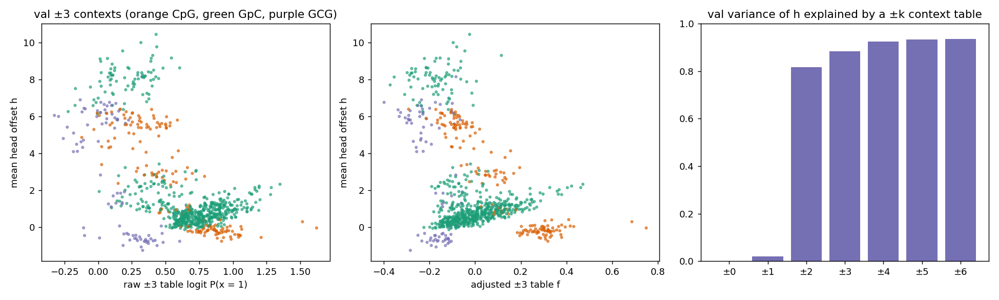
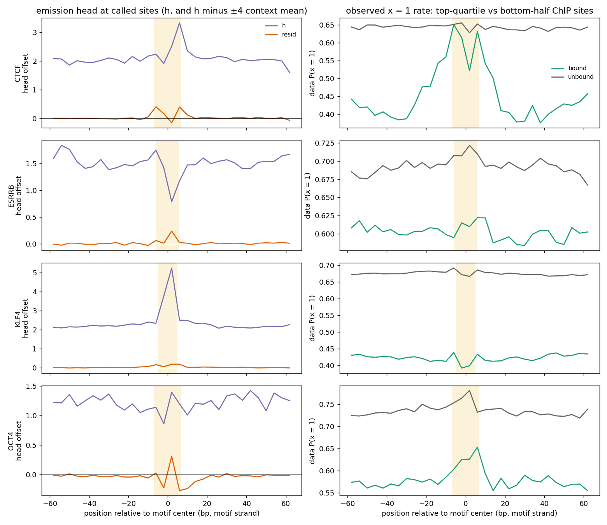

# Summary

In `transition=fixed_blocks_single_tf`, the prior CNN outputs a per-position offset `h(DNA)`. It
is added to the raw protection logit of the single `TF` group, inside its band. The user's
intent was for `h` to learn TF-conditional footprint strength: some TFs footprint much more
strongly than others, e.g. CTCF vs ESRRB.

We checked the run `2026-11-02_fixed_blocks_single_tf_global_kl3` in two ways. The data does
show the intended difference, but the head learned little of it:

1. **Not enzyme bias.** `h` is a very local function of sequence, but it is anti-correlated with
   a ±3 bp lookup table of P(x = 1 | DNA).
2. **Mostly a CGC detector.** It is about +6.7 at called sites in a CGC (a CpG cytosine and a
   GpC cytosine sharing the G) and about +0.7 elsewhere. That one indicator explains 74% of its
   variance. This is likely a data-processing artifact (inferred, see Details).
3. **Only weak TF identity.** We removed a ±4 bp context table of `h` and looked at what was left
   at motif sites. It ranks the TFs in the same order as their observed footprints (CTCF >
   OCT4 > KLF4 ≈ ESRRB ≈ 0). But it is small (+0.78 at bound CTCF motifs, against `h` SD 2.5),
   and it sits only in the motif core, not across the ~40 bp CTCF footprint.

# Key Points

- **Locality** (val, 10,000-region subset). A context table of `h` explains this share of its
  variance: ±1: 2%, ±2: 82%, ±3: 88%, ±4: 92%, ±6: 94%. The CNN's receptive field is ±12 bp.
- **Against the context table of P(x = 1).** Correlation of `h` with the ±3 table, all val sites:
  Pearson −0.57 raw, −0.36 accessibility-adjusted. CpG-only sites: −0.80 / −0.86. GpC-only
  sites (72% of sites): Spearman with the adjusted table 0.02.
- **Information content.** As a per-site predictor, binned `h` gains 0.0056 bits/call held-out;
  the ±3 table gains 0.013. Context bias is small in this assay: 0.013 bits on a 0.926 bits/call
  constant baseline (~1.4%). The GM12878 m6A bias was about 0.06 on 0.53, per the
  [context-bias note](../2026-10-30/fiberseq-m6a-sequence-context-bias.md).
- **CGC sites** (val; 16% of sites):
  - mean `h` 6.72 vs 0.69;
  - x = 1 rate 0.56 vs 0.68, but the rate at other sites 7–50 bp away is also lower (0.59 vs
    0.67), so this is mostly accessible-region composition;
  - more calls per site, 153 vs 119 (3,000-region check);
  - on the same read, the two Cs of a CGC agree 99.3% of the time, vs 95.7% for call pairs
    3–4 bp apart.
- **At motifs** (all val regions; bound = top-quartile pooled ChIP-nexus, low = bottom half):

| | CTCF | ESRRB | KLF4 | OCT4 |
|---|---|---|---|---|
| motif sites in val regions | 14,709 | 7,624 | 25,186 | 3,789 |
| data footprint, bound (motif − flank x = 1 rate) | **+0.22** | +0.01 | −0.01 | +0.05 |
| data footprint, low ChIP | +0.01 | +0.02 | +0.01 | +0.05 |
| `h` residual in motif, bound | **+0.78** | 0.00 | +0.17 | +0.38 |
| `h` residual in motif, low ChIP | +0.13 | 0.00 | +0.11 | +0.11 |
| TF P(x = 1) in motif vs flank, bound | 0.95 vs 0.90 | 0.89 vs 0.88 | 0.93 vs 0.91 | 0.93 vs 0.87 |

# Details

**Method 1: context bias** (`compare_emission_head.py`).
- Data: per called site, the calls pooled over reads.
- Tables of P(x = 1 | ±k context), fitted on the train chromosomes and scored on val:
  - raw: each entry shrunk toward its ±(k−1) parent;
  - accessibility-adjusted: logit P = f[±3 context] + g[bin of the pooled x = 1 rate 7–50 bp
    away]. This follows the
    [m6A context-bias note](../2026-10-30/fiberseq-m6a-sequence-context-bias.md).
- `h` is the TF channel of the prior's emission output, computed on full 2,114 bp regions.



*Across val ±3 contexts, mean `h` falls as the raw and adjusted P(x = 1) tables rise, and a ±2
table already explains about 80% of its variance. Output of `compare_emission_head.py`.*

**Why CGC is probably an artifact (inferred, not confirmed).** The docstring of
`reverse_complement_dna_and_smf` in `smf_hmm/data.py` describes how the pipeline building the h5
handles reverse-strand reads. A bottom-strand call at a forward GCG lands on one cytosine that
belongs to both a CpG and a GpC. The pipeline copies that call to both cytosines of the
top-strand CGC. The HMM then counts one measurement twice as independent evidence. The 99.3%
same-read agreement and the higher call count fit this. We have not checked the h5 builder
itself. We also have not worked out why the head answers with *higher* TF protection at these
sites.

**Method 2: motifs** (`emission_head_at_motifs.py`).
- Data: SMF read directly from the h5 for all 7,559 val regions.
- Residual: `h` minus a ±4 bp context table of `h`, fitted on the DNA of 10,000 random
  train-chromosome regions. This takes out CGC and other local composition, so the residual
  shows motif-level information.
- Sites: the chr8/chr16 motif caches from evaluation/tf_chip. Each site is assigned to its most
  central val region. Called sites within ±60 bp are strand-oriented. "In motif" means within the
  motif half-length of the center; flanks are 20–60 bp away.
- Profiles (figure):
  - The raw `h` at motifs follows composition: a spike to about +5 in the GC-rich KLF4 motif,
    and a dip in the ESRRB motif.
  - The residual is near 0 outside the motif core for every TF.
  - The CTCF residual is two peaks of about +0.4 in the motif. It is absent across the
    ±20 bp footprint seen in the data.



*Left: raw `h` and its ±4-context residual by position at each TF's motifs. Right: observed
P(x = 1) at bound and low-ChIP sites. Only bound CTCF shows a wide data footprint, while the
residual stays inside the motif core (shaded). Output of `emission_head_at_motifs.py`.*

**Interpretation (partly inferred).**
- The CTCF > ESRRB ordering in the residual means the head learned some TF identity.
- Three things limit it:
  - the CGC artifact likely dominates the head's gradient signal;
  - TF protection is near its ceiling (mean 0.89 at called sites; band upper bound 0.99);
  - a weak footprinter would need a negative offset at its motifs, and none was learned.
- The bound vs low-ChIP gap in the residual comes from sequence alone. Bound sites presumably
  have stronger or more canonical motifs; this was not tested against `motif_score`.
- The ±4 control does not remove composition effects wider than ±4 bp.

**Plotting.** `python -m smf_hmm.cli.plot RUN_DIR ... --emissions` adds a panel to each region
figure: P(x = 1) by position for each sequence-dependent group.

**Proposed next steps** (not implemented; they change the model or data, so they need the
user's sign-off):
1. Remove the CGC duplicate calls: merge or drop one of each pair, at load time or in the h5
   builder.
2. Let the TF band go lower, or start TF protection below 0.7, so the head can make a weak
   footprinter less protected.
3. Retrain, then rerun both scripts. Check that the motif residual grows and spreads across the
   footprint width.

# Commands

All commands were run from `/home/users/diamant/repos/smf_hmm` inside Slurm job 50835752
(akundaje partition, 4 CPUs, 24 GB, 1 L40S). They ran on CPU because the user's training job
`2026-09-29_single_tf_tapered_histone_global_kl3` held the GPU, which is in exclusive mode.

The checkpoint was saved with `cuda:0` sharding, and Orbax fails to restore it without that
device. The scripts' `HostCheckpointer` skips Orbax's sharding lookup and restores the arrays as
numpy. `load_run` and `smf_hmm.cli.plot` still need a free GPU.

```bash
PY=/home/groups/btrippe/diamant/miniforge/envs/hmm/bin/python
R=/scratch/users/diamant/2026-11-02_fixed_blocks_single_tf_global_kl3
# Head vs context tables (~80 s, 4 GB)
JAX_PLATFORMS=cpu MPLCONFIGDIR=$PWD/.mplconfig PYTHONPATH=$PWD \
  $PY evaluation/emission_context_bias/compare_emission_head.py $R --region-subset 10000
# Head at TF motifs (~2 min, 4 GB)
JAX_PLATFORMS=cpu MPLCONFIGDIR=$PWD/.mplconfig \
  $PY -m evaluation.emission_context_bias.emission_head_at_motifs $R
# Region figures with the emission panel (needs the GPU, or a CPU-restorable checkpoint)
MPLCONFIGDIR=$PWD/.mplconfig $PY -m smf_hmm.cli.plot $R \
  --split val --num-regions 8 --reads-per-region 3 --seed 0 --emissions
```

The ±2 bp breakdown and the CGC same-read agreement came from one-off snippets on a
3,000-region subset; they are not saved scripts. The CGC summary is reproduced by
`compare_emission_head.py` (`results.json` → `cgc`).

# Related Notes

- [m6A sequence-context bias in GM12878 Fiber-seq](../2026-10-30/fiberseq-m6a-sequence-context-bias.md): The lookup-table and accessibility-adjustment method reused here, and the much larger m6A bias for comparison.
- [Fiber-seq HMM absorbs m6A context bias](../2026-10-30/fiber-hmm-enzyme-bias-diagnostic.md): An earlier case of a DNA-conditioned prior absorbing a non-biological sequence effect. Here it is the emission head, and the artifact is CGC.
- [Multi-TF motif caches](../2026-09-16/multi-tf-motif-cache-and-state-call-visualization.md): Source of the CTCF/ESRRB/KLF4/OCT4 motif sites and ChIP-nexus sums used in the motif analysis.
- [Posterior predictive checks of the fixed-blocks SMF HMM](../2026-10-22/posterior-predictive-checks.md): Other diagnostics of the same fixed-blocks model family.

# Open Questions

- Does the h5 builder really copy one reverse-strand call to both cytosines of a CGC? Why does
  the head raise TF protection there rather than lower it?
- After CGC deduplication and a wider TF band, does the head learn TF-specific footprint strength
  across the footprint width?
- Is ESRRB's missing footprint a truly weak footprint, or low occupancy and poor detection at the
  selected sites?
- Does the residual at CTCF motifs track `motif_score`?

# Sources

- Run directory: `/scratch/users/diamant/2026-11-02_fixed_blocks_single_tf_global_kl3` (checkpoints, `.hydra/config.yaml`, `emission_context_bias/`, `plots/val_seed0_emissions/`)
- Figure copies from that run's `emission_context_bias/`: [emission_head_vs_context.png](single-tf-emission-head-learns-cgc-not-tf-identity/emission_head_vs_context.png), [emission_head_at_motifs.png](single-tf-emission-head-learns-cgc-not-tf-identity/emission_head_at_motifs.png)
- smf_hmm: `evaluation/emission_context_bias/compare_emission_head.py`, `evaluation/emission_context_bias/emission_head_at_motifs.py`, `smf_hmm/cli/plot.py`, `smf_hmm/plot.py`, `smf_hmm/emission_modules.py`, `smf_hmm/data.py` (branch `nd/experiments`, base `d0d5c32`, uncommitted as of this note)
- Motif/ChIP cache: `/scratch/users/diamant/mesc_validation/benchmark_cache/mesc_tf_chip_validation_v1`; config `evaluation/tf_chip/configs/mesc_validation.yaml`; motifs `evaluation/tf_chip/references/` (JASPAR MA0139.2, MA0141.2, MA0039.2, MA0142.1)
- SMF data: `/scratch/groups/btrippe/ndiamant/ONT_mESC_acRegions.h5`; genome `/scratch/groups/btrippe/ndiamant/mm10.fa`
