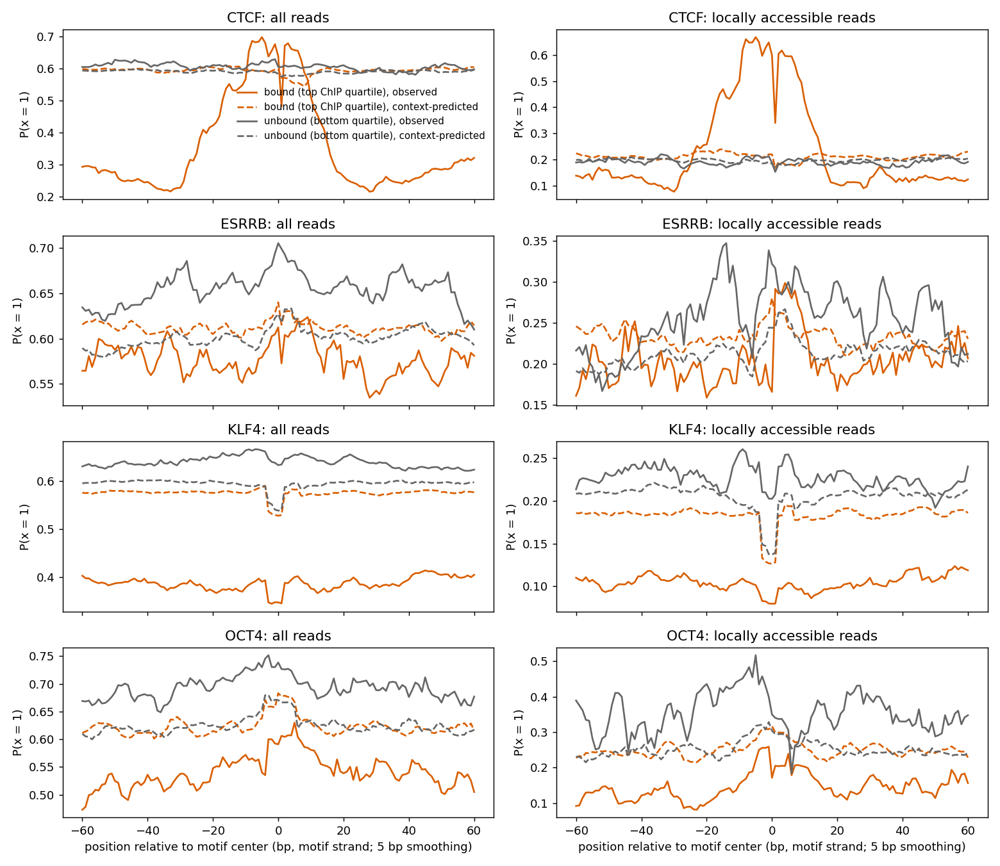
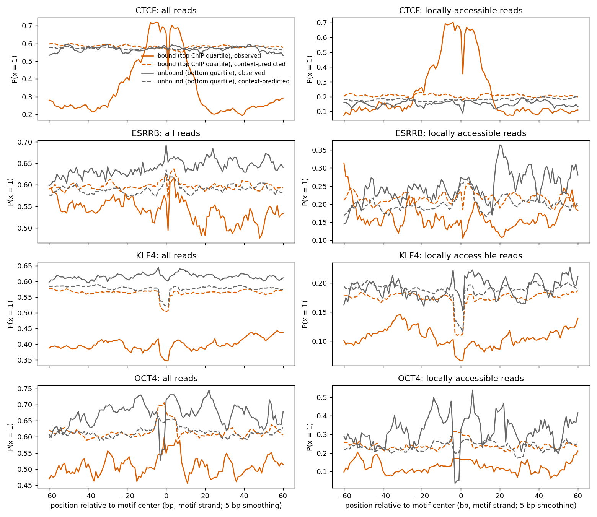

# Summary

We ran the motif-anchored ChIP covariation benchmark on four fixed-block models, on the chr8
and chr16 covariation windows. Results were compared with the existing geometric, phase-type,
`neural_global` and HiddenFoot posteriors.

**Main result.** The three single-TF models, which have a sequence-conditional TF emission
head, tie the multi-TF fixed-block models on CTCF and ESRRB. They are clearly worse on **OCT4**
(Spearman with ChIP 0.30–0.41 vs 0.50–0.57) and **KLF4** (0.08–0.13 vs 0.19–0.24). The new
merged-CGC / 147 bp run is no better than plain `single_tf`.

**Where the OCT4 gap comes from:**
- **Bound sites only.** At low-ChIP motifs every model gives P(TF) ≈ 0.05. At top-quartile ChIP
  motifs, multi-TF gives 0.14–0.18 and single-TF stays at about 0.08.
- **The weak TF groups.** The multi-TF gain is almost all in `TF_short_weak` plus
  `TF_long_weak`. Both learned P(x = 1) = 0.20, which is the closed band's floor; open is 0.01
  and the strong groups 0.99.
- **The sequence prior.** Before any reads are seen, prior-only P(TF) at OCT4 motifs correlates
  with ChIP at 0.39–0.43 for multi-TF, vs 0.20–0.27 for single-TF. The reads then raise every
  model by about the same amount.

**Clarification (2026-11-04).** `neural_global` does detect real OCT4 footprint reads
(protected motif, accessible flanks; motif P(TF) 0.67–0.82 at the example site). It is the
weak-TF floor on fully accessible reads that drives its site-level ChIP correlation. A
learned context-offset table did not remove that floor, so the context-bias explanation
below is not supported. See [controlled ChIP metrics and context
offsets](../2026-11-04/controlled-chip-metrics-and-context-offsets.md).

**Revision (later on 2026-11-03; details under "Read-level and context follow-up").**
`neural_global` did learn the OCT4 motif, but mostly as a **sequence-context pattern**, not
footprint protection:
- **Accessible reads.** At bound OCT4 motifs, most of its extra P(TF) sits on reads whose
  motif calls are accessible.
- **Context explains the motif calls.** The excess protected calls at OCT4 motifs are matched
  by a ±3 bp context table fitted away from motifs.
- **The binding-specific footprint is small.** Bound OCT4 sites do show an aggregate rise in
  P(x = 1) at the motif (as the user saw), but only about +0.02–0.03 of it exceeds the context
  prediction relative to unbound sites. For CTCF it is about +0.4.
- **Why weak TF and not single-TF TF.** On emission likelihood, a weak TF state at 0.2 beats
  open once more than ~6.5% of calls are protected. The single-TF state at 0.8 needs ~27%. The
  OCT4 motif's ~13% protected-call rate falls between these, so weak TF is worth placing there
  and single-TF TF is not.

**Bug fixed along the way** (commit `7cd90ea`). `smf_hmm.cli.infer_posterior` built posteriors
from prior terms only, so the sequence-conditional emission head was never applied in ChIP
inference. Training was unaffected. Earlier ChIP numbers for single-TF models would have been
computed without the head; `neural_global` has no head and is unaffected.

# Key Points

- **Individual sites:** Spearman between motif-averaged P(TF) and pooled ChIP-nexus, chr8 /
  chr16.

| model | CTCF | ESRRB | KLF4 | OCT4 |
|---|---|---|---|---|
| sites | 3780 / 1754 | 1674 / 859 | 6655 / 3329 | 810 / 520 |
| geometric | 0.60 / 0.63 | 0.25 / 0.30 | 0.11 / 0.08 | 0.26 / 0.30 |
| phase_type | 0.64 / 0.64 | 0.25 / 0.30 | 0.24 / 0.20 | 0.33 / 0.38 |
| hiddenfoot | 0.30 / 0.25 | 0.08 / 0.05 | −0.18 / −0.17 | −0.05 / −0.06 |
| neural_global (multi-TF, `2026-09-29_fixed_blocks_global_kl3`) | **0.67 / 0.69** | 0.25 / 0.30 | **0.24 / 0.21** | **0.50 / 0.57** |
| fixed_blocks_tapered (multi-TF, tapered histone) | 0.66 / 0.68 | **0.28 / 0.32** | 0.23 / 0.19 | **0.50 / 0.56** |
| single_tf (`2026-11-02_fixed_blocks_single_tf_global_kl3`) | 0.64 / 0.67 | 0.27 / 0.30 | 0.13 / 0.11 | 0.34 / 0.41 |
| single_tf_tapered (`2026-09-29_single_tf_tapered_histone_global_kl3`) | 0.65 / 0.66 | 0.21 / 0.25 | 0.12 / 0.08 | 0.30 / 0.33 |
| single_tf_147_merged_cgc (`2026-11-03_...`) | 0.65 / 0.68 | 0.24 / 0.30 | 0.11 / 0.08 | 0.33 / 0.38 |

- **Histone taper:** no consistent effect. It's neutral between the two multi-TF models and
  slightly negative among the single-TF models.
- **Motif pairs** (`nonoverlapping_chip` scope, all distances):
  - Every HMM model stays near 0 on same-TF pairs (−0.1 to 0.2), where ChIP is 0.6–0.75. None
    of the new models changes this.
  - HiddenFoot scores 0.3–0.55 on every pair, including CTCF–ESRRB, where ChIP is −0.18 (chr8)
    and −0.29 (chr16). This suggests a window-wide shared signal such as accessibility, not TF
    covariation (inferred).
- **OCT4, mean motif P(TF) by ChIP quartile** (chr8; chr16 is similar):

| ChIP quartile | neural_global | fixed_blocks_tapered | single_tf | single_tf_147_merged_cgc |
|---|---|---|---|---|
| Q1 (low) | 0.059 | 0.057 | 0.052 | 0.048 |
| Q4 (high) | 0.147 | 0.141 | 0.083 | 0.081 |

- **`neural_global` OCT4 P(TF) by group**, Q1 → Q4 (chr8; chr16 in brackets):
  - TF_short_weak: 0.013 → 0.045 (0.014 → 0.063)
  - TF_long_weak: 0.020 → 0.063 (0.018 → 0.073)
  - TF_short_strong: 0.012 → 0.017 (0.012 → 0.017)
  - TF_long_strong: 0.014 → 0.022 (0.013 → 0.024)
- **Prior-only vs posterior** Spearman with ChIP at OCT4 motifs, chr8 / chr16:

| model | prior only | posterior |
|---|---|---|
| neural_global | 0.39 / 0.43 | 0.50 / 0.57 |
| single_tf | 0.26 / 0.27 | 0.34 / 0.41 |
| single_tf_147_merged_cgc | 0.22 / 0.20 | 0.33 / 0.38 |

  Correlation with motif score shows the same pattern: 0.33–0.37 for multi-TF vs 0.17–0.25 for
  single-TF.

# Details

**Bug in posterior inference** (fixed in `7cd90ea`).
- `smf_hmm/posterior_inference.py` used `model.prior_terms` and
  `log_posterior_state_marginals_with_prior_terms(x, initial, bias)`. With no `log_emission`,
  the HMM falls back to `emission_module.log_emission_matrix()`, which is the zero-offset
  emissions.
- It now uses `model.region_terms`, as `smf_hmm/train.py` does.
- A new `--assay-type` option (`InferenceConfig.assay_type`) merges CGC calls for models trained
  on `cg_gc_accessibility_merged_cgc`.
- Two new tests:
  - inference must match `log_posterior_state_marginals` on a model with a non-zero head, and
    must differ from the zero-offset posterior;
  - merged-assay inference must equal inference on hand-merged observations.
- Still unfixed: the same omission is in `smf_hmm/state_call_inference.py` (the older
  state-call evaluation) and in the user's untracked `smf_hmm/posterior_checks/heldout.py` and
  `replicates.py`.

**First interpretation** (superseded by the follow-up below, kept for the record):
- **Weak TF states are cheap at motifs.** A weak TF state at P(x = 1) = 0.2 costs only about
  log(0.8/0.99) ≈ −0.21 nats per accessible call relative to open. The multi-TF prior can
  therefore learn "OCT4 motif → weak TF" without strong read evidence.
- **Single-TF can't do this.** Its one TF state emits P(x = 1) ≈ 0.80 at zero offset, so each
  accessible call costs about −1.6 nats. Its prior learns less from motifs, and its emission
  head can't lower protection that far: across positions its range is 0.55–0.99, against the
  0.20 of the multi-TF weak groups.

**Example plots.**
- `evaluation/tf_chip/plot_posterior_examples.py` was extended (uncommitted when this was
  written):
  - `--site-key` plots chosen sites, skipping those with fewer than 10 motif-covered reads;
  - every site now gets a summary page first: a heatmap of all reads' calls sorted by the first
    model's motif P(TF), read-averaged P(TF) for all models overlaid, and per-model
    read-averaged group posteriors. The existing single-read pages follow.
- Sites chosen: the 12 chr8 OCT4 motifs in the top ChIP quartile with the largest
  `neural_global` − `single_tf_147_merged_cgc` gap in motif P(TF). Five lacked 10 motif-covered
  reads, leaving 7 sites.
- At `chr8:90670968-90670983:+` (ChIP 1489, motif score 19.0), the reads show protected calls
  over the motif. Read-averaged motif P(TF) is 0.51 for `neural_global`, almost all from its
  weak groups, vs 0.27 for `single_tf` and 0.22 for the merged-CGC model.
- At `chr8:24571331-24571346:-` (ChIP 292), the motif calls are mostly accessible.
  `neural_global` still gives 0.31, while the single-TF models give 0.03–0.05.
- The single-read pages, which show each model's highest-scoring read, look similar across
  models. The difference is in the read average.

**Read-level and context follow-up** (`evaluation/tf_chip/motif_call_diagnostics.py`, plus
one-off checks on the example site).

- **The example site** (`chr8:24571331-24571346:-`, ChIP 292):
  - The motif has a single assayable position (bp 281). The calls within ±25 bp split the 77
    reads into 50 accessible throughout (most often `0000000`) and 25 protected throughout
    (most often `1111111`, at least 42 bp, so a nucleosome).
  - Essentially no read shows a footprint (protected at the motif, accessible flanks).
  - `neural_global` motif P(TF): **0.41 on the accessible reads** (as `TF_short_weak`) and
    0.13 on the protected reads, which it mostly calls histone (0.64).
  - The single-TF models give the accessible reads 0.01–0.02 (they call them open) and the
    protected reads 0.10–0.11.
- **Most motifs have little direct evidence.** The median OCT4, KLF4 and ESRRB motif has one
  assayable CpG/GpC position; CTCF has two. 37% of OCT4 motifs have none (chr8: 303 of 810).
- **Read categories at OCT4 motifs** (chr8), low → high ChIP quartile:
  - all-accessible reads: 15% → 25%;
  - reads with any protected motif call: 41% → 38%.

  So in this data OCT4 binding shows up mostly as accessibility. The single-TF models score
  protection, so for OCT4/KLF4/ESRRB they aren't really missing footprints.
- **Where `neural_global`'s OCT4 gain comes from.** Of its Q1 → Q4 rise in site-mean P(TF)
  (+0.089 on chr8), all-accessible reads contribute +0.044, reads with no motif call +0.031,
  and reads with a protected call +0.014.
- **Emission break-even.** Suppose a fraction q of motif calls are protected. A weak TF state
  (0.2) beats open (0.01) on emission likelihood when q · log(0.2/0.01) > (1 − q) ·
  log(0.99/0.8), i.e. **q > ~6.5%**. The single-TF state at 0.80 needs **q > ~27%**, and even
  at its head's minimum (0.55) about 17%. In locally accessible reads, OCT4 motif calls have
  q ≈ 0.10–0.13, which lies between the two thresholds.
- **Context explains the motif calls.** A ±3 bp context table of P(x = 1) was fitted on calls
  outside all four TFs' motifs, using locally accessible reads defined by a 5–25 bp flank
  (one-off). Observed vs predicted protected fraction at motif calls, chr8 / chr16:

| | OCT4 | KLF4 | ESRRB | CTCF |
|---|---|---|---|---|
| observed | 0.129 / 0.102 | 0.050 / 0.050 | 0.120 / 0.115 | 0.155 / 0.153 |
| context-predicted | 0.131 / 0.124 | 0.054 / 0.049 | 0.092 / 0.086 | 0.061 / 0.059 |

- **Caveat on the accessibility filter.** Judging accessibility from calls 5–25 bp away
  excludes reads whose own footprint is wider than ~10 bp. The saved script therefore uses
  25–50 bp, and with that filter the per-site rates shift a lot. The conclusions below rest on
  the all-reads meta-profile, which needs no filter.
- **Aggregate footprints** (all reads; the user observed a clear OCT4 or OCT4:SOX2 footprint in
  averaged raw SMF):
  - "Rise" is P(x = 1) within 7 bp of the motif center minus P(x = 1) 20–40 bp away;
    "context" is the rise predicted by the context table; "excess" is the difference.
  - Bound is the top ChIP quartile, unbound the bottom.
  - Results, chr8 / chr16:

| | bound rise | bound context | bound excess | unbound excess |
|---|---|---|---|---|
| CTCF | +0.40 / +0.44 | −0.02 / −0.02 | **+0.42 / +0.46** | +0.02 / +0.01 |
| OCT4 | +0.07 / +0.07 | +0.05 / +0.05 | **+0.02 / +0.01** | −0.01 / −0.01 |
| ESRRB | +0.03 / +0.02 | +0.01 / +0.01 | +0.02 / +0.00 | +0.01 / +0.00 |
| KLF4 | −0.01 / −0.02 | −0.01 / −0.02 | +0.01 / +0.01 | +0.03 / +0.03 |

  So the aggregate OCT4 footprint is real (a +0.07 rise at bound sites), but about three
  quarters of it is predicted by sequence context. The binding-specific part, bound minus
  unbound excess, is about +0.02–0.03 on both chromosomes. CTCF's is about +0.4. In
  `meta_profiles.png`, the bound OCT4 hump spans roughly ±15–20 bp, wider than the narrow
  context bump. Unbound OCT4 sites show only the context bump.

  

  

  *Observed (solid) and context-predicted (dashed) P(x = 1) around each TF's motifs at bound
  (top ChIP quartile) and unbound (bottom quartile) sites, chr8 then chr16. Left: all reads.
  Right: locally accessible reads, under the filter discussed in the caveat above. Only bound
  CTCF rises well above its context prediction.*
- **Reference scores.** Spearman with pooled ChIP, chr8 / chr16. "Accessibility" is the
  fraction of accessible calls within ±25 bp of the motif; "motif score" is the external PWM
  score; "access + motif" is the sum of their ranks.
  - The motif score is not a trivial baseline, since the models never see a PWM (user
    correction). It is a useful reference.

| TF | accessibility | motif score | access + motif | neural_global | single_tf |
|---|---|---|---|---|---|
| CTCF | 0.29 / 0.29 | 0.54 / 0.52 | 0.56 / 0.54 | **0.67 / 0.69** | 0.64 / 0.67 |
| ESRRB | 0.25 / 0.27 | 0.25 / 0.28 | **0.35 / 0.38** | 0.25 / 0.30 | 0.27 / 0.30 |
| KLF4 | **0.47 / 0.41** | 0.22 / 0.20 | 0.45 / 0.42 | 0.24 / 0.21 | 0.13 / 0.11 |
| OCT4 | 0.40 / 0.45 | 0.29 / 0.41 | 0.46 / **0.57** | **0.50 / 0.57** | 0.34 / 0.41 |

  - CTCF is the only TF where the HMMs clearly beat accessibility and motif score.
  - For KLF4, accessibility alone beats every HMM model.

**Revised interpretation (inferred):**
- `neural_global` learned the OCT4 motif mainly because the motif's CpG/GpC contexts carry
  excess protected calls (enzyme or caller bias) at bound and unbound sites alike. The weak TF
  state is the cheapest way to explain that.
- Its ChIP correlation then comes from combining that with accessibility: bound motifs have
  more accessible reads, and those reads receive the weak-TF mass.
- The weak TF groups (P(x = 1) = 0.2) act as "slightly under-methylated DNA" states. They are
  the natural sink for context bias, the same pattern as the
  [Fiber-seq HMM enzyme-bias note](../2026-10-30/fiber-hmm-enzyme-bias-diagnostic.md).
- A small binding-specific OCT4 footprint (+0.02–0.03 over context, and broad) does exist, so
  there is something to learn.
- **Capacity** (user's suggestion): these runs used `prior.kernel_size=9` with 3 conv layers,
  a receptive field of ±12 bp. That covers the 15 bp OCT4:SOX2 motif, but not a ±20 bp
  footprint seen from its edges, nor TF-block entry 20–40 bp upstream. The code's default
  kernel of 21 gives ±30 bp.

**Proposed directions** (revised; none implemented):
1. **Model context bias explicitly**, with a local ±3 bp efficiency table learned in the HMM.
   That removes the weak-TF incentive at biased motifs and shows what real OCT4 signal remains.
   We expect the multi-TF OCT4 correlation to fall toward the accessibility level unless the
   model then learns the small footprint.
2. **Give the prior more receptive field** (kernel 21 or dilations) so that a ~+0.02–0.03,
   ±20 bp footprint is learnable at all.
3. **Build on the multi-TF block structure**, where the prior chooses weak vs strong TF types.
   Port the merged-CGC assay and the 147 bp invaded-edge histone to it. Treat the weak groups
   with suspicion until bias is modelled.
4. **Add reference scores to `analyze_covariation`**: accessibility, motif score, their rank
   sum, and prior-only P(TF). Then motif scanning and accessibility can't be mistaken for
   footprint detection.

# Commands

Everything ran in Slurm job 50835752 (akundaje partition, 1 L40S). Inference took about
6 min per chr8 model and 2 min per chr16 model. Analysis took 277 s (chr8) and 112 s (chr16),
using about 1.4 GB.

```bash
cd /home/users/diamant/repos/smf_hmm
M=/scratch/users/diamant/mesc_validation/covariation_windows
bash $M/infer_2026-11-03.sh       # 4 models x {chr8, chr16}; only the merged-CGC model gets --assay-type cg_gc_accessibility_merged_cgc
PY=/home/groups/btrippe/diamant/miniforge/envs/smf_clean/bin/python
for CHR in chr8 chr16; do D=$M/$CHR-512-valid90-reads10; P=$D/posteriors
  $PY -m evaluation.tf_chip.analyze_covariation $D/dataset.h5 \
    --prediction geometric=$P/geometric.h5 --prediction phase_type=$P/phase_type.h5 \
    --prediction neural_global=$P/neural_global.h5 --prediction hiddenfoot=$P/hiddenfoot.h5 \
    --prediction fixed_blocks_tapered=$P/fixed_blocks_tapered.h5 --prediction single_tf=$P/single_tf.h5 \
    --prediction single_tf_tapered=$P/single_tf_tapered.h5 --prediction single_tf_147_merged_cgc=$P/single_tf_147_merged_cgc.h5 \
    --output-dir $D/analysis_2026-11-03
done
D=$M/chr8-512-valid90-reads10
$PY -m evaluation.tf_chip.plot_posterior_examples $D/dataset.h5 \
  --run neural_global=$D/posteriors/neural_global.h5 --run single_tf=$D/posteriors/single_tf.h5 \
  --run single_tf_147_merged_cgc=$D/posteriors/single_tf_147_merged_cgc.h5 \
  $(cat $D/analysis_2026-11-03/oct4_disagreement_site_keys.txt) \
  --output $D/analysis_2026-11-03/oct4_disagreement_sites.pdf
ml poppler && pdftoppm -r 70 -png $D/analysis_2026-11-03/oct4_disagreement_sites.pdf $D/analysis_2026-11-03/oct4_sites_png/page
# Read categories, motif/flank rates, context table, reference scores, meta-profiles (~3.5 min chr8, ~1.5 min chr16)
for CHR in chr8 chr16; do D=$M/$CHR-512-valid90-reads10
  $PY -m evaluation.tf_chip.motif_call_diagnostics $D/dataset.h5 $D/analysis_2026-11-03 \
    --model neural_global --model single_tf --model single_tf_147_merged_cgc
done
```

- `motif_call_diagnostics.py` reproduces the read categories, model contributions by read
  category, reference scores, footprint-over-context numbers and meta-profiles. Its saved
  version uses the 25–50 bp accessibility flank.
- The context table in the observed-vs-predicted table above, and the example-site breakdown,
  came from one-off snippets that used a 5–25 bp per-call flank.
- The quartile, group and prior-only numbers came from one-off snippets, not saved scripts:
  - the quartile and group splits were read from `unique_motif_summaries.tsv.gz`;
  - the prior-only P(TF) was computed by running each checkpoint's prior on the prepared windows'
    DNA and averaging over the motif span.
- An earlier PDF without summary pages, `oct4_disagreement_examples.pdf`, is also in the
  analysis directory.

# Related Notes

- [Merged-CGC assay and 147 bp histone run](merged-cgc-147bp-histone-run.md): The `single_tf_147_merged_cgc` model evaluated here, its call-free TF segments, and the per-TF data footprints.
- [Single-TF emission head learns a CGC artifact](../2026-11-02/single-tf-emission-head-learns-cgc-not-tf-identity.md): Why the single-TF head was expected to carry TF identity, and evidence that it carries little.
- [HiddenFoot baseline: bugs and variants](../2026-10-23/hiddenfoot-baseline-bugs-and-variants.md): Source of the `hiddenfoot.h5` posteriors and the `analysis_hiddenfoot_fixed` convention reused here.
- [Chr16 covariation, ChIP width, and window selection](../2026-09-28/chr16-covariation-chip-width-and-window-selection.md): The covariation-window benchmark design.
- [Fiber-seq HMM absorbs m6A context bias](../2026-10-30/fiber-hmm-enzyme-bias-diagnostic.md): The same pattern, a DNA-conditioned model absorbing enzyme or caller context bias into its states, in the Fiber-seq model.

# Open Questions

- With context bias modelled explicitly, how much OCT4 correlation does the multi-TF model
  keep, and does it then learn the small binding-specific footprint?
- Does a wider prior receptive field (kernel 21) help it learn a ±20 bp, ~+0.03 footprint?
- Does the multi-TF model with merged CGC and a 147 bp invaded-edge histone keep its OCT4/KLF4
  advantage?
- How much of each model's ChIP correlation is prior-only motif scanning? This should be
  measured for all TFs, not only OCT4.
- Is the context bias at OCT4 motifs from the methyltransferase or from the caller? A context
  table can't separate them.
- Why are all HMM pair correlations near zero while ChIP pair correlations are 0.6–0.75? Is it
  the 512 bp window, or the HMM's TF-call noise?

# Sources

- Analysis outputs: `/scratch/users/diamant/mesc_validation/covariation_windows/{chr8,chr16}-512-valid90-reads10/analysis_2026-11-03/`
- Posteriors: `.../posteriors/{single_tf_147_merged_cgc,single_tf_tapered,fixed_blocks_tapered,single_tf}.h5` (new); `{geometric,phase_type,neural_global,hiddenfoot}.h5` (existing)
- Checkpoints: `/scratch/users/diamant/{2026-11-03_single_tf_147_histone_merged_cgc_global_kl3,2026-09-29_single_tf_tapered_histone_global_kl3,2026-09-29_fixed_blocks_tapered_histone_global_kl3,2026-11-02_fixed_blocks_single_tf_global_kl3,2026-09-29_fixed_blocks_global_kl3}/checkpoints`
- smf_hmm `nd/experiments`: `7cd90ea` (`smf_hmm/posterior_inference.py`, `smf_hmm/cli/infer_posterior.py`, `tests/test_posterior_inference.py`); `evaluation/tf_chip/plot_posterior_examples.py`, `tests/test_tf_chip_plot_posterior_examples.py` and `evaluation/tf_chip/motif_call_diagnostics.py` (uncommitted)
- Diagnostics outputs: `.../analysis_2026-11-03/motif_call_diagnostics/{results.json,meta_profiles.png}` for chr8 and chr16; figure copies: [meta_profiles_chr8.png](chip-eval-single-tf-vs-multi-tf/meta_profiles_chr8.png), [meta_profiles_chr16.png](chip-eval-single-tf-vs-multi-tf/meta_profiles_chr16.png)
