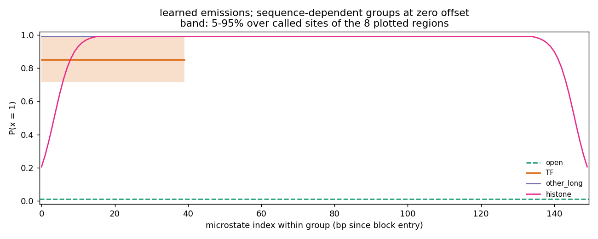
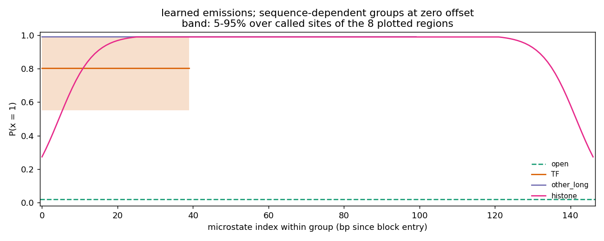
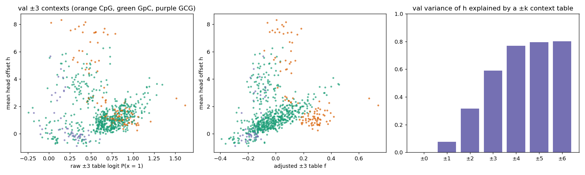
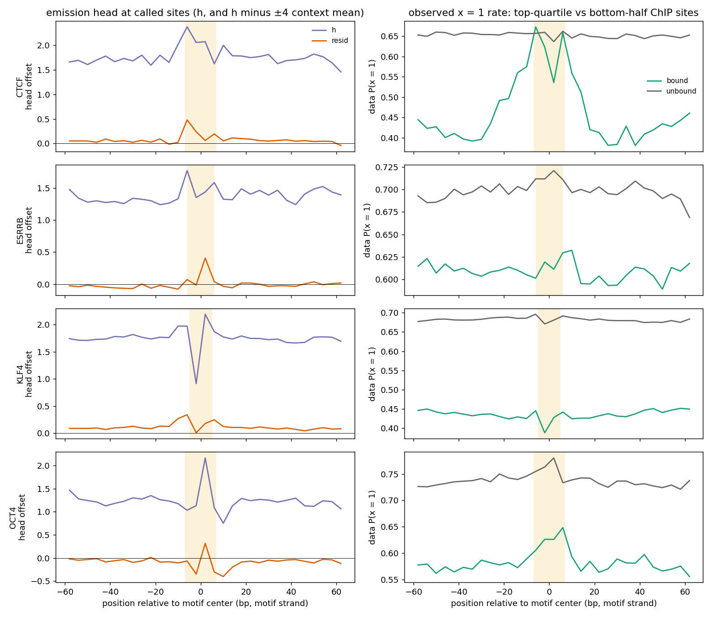

# Summary

The [emission-head note](../2026-11-02/single-tf-emission-head-learns-cgc-not-tf-identity.md)
found three problems with the single-TF tapered-histone model:

- the sequence-conditional emission head mostly learned a CGC artifact;
- `other_long` was taking short-looking nucleosomes;
- TF was absorbing stray unmethylated calls.

To address all three together, we added an assay type that merges CGC calls
(`cg_gc_accessibility_merged_cgc`). We then trained one run with that assay and new settings:

- histone fixed at **147 bp**, with a **25 bp invaded-edge ramp**;
- `other_long` made sub-nucleosomal, **40–100 bp**;
- open band **0.02–0.05**;
- closed band **0.1–0.99**.

Results, compared with the baseline run `2026-09-29_single_tf_tapered_histone_global_kl3`:

- **CGC artifact gone.** CGC explains 2.6% of head variance (was 74%).
- **Histone edges learn freely.** The edge emission settles at 0.27, inside its band, not at
  the floor.
- **`other_long` halved** (MAP occupancy 0.088 → 0.041). But 73% of the remaining segments sit
  at the new 100 bp cap.
- **Fewer stray-1 TF segments** (48% → 27%).
- **New problem: 36% of TF segments contain no observed calls** (was 1%). They are 8 bp TF
  segments inside open stretches, apparently placed by the prior.
- **No more TF identity.** The TF ranking at motifs is unchanged, and the effect is still small.

# Key Points

- **Design decisions** (user, 2026-11-02):
  - Real nucleosomes are ~147 bp, and the methyltransferase reaches into their ends. So keep
    histone fixed-length and model deeper edge invasion; don't make it variable-length.
  - Accepted cost: TFs bound within ~20 bp of a nucleosome edge cannot be called.
  - A TF floor of 0.1 is acceptable; the concern is TF being used to represent open DNA.
  - CGC deduplication goes in an assay type in `smf_hmm/data.py`, not in the h5 preprocessing.
- **Learned emissions** (P(x = 1); "at bound" = pinned at the band limit):

| | baseline | new |
|---|---|---|
| open | 0.010 (at floor) | 0.020 (at new floor) |
| TF, zero offset (5–95% with sequence) | 0.85 (0.71–0.99) | 0.80 (0.55–0.99) |
| other_long | 0.99 (at ceiling) | 0.99 (at ceiling) |
| histone edge → core | 0.20 (at floor) → 0.99 | **0.27** → 0.99 |





*Learned P(x = 1) by position within each block, baseline (top) and new run (bottom). The new
histone edge starts at 0.27 and ramps over a longer stretch, and the TF band reaches lower. Both
are `plots/.../emissions.png` from each run directory.*

- **MAP state statistics** (val reads):

| | baseline | new |
|---|---|---|
| MAP occupancy open / TF / other_long / histone | 0.325 / 0.022 / 0.088 / 0.565 | 0.317 / 0.023 / 0.041 / 0.619 |
| prior occupancy TF / other_long | 0.065 / 0.154 | 0.067 / 0.093 |
| other_long segments at length cap | 59% (120 bp) | 73% (100 bp) |
| TF segments with 0 / 1 / 2 / ≥3 observed calls | 1% / 48% / 19% / 31% | **36%** / 27% / 15% / 22% |
| TF segments resting on a single x = 1 call | 48% | 27% |

- **Zero-call TF segments** (new run):
  - 95% sit between two open segments, and their median length is 8 bp, the minimum.
  - Prior P(TF) is 0.078 at positions with no called site within 4 bp, vs 0.058 near a called
    site. In the baseline it was 0.071 vs 0.060.
  - About 46% of positions have no called site within 4 bp. These positions can be recognised
    from DNA alone (no CpG or GpC nearby).
- **Emission head after the merge:**
  - CGC explains 2.6% of its variance; SD 1.99.
  - A ±k context table of the head explains: ±1: 8%, ±2: 32%, ±3: 59%, ±4: 77%, ±6: 80%.
    Baseline: 2% / 82% / 88% / 92% / 94%.
  - Correlation with the accessibility-adjusted ±3 P(x = 1) table: Pearson 0.16, Spearman 0.28.
    Baseline: −0.36 / −0.21.
  - As a predictor of x, the head gains 0.0011 bits/call held-out; the ±3 table gains 0.0108.

  

  *After the merge, the high-`h` cluster is CpG rather than GCG contexts, `h` rises with the
  adjusted table, and a ±k table explains less of its variance than in the
  [earlier run](../2026-11-02/single-tf-emission-head-learns-cgc-not-tf-identity.md). Output of
  `compare_emission_head.py`.*
- **At motifs:** what's left of the head after removing ±4 bp context, inside the motif at
  bound sites. "Footprint" is the data's motif-minus-flank x = 1 rate at bound sites. Bound
  means the top quartile of pooled ChIP-nexus.

| | CTCF | ESRRB | KLF4 | OCT4 |
|---|---|---|---|---|
| head residual, new | +0.69 | 0.02 | +0.29 | +0.25 |
| head residual, earlier run* | +0.78 | 0.00 | +0.17 | +0.38 |
| TF P(x = 1) in motif vs flank, new | 0.91 vs 0.89 | 0.90 vs 0.88 | 0.90 vs 0.90 | 0.94 vs 0.88 |
| data footprint, new | +0.23 | +0.01 | −0.02 | +0.05 |

\*From the [emission-head note](../2026-11-02/single-tf-emission-head-learns-cgc-not-tf-identity.md):
run `2026-11-02_fixed_blocks_single_tf_global_kl3`, which has no taper. This row is not the
baseline above.



*Left: raw `h` and its ±4-context residual at each TF's motifs. Right: observed P(x = 1) at
bound and low-ChIP sites. As before, the residual stays in the motif core (shaded) and only bound
CTCF has a wide data footprint. Output of `emission_head_at_motifs.py`.*

# Details

**Merged-CGC assay** (commit `776dbd9`, `smf_hmm/data.py`). `AssaySpec` gains `merge_cgc`.
The new assay `cg_gc_accessibility_merged_cgc` is `cg_gc` with `merge_cgc=True`.

- **At load** (`ChromosomeDataModule.from_h5`, via `merge_cgc_sparse`): each CGC's CpG-cytosine
  call moves onto its GpC cytosine. The GpC call wins where present; otherwise the CpG call is
  used. The CpG cytosine is then dropped.
- **Chains:** in runs like CGCGC the merges chain, and everything ends at the last cytosine.
- **Site mask:** `get_valid_mask` excludes the CpG cytosine of a CGC.
- **RC augmentation:** `reverse_complement_dna_and_smf` merges again after the flip. Without
  this, the old rule copies a forward GCG call to both cytosines of the RC CGC.
- **Why all CGCs:** the h5 has no read strand, so every CGC is merged, not only reverse-strand
  ones.
- **Check:** in the loaded data, no call remains on a CGC's CpG cytosine.
- **Effect:** CGC GpC-end sites are 8% of val sites after the merge.

**Run configuration** (`train.sh` in the run directory). It is `transition=fixed_blocks_single_tf_tapered_histone`
with:

- blocks TF 8–40 bp (occupancy 0.06), other_long 40–100 bp (0.08), histone 147 bp (0.55);
- `emission.open_protected_probability=0.03`, `open_band=[0.02,0.05]`,
  `closed_band=[0.1,0.99]`, `histone_edge_width=25` (edge init 0.4);
- unchanged: occupancy KL weight 3 with targets open / TF / other_long / histone =
  0.31 / 0.06 / 0.08 / 0.55, `prior.kernel_size=9`, global normalization, 100 epochs,
  lr 0.001.

It trained in about 2 h on one L40S. Its loss (final 12.44) is not comparable with the baseline,
because merging removes sites.

**Interpretation (inferred, not proven):**
- **Zero-call TF segments.** The prior's occupancy KL pulls prior TF occupancy to its 0.06
  target, but the data supports only ~0.023 by MAP. The prior can meet the target cheaply by
  putting TF mass where no calls contradict it. The merge created more call-free stretches. The
  prior-mass gap between call-free and called positions fits this. The test is one run with a
  lower TF target.
- **`other_long` at its cap.** It now holds 86–100 bp protected stretches that still want to be
  longer. These may be nucleosomes invaded by more than 25 bp at an edge, or genuine
  sub-nucleosomes. The two can't be told apart yet.
- **Emission head.** Removing CGC made it less local and no longer bias-like. It still carries
  only a small, motif-core TF signal, so CGC was not what blocked TF learning.

**Proposed next run** (not started): lower the TF occupancy target from 0.06 to ~0.025, or
lower its KL weight, changing nothing else. Then try a 30–35 bp histone edge ramp for the
`other_long` question.

# Commands

All runs were in Slurm job 50835752 (akundaje partition, 1 L40S, 4 CPUs, 24 GB). Training ran
as a background process in that allocation because the `btrippe` partition was full; peak RSS
was about 4.9 GB. A 1-epoch smoke run on 500 regions
(`/scratch/users/diamant/smoke_merged_cgc_147`) checked the model spec and the merge before the
full run.

```bash
cd /home/users/diamant/repos/smf_hmm
PY=/home/groups/btrippe/diamant/miniforge/envs/hmm/bin/python
R=/scratch/users/diamant/2026-11-03_single_tf_147_histone_merged_cgc_global_kl3
bash $R/train.sh > $R/train.log 2>&1
MPLCONFIGDIR=$PWD/.mplconfig $PY -m smf_hmm.cli.plot $R --split val --num-regions 8 --reads-per-region 3 --seed 0 --emissions
MPLCONFIGDIR=$PWD/.mplconfig $PY -m evaluation.emission_context_bias.map_segment_stats $R   # also run on the baseline
MPLCONFIGDIR=$PWD/.mplconfig PYTHONPATH=$PWD $PY evaluation/emission_context_bias/compare_emission_head.py $R --region-subset 10000
MPLCONFIGDIR=$PWD/.mplconfig $PY -m evaluation.emission_context_bias.emission_head_at_motifs $R
```

- Tests: the full suite passes except two tests that already failed, because they call a
  hardcoded macOS Python path (`tests/test_cli_eval.py`, `tests/test_state_call_inference.py`).
- `map_segment_stats.py` was first run as a scratch script, and the saved version reproduces
  those numbers. The baseline's TF call counts and its gap-length histogram (in the previous
  conversation) came from one-off snippets.

# Related Notes

- [Single-TF emission head learns a CGC artifact](../2026-11-02/single-tf-emission-head-learns-cgc-not-tf-identity.md): The CGC finding, the context-table and motif methods, and the earlier run's motif numbers compared here. Its smf_hmm code was uncommitted then and is now in commits 776dbd9, cafcf18 and 783cd11.
- [Posterior predictive checks of the fixed-blocks SMF HMM](../2026-10-22/posterior-predictive-checks.md): Other diagnostics of the same fixed-blocks model family.
- [Multi-TF motif caches](../2026-09-16/multi-tf-motif-cache-and-state-call-visualization.md): Source of the motif sites and ChIP-nexus sums.

# Open Questions

- Does lowering the TF occupancy target remove the zero-call TF segments without losing the
  CTCF footprint?
- Are the 86–100 bp `other_long` stretches deeply invaded nucleosomes or sub-nucleosomes? Would
  a 30–35 bp edge ramp absorb them?
- The open emission is pinned at its new 0.02 floor. Is that floor too high for real open DNA,
  or doing its job against stray 1s?
- How many TFs bound near a nucleosome edge does the fixed 147 bp histone hide? (Split motifs by
  distance to the nearest MAP nucleosome.)
- The h5 also appears to contain duplicate read IDs (first region, consecutive entries), a
  separate source of double counting. See `evaluation/datasets/smf/READ_DEDUPLICATION_GOAL.md`
  in smf_hmm.

# Sources

- New run: `/scratch/users/diamant/2026-11-03_single_tf_147_histone_merged_cgc_global_kl3` (`train.sh`, `train.log`, `plots/val_seed0/emissions.png`, `emission_context_bias/results.json`, `motif_results.json`, `emission_head_at_motifs.png`)
- Baseline run: `/scratch/users/diamant/2026-09-29_single_tf_tapered_histone_global_kl3` (`plots/val_seed0_emission_profiles/emissions.png`)
- Figure copies: [emissions_merged_cgc.png](merged-cgc-147bp-histone-run/emissions_merged_cgc.png), [emissions_baseline.png](merged-cgc-147bp-histone-run/emissions_baseline.png), [emission_head_vs_context.png](merged-cgc-147bp-histone-run/emission_head_vs_context.png), [emission_head_at_motifs.png](merged-cgc-147bp-histone-run/emission_head_at_motifs.png) (the last two from the new run)
- smf_hmm `nd/experiments`: `776dbd9` (`smf_hmm/data.py`, `tests/test_data.py`), `cafcf18` (`smf_hmm/plot.py`, `smf_hmm/cli/plot.py`, `smf_hmm/emission_modules.py`), `783cd11` (`evaluation/emission_context_bias/`)
- Data: `/scratch/groups/btrippe/ndiamant/ONT_mESC_acRegions.h5`, `/scratch/groups/btrippe/ndiamant/mm10.fa`; motif cache `/scratch/users/diamant/mesc_validation/benchmark_cache/mesc_tf_chip_validation_v1`
