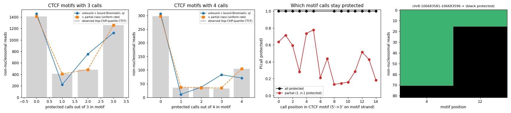

# Summary

We looked for single-molecule evidence of TF dissociation during the
methylation reaction: reads where a bound motif is *partially* protected
(some calls methylated, some not). Analysis is restricted to
non-nucleosomal reads and to motifs with at least 2 calls.

- **CTCF:** partial protection is common at bound sites. In the top ChIP
  quartile, 24% of non-nucleosomal reads are mixed, against ~3% expected
  from background. But at a given site it is almost always **the same
  call** that stays protected: the median orientation consistency is 1.00,
  where a random orientation would give 0.57. That points to a site-fixed
  pattern, not stochastic dissociation. Candidates are a protected region
  offset from the motif match, or a cytosine that methylates poorly
  whatever the TF is doing. Weakly bound and unbound sites are just as
  consistent (84% of sites ≥0.9), which favours the cytosine explanation
  (inferred, not tested).
- **OCT4 / NF-Y:** the test isn't possible with this SMF data.
  - Motifs rarely have ≥2 GpC/CpG calls: 1% of NF-Y and 11% of OCT4
    matches.
  - Even with the motif widened by ±5 bp, bound sites show only ~1.5
    points more fully protected reads than other sites, and no excess of
    mixed reads.
- **m6A** would give many more callable sites per motif: OCT4 11 vs 1
  (median, A/T bp vs SMF calls), NF-Y 4 vs 0, CTCF 5 vs 2. This is an upper
  bound, because of Hia5 context bias.

# Key Points

- **Definitions** (calls CGC-merged as in training):
  - *Non-nucleosomal read:* both flanks, 5–30 bp from the motif, have ≥1
    call and all of them are accessible.
  - *Reads used:* those observing ≥2 calls inside the motif match.
  - *Classes:* all-accessible / mixed / all-protected.
  - *ChIP quartiles* are per TF, on pooled ChIP-nexus.
- **CTCF, top ChIP quartile:** 32% accessible, 24% mixed, 44% all
  protected (14,052 reads, 467 sites). Bottom quartile: 93% / 5% / 1%.
- **Read-class mixtures, CTCF motifs with 3 and 4 calls:**
  - "Unbound background + bound reads with independent per-call
    leakage (Binomial)" fits poorly. It under-predicts reads with 1
    protected call and over-predicts reads with n−1.
  - Adding a third "partial" class (per-read protection rate uniform on
    [0, 1]) fits almost exactly. That class takes 40% of reads (n=3) and
    33% (n=4), and the bound component then has q ≈ 0.96–1.00.
- **The partial state is site-fixed.** For 2-call CTCF motifs, take the
  reads with exactly one of the two calls protected. In 86% of 92 bound
  sites, ≥90% of those reads have the same call protected.
  - Example: chr8:106683581 (+). In 55 of 82 reads the call at motif
    position 12 is protected and the one at position 4 is accessible.
- **Which call stays protected varies between sites.** Pooled over sites,
  5' positions (0–5) stay protected more often than 3' positions in
  partial reads, but individual sites go either way. The pooled profile is
  therefore not a clean structural signature.
- **OCT4 and NF-Y have little protection to work with,** consistent with
  the earlier finding that on accessible DNA these TFs leave little
  protection in this assay.

# Details

## CTCF read-class fits (top ChIP quartile)

Observed counts are for k = 0..n protected calls. In the "fit" columns,
"background" is the bottom-ChIP-quartile distribution.

| n calls | observed | bg + Binomial fit | + partial class fit |
|---|---|---|---|
| 3 (3,563 reads) | 1413 / 408 / 484 / 1258 | 1459 / 224 / 755 / 1125 (NLL 4591.7) | 1413 / 408 / 484 / 1258 (NLL 4466.9) |
| 4 (509 reads) | 298 / 36 / 38 / 32 / 105 | 307 / 11 / 37 / 83 / 71 (NLL 653.0) | 298 / 37 / 34 / 34 / 105 (NLL 608.1) |

On its own, a well-fit "partial" class would be compatible with
dissociation. The orientation analysis is what rules dissociation out as
the main source: the partial pattern repeats read after read at each site.



The four panels are: the two fits for 3- and 4-call motifs, P(protected)
by motif position for all-protected vs partial reads, and the example
site's reads.

## OCT4 / NF-Y, motif widened by ±ext bp

For this table, non-nucleosomal flanks are 5–25 bp from the widened
window.

| TF | ext | group | sites with ≥2 calls | reads | mixed | all protected |
|---|---|---|---|---|---|---|
| NF-Y | 0 | Q4 | 4 | 77 | 1.3% | 1.3% |
| NF-Y | 5 | Q4 | 86 | 2,352 | 7.3% | 4.4% |
| NF-Y | 5 | Q1–3 | 150 | 1,871 | 7.7% | 3.1% |
| OCT4 | 0 | Q4 | 21 | 264 | 6.4% | 4.5% |
| OCT4 | 5 | Q4 | 103 | 1,304 | 7.9% | 4.1% |
| OCT4 | 5 | Q1–3 | 253 | 1,768 | 7.6% | 2.5% |
| CTCF | 5 | Q4 | 768 | 21,884 | 34.1% | 40.8% |
| CTCF | 5 | Q1–3 | 2,190 | 26,794 | 10.4% | 4.7% |

## Callable sites per motif instance (chr8)

SMF counts are the CGC-merged GpC/CpG calls present in the data inside the
motif. m6A counts are A/T base pairs, assuming an adenine methylase calls
A on either strand; this is an upper bound.

| motif | width | SMF median (mean) | SMF ≥2 | m6A median (mean) |
|---|---|---|---|---|
| CTCF | 15 | 2 (1.8) | 59% | 5 (4.6) |
| NF-Y | 8 | 0 (0.3) | 1% | 4 (4.1) |
| OCT4 | 15 | 1 (0.7) | 11% | 11 (10.5) |
| CTCF ±5 | 25 | 3 (2.7) | 80% | 9 (9.0) |
| NF-Y ±5 | 18 | 1 (1.3) | 37% | 9 (9.1) |
| OCT4 ±5 | 25 | 1 (1.4) | 45% | 16 (15.7) |

## Reproduction

The scripts are saved in [partial-motif-protection/](partial-motif-protection/).
The originals and their outputs are in
`/scratch/users/diamant/mesc_validation/covariation_windows/partial_motif_methylation_2026-11-06/`,
which is purgeable. Run from the smf_hmm repo with the `smf_clean` env:

```bash
cd ~/repos/smf_hmm
PY=/home/groups/btrippe/diamant/miniforge/envs/smf_clean/bin/python
M=/scratch/users/diamant/mesc_validation/covariation_windows
O=$M/partial_motif_methylation_2026-11-06
S=~/repos/LM_research_notes/projects/smf-hmm/2026-11-06/partial-motif-protection
# per-site read classes by ChIP quartile (all TFs) -> $O/sites.tsv, summary_by_chip_quartile.tsv
PYTHONPATH=$PWD $PY $S/partial_motif_calls.py $O $M/chr8-512-valid90-reads10 $M/footprint_chr8-512-valid90-reads10
# per-call table -> $O/calls.tsv.gz
PYTHONPATH=$PWD $PY $S/partial_motif_positions.py $O $M/chr8-512-valid90-reads10 $M/footprint_chr8-512-valid90-reads10
# figure -> $O/ctcf_partial_protection.png
$PY $S/plot_partial.py $O
# mixture fits, orientation consistency, widened windows, SMF vs m6A counts (output in followups.txt)
PYTHONPATH=$PWD $PY $S/followups.py $O $M/chr8-512-valid90-reads10 $M/footprint_chr8-512-valid90-reads10
```

Runs on CPU in a few minutes, inside an interactive allocation.

# Related Notes

- [More ChIP-nexus TFs (MAX::MYC, NF-Y, ZFP281)](../2026-11-05/chip-nexus-tfs-max-myc-nfy-zfp281.md): Established that NF-Y has only a small, narrow footprint; here the cause is shown to include a lack of calls in the motif.
- [Protected-read ChIP metric](../2026-11-05/protected-read-chip-metric.md): Same "reads with protection at the motif" idea; the footprint-like read definition is reused.
- [Controlled ChIP metrics](../2026-11-04/controlled-chip-metrics-and-context-offsets.md): Background on weak OCT4 protection and the accessibility confound.
- [Merged-CGC assay](../2026-11-03/merged-cgc-147bp-histone-run.md): Why calls are CGC-merged before counting.
- [m6A sequence-context bias in Fiber-seq](../2026-10-30/fiberseq-m6a-sequence-context-bias.md): Why the m6A counts here are an upper bound.
- [AlphaGenome encoder prior](alphagenome-encoder-prior.md): Same-day context; OCT4/NF-Y ChIP metrics appear capped by how little protection the assay sees.

# Open Questions

- Are the stuck-protected CTCF calls a sequence-context (enzyme-bias)
  effect? Test: do the same cytosines stay unmethylated in unbound, open
  copies of the motif, and do they share a context such as CGC, CpG or
  GCG?
- After removing site-fixed calls, is there any residual variable-pattern
  partial protection that could reflect dissociation?
- Is the protected region at some CTCF sites shifted relative to the motif
  match (e.g., toward cohesin/N-terminus side)? This is speculative.
- Would Fiber-seq (m6A) in mESC give enough informative calls per
  OCT4/NF-Y motif to run this test? This needs Hia5 efficiency at these
  motif sequences.

# Sources

- Data: `/scratch/users/diamant/mesc_validation/covariation_windows/{chr8,footprint_chr8}-512-valid90-reads10/dataset.h5`
  and `analysis_clip_ema/unique_motif_summaries.tsv.gz` (pooled ChIP-nexus per motif).
- Scripts, figure and tables: [partial-motif-protection/](partial-motif-protection/)
  (`followups.txt` is the verbatim output of `followups.py`).
- CGC merge: smf_hmm `smf_hmm/data.py::merge_cgc_sparse` (branch nd/experiments).
