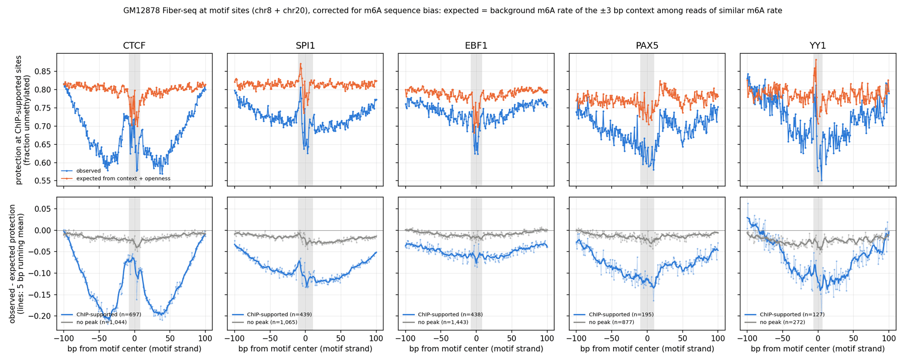
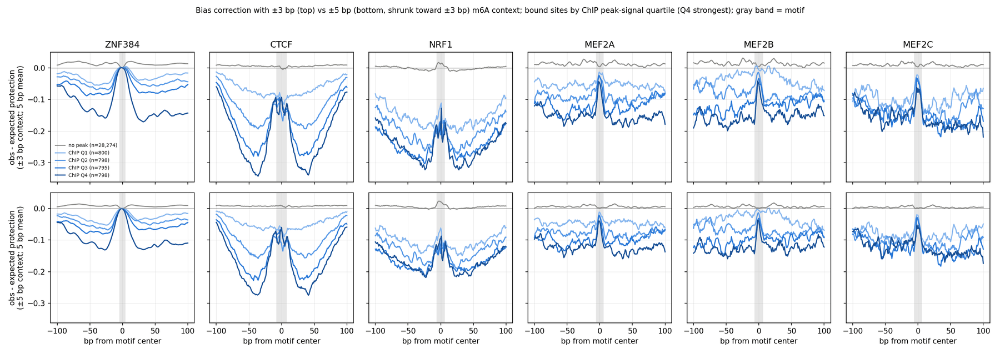
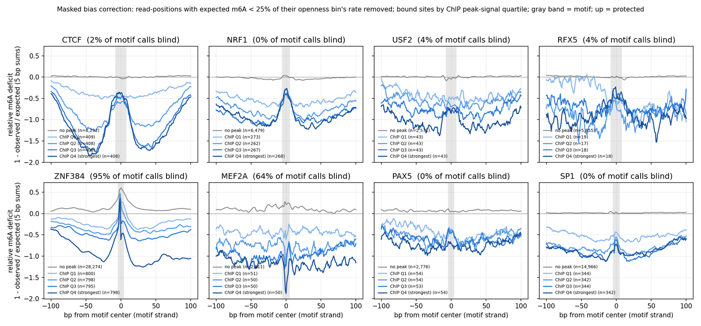
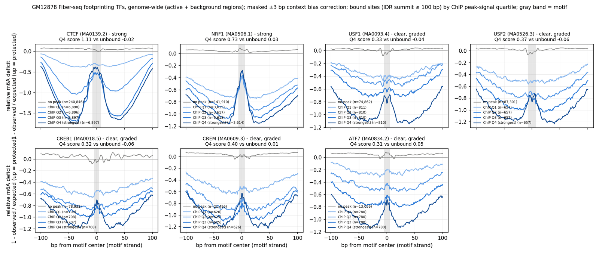

# Summary

We set up a GM12878 Fiber-seq TF/ChIP benchmark and then asked which ENCODE GM12878 ChIP'd TFs
actually leave a protected footprint in m6A data, as opposed to sitting in open DNA.

- **First benchmark (5 TFs: CTCF, EBF1, YY1, SPI1, PAX5).** The fiber `fixed_blocks` model
  beats its own DNA-only prior, but a sequence-free phase-type HMM matches or beats it, and plain
  accessibility is the best predictor for YY1, PAX5 and EBF1. Controlled for accessibility, the
  reads add almost nothing.
- **Of those five, only CTCF footprints.** After correcting for m6A sequence-context bias
  (±3 bp × read openness), CTCF shows a protected bump over the motif between deep accessible
  troughs; EBF1, PAX5, SPI1 and YY1 show motif-centered open DNA but no protection.
- **m6A blind spots fake footprints.** In A-runs m6A is almost never called (`AAA[A]AAA`: 0.3%
  in the most open reads vs 45% on average), so corrected residuals there are pinned at 0 and
  look like protection next to opening flanks. This made ZNF384 and MEF2A/B/C look like
  footprinters until those positions were masked.
- **A genome-wide masked screen of 91 TFs** (all chromosomes, active + background, 167k
  regions) finds **CTCF and NRF1** as strong footprinters, the **E-box (USF1/USF2)** and
  **CRE (CREB1/CREM/ATF7)** as clear dose-dependent but weaker ones, and **RFX5** weaker still.
  The E-box and CRE are bound by several TFs at the same sites, so their footprints are per
  motif family.
- **Benchmark update:** NRF1, USF2 (for the E-box), CREM (for the CRE) and RFX5 were added to
  the GM12878 config; downloads were in progress and caches/evaluation not yet rerun at writing.

This builds on the [m6A context-bias note](../2026-10-30/fiberseq-m6a-sequence-context-bias.md)
(±3 bp context captures most of the bias) and is consistent with the mESC result that only CTCF
footprints strongly among ChIP-nexus TFs ([ChIP-nexus TFs note](../2026-11-05/chip-nexus-tfs-max-myc-nfy-zfp281.md)).

# Key Points

- **Benchmark (chr8 / chr20, Spearman ρ with ChIP, 245–1,332 sites per TF):**

  | TF | phase-type | fiber model | fiber prior only | accessibility |
  |---|---|---|---|---|
  | CTCF | **0.58 / 0.53** | 0.53 / 0.52 | 0.45 / 0.47 | 0.44 / 0.42 |
  | EBF1 | 0.34 / 0.38 | 0.26 / 0.32 | 0.15 / 0.14 | **0.35 / 0.44** |
  | PAX5 | 0.44 / 0.39 | 0.30 / 0.28 | 0.20 / 0.21 | **0.52 / 0.57** |
  | SPI1 | 0.49 / 0.49 | 0.48 / 0.47 | 0.44 / 0.39 | **0.52 / 0.52** |
  | YY1 | 0.40 / 0.39 | 0.41 / 0.32 | 0.39 / 0.31 | **0.64 / 0.67** |

  Partial ρ controlling for accessibility: CTCF phase-type 0.43/0.37 vs fiber 0.38/0.39; for
  SPI1 and YY1 the fiber model's reads make it *worse* than its prior (YY1 0.09/−0.02 vs
  0.29/0.17). The baselines use CpG/GpC-tuned emissions, so they are a reference, not a tuned
  competitor.
- **Context bias is large:** within one openness bin, the m6A rate of a ±3 bp context spans
  0.09× to 2× the bin average (5th–95th percentile). GC-rich contexts are the most efficient
  (`GCG[A]CGC` 0.55 in the most open bin), A-runs the least.
- **Blind fraction** (share of a motif's called A/T read-positions with expected m6A < 25% of
  their openness bin's rate): ZNF384 95%, ARID3A 74%, MEF2A/B/C 57–68%, ZBTB40 57%, FOXK2,
  POU2F2, TCF7 35–42%; CTCF 2%, NRF1 0%. Motifs above 30% blind cannot be scored.
- **Genome-wide footprint score** (masked relative m6A deficit over the motif minus over its
  5–40 bp shoulders; unbound / weakest / strongest ChIP quartile):

  | TF | bound sites | score |
  |---|---|---|
  | CTCF | 27,483 | −0.02 / 0.09 / 1.11 |
  | NRF1 | 12,066 | 0.03 / 0.25 / 0.73 |
  | CREM (CRE) | 2,502 | 0.01 / 0.05 / 0.40 |
  | USF2 (E-box) | 2,628 | −0.06 / 0.01 / 0.37 |
  | USF1 (E-box) | 3,241 | −0.04 / 0.03 / 0.33 |
  | CREB1 (CRE) | 2,831 | −0.06 / 0.03 / 0.32 |
  | RFX5 | 1,379 | −0.01 / 0.08 / 0.24 |
  | EBF1 / PAX5 / SPI1 / YY1 | 3.5k–18k | Q4 ≤ 0.16 |

- **A stricter ChIP threshold strengthens real footprints:** on chr8/chr20 the CTCF score at the
  strongest-quartile peaks is 0.21 vs 0.10 for all bound sites (unmasked score).
- **Motif families** (column-wise PWM similarity; share of one TF's IDR summits within 100 bp of
  the other's): USF1–USF2 1.00, 81% of USF2 summits; CREB1–CREM 0.86, 62%; ATF7/ATF3/CREM
  0.82–0.99; JUND/JUNB/BATF 1.00, 60–65%; USF2–BHLHE40 0.80, 71%. CTCF, NRF1, RFX5 have no close
  relative in the set.

# Details

## Benchmark setup

- **Data:** training H5 `h5_ont_polarity/active.h5` (not `h5/`, which has inverted polarity),
  chr8/chr20 regions converted to region-row calls TSVs with the committed `h5_to_calls.py`
  (b02d09e), so evaluation windows are selected exactly as in training and the mESC benchmark.
  All 15.3M sampled calls sit on reference A/T.
- **Code:** `smf.assay_type` in benchmark configs and A/T-aware `assayable_positions` (5811ab7);
  unstranded fold-change ChIP signal (5985378) for ENCODE bigWigs; config
  `gm12878_validation.yaml` (c743ad5), half-window 50, replicate tracks summed.
- **Baselines hang on GPU:** `--baseline geometric|phase_type` stalled at the first batch on an
  akundaje L40S node (0% GPU, process asleep) but ran on CPU (`JAX_PLATFORMS=cpu`); cause not
  investigated.

## Bias-corrected profiles of the five benchmark TFs



*Only CTCF has a protected bump at the motif after the ±3 bp context correction; unbound sites
are flat, and the sharp in-motif features of the raw profiles appear in the expected curve, so
they were enzyme bias.*

## m6A blind spots

The ±5 bp correction (shrunk toward ±3 bp) did not remove ZNF384's apparent footprint: its motif
residual stays at about 0 in every ChIP quartile and at unbound sites. The bias table shows why:
the poly-A context has essentially no m6A at any openness, so expected ≈ observed ≈ protected.



*Widening the context to ±5 bp leaves ZNF384's motif pinned at 0 for every group, while CTCF,
NRF1 and MEF2 keep their shapes; the ZNF384 signal is a blind spot, not residual bias.*

Masking blind read-positions removes the MEF2 peak and exposes ZNF384 (its unbound sites show
the same peak). The masked score has its own bias: as a ratio it favors GC-rich motifs whose m6A
saturates near 55% (SP1, EGR1, MAZ, PAX5 get small positive scores without a footprint), so
calls need the profile shape and dose response, not the score alone.



*With blind positions masked, CTCF and NRF1 keep graded footprints, MEF2A's disappears, and
ZNF384's persists at unbound sites too, marking it as an artifact.*

## Genome-wide screen

Candidates: the 155 TF ChIP targets in the GM12878 ENCODE listing; 91 have a JASPAR CORE
vertebrate motif (human ChIP-seq matrices preferred). Peaks: GRCh38 default-analysis pooled IDR
peaks of the experiment with the most reproducible peaks. On chr8/chr20 alone most TFs had
12–100 sites per ChIP quartile; genome-wide gives about 15× more (USF2 172 → 2,628 bound sites),
which resolves the E-box and CRE footprints. Choosing footprint TFs on all chromosomes is a
property of the data, so model evaluation can stay on chr8/chr20 without leakage.



*CTCF and NRF1 footprint strongly and the E-box (USF1/2) and CRE (CREB1, CREM, ATF7) clearly,
with protection over the motif growing with ChIP peak strength while unbound sites stay flat.*

Probable artifacts: AP-1 (BATF, JUNB, JUND) show a 1–3 bp spike present already at the weakest
quartile and faintly at unbound sites. Too few sites: PAX8, ATF3, SREBF1, RXRA. 27 TFs are
reliable but show no footprint (including YY1, IRF4, SRF, IKZF1, STATs, NFATCs).

## Benchmark update

Added NRF1 (ENCSR000DZO), USF2 (ENCSR000DZU), CREM (ENCSR839XZU) and RFX5 (ENCSR000DZW),
motifs MA0506.1, MA0526.3, MA0609.3, MA0510.1. USF2 was chosen over USF1 because USF1's only
GM12878 experiment (ENCSR000BGI) has extremely-low-read-length and insufficient-depth audits;
CREM over CREB1 because its matrix is the full palindromic CRE. The benchmark name stays
`gm12878_tf_chip_validation_v1`: cache shards are per TF, so the first five's are unchanged.

## Command provenance

```bash
# Benchmark pipeline (job scripts in /scratch/users/diamant/fiber_eval_work/)
sbatch build_cache.sbatch                       # job 51720625
sbatch --dependency=afterok:<cache> select_windows.sbatch   # 51721144
sbatch --dependency=afterok:<select> infer.sbatch           # 51721150, akundaje GPU
sbatch --dependency=afterok:<infer> analyze.sbatch          # 51721155
sbatch infer_baselines_cpu.sbatch               # 51736883 (CPU; GPU attempt 51735843 hung)
sbatch --dependency=afterok:51736883 analyze_baselines.sbatch  # 51736884

# Footprint analyses (hmm env; MPLCONFIGDIR=$PWD/.mplconfig, run from ~/repos/smf_hmm)
PY=/home/groups/btrippe/diamant/miniforge/envs/hmm/bin/python
$PY $SCRATCH/fiber_eval_work/footprint_kmer_corrected.py          # context_corrected figure
$PY -W ignore $SCRATCH/fiber_eval_work/tf_screen/wider_context.py  # ±3 vs ±5 figure
$PY -W ignore $SCRATCH/fiber_eval_work/tf_screen/dose_masked.py    # masked chr8/chr20 figure
SLURM_CPUS_PER_TASK=4 $PY -W ignore $SCRATCH/fiber_eval_work/tf_screen/genome_screen.py  # 36 min
$PY -W ignore $SCRATCH/fiber_eval_work/tf_screen/plot_genome_screen.py
# strong_graded_footprints.png: inline plot from genome_screen_profiles_genome.npz (2026-11-10)

# Benchmark update
$PY evaluation/datasets/chip_GM12878/build_manifest.py
CHIP_DIR=$GROUP_SCRATCH/ndiamant/encode/GM12878_chip bash evaluation/datasets/chip_GM12878/fetch.sh
```

The genome screen ran in the interactive allocation (job 51686730) after the Slurm submission
(51817511) waited with no start estimate. Figures were resized to 1,600–1,800 px and quantized
to 256 colors with Pillow.

# Related Notes

- [m6A sequence-context bias in GM12878 Fiber-seq](../2026-10-30/fiberseq-m6a-sequence-context-bias.md):
  Shows ±3 bp context captures most of the bias; this note's correction uses ±3 bp for that
  reason and finds the same A-run extreme.
- [Fiber-seq HMM absorbs m6A context bias](../2026-10-30/fiber-hmm-enzyme-bias-diagnostic.md):
  Explains why the fiber model's TF calls track context rather than footprints, consistent with
  its weak benchmark numbers here.
- [More ChIP-nexus TFs (MAX::MYC, NF-Y, ZFP281)](../2026-11-05/chip-nexus-tfs-max-myc-nfy-zfp281.md):
  The mESC counterpart: only CTCF footprints strongly there too.
- [Accessibility-controlled ChIP metrics](../2026-11-04/controlled-chip-metrics-and-context-offsets.md):
  Defines the controlled metrics and reference scores used in the benchmark table.

# Open Questions

- Do NRF1, USF2, CREM and RFX5 change the model comparison once the benchmark is rerun with
  them? (Caches and evaluation not yet run.)
- Is the AP-1 spike a bias residual at one base, or a real narrow contact? A per-base look at
  observed vs expected would tell.
- Would single-molecule footprint counts recover lower-occupancy TFs that averaging dilutes?
- Why do the fixed baselines hang on GPU but not CPU?
- The masked ratio score inflates GC-rich motifs; an openness-matched unbound control with
  masking would give one score neither bias moves.

# Sources

- smf_hmm repo (branch nd/experiments): `evaluation/datasets/chip_GM12878/README.md`,
  `evaluation/tf_chip/references/README.md`, `evaluation/tf_chip/configs/gm12878_validation.yaml`,
  commits listed in the frontmatter.
- ENCODE experiments: CTCF ENCSR000DZN, EBF1 ENCSR000BGU, YY1 ENCSR000BNP, SPI1 ENCSR000BGQ,
  PAX5 ENCSR000BHD, NRF1 ENCSR000DZO, USF2 ENCSR000DZU, CREM ENCSR839XZU, RFX5 ENCSR000DZW
  (https://www.encodeproject.org).
- JASPAR matrices (https://jaspar.elixir.no): MA0139.2, MA0154.4, MA0095.2, MA0080.5, MA0014.2,
  MA0506.1, MA0526.3, MA0609.3, MA0510.1.
- Vollger et al., GM12878 Fiber-seq FIRE data, doi:10.1101/2024.06.14.599122.
