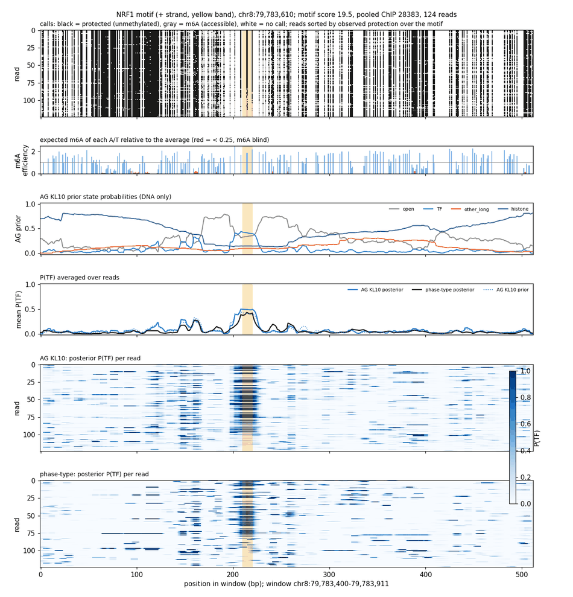
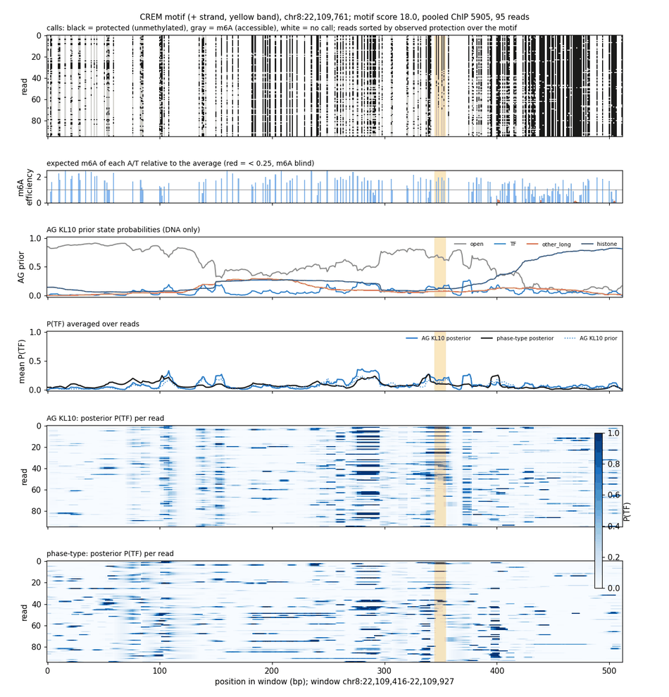
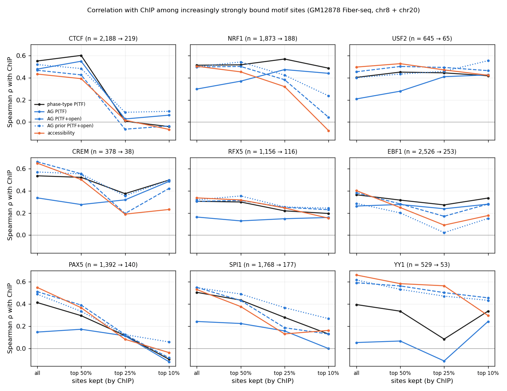

# Summary

On the nine-TF GM12878 Fiber-seq benchmark (CTCF, NRF1, USF2, CREM, RFX5, EBF1, PAX5, SPI1,
YY1; chr8 and chr20), four neural single-TF models (AlphaGenome or CNN prior, occupancy KL 10
or 30) all correlate with ChIP worse than the sequence-free phase-type HMM when sites are scored
by mean P(TF) over the motif.

**This is mostly a labeling difference, not a failure to read the data:**

- Scored by **P(TF) + P(open)** (nucleosome-free probability at the motif), AG KL10 ties
  phase-type for every TF except CTCF, and the **AG prior alone (DNA only, no reads)** is about
  as good as read-based accessibility.
- The AG prior *does* know which motif sites are bound, but as "open": its prior P(open)
  correlates with ChIP at 0.25–0.59 and with accessibility at 0.60–0.73. AG's posterior stays
  close to its prior (ρ 0.58–0.89 across sites).
- Phase-type's P(TF) rises with openness (ρ 0.50–0.72 with accessibility), because in
  under-methylated open fiber DNA the gaps between m6A calls look like short protected
  stretches. Since ChIP tracks accessibility, P(TF) rewards this.
- The [footprint screen](../2026-11-10/gm12878-fiberseq-tf-footprint-screen.md) found that most
  of these TFs leave no protected footprint, so "open" is the better call for them.
- **Among strongly bound sites of footprinting TFs, P(TF) becomes the informative score and the
  gap closes:** at NRF1's top 10% of ChIP sites, P(TF) still ranks ChIP (phase-type 0.49,
  AG 0.44) while accessibility drops to −0.08.

# Key Points

- **Mean P(TF) vs ChIP, Spearman ρ, chr20 / chr8 averaged**, footprint TFs (first five) /
  other four: geometric 0.42 / 0.40, phase-type **0.46 / 0.41**, CNN KL10 0.33 / 0.24, AG KL10
  0.30 / 0.17, CNN KL30 0.27 / 0.17, AG KL30 0.27 / 0.10; accessibility 0.48 / 0.53. Controlled
  for accessibility: phase-type 0.21 / 0.17, neural 0.13–0.15 / 0.05–0.10, motif score 0.19 /
  0.23. KL30 mostly removes the accessibility component; AlphaGenome ≤ CNN.
- **Nucleosome-free scoring (all motif sites, chr8 + chr20):**

  | TF | phase-type P(TF) | phase-type P(TF+open) | AG P(TF) | AG P(TF+open) | AG prior P(TF+open) | accessibility |
  |---|---|---|---|---|---|---|
  | CTCF | 0.55 | 0.53 | 0.48 | 0.47 | 0.52 | 0.43 |
  | NRF1 | 0.51 | 0.54 | 0.30 | 0.50 | 0.50 | 0.50 |
  | USF2 | 0.40 | 0.45 | 0.21 | 0.45 | 0.40 | 0.50 |
  | CREM | 0.53 | 0.67 | 0.34 | 0.66 | 0.57 | 0.65 |
  | RFX5 | 0.31 | 0.31 | 0.16 | 0.31 | 0.32 | 0.34 |
  | EBF1 | 0.36 | 0.39 | 0.26 | 0.38 | 0.29 | 0.40 |
  | PAX5 | 0.41 | 0.53 | 0.15 | 0.51 | 0.49 | 0.55 |
  | SPI1 | 0.50 | 0.55 | 0.24 | 0.55 | 0.55 | 0.53 |
  | YY1 | 0.39 | 0.61 | 0.05 | 0.59 | 0.62 | 0.66 |

- **Where AG's ChIP signal comes from** (Spearman across motif sites): AG posterior vs its prior
  0.58–0.89; AG read update (posterior − prior) vs ChIP only 0.07–0.18; AG prior P(TF) vs ChIP
  0.11–0.47 (CTCF 0.47, above motif score's 0.42).
- **Stricter ChIP cutoffs** (ρ within each TF's top sites by pooled ChIP):

  | TF, cutoff (n) | phase-type P(TF) | AG P(TF) | AG P(TF+open) | AG prior P(TF+open) | accessibility | motif score |
  |---|---|---|---|---|---|---|
  | NRF1 top 25% (469) | 0.57 | 0.47 | 0.38 | 0.42 | 0.32 | 0.40 |
  | NRF1 top 10% (188) | 0.49 | 0.44 | 0.04 | 0.24 | −0.08 | 0.24 |
  | USF2 top 10% (65) | 0.42 | 0.43 | 0.46 | 0.55 | 0.42 | 0.11 |
  | CREM top 10% (38) | 0.50 | 0.48 | 0.42 | 0.50 | 0.23 | 0.14 |
  | CTCF top 50% (1,094) | 0.60 | 0.55 | 0.43 | 0.48 | 0.39 | 0.43 |
  | CTCF top 25% (547) | 0.01 | 0.03 | −0.06 | 0.09 | 0.02 | 0.02 |
  | YY1 top 25% (133) | 0.08 | −0.11 | 0.50 | 0.47 | 0.56 | 0.36 |
  | SPI1 top 10% (177) | 0.13 | −0.00 | 0.13 | 0.27 | 0.16 | 0.21 |
  | PAX5 top 10% (140) | −0.10 | −0.12 | −0.09 | 0.06 | −0.04 | 0.07 |

  CTCF collapses to about 0 for every score, motif score included, above its top 25%: ChIP is
  probably saturated there (inferred).

# Details

## Example sites

At the strongest CTCF and NRF1 sites the AG prior is informative (P(TF) ≈ 0.4 on the motif,
high P(open) on the flanking NDR) and the posterior reflects whether the motif is protected,
as does phase-type. Weaker footprint TFs vary: the prior recognizes some USF2 E-boxes well
(P(TF) ≈ 0.6) but not the CREM and RFX5 sites shown, where both posteriors stay low.



*At a strong NRF1 site the AG prior already puts P(TF) ≈ 0.4 on the motif inside an open
region, and both models' posteriors agree with the reads protected over the motif.*



*At this CREM site the AG prior gives the CRE only P(TF) ≈ 0.1 inside a broad open region,
and neither model's posterior calls the TF although about 40 of 95 reads are protected over
the motif.*

Plot layout (top to bottom): every read's calls (black = protected, gray = m6A, white = no call;
reads sorted by observed protection over the motif); m6A efficiency of each A/T from the
chr8/chr20 ±3 bp bias table (red = blind); AG KL10 prior state probabilities; read-averaged
P(TF) for both posteriors and the prior; per-read P(TF) for AG and for phase-type.

## ChIP cutoffs



*For the footprint TFs NRF1, USF2 and CREM, P(TF) keeps its correlation with ChIP among the
most strongly bound sites, and AG catches up with phase-type, while accessibility loses it; for
PAX5, SPI1 and EBF1 every score decays, and YY1 stays accessibility-driven.*

## Interpretation (inferred)

The raw P(TF) correlation conflates two things: separating bound from weak or unbound sites,
which accessibility does well because ChIP tracks openness, and ranking bound sites by
occupancy, which needs a footprint. Phase-type gets the first through leaky TF calls in open
DNA; AG labels that DNA open. A fair benchmark should report accessibility-controlled metrics,
judge P(TF) on footprinting TFs (ideally among bound sites or with the protected-read variant),
and add P(TF + open) as a separate nucleosome-free score.

## Command provenance

```bash
W=/scratch/users/diamant/fiber_eval_work
# Nine-TF windows and baselines (CPU; baselines hang on GPU)
sbatch $W/select_windows_v2.sbatch                                # 51839147, 21 min
sbatch --dependency=afterok:51839147 $W/infer_baselines_v2.sbatch # array 51839156, up to 2h19
# Neural models: task 0 on akundaje (array 51876251), tasks 1-7 on the interactive H100
for i in 1 2 3 4 5 6 7; do SLURM_ARRAY_TASK_ID=$i bash $W/infer_neural_v2.sbatch; done
bash $W/analyze_all_v2.sbatch                                     # 6-model analysis_all/
# AG KL10 prior-only marginals (H100)
python -m smf_hmm.cli.infer_posterior $D/dataset.h5 $D/posteriors/ag_kl10_prior.h5 \
  --checkpoint-dir /scratch/users/diamant/2026-11-10_fiber_single_tf_tapered147_otherlong40_kl10_context3_alphagenome_bf16/checkpoints \
  --assay-type fiberseq_m6a --batch-size 32 --prior-only
# Example plots and nucleosome-free / ChIP-cutoff tables (hmm env)
python $W/compare_posteriors_prior.py usf2 crem rfx5; python $W/compare_posteriors_prior.py ctcf nrf1
python $W/nucleosome_free_scores.py
```

The cutoff figure was drawn inline from `nucleosome_free_chip_cutoffs.tsv`. Figures were
resized and quantized to 256 colors with Pillow.

# Related Notes

- [GM12878 Fiber-seq TF footprint screen](../2026-11-10/gm12878-fiberseq-tf-footprint-screen.md):
  Establishes which TFs footprint; the "open" labeling is judged correct for the others because
  of it.
- [Fiber-seq HMM absorbs m6A context bias](../2026-10-30/fiber-hmm-enzyme-bias-diagnostic.md):
  Earlier fiber model diagnosis; these runs use ±3 bp context offsets.
- [AlphaGenome encoder prior](../2026-11-06/alphagenome-encoder-prior.md): The mESC result
  that the AG prior improves likelihood but not posterior ChIP agreement, consistent with this.
- [Accessibility-controlled ChIP metrics](../2026-11-04/controlled-chip-metrics-and-context-offsets.md):
  Defines the controlled metrics used above.

# Open Questions

- Add a P(TF + open) score to `analyze_covariation.py` and report it in the benchmark?
- Does phase-type's P(TF) rise with openness at *unbound* motifs (direct test of leaky TF calls)?
- For CTCF, AG's posterior P(TF+open) is slightly below its prior (0.47 vs 0.52): do reads at
  CTCF sites push AG toward histone or other_long?
- Would TF-specific states for the footprinting motif families let the prior learn TF identity?

# Sources

- smf_hmm repo (branch nd/experiments): `evaluation/tf_chip/configs/gm12878_validation.yaml`,
  `evaluation/datasets/chip_GM12878/README.md`, commit b41303f.
- Outputs and scripts listed in the frontmatter.
