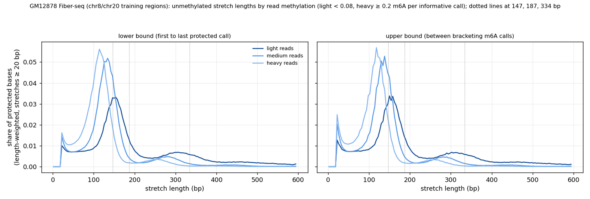

# Summary

This follows the [nucleosome-free scoring note](fiber-neural-vs-phase-type-nucleosome-free.md),
which found that the AG KL10 fiber model trails the sequence-free phase-type HMM on mean P(TF)
mostly because it labels bound, unprotected DNA open.

- **AG also under-calls TF on reads that do show a footprint**, labelling them `other_long`
  instead. On reads with a fully protected motif between accessible flanks, AG gives P(TF) 0.49
  vs phase-type's 0.72 at CTCF, with `other_long` 0.47.
- **Cause (inferred):** AG's TF state is 8–40 bp with occupancy target 0.02, and `other_long` is
  40–100 bp with target 0.10. Footprints on these reads are mostly 23–39 bp (median
  lower-bound length), right at that boundary, and the bigger `other_long` budget wins.
  Phase-type has one short TF state (≥ 7 bp, mean 10) and calls a TF in 80% of CTCF footprint
  reads against AG's 51%, with similar TF-called lengths (34 vs 30 bp).
- **`other_long` is not rare: it covers about 16% of positions** (posterior; target 0.10), 99%
  of its calls protected. It was meant for rare long complexes.
- **The fixed 147 bp histone is not flexible enough.** The "tapered" histone tapers only the
  emissions of its outer 25 bp; its duration is fixed. Fiber-seq nucleosome-length stretches
  shrink with read methylation (main peak about 150–155 bp on lightly methylated reads, about
  115–120 bp on heavily methylated ones), and lightly methylated reads show merged
  dinucleosomes near 300 bp, both documented effects in methyltransferase footprinting.
- **Most 40–100 bp protection is on heavily methylated, open-rich reads** (29% of their protected
  bases), whose origin (real sub-nucleosomal particles vs enzyme or calling effects) is
  unresolved.
- **Experiment launched:** the same AG KL10 model retrained with the `other_long` target cut from
  0.10 to 0.01 (difference to histone), to see what absorbs that mass.

# Key Points

- **Per-read classes at motif sites** (informative A/T calls only: ±3 bp context efficiency ≥ 25%
  of the openness bin's average, so A-runs are excluded). Footprint = ≥ 2 motif calls, all
  protected, ≥ 2 m6A in each 15–40 bp flank; open = ≥ 1 m6A in the motif with accessible
  flanks; closed = no m6A in motif or flanks. Mean P(TF) over the motif, AG / phase-type:

  | TF | footprint share | footprint | open | closed | other |
  |---|---|---|---|---|---|
  | CTCF | 8.1% | 0.49 / 0.72 | 0.15 / 0.14 | 0.01 / 0.00 | 0.08 / 0.05 |
  | NRF1 | 1.7% | 0.62 / 0.67 | 0.10 / 0.08 | 0.01 / 0.00 | 0.07 / 0.06 |
  | USF2 | 1.4% | 0.50 / 0.59 | 0.12 / 0.12 | 0.00 / 0.00 | 0.09 / 0.05 |
  | CREM | 1.9% | 0.64 / 0.63 | 0.11 / 0.12 | 0.01 / 0.00 | 0.09 / 0.05 |
  | PAX5 | 1.1% | 0.25 / 0.46 | 0.13 / 0.14 | 0.01 / 0.00 | 0.08 / 0.05 |
  | YY1 | 2.8% | 0.45 / 0.60 | 0.14 / 0.19 | 0.01 / 0.00 | 0.10 / 0.06 |

  On open reads the two models agree, which corrects the earlier "leaky TF calls in open DNA"
  explanation for phase-type's lead.
- **AG state split on footprint reads:** CTCF TF 0.49 / other_long 0.47; YY1 0.45 / 0.47; PAX5
  0.25 / 0.53; NRF1 0.62 / 0.23. Scoring AG by P(TF + other_long) makes ChIP agreement much
  worse (CTCF 0.20, most TFs < 0), since across all reads `other_long` mostly marks closed DNA.
- **Footprint lengths on footprint reads** (lower bound = first to last protected call; upper
  bound = between bracketing m6A calls; medians): CTCF 33 / 37 bp, NRF1 23 / 32, USF2 30 / 39,
  PAX5 39 / 45, YY1 33 / 37. Phase-type's TF-called span exceeds 40 bp on 9–22% of footprint
  reads.
- **Footprint occupancy** (footprint ÷ (footprint + open) reads per site) tracks ChIP only for
  CTCF (ρ 0.38, vs accessibility 0.40); for other TFs ≤ 0.12, as footprint reads are rare.
- **AG KL10 occupancy, 300 random windows per chromosome** (posterior / prior / training
  target): open 0.23 / 0.24 / 0.28, TF 0.08 / 0.07 / 0.02, other_long 0.16 / 0.12 / 0.10,
  histone 0.53 / 0.57 / 0.60.
- **`other_long` by read m6A rate** (deciles; 9.3k reads each): 0.19 on the least methylated
  reads (76% histone), about 0.10 in the low-middle, 0.20–0.22 on well-methylated reads.

# Details

## Protected-stretch lengths



*The nucleosome-length peak shifts from about 150–155 bp on lightly methylated reads to about
115–120 bp on heavily methylated reads, and lightly methylated reads show a second peak near
300 bp (merged dinucleosomes).*

Share of protected bases (lower bound; upper bound within a few points), 746k reads of the
chr8/chr20 training-H5 regions, grouped by m6A per informative call:

| reads (share) | 40–100 bp | 100–160 bp | 160–260 bp | ≥ 260 bp |
|---|---|---|---|---|
| light, < 0.08 (15%) | 11% | 31% | 24% | 30% |
| medium (52%) | 14% | 58% | 12% | 10% |
| heavy, ≥ 0.2 (33%) | 29% | 54% | 7% | 4% |

The 300 bp peak fits two back-to-back 147 bp histones, so merged dinucleosomes are probably a
minor source of `other_long` (inferred). The methylation-dependent nucleosome length is not fit
by one fixed 147 bp block plus a 25 bp emission taper. The 40–100 bp mass sits on heavily
methylated reads, where `other_long` is also highest.

## Literature (from a search agent; full citations in the scratch notes)

- **Merged footprints from under-methylated linkers** are stated most directly for SAMOSA/IDLI
  (EcoGII): "Poorly methylated samples exhibit a higher fraction of footprints longer than the
  expected length of DNA protected by a mononucleosome …, which can be ascribed to the failure of
  EcoGII to efficiently methylate in linker DNA" (Nature 2026, doi:10.1038/s41586-026-10418-6).
  nanoNOMe reports inaccessible runs peaking at 128 and 310 bp (Lee et al. 2020,
  doi:10.1038/s41592-020-01000-7).
- **No Fiber-seq paper found states that Hia5 leaves short linkers unmethylated** (Stergachis
  2020 was paywalled and not read). fibertools: 10–25% of linkers carry a single m6A (Jha et al.
  2024, doi:10.1101/gr.279095.124); its nucleosome caller has no maximum length and does not
  split long stretches (from the fiberseq/fibertools-rs source). DiMeLo-seq: Hia5 methylates
  poorly within about 20 bp of a bound protein (Altemose et al. 2022,
  doi:10.1038/s41592-022-01475-6).
- **Nucleosome size depends on methylation level**: "as the percent of adenines methylated
  increases, … inferred nucleosome sizes decrease" (Bubb et al. 2026,
  doi:10.3389/freae.2026.1968465), consistent with the peak shift above.
- **Sub-nucleosomal species** (hexasomes, tetrasomes, unwrapped nucleosomes) are reported as real
  in IDLI and RASAM (doi:10.1016/j.cell.2024.10.039); no Fiber-seq report of abundant 40–100 bp
  footprints was found.

## Experiment: other_long target cut to 0.01

Same as the AG KL10 run (`2026-11-10_fiber_single_tf_tapered147_otherlong40_kl10_context3_alphagenome_bf16`)
except `other_long` occupancy 0.10 → 0.01 and histone 0.60 → 0.69, in both
`transition.block_specs` and `objective.prior_occupancy_target_rates` (open 0.28, TF 0.02
unchanged), and `data.fasta_path` pointing at the replacement hg38 (below). Expected (not yet
tested): footprints at 30–40 bp move to TF, but the 16% of positions `other_long` now explains
must go elsewhere; with histone fixed at 147 bp, some may become TF in closed chromatin.

## Reference genome purged

`/scratch/groups/btrippe/brian/projects/SMF/fiberseq/reference/` was emptied on 2026-11-11
(hg38.fa dated 2026-08-13, so most likely the 90-day `$GROUP_SCRATCH` purge). A same-size copy is
at `/scratch/groups/btrippe/ndiamant/reference/hg38.fa`. Still pointing at the purged path:
`evaluation/tf_chip/configs/gm12878_validation.yaml` (`genome.fasta`), the
`/scratch/users/diamant/smfnet_paper_data/reference/hg38.fa` symlink, and earlier training
runs' configs.

## Command provenance

```bash
PY=/home/groups/btrippe/diamant/miniforge/envs/hmm/bin/python
$PY -W ignore $SCRATCH/fiber_eval_work/read_classes.py              # read classes, occupancy vs ChIP
MPLCONFIGDIR=$PWD/.mplconfig $PY -W ignore $SCRATCH/fiber_eval_work/protected_stretch_lengths.py
sbatch /scratch/users/diamant/2026-11-11_fiber_single_tf_tapered147_otherlong40_ol001_kl10_context3_alphagenome_bf16/train.sbatch
```

The AG state split on footprint reads, the footprint and TF-called span lengths, the
P(TF + other_long) scoring, the AG occupancy table and the occupancy by read m6A rate were inline
Python run on 2026-11-11 against the posterior files above, using the read-class definitions in
`read_classes.py`. The figure was resized and quantized to 256 colors with Pillow.

# Related Notes

- [Fiber neural HMMs vs phase-type: nucleosome-free scoring](fiber-neural-vs-phase-type-nucleosome-free.md):
  The model comparison this note explains further.
- [GM12878 Fiber-seq TF footprint screen](../2026-11-10/gm12878-fiberseq-tf-footprint-screen.md):
  Defines the footprint TFs and the m6A blind-spot masking used here.
- [m6A sequence-context bias](../2026-10-30/fiberseq-m6a-sequence-context-bias.md): Source of the
  ±3 bp context efficiency used to mask blind positions.

# Open Questions

- What does the `other_long` 0.01 run do to occupancy, footprint-read P(TF) and the benchmark?
- Would a flexible histone duration (e.g. 100–180 bp, or a methylation-dependent length) absorb
  most of what `other_long` now covers?
- Are the 40–100 bp protected stretches on heavily methylated reads real particles or enzyme /
  calling effects? Compare the same length distribution in the mESC SMF data.
- Should the TF state allow up to about 50–60 bp, overlapping `other_long`?

# Sources

- Outputs, scripts and runs in the frontmatter.
- Literature as cited in Details.
