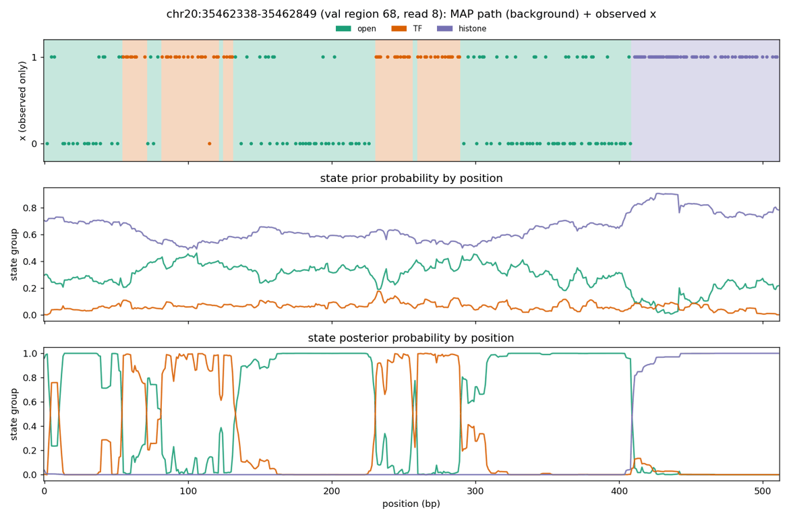

# Summary

**Setup.** We trained the AG KL10 recipe with the phase-type baseline's state structure plus a TF
cap:
- open;
- TF of 7-40 bp, zero-bias mean 10, which must exit to open;
- histone of ≥ 130 bp, geometric tail, mean 150;
- no `other_long` state and no fixed-length tapered histone;
- occupancy and prior KL targets 0.28 / 0.02 / 0.70.

Everything else matches AG KL10. We scored it on the val IDR benchmark at prior scales 1, 0.5 and
0, and prior-only.

**The cap did not prevent long TF calls.** The model calls TF on 8.1% of bases, more than any
other model. 35% of TF-called bases are in runs of ≥ 35 bp (near the cap), and when runs separated
by ≤ 10 bp non-histone gaps are merged, 51% are in chains > 40 bp and **22% in chains > 100 bp**.
In the read plots, TF blocks of up to 40 bp are joined by open gaps of a few bp across 70-80 bp
protected stretches.

The prior drives the chaining. Chains > 100 bp hold 4.2% of TF bases at prior scale 0.5 and 1.3% at
0, against 2.2% for phase-type, which has no cap at all. With no `other_long`, sub-nucleosomal
protection still has to go somewhere: about 28% of TF bases stay in near-cap runs even with the
prior off.

**Benchmark.**
- At full prior strength this is the **worst neural model on bound vs unbound** (raw AUROC NRF1 0.74
  vs phase-type 0.89, SPI1 0.57 vs 0.82, PAX5 0.55 vs 0.76). TF calls painted along protected
  stretches everywhere dilute the motif signal.
- With the prior off (s = 0) it is the closest neural variant to phase-type. It ties on NRF1 raw
  AUROC (0.89), on CTCF and NRF1 protected-read AUROC (0.89, 0.91 vs 0.89, 0.92), and is within
  the CIs on RFX5, EBF1 and YY1. That is expected: structurally it is phase-type with learned
  emissions and context offsets.
- At s = 0.5, within-bound ChIP ranking for NRF1 is significantly above phase-type (0.50 vs 0.45),
  as AG ol001 at s = 0.5 was for CTCF.

**Conclusion** (inferred):
- With a strong sequence prior, a TF state needs more than a length cap. It needs a minimum open
  separation (or an explicit TF → open → TF penalty), and some state for 40-100 bp protection.
- Among the models so far, **AG ol001 at prior scale 0.5** remains the best overall: it ties
  phase-type on most accessibility-controlled AUROCs and beats it on CTCF and PAX5 ranking.

# Key Points

- **TF run lengths** (first 60k reads per val chromosome; P(TF) > 0.5; chains merge runs across
  ≤ 10 bp gaps with no P(histone or other_long) > 0.5):

  | model | TF base share | runs ≥ 35 bp | chains > 40 bp | chains > 60 bp | chains > 100 bp |
  |---|---|---|---|---|---|
  | phase-type | 0.050 | 11% | 26% | 14% | 2.2% |
  | AG KL10 | 0.063 | 1% | 15% | 4% | 0.6% |
  | AG ol001 | 0.062 | 2% | 16% | 5% | 0.7% |
  | AG ol001, s = 0.5 | 0.034 | 5% | 9% | 2% | 0.3% |
  | **AG phase-type structure** | 0.081 | 35% | 51% | 44% | 22% |
  | same, s = 0.5 | 0.037 | 29% | 38% | 30% | 4.2% |
  | same, s = 0 | 0.026 | 28% | 35% | 25% | 1.3% |

  Phase-type itself, the benchmark leader, has the second-highest long-TF share (26% of TF bases
  in chains > 40 bp), so part of its benchmark advantage may come from over-long TF calls at bound
  sites (consistent with the user's 2026-11-11 suspicion; not tested directly).
- **Validation loss:** final loss 61.90, against 61.02 for AG ol001; slightly worse with fewer
  states.



*Read 8 of val region 68 (chr20:35,462,338): the MAP path (top, orange = TF) covers roughly
bp 55-131 and 230-290 with 40 bp-capped TF blocks joined by open gaps of a few bp, under a prior
that puts 5-15% on TF throughout.*

# Details

## Benchmark (val chr8 + chr20, IDR labels; "−"/"+" significant vs phase-type)

| TF | metric | phase-type | AG pt s1 | s0.5 | s0 | AG pt prior | AG ol001 | AG ol001 s0.5 |
|---|---|---|---|---|---|---|---|---|
| CTCF | raw AUROC | 0.88 | 0.80− | 0.86− | 0.87− | 0.83− | 0.85− | 0.87− |
| CTCF | AUROC within accessibility quintiles | 0.80 | 0.77− | 0.80 | 0.80 | 0.79 | 0.78− | 0.81 |
| CTCF | protected-read AUROC | 0.89 | 0.83− | 0.87− | 0.89 | 0.83− | 0.87− | 0.88− |
| CTCF | within-bound ρ | 0.24 | 0.21− | 0.24 | 0.25 | 0.26 | 0.25 | 0.28+ |
| NRF1 | raw AUROC | 0.89 | 0.74− | 0.82− | 0.89 | 0.74− | 0.82− | 0.85− |
| NRF1 | protected-read AUROC | 0.92 | 0.88− | 0.90− | 0.91 | 0.77− | 0.89− | 0.90− |
| NRF1 | within-bound ρ | 0.45 | 0.49 | 0.50+ | 0.48 | 0.45 | 0.44 | 0.48 |
| USF2 | protected-read AUROC | 0.87 | 0.73− | 0.79− | 0.80− | 0.70− | 0.80− | 0.81− |
| USF2 | within-bound ρ | 0.27 | 0.31 | 0.31 | 0.27 | 0.54+ | 0.30 | 0.27 |
| CREM | protected-read AUROC | 0.88 | 0.69− | 0.76− | 0.80− | 0.68− | 0.81− | 0.84− |
| SPI1 | AUROC within accessibility quintiles | 0.71 | 0.52− | 0.63− | 0.66− | 0.56− | 0.62− | 0.67− |
| PAX5 | protected-read AUROC | 0.77 | 0.60− | 0.71− | 0.75− | 0.53− | 0.70− | 0.74− |
| YY1 | protected-read AUROC | 0.76 | 0.63− | 0.68− | 0.72 | 0.64− | 0.60− | 0.61− |

The USF2 prior-only within-bound ρ of 0.54 rests on 76 bound sites. All TFs and CIs are in
`idr_summary_ag_pt_val.tsv`.

## Command provenance

```bash
sbatch /scratch/users/diamant/2026-11-12_fiber_single_tf_phasetype_tf7to40_hist130plus_kl10_context3_alphagenome_bf16/train.sbatch   # 52036412
W=/scratch/users/diamant/fiber_eval_work
j=$(sbatch --parsable --dependency=afterok:52036412 $W/infer_phasetype_ag_val.sbatch)   # 52045349: ag_pt, ag_pt_s05, ag_pt_s0, ag_pt_prior
sbatch --dependency=afterok:$j $W/analyze_phasetype_ag_val.sbatch                      # 52045351 -> idr_summary_ag_pt_val.tsv
/home/groups/btrippe/diamant/miniforge/envs/smf_clean/bin/python $W/tf_run_lengths.py \
  phase_type ag_kl10 ag_ol001 ag_ol001_s05 ag_pt ag_pt_s05 ag_pt_s0 | tee $W/tf_run_lengths_val.txt
```

Transition overrides (from `train.sbatch`):
`transition=fixed_blocks_single_tf 'transition.block_specs=[{name:TF,min_duration:7,max_duration:40,mean_duration:10.0,occupancy:0.02},{name:histone,min_duration:130,max_duration:null,mean_duration:150.0,occupancy:0.70}]'`,
emission groups TF (0.95, floor 0.85) and histone (0.98), KL targets [0.28, 0.02, 0.70]. The
figure is the run's own `smf_hmm.cli.plot` output, resized and quantized with Pillow.

# Related Notes

- [Prior-scale ablation](fiber-prior-scale-ablation.md): The same prior-scale comparison for
  AG KL10 and AG ol001.
- [IDR-labelled benchmark](fiber-idr-chip-benchmark.md): The metrics, and where this run was
  proposed.
- [Read m6A-rate evaluation](fiber-read-m6a-rate-evaluation.md): `other_long` absorbs
  labeling-rate effects; this run shows what happens without it.
- [other_long footprint reads and linkers](../2026-11-11/fiber-other-long-footprint-reads-and-linkers.md):
  Why 40-100 bp protection exists in Fiber-seq.

# Open Questions

- **Minimum open separation:** does a minimum open run after TF (for example 10 bp), or an
  explicit TF → open → TF penalty, stop the chaining at full prior strength?
- **Training-time prior weight:** would a down-weighted prior during training (prior dropout,
  or a learned prior temperature) give the s = 0.5 behavior without inference-time tuning?
- **Phase-type's long TF calls:** how much of phase-type's benchmark lead comes from its long
  (> 40 bp) TF calls? Re-score phase-type with TF chains > 40 bp reassigned to non-TF.
- **Train chromosomes:** the train-chromosome comparison (Slurm 52038652) was still waiting on
  phase-type inference for chr2 at writing.

# Sources

- Outputs, runs and scripts in the frontmatter.
