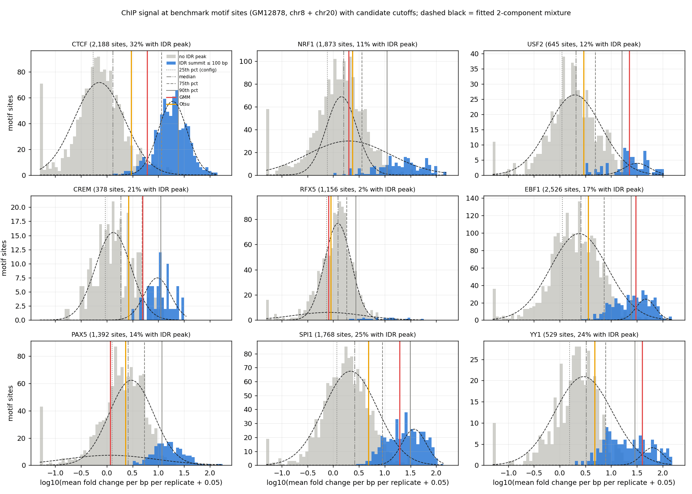

# Summary

The GM12878 benchmark now labels motif sites with ENCODE's conservative IDR peaks instead of a
ChIP-quantile cutoff. A site is **bound** if a pooled IDR summit lies within 100 bp of the motif
center, **unbound** if no summit lies within 1 kb, and **ambiguous** (excluded) in between. Two
metrics follow:

- **bound vs unbound** discrimination, as AUROC within accessibility quintiles;
- **ranking within bound sites** by ChIP signal, as a partial Spearman controlling for
  accessibility.

On val (chr8 + chr20), the sequence-free phase-type HMM is best or tied-best on every TF for bound
vs unbound. Within bound sites, the neural posteriors match phase-type on CTCF, NRF1 and USF2, and
the **AG prior alone (DNA only) ranks bound sites slightly best** on CTCF, NRF1, USF2 and SPI1 (not
significant). So the DNA prior carries real occupancy-ranking information, but in the posterior it
costs discrimination; this fits the earlier finding that AG calls bound, unprotected DNA open
([nucleosome-free note](../2026-11-11/fiber-neural-vs-phase-type-nucleosome-free.md)).

Cutting the `other_long` target to 0.01 (AG ol001) helps slightly everywhere but does not close
the gap. A train-chromosome copy of the benchmark (chr2, chr11, chr12, chr17, chr19; about 4× the
sites) is running. It adds power and gives a memorization check: the DNA prior was fit to those
reads.

# Key Points

- **Why IDR labels.** IDR is ENCODE's standard replicate-reproducibility peak call at a fixed
  threshold (0.05), so the rule is easy to state in methods and was not tuned by us.
  - The config's 25th-percentile ChIP cutoff keeps 75% of sites, mostly in the noise mode.
  - A 2-component GMM on log ChIP matches IDR for the bimodal TFs (CTCF, CREM) but fails for NRF1,
    PAX5 and RFX5, and would need justifying per TF. Otsu is too permissive.
  - IDR sites form the high-signal mode wherever a mode exists (figure).
- **Too few bound sites.**
  - RFX5 has only 23 bound sites on val, so its CIs span about ±0.1: treat it as exploratory, or
    drop it.
  - CREM (80) and USF2 (76) are usable but noisy.
  - YY1 has a large ambiguous band (127 bound / 272 unbound / 130 ambiguous). Across TFs, 10–30% of
    sites are ambiguous.
- **Bound vs unbound, val:** phase-type leads. The neural deficit is largest for the
  non-footprinting TFs: SPI1 0.71 vs 0.61–0.66, YY1 0.58 vs 0.49–0.51, PAX5 0.63 vs 0.58–0.60.
- **Within bound sites, val:** footprint TFs tie. NRF1 0.45 for phase-type vs 0.45–0.47 for the
  neural posteriors and 0.50 for the AG prior; USF2 0.27 vs 0.30–0.33 and 0.35; CTCF 0.24 vs
  0.25–0.26 and 0.28. CREM and EBF1 are worse for the neural models.
- **Overfitting on train chromosomes is model-specific.**
  - The sequence-free baselines have a handful of parameters, so train chromosomes are
    effectively held out for them.
  - A DNA prior was trained on those exact reads and can memorize locus-specific protection, which
    the benchmark would score as correct TF calls.
  - So: report train beside val, never pooled, and read a neural train − val gap that the baselines
    lack as memorization.
- **AG ol001 retrain** (other_long occupancy 0.10 → 0.01, histone 0.60 → 0.69):
  - prior other_long fell 0.12 → 0.05, but posterior other_long only 0.16 → 0.12;
  - CTCF footprint-read P(TF) rose 0.49 → 0.54 (phase-type 0.72);
  - IDR metrics moved +0.00–0.03 over AG KL10.



*IDR-supported sites (blue) are the high-ChIP mode for CTCF, CREM, SPI1, EBF1 and USF2; the
config's 25th-percentile cutoff (dotted) sits inside the noise mode, and RFX5 has almost no IDR
sites.*

# Details

## Val results (chr8 + chr20 pooled)

95% paired bootstrap over sites (bound and unbound resampled separately within TF; 500 draws).
"−" marks a model significantly below phase-type. No model was significantly above phase-type on
these two metrics.

**Bound vs unbound, AUROC within accessibility quintiles:**

| TF (bound/unbound) | phase-type | geometric | AG KL10 | AG ol001 | CNN KL10 | AG KL10 prior | AG ol001 prior |
|---|---|---|---|---|---|---|---|
| CTCF (697/1044) | 0.80 | 0.74− | 0.77− | 0.78− | 0.80 | 0.79 | 0.79 |
| NRF1 (215/1285) | 0.76 | 0.72− | 0.72− | 0.74 | 0.74 | 0.72− | 0.76 |
| CREM (80/218) | 0.65 | 0.55− | 0.61 | 0.63 | 0.60 | 0.61 | 0.58 |
| USF2 (76/528) | 0.67 | 0.63 | 0.62 | 0.64 | 0.64 | 0.65 | 0.69 |
| SPI1 (439/1065) | 0.71 | 0.70 | 0.61− | 0.62− | 0.66− | 0.65− | 0.68− |
| EBF1 (438/1443) | 0.64 | 0.60− | 0.62 | 0.62 | 0.61 | 0.59− | 0.58− |
| PAX5 (195/877) | 0.63 | 0.62 | 0.58− | 0.60 | 0.60 | 0.58− | 0.60 |
| YY1 (127/272) | 0.58 | 0.59 | 0.49− | 0.49− | 0.51− | 0.56 | 0.57 |
| RFX5 (23/1080) | 0.71 | 0.71 | 0.64 | 0.62 | 0.66 | 0.64 | 0.59− |

Raw AUROC (no accessibility control) favors phase-type more strongly: every neural model is
significantly below it on every TF (for example SPI1 0.82 vs 0.67–0.72). The protected-read AUROC
follows the same pattern (all neural models below phase-type except on RFX5, where the CIs
are wide).

**ChIP rank within bound sites, partial Spearman on accessibility:**

| TF | phase-type | geometric | AG KL10 | AG ol001 | CNN KL10 | AG KL10 prior | AG ol001 prior |
|---|---|---|---|---|---|---|---|
| NRF1 | 0.45 | 0.36− | 0.45 | 0.44 | 0.47 | 0.50 | 0.48 |
| USF2 | 0.27 | 0.05− | 0.32 | 0.30 | 0.33 | 0.35 | 0.36 |
| CTCF | 0.24 | 0.21 | 0.25 | 0.25 | 0.26 | 0.28 | 0.25 |
| CREM | 0.38 | 0.30 | 0.25− | 0.28 | 0.33 | 0.18− | 0.15− |
| SPI1 | 0.16 | 0.13− | 0.09− | 0.10− | 0.14 | 0.22 | 0.22 |
| EBF1 | 0.28 | 0.21− | 0.21− | 0.21− | 0.18− | 0.06− | 0.06− |
| YY1 | 0.07 | 0.12 | −0.08− | −0.10− | −0.02 | −0.03 | −0.02 |
| PAX5 | −0.07 | −0.11 | −0.07 | −0.07 | −0.05 | −0.04 | −0.03 |
| RFX5 | −0.30 | −0.25 | −0.41 | −0.46 | −0.44 | −0.44 | −0.47 |

**Interpretation** (inferred, not tested):
- **Bound vs unbound** mostly asks whether the motif is protected on more reads at bound sites.
  The sequence-free model reads that straight from the calls. The AG prior pulls weakly protected
  reads toward open or `other_long` everywhere, which blurs the contrast.
- **Within bound sites,** the DNA prior's sequence-level estimate of occupancy agrees with ChIP
  strength at least as well as the reads do. That makes a prior that is weaker in the posterior
  attractive (Open Questions).

## Analysis changes (smf_hmm, uncommitted)

- **New option.** `evaluation/tf_chip/analyze_covariation.py` takes `--idr-peaks TF=PATH` (one per
  TF), labels sites (`idr_distance`, `idr_label`) and writes `idr_metrics.tsv`.
- **Metrics per reference or model score:**
  - `auroc`, plus `auroc_stratified_accessibility` (within accessibility quintiles, weighted by
    each quintile's positive–negative pair count);
  - `auroc_protected` (protected-read means, on sites with at least 3 protected reads);
  - `spearman_rho_bound` and `partial_rho_bound_accessibility`.
- **Summits** are peak start + column 10 of the narrowPeak; a missing summit (−1) falls back to the
  peak midpoint.
- **Tests:** five new tests in `tests/test_tf_chip_analyze_covariation.py`; that file and the TF
  groups and posterior-example test files pass (24 tests).

## Train-chromosome benchmark (running)

- **Config.** `evaluation/tf_chip/configs/gm12878_train.yaml` (`gm12878_tf_chip_train_v1`) is the
  val config with chromosomes chr2, chr11, chr12, chr17 and chr19 (23.6k `active.h5` regions vs
  5.8k on val), and the replacement hg38 at `/scratch/groups/btrippe/ndiamant/reference/hg38.fa`.
  The test chromosomes (chr1, chr3, chr6) are not used.
- **Prep job.** Region-row calls are made per chromosome with the same converter (saved copy
  `h5_to_calls_b02d09e.py`), written next to the val TSVs in
  `$GROUP_SCRATCH/ndiamant/fiberseq/GM12878/calls_tsv_regions/`. Then come the cache shards and
  window selection. The selection cap is 20,000, so every eligible window is kept, as on val.
- **Models:** geometric and phase-type on CPU; AG KL10, AG ol001 and CNN KL10, each as posterior
  plus prior-only. CNN KL10 prior-only was also added on val (job 52035360).

## Command provenance

```bash
cd /home/users/diamant/repos/smf_hmm
W=/scratch/users/diamant/fiber_eval_work
# Train benchmark: prep array, then per-chromosome inference (aftercorr = task i waits for prep task i)
sbatch $W/train_prepare.sbatch                                        # 52032085, array 0-4
sbatch --dependency=aftercorr:52032085 --job-name=geometric  $W/train_baselines.sbatch geometric   # 52032109
sbatch --dependency=aftercorr:52032085 --job-name=phase_type $W/train_baselines.sbatch phase_type  # 52032113
sbatch --dependency=aftercorr:52032085 $W/train_neural.sbatch        # 52032114, akundaje GPU
sbatch $W/infer_cnn_prior_val.sbatch                                  # 52035360
# IDR analysis per window set, then the pooled per-split summary (first model = reference)
V=/scratch/users/diamant/gm12878_validation/covariation_windows_v2
for c in chr20 chr8; do
  $W/analyze_idr.sh $V/$c-512-valid90-reads10-flank128 analysis_idr \
    geometric phase_type ag_kl10 ag_kl10_prior ag_ol001 ag_ol001_prior cnn_kl10
done
/home/groups/btrippe/diamant/miniforge/envs/smf_clean/bin/python $W/idr_split_summary.py \
  $W/idr_summary_val.tsv phase_type geometric ag_kl10 ag_ol001 cnn_kl10 ag_kl10_prior ag_ol001_prior
```

`idr_split_summary.py` skips a split whose `analysis_idr` outputs are missing. Rerun it after
`analyze_idr.sh` has run on the train windows (`$SCRATCH/gm12878_train/covariation_windows/`) to
add the train rows. The figure was made by `chip_threshold_histograms.py` and quantized to 256
colors with Pillow.

# Related Notes

- [Fiber neural HMMs vs phase-type: nucleosome-free scoring](../2026-11-11/fiber-neural-vs-phase-type-nucleosome-free.md):
  The finding that AG calls bound, unprotected DNA open, which these AUROCs reflect.
- [other_long footprint reads and linkers](../2026-11-11/fiber-other-long-footprint-reads-and-linkers.md):
  Motivates the ol001 retrain whose results are recorded here.
- [GM12878 Fiber-seq TF footprint screen](../2026-11-10/gm12878-fiberseq-tf-footprint-screen.md):
  Defines the nine benchmark TFs and which of them footprint.
- [A frozen AlphaGenome encoder prior](../2026-11-06/alphagenome-encoder-prior.md): The same pattern
  on mESC: a better sequence prior that does not improve posterior ChIP agreement.

# Open Questions

- **Train vs val:** does the neural within-bound advantage grow on train chromosomes while the
  baselines stay flat (memorization)?
- **Proposed run (user idea, 2026-11-11):** an AG-encoder model whose state structure is the
  phase-type baseline's, with a TF length cap.
  - **No new code needed.** `FixedBlockTransition` already supports it: TF {min 7, max 40,
    mean 10}, histone {min 130, max none, mean 150}, no `other_long`, occupancies 0.02 / 0.70
    (the phase-type values), with the prior occupancy KL on the same targets.
  - **The cap prevents single long TF segments.** Capped blocks must exit to open. The occupancy
    KL controls only total TF mass, not segment length, which is likely why an uncapped earlier
    attempt grew very long TFs.
  - **Remaining loophole:** TF–open(1 bp)–TF chains. Check the TF-called span lengths after
    training.
- **Prior strength vs state structure:** a cheaper first test would scale the trained prior at
  inference only (prior weight 0, 0.5, 1 on the AG KL10 checkpoint), which isolates the prior's
  effect. That needs a small change to `smf_hmm.cli.infer_posterior`.
- **RFX5:** drop it, or keep it as exploratory?

# Sources

- Outputs, scripts, repo files and ChIP inputs in the frontmatter.
- ENCODE IDR thresholded peaks: the GM12878 experiments in
  `evaluation/datasets/chip_GM12878/build_manifest.py` (CTCF ENCSR000DZN, EBF1 ENCSR000BGU, YY1
  ENCSR000BNP, SPI1 ENCSR000BGQ, PAX5 ENCSR000BHD, NRF1 ENCSR000DZO, USF2 ENCSR000DZU, CREM
  ENCSR839XZU, RFX5 ENCSR000DZW).
