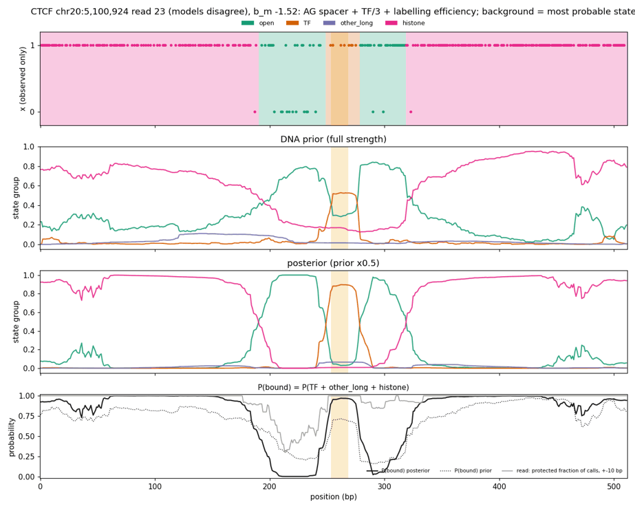
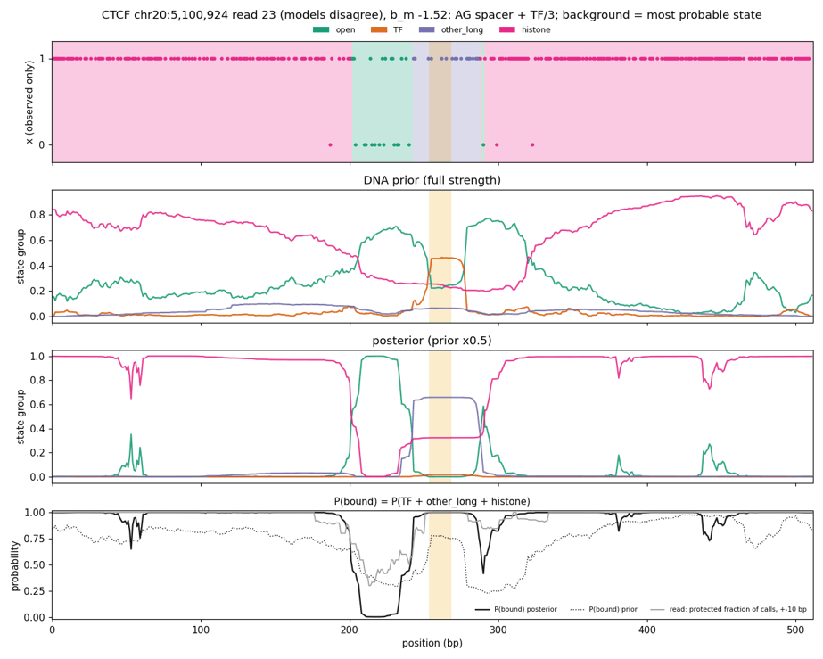
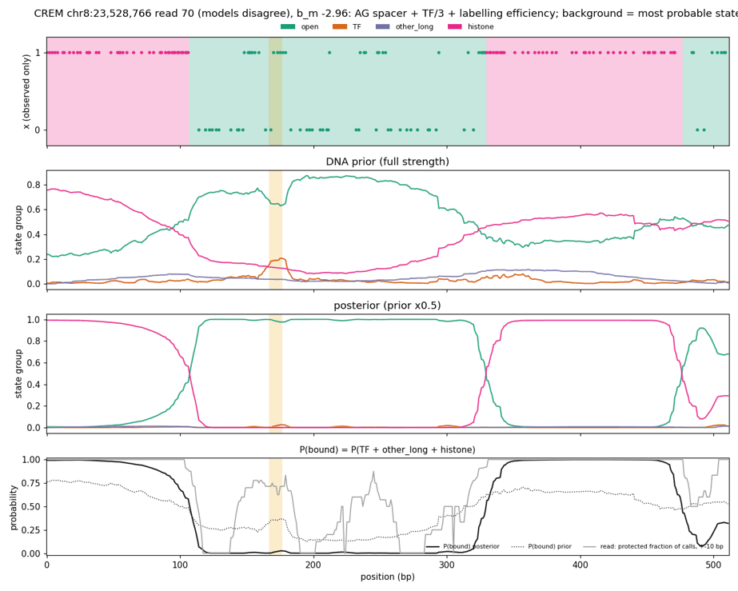
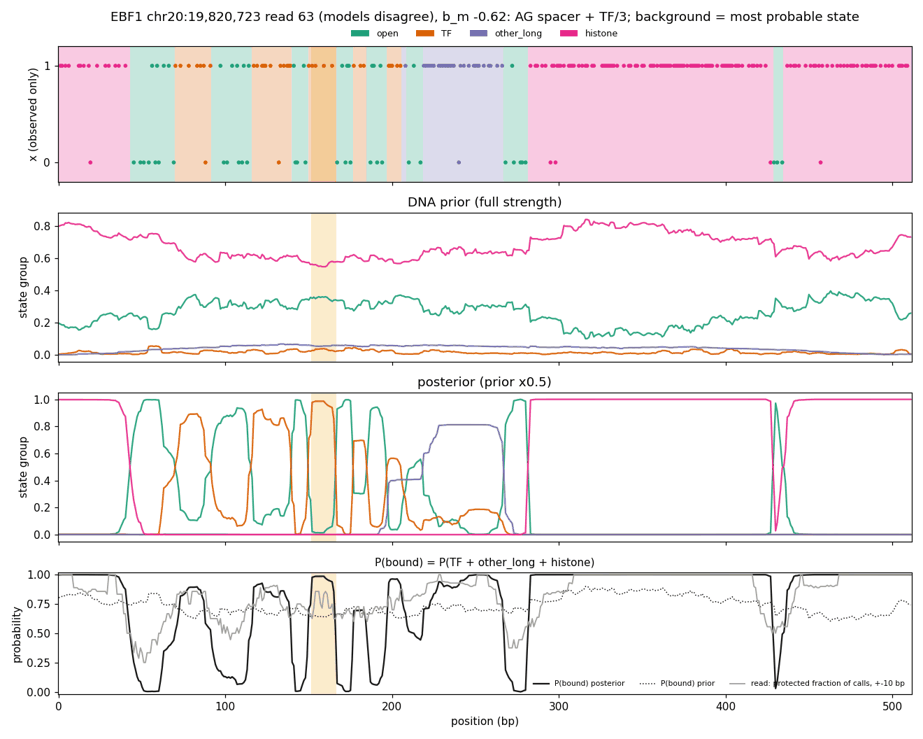
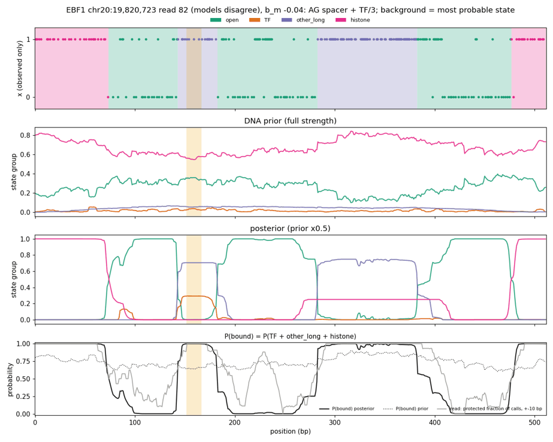
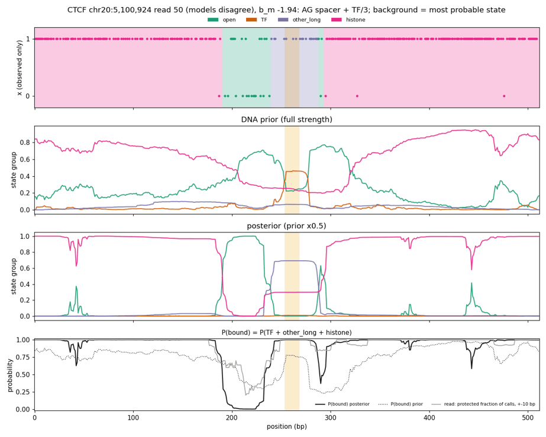

# Summary

**Motivation.** On the val benchmark reads, every model's state use shifted with the
per-molecule labelling efficiency b_m, from the SMFNet 16 kb pilot note. In the spacer + TF/3
model, histone occupancy fell by 0.32 and open rose by 0.22 from the least- to the best-labelled
fifth of molecules. We moved both labelling and the enzyme's sequence-context bias into the
emission form, so the state parameters cannot model them:

P(m6A | state k, position t, molecule m) = (1 − p_k) · σ(β − c_t + b_m) + p_k · ε

| term | meaning | depends on | source |
|---|---|---|---|
| p_k | the state's protected (enzyme-inaccessible) fraction | state (and histone-edge microstate) | learned within bands |
| c_t | ±3 bp context offset | 7-mer at t; shared by states and molecules | learned table |
| b_m | the molecule's labelling efficiency | molecule | data |
| β | efficiency of fully accessible DNA | global | learned |
| ε | false-m6A rate | — | fixed at 0 |

Before this, context offsets were added to every state's logit (histone included), and labelling
was not modelled. The model is spacer + TF/3 with this emission. The open protected fraction now
starts at 0.05 (band 0.01-0.45) instead of 0.3, because the efficiency term takes over incomplete
labelling of open DNA.

**Result (val):** mixed.
- **Within-bound ChIP ranking improves:** mean ρ 0.210 vs 0.203 for spacer + TF/3 and 0.164 for
  phase-type. NRF1 reaches 0.53 and CTCF 0.28, both above phase-type; RFX5 moves from −0.22 to
  −0.08.
- **Bound vs unbound gets worse:** mean raw AUROC 0.753 vs 0.790, protected-read 0.768 vs 0.803.
- **The labelling dependence of state use shrinks but stays:** across b_m quintiles open varies
  by 0.13 (was 0.22) and histone by 0.23 (was 0.32), while other_long barely changes (0.09).

**Per-read posteriors** (with a new P(bound) panel) show where the AUROC loss comes from. On
lightly labelled molecules a missing m6A is now weak evidence for protection.
- **This rescues CTCF footprints** whose open flanks have few m6A. CTCF read 23 (b_m −1.52): motif
  P(TF) 0.89, against 0.02 under spacer + TF/3, which called the region other_long/histone.
- **It explains away short protection inside open DNA as under-labelling.** CREM read 70 (b_m
  −2.96): 200 bp, including the motif, called open with P(bound) ≈ 0 while 20-85% of the calls are
  protected; spacer + TF/3 gave motif P(TF) 0.66.

The benchmark says those lightly labelled CREM protections carry binding signal (next section), so
this is over-correction on the extreme low-labelling tail. The user judged the calls overall to look
reasonable.

# Key Points

- **Benchmark,** val, means over nine TFs ("+" / "−" vs phase-type where noted):

  | model | raw AUROC | accessibility-controlled AUROC | protected-read AUROC | within-bound ρ |
  |---|---|---|---|---|
  | phase-type | 0.809 | 0.683 | 0.826 | 0.164 |
  | spacer + TF/3, prior × 0.5 | 0.790 | 0.678 | 0.803 | 0.203 |
  | + labelling efficiency, prior × 1 | 0.729 | 0.636 | 0.751 | 0.196 |
  | + labelling efficiency, prior × 0.5 | 0.753 | 0.646 | 0.768 | 0.210 |
  | + labelling efficiency, prior alone | 0.728 | 0.650 | 0.729 | 0.184 |

  Per TF, the efficiency model at × 0.5 ties phase-type on CTCF and NRF1 raw AUROC (0.88, 0.88),
  and is below on USF2, CREM, PAX5, SPI1 and YY1. Its within-bound ρ is significantly above
  phase-type on CTCF (0.28) and NRF1 (0.53).
- **The loss is on lightly labelled reads.** AUROC from 3 reads per b_m tertile at the same sites,
  spacer + TF/3 vs efficiency model (both × 0.5); the low tertile is b_m < −0.33:

  | TF | low | mid | high |
  |---|---|---|---|
  | CTCF | 0.78 / 0.79 | 0.78 / 0.78 | 0.72 / 0.73 |
  | NRF1 | 0.82 / 0.80 | 0.80 / 0.79 | 0.75 / 0.73 |
  | CREM | 0.77 / 0.71 | 0.72 / 0.70 | 0.66 / 0.66 |
  | USF2 | 0.71 / 0.67 | 0.66 / 0.65 | 0.64 / 0.64 |
  | SPI1 | 0.66 / 0.62 | 0.63 / 0.60 | 0.58 / 0.58 |

  A model-free footprint score shows the low tertile carries the most binding information:
  footprint share among footprint + open reads at bound CTCF is 0.51 / 0.41 / 0.30, against
  0.07-0.09 at unbound sites. The efficiency model discounts some of it.
- **Footprint-read P(TF) at bound sites rises with b_m** in every model, from low to high
  tertile:
  - phase-type: CTCF 0.65 / 0.79 / 0.83;
  - spacer + TF/3: 0.53 / 0.67 / 0.76.

  The efficiency model raises P(TF) on footprint reads overall (CTCF high tertile 0.85 at × 0.5),
  but the full tertile split for it is in `tables_eff/efficiency_summary.txt`.
- **TF call lengths:** 12% of TF-called bases are in runs of ≥ 35 bp (6% for spacer + TF/3). The
  TF share is 0.008 at × 0.5, and TF use now rises slightly with b_m (0.008 → 0.017).



*CTCF read 23 (b_m −1.52) under the efficiency model: a clean TF call on the motif between open
spacers. P(bound) (black) drops to 0 over bp 205-245 although 30-60% of the read's calls there are
protected (grey).*



*The same read under spacer + TF/3: the motif region is other_long/histone (65/33) and P(bound)
follows the raw protection.*



*CREM read 70 (b_m −2.96): the efficiency model calls 200 bp including the motif open. This is
the over-correction on extremely under-labelled molecules.*

# Details

## Problem reads the user flagged (spacer + TF/3, independent of the efficiency emission)

- **TF chains in a sparse-m6A stretch.** In EBF1 read 63 (b_m −0.62), about 235 bp of mostly
  protected calls with an m6A every 10-20 bp is cut into four TF calls with open spacers, plus
  other_long. The spacer cannot stop this because the scattered m6A provide real open stretches.
  The user reads it as probably a nucleosome; the efficiency model calls it mostly open.
- **other_long vs TF at about 40 bp.** EBF1 read 82: a 35 bp protected stretch over the motif
  goes to other_long (0.7) rather than TF (0.3). The TF cap (40 bp) meets other_long's minimum
  (40 bp) there, so 35-45 bp footprints are a coin flip.
- **Very long histones on lightly labelled molecules.** In CTCF read 50 (b_m −1.94), linkers carry
  so few m6A that consecutive nucleosomes merge into protected runs of hundreds of bp.



*EBF1 read 63: four TF calls with open spacers and other_long inside a 235 bp mostly protected
stretch, probably a nucleosome.*



*EBF1 read 82: other_long takes the 35 bp footprint at the motif, and a 100 bp protected stretch
flanked by open DNA.*



*CTCF read 50 (b_m −1.94): nearly all histone; on lightly labelled molecules nucleosomes merge
into very long protected runs.*

## Proposals from the discussion

1. **Replace other_long with a variable-length tapered nucleosome:** about 100-180 bp, mean 147,
   with 25 bp tapered edges at both ends. A fixed 147 bp histone cannot fit a 100 bp protection
   flanked by m6A without putting accessible DNA on its edges. Removing other_long outright (the
   [phase-type-structure run](fiber-ag-phase-type-structure-run.md)) pushed that protection into
   near-cap TF runs. The end taper must count from the exit, so the chain's middle needs to jump
   into a fixed exit taper (not implemented yet).
2. **Minimum and maximum b_m filters.**
   - The 5th percentile of benchmark b_m is −1.48, and reads 23, 50 and 70 (−1.5 to −3.0) are in
     that tail.
   - The low tertile as a whole is the most informative, so a cut should target only the extreme
     tails.
   - The user suggested locating the cuts with the phase-type HMM: how often it calls over-long
     histones at each b_m. That analysis is running (`read_rate/bm_thresholds.py`, Slurm 52140781).
3. **Other levers (untested):**
   - a learned shrinkage λ on b_m;
   - ε > 0;
   - clamping b_m at about −1.5.

## Plot additions

`smf_hmm.plot.plot_x_with_prior_panel` gains `bound_groups` / `bound_smoothing`. It adds a panel of
P(bound) = P(TF + other_long + histone), posterior solid and prior dotted, against the read's
protected fraction of calls within ±10 bp (grey). The user asked for this to see where P(bound)
departs from the read's labelling-biased calls.

The figures here use the saved group-level posteriors, so the top panel's background is each
position's most probable group, not a MAP path. The change is uncommitted at writing; it adds tests
in `tests/test_plot.py`.

## Command provenance

```bash
S=/scratch/users/diamant; W=$S/fiber_eval_work; EFF=/scratch/groups/btrippe/ndiamant/fiberseq/GM12878/h5_ont_polarity/active_efficiency.h5
sbatch $W/build_efficiency_h5.sbatch                                          # 52112473: molecule_efficiency_h5.py
sbatch --dependency=afterok:52112473 $S/2026-11-12_fiber_single_tf_tapered147_ol001_spacer10_tf0067_efficiency_kl10_context3_alphagenome_bf16/train.sbatch   # 52113216
sbatch --dependency=afterok:52113216 $W/infer_variant_val_extra.sbatch ag_eff <run dir> "--efficiency-path $EFF"   # 52113217
sbatch --dependency=afterok:52113217 $W/analyze_efficiency_model_val.sbatch  # 52113227
python $W/compare_eff_models.py; python $W/per_read_eff.py; python $W/per_read_panels.py   # figures
```

Training overrides added to the spacer + TF/3 recipe:
- `data.efficiency_path=$EFF`;
- `emission.labelling_efficiency=true emission.efficiency_init=0.7 emission.false_m6a_probability=0.0`;
- `emission.open_protected_probability=0.05 'emission.open_band=[0.01,0.45]'`.

Figures were resized and quantized with Pillow.

# Related Notes

- [Spacer + TF/3](fiber-tf-spacer-and-tf-target.md): The base recipe and the comparison model.
- [Read m6A-rate evaluation](fiber-read-m6a-rate-evaluation.md): The state-use dependence on
  labelling that motivated this.
- [16 kb pilot and labelling efficiency (SMFNet)](../../smfnet/2026-11-12/fiberseq-16kb-pilot-labelling-efficiency.md):
  The b_m estimate and the emission design this follows.
- [m6A sequence-context bias](../2026-10-30/fiberseq-m6a-sequence-context-bias.md): The ±3 bp
  context bias now acting only on accessible DNA.

# Open Questions

- **Bias-corrected phase-type:** does the same emission form help or hurt a sequence-free model?
  The run is `2026-11-12_fiber_phase_type_efficiency_context3` (Slurm 52115118); evaluation pending
  (52115120, 52115121).
- **b_m cuts:** where should the minimum and maximum be? Does dropping the extreme low tail recover
  the CREM/USF2 losses?
- **Nucleosome state:** does a variable-length tapered nucleosome without other_long fix the
  EBF1-type reads?

# Sources

- Code, runs and outputs in the frontmatter.
