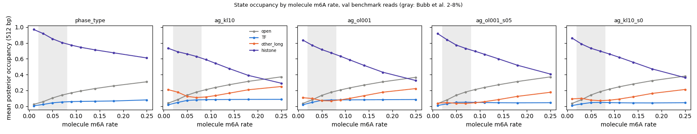
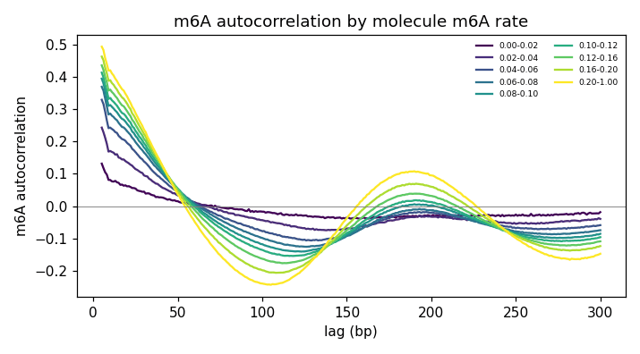
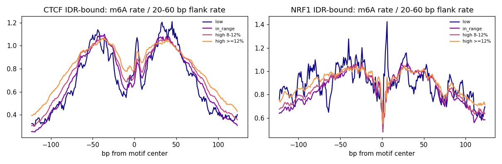

# Summary

The [SMFNet note](../../smfnet/2026-11-12/fiberseq-per-read-m6a-rate.md) found that our Fiber-seq
pipeline applies no per-molecule m6A-rate filter. Bubb et al. 2026 recommend 2-8% for per-fiber
inference. We tested whether this matters for the smf_hmm models and the ChIP benchmark, using the
518k reads in the val benchmark windows (chr8 + chr20), each joined to its whole-molecule m6A rate.

The benchmark reads are more heavily labelled than the genome-wide population (median 10.8% vs
8.7%; they sit in active regions): 3% are below 2%, 25% are at 2-8%, 32% at 8-12% and 41% at
≥ 12%.

**Findings:**

- **Model state usage tracks molecule labeling rate strongly.** The states partly encode "how
  methylated is this molecule", not only chromatin.
  - Phase-type histone occupancy falls from 0.97 (< 2%) to 0.61 (> 20%).
  - AG `other_long` is U-shaped: 0.21 at < 2%, 0.11 at 6-8%, 0.25 at > 20%.
- **Reads at 8-12% are as informative about binding as 2-8% reads; ≥ 12% reads are clearly less
  informative.** At a matched 3 reads per class at the same sites, the bound-vs-unbound AUROC is
  about the same for 2-8% and 8-12% reads, and drops at ≥ 12%:
  - phase-type CTCF 0.77 / 0.77 / 0.73, NRF1 0.80 / 0.79 / 0.73, SPI1 0.68 / 0.68 / 0.63;
  - AG models drop more (SPI1 0.63 / 0.59 / 0.52).
- **Heavily methylated reads show Bubb et al.'s artifact locally.** At bound CTCF, the m6A rate at
  the flanking nucleosome positions (≥ 105 bp from center) relative to the linker (30-50 bp) rises
  from 0.30 (2-8%) to 0.45 (≥ 12%). The CTCF footprint depth falls from 0.28 to 0.15.
- **Reads below 2% carry almost no information**: no nucleosome periodicity, and single-read
  AUROC near 0.5. The models call them histone or `other_long`.
- **A strict 2-8% filter is a poor trade.**
  - Per read, the filtered reads are better: AUROC +0.02 to +0.14 over random subsets of the same
    size, more so for the AG models.
  - But it discards about 75% of benchmark reads. Bound-vs-unbound AUROC is then mixed relative
    to using all reads, and the ChIP ranking within bound sites mostly gets worse (phase-type USF2
    0.29 → −0.03, CTCF 0.25 → 0.20).

**Recommendation** (inferred, untested by retraining):
- Drop or down-weight reads below 2% (3% of reads; cheap).
- Do not apply the 8% ceiling. If anything, flag reads at ≥ 12%.
- Better, give the HMM a per-molecule labeling-efficiency term in the emissions, so the states
  stop absorbing it (idea 4 in the model-improvement list).

# Key Points

- **Rate scale caveat:** our rate is accessible / (accessible + protected) over all assayable
  A/T at ML ≥ 230. Bubb et al.'s denominator and threshold are unconfirmed (SMFNet note), so
  where our "drop-off" sits (~12%) need not contradict their 8%.
- **No confounding by site type:** the rate-class mix of reads is similar at IDR-bound and
  unbound sites (within ~5 points for every TF). The molecule rate correlates with the 512 bp
  window rate at Spearman 0.53.
- **Occupancy by rate** (figure): TF occupancy rises with rate up to about 6-8% and then stays
  flat (AG about 0.08, phase-type 0.05-0.08). Open rises steadily. `other_long` absorbs both
  tails: sparse calls on light reads, and sub-nucleosomal protected stretches on heavy reads.
  Scaling the prior to 0.5 lowers `other_long` at every rate but keeps the shape.
- **Footprint reads at bound sites:** CTCF footprint reads get more P(TF) on heavier reads
  (AG KL10 0.38 at 2-8%, 0.50 at 8-12%, 0.63 at ≥ 12%; phase-type 0.65 / 0.79 / 0.82). The share
  of footprint reads among footprint + open reads at bound CTCF falls with rate (0.51 / 0.42 /
  0.32), while unbound sites stay about 0.07-0.09.



*Every model's state mix shifts strongly with molecule labeling rate; AG `other_long` rises at
both the light and heavy ends, and scaling the prior to 0.5 (ag_ol001_s05) mutes but keeps it.*

# Details

## A. Matched-read-count AUROC (bound vs unbound, IDR labels)

For each TF, we kept only sites with at least k reads in every compared class. We then sampled k
reads per class per site, scored each site by mean motif P(TF) (or a read-only score), and
averaged the AUROC over 20 draws. Every class is scored on the same sites.

| TF (bound/unbound) | score | 2-8% | 8-12% | ≥ 12% |
|---|---|---|---|---|
| CTCF (690/1007) | phase-type | 0.765 | 0.772 | 0.731 |
| | AG ol001 | 0.707 | 0.707 | 0.670 |
| NRF1 (215/1222) | phase-type | 0.797 | 0.786 | 0.727 |
| | AG ol001 | 0.799 | 0.767 | 0.713 |
| USF2 (73/521) | phase-type | 0.681 | 0.697 | 0.608 |
| CREM (76/216) | phase-type | 0.728 | 0.704 | 0.633 |
| SPI1 (437/1055) | phase-type | 0.678 | 0.676 | 0.625 |
| | AG ol001 | 0.629 | 0.592 | 0.525 |
| PAX5 (192/860) | phase-type | 0.661 | 0.653 | 0.592 |
| YY1 (127/269) | phase-type | 0.674 | 0.668 | 0.602 |

These use k = 3. With k = 5 and two classes (2-8% vs ≥ 8%), 2-8% wins for every TF and model
(phase-type CTCF 0.81 vs 0.79, CREM 0.77 vs 0.69). On reads protected at the motif, the
2-8% vs ≥ 8% gap is smaller and reverses for CTCF (phase-type 0.77 vs 0.79). Single reads below
2% give model AUROCs of mostly 0.47-0.61 (NRF1 0.56-0.70), against 0.52-0.74 for in-range reads.

## B. Simulated 2-8% filter

Sites with ≥ 3 in-range reads; site scores from (i) all reads, (ii) in-range reads only, and
(iii) random subsets of all reads of the same per-site size (20 draws).

- **Accessibility-stratified AUROC, in-range minus random:** positive for most TFs. It is largest
  for the TFs that don't footprint and for the AG models: CREM +0.08 to +0.13, PAX5 +0.04 to
  +0.06, SPI1 +0.03 to +0.05, while CTCF is −0.04 to +0.01. So in-range reads are more
  informative per read.
- **Against all reads:** AUROC improves for AG on the weak TFs (AG KL10 raw AUROC PAX5 0.62 →
  0.71, YY1 0.54 → 0.63, SPI1 0.67 → 0.74) but not for phase-type. The within-bound ChIP
  ranking mostly gets worse with only a quarter of the reads (phase-type CTCF 0.25 → 0.20, NRF1
  0.45 → 0.38, USF2 0.29 → −0.03).
- **Reading** (inferred): filtering helps AG mainly by removing the heavy reads, where it calls the
  most `other_long` and gives bound and unbound sites the least different P(TF). That is a model problem a labeling-efficiency
  term should address without discarding data. Full table: `simulated_filter.tsv`.

## C. Nucleosome signal by rate



*The nucleosome-repeat peak (about 190 bp) grows with labeling rate, and the trough moves from
about 130 to about 105 bp. Light reads have no periodic structure.*

- **Caution:** the autocorrelation of a sparsely sampled binary signal grows with sampling
  density, so the higher amplitude on heavy reads is mostly a sampling effect, not stronger
  nucleosome positioning.
- **The trough shift is informative:** the lag at which m6A pairs are least likely shortens from
  about 130 to about 105 bp. That is consistent with heavy labeling methylating nucleosome edges,
  so protected spans look shorter (also seen as about 115 vs 150 bp protected stretches in the
  [other_long note](../2026-11-11/fiber-other-long-footprint-reads-and-linkers.md)).



*Relative to the linker, heavy (≥ 12%) reads are more methylated over the nucleosomes flanking
bound CTCF and have a shallower footprint, matching Bubb et al.'s concern; 8-12% reads are
intermediate.*

| bound sites | class | footprint depth (1 − core/flank) | flanking-nucleosome / linker rate |
|---|---|---|---|
| CTCF | 2-8% | 0.28 | 0.30 |
| CTCF | 8-12% | 0.22 | 0.36 |
| CTCF | ≥ 12% | 0.15 | 0.45 |
| NRF1 | 2-8% | 0.23 | 0.64 |
| NRF1 | 8-12% | 0.24 | 0.67 |
| NRF1 | ≥ 12% | 0.18 | 0.75 |

The profiles are not corrected for sequence-context bias. The comparison across classes is at the
same sites, so the sequence is shared, but the absolute depths are not footprint estimates.

## Command provenance

```bash
W=/scratch/users/diamant/fiber_eval_work/read_rate
sbatch $W/molecule_rates_named.sbatch      # 52041020: molecule_rates_named.py -> $SCRATCH/fiber_read_m6a/named/
sbatch $W/build_and_analyze.sbatch         # 52042241: build_read_tables.py chr8/chr20 -> tables/, then analyze_read_rate.py tables
MPLCONFIGDIR=$W/.mpl /home/groups/btrippe/diamant/miniforge/envs/smf_clean/bin/python $W/replot_occupancy.py $W/tables
```

`replot_occupancy.py` redraws the occupancy figure with one fixed color per state.
`analyze_read_rate.py`'s version colored by column order, which differs between models, so its
single legend was wrong for the AG panels. It also prints the flanking-nucleosome / linker
table. Figures were quantized to 256 colors with Pillow.

- **Rate classes:** use the whole-molecule rate from the calls TSVs, joined through `active.h5`
  `read_id`; all 518,408 reads matched.
- **Read classes:** as in `read_classes.py` (informative A/T only).
- **Posteriors:** the existing val benchmark files, including the prior-scale ablation outputs.

# Related Notes

- [Per-molecule m6A rate (SMFNet)](../../smfnet/2026-11-12/fiberseq-per-read-m6a-rate.md): The
  genome-wide rate distribution and Bubb et al.'s recommendation tested here.
- [other_long footprint reads and linkers](../2026-11-11/fiber-other-long-footprint-reads-and-linkers.md):
  The methylation-dependent protected-stretch lengths, which this note extends to state usage.
- [IDR-labelled benchmark](fiber-idr-chip-benchmark.md): The labels and metrics used here.

# Open Questions

- **Labeling-efficiency term:** does a per-molecule labeling-efficiency term (for example
  emission logit offsets per rate bin, or a per-read latent) remove the rate dependence of
  occupancy and close the AG gap on heavy reads?
- **Training filters:** would training with a < 2% filter, or a [2%, 12%] window, change the
  learned prior? Untested.
- **Rate scale:** does Bubb et al.'s scale match ours?
- **Window vs molecule rate:** the window rate is more local, but it also reflects the locus's
  accessibility.

# Sources

- Bubb KL, Perchlik M, Cuperus J, Queitsch C. "Unpacking Chromatin Accessibility with
  Fiber-seq." bioRxiv 2026, https://www.biorxiv.org/content/10.64898/2026.08.14.744917v1 (via
  the SMFNet note).
- Outputs and scripts in the frontmatter.
