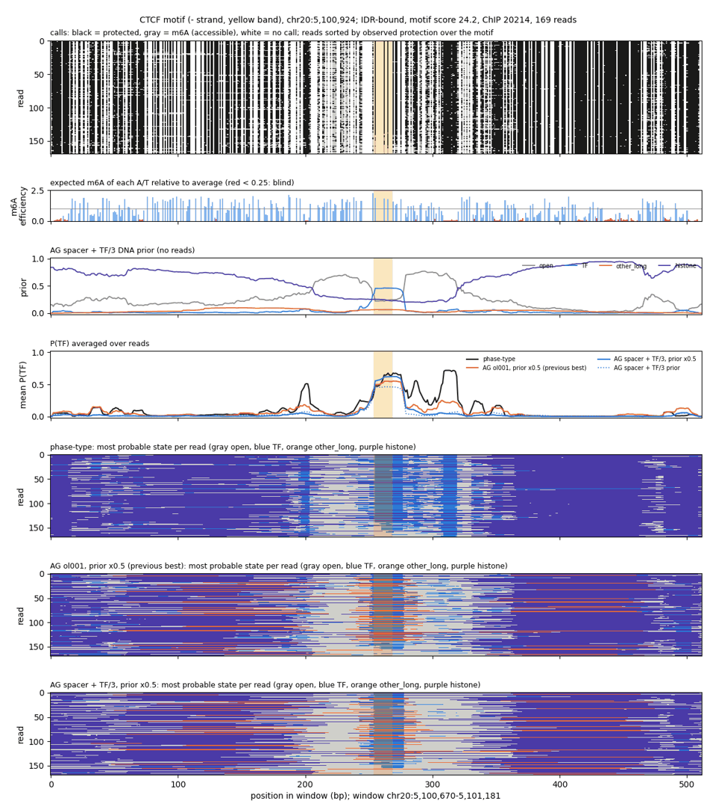
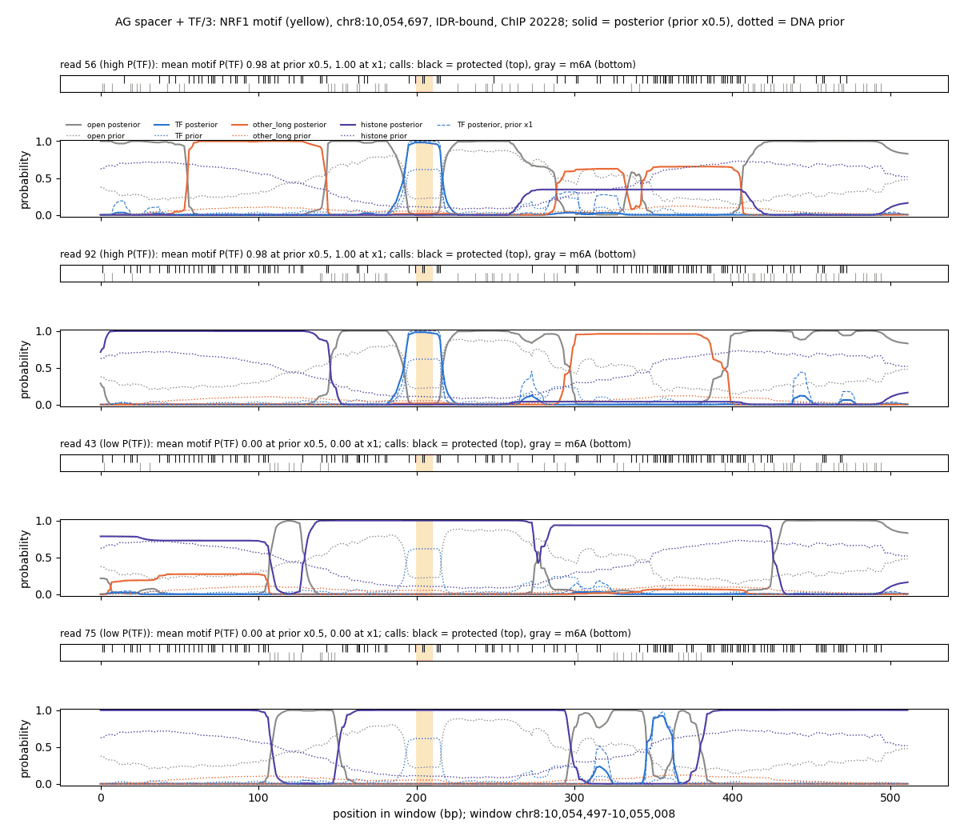
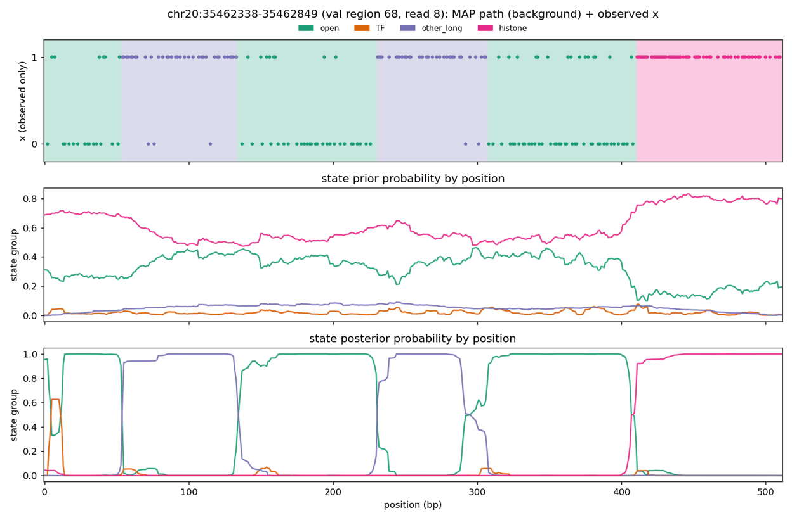

# Summary

The [phase-type-structure run](fiber-ag-phase-type-structure-run.md) showed that a 40 bp TF cap
is not enough with a strong DNA prior: capped TF calls chain through open gaps of a few bp. We
added **enforced open space around TF calls** and, separately, cut the **TF occupancy target 3x**
(0.02 → 0.0067). The 3x cut follows the mESC MAP-target result
([2026-11-04](../2026-11-04/controlled-chip-metrics-and-context-offsets.md)).

**Spacer design (user decisions):**
- A TF call is entered from open only through an entry spacer of L = 10 states, and exits only
  into an exit spacer of L = 10 states.
- The exit spacer leads to TF again (zero-bias probability 0.05) or to open. So every TF call has at
  least 10 bp of open on each side, and two TF calls are at least 10 bp apart.
- Spacer states belong to the open group: they share open's emissions, output group and occupancy
  target, and take the open state's prior potential.

**Result.** Spacer + TF/3 at prior scale 0.5 is the first AG model to tie or beat phase-type on most
TFs that leave footprints.
- **Val:** mean raw AUROC 0.790 vs 0.809 for phase-type; within-bound ρ 0.203 vs 0.164.
- **Train chromosomes,** about 2x tighter CIs:
  - it beats phase-type significantly on accessibility-controlled AUROC for CTCF, NRF1, USF2, CREM
    and EBF1;
  - it beats it on within-bound ChIP ranking for CTCF, NRF1, USF2, EBF1 and PAX5;
  - it ties CTCF and CREM raw AUROC.
- It remains worse on PAX5, SPI1 and YY1, the TFs without footprints.

**Which change mattered.** The spacer did most of the work. The TF/3 cut alone barely changes
posterior TF; on top of the spacer it mainly helps the within-bound ranking. The spacer costs
validation likelihood (final loss 62.6 vs 61.0 for AG ol001), so it is an interpretability
constraint, not a likelihood gain.

# Key Points

- **TF call lengths,** val (TF bases = P(TF) > 0.5; chains = TF runs merged across ≤ 10 bp gaps):

  | model | TF share of bases | runs ≥ 35 bp | chains > 40 bp | chains > 100 bp |
  |---|---|---|---|---|
  | phase-type | 0.050 | 11% | 26% | 2.2% |
  | AG ol001 | 0.062 | 2% | 16% | 0.7% |
  | spacer only | 0.021 | 5% | 6% | 0.1% |
  | TF/3 only | 0.056 | 1% | 14% | 0.5% |
  | spacer + TF/3 | 0.018 | 4% | 8% | 0.3% |
  | spacer + TF/3, prior × 0.5 | 0.010 | 6% | 6% | 0.2% |

- **Benchmark means over the nine TFs** (prior × 0.5 unless noted):

  | metric | split | phase-type | AG ol001 | spacer + TF/3 (× 1) | spacer + TF/3 | its prior alone |
  |---|---|---|---|---|---|---|
  | raw AUROC | val | 0.809 | 0.747 | 0.771 | 0.790 | 0.759 |
  | raw AUROC | train | 0.820 | 0.761 | 0.791 | 0.812 | 0.772 |
  | accessibility-controlled AUROC | val | 0.683 | 0.660 | 0.663 | 0.678 | 0.678 |
  | accessibility-controlled AUROC | train | 0.690 | 0.672 | 0.688 | 0.701 | 0.690 |
  | protected-read AUROC | val | 0.826 | 0.780 | 0.790 | 0.803 | 0.760 |
  | protected-read AUROC | train | 0.839 | 0.796 | 0.810 | 0.823 | 0.773 |
  | within-bound ρ | val | 0.164 | 0.182 | 0.169 | 0.203 | 0.179 |
  | within-bound ρ | train | 0.258 | 0.240 | 0.259 | 0.280 | 0.247 |

  On val, spacer only at prior × 0.5 reaches 0.791 raw, 0.670 accessibility-controlled and 0.181
  within-bound; TF/3 only reaches 0.737 / 0.660 / 0.172.
- **The spacer changed what the prior learns.** The DNA prior alone now matches phase-type on CTCF
  raw AUROC (0.88). It ranks bound CTCF sites significantly better than phase-type (val 0.31,
  train 0.34, against 0.24 and 0.27). Its prior TF mass sits on motif-anchored footprints: about
  0.45 at CTCF and 0.6 at NRF1 from DNA alone.
- **Train vs val gap:** the shift matches the baselines', as in the
  [memorization check](fiber-train-vs-val-chip-benchmark.md). Selecting this model on val among
  several variants did not inflate its margin.



*At chr20:5,100,924 all three models call TF on the CTCF footprint; phase-type adds TF calls on
nearby protected stretches (bp 200, 305-320), which the spacer model calls open or histone.*



*NRF1 chr8:10,054,697: high-TF reads are clean footprints between open spacers. Low-TF reads at
this strongly bound site carry a nucleosome over the motif, even where the prior says open (read
43).*



*Val read 68/8: the 60-75 bp protected stretches that the capped phase-type-structure model split
into chained TF blocks are other_long under spacer + TF/3.*

# Details

## Implementation

`FixedBlockTransitionConfig` takes `spacer_length`, `spaced_blocks` and
`spacer_repeat_probability`.
- **Occupancy:** block occupancies keep their meaning, and spacer time counts as open. In the
  fiber config the spacers take 2.2 of the open group's 28 points.
- **Prior tying:** spacer states get the open state's prior potential through
  `prior_potential_index`, applied in the HMM's prior terms. It is a static tuple, not model state,
  so older checkpoints load unchanged.
- **Tests:** topology, stationary occupancy, gap enforcement on sampled paths under a random prior,
  potential tying and checkpoint round-trip.

## Runs

All three runs use the AG ol001 recipe (other_long 0.01, histone 147 bp tapered, KL 10, ±3 bp
context offsets, AlphaGenome bf16):
- **spacer10:** spacer L = 10, repeat probability 0.05;
- **tf0067:** TF block occupancy and KL target 0.0067, the difference given to open;
- **spacer10_tf0067:** both.

Final validation losses: 62.46 / 61.29 / 62.61, against 61.02 for AG ol001.

```bash
# training (akundaje L40S), then val inference at prior scale 1, 0.5 and prior-only, then analysis
sbatch $S/<run>/train.sbatch
sbatch --dependency=afterok:<train> $W/infer_variant_val.sbatch <name> $S/<run>
sbatch --dependency=afterok:<infer...> $W/analyze_variants_val.sbatch      # 52078580
sbatch $W/train_variants.sbatch                                            # 52106326, train chromosomes
sbatch --dependency=afterok:52106326 $W/analyze_variants_train.sbatch      # 52106327
python $W/compare_three_models.py; python $W/per_read_sptf.py              # figures
```

`S=/scratch/users/diamant` and `W=$S/fiber_eval_work`. Figures were resized and quantized to 256
colours with Pillow.

# Related Notes

- [AG phase-type-structure run](fiber-ag-phase-type-structure-run.md): The TF chaining that
  motivated the spacer.
- [Prior-scale ablation](fiber-prior-scale-ablation.md): Why prior × 0.5 is the reported setting.
- [Controlled ChIP metrics and MAP targets (mESC)](../2026-11-04/controlled-chip-metrics-and-context-offsets.md):
  The 3x TF-target cut that helped the SMF model.
- [Train vs val benchmark](fiber-train-vs-val-chip-benchmark.md): The train chromosomes and the
  memorization check.
- [Labelling-efficiency emissions](fiber-labelling-efficiency-emissions.md): The next model, built
  on this recipe.

# Open Questions

- **Non-footprinting TFs:** do SPI1, YY1 and PAX5 lose only because phase-type calls short TF in
  gaps between m6A in accessible DNA? Re-score phase-type without TF calls on reads with m6A in
  the motif.
- **other_long:** it still competes with TF for 35-45 bp footprints and absorbs 60-100 bp protection
  (see the labelling-efficiency note). Can a variable-length tapered nucleosome replace it?

# Sources

- Code, runs and outputs in the frontmatter.
