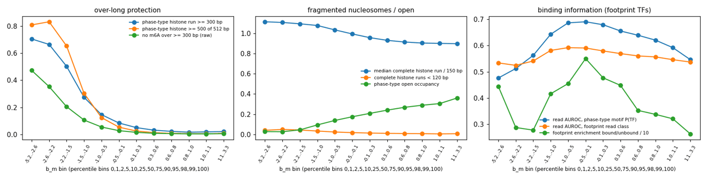

# Summary

**Question** (user, 2026-11-12): do under- or over-labelled molecules need filtering? The user
pointed out that undermethylated molecules are where linkers lack m6A, so nucleosomes merge into
very long histone states. They suggested locating the cuts with the phase-type HMM: how often it
calls over-long histones at each b_m. On the 518k val benchmark reads, binned at percentiles of
b_m, we measured:
- phase-type nucleosome statistics;
- model-free stretches without m6A;
- binding information: read-level AUROC of phase-type motif P(TF), and footprint enrichment at
  bound vs unbound sites, for footprinting TFs.

**Low end:** a clear break.
- Below about b_m −1.5 (the bottom 5%), 65-83% of reads are called histone across ≥ 500 of 512 bp
  (2.5% at the median), and the read AUROC is at chance (0.48-0.56).
- Between −1.5 and −1.0 (5th-10th percentile), reads are still useful (AUROC 0.64), but 30% are
  whole-window histone.

**High end:** no break.
- AUROC declines steadily from 0.69 at the median to 0.62 at the 95-98th percentile, and 0.55-0.59
  in the top 2%.
- Nucleosome calls shorten (median complete histone run 149 → 135 bp) but do not fragment (runs
  < 120 bp stay at about 1%).
- Open occupancy doubles, consistent with heavy labelling methylating nucleosome edges and linkers.

**SMFNet's rule** drops molecules with background-site m6A rate < 2%. On these reads it is a strict
subset of b_m < −1.5:
- it drops 3.4% of reads, against 4.9% for the b_m cut;
- every read it drops, the b_m cut also drops;
- b_m −1.5 corresponds to a background rate of about 2.3%;
- the kept reads score the same (read AUROC 0.671 vs 0.672).

**Decision:** adopt the SMFNet rule as-is, so both projects share one definition, and set no high
cap. The high-b_m reads are under 2% and the efficiency emission is meant to handle them. Not yet
implemented in smf_hmm: a `min_molecule_rate` loader option reading the background rate alongside
b_m.

# Key Points

| b_m bin (percentile) | b_m range | reads ≥ 500/512 bp histone | histone run ≥ 300 bp | median complete histone run | open occupancy | read AUROC | footprint enrichment |
|---|---|---|---|---|---|---|---|
| 0-1 | < −2.56 | 81% | 70% | 167 | 0.03 | 0.48 | 4.4 |
| 1-2 | −2.56 to −2.21 | 83% | 67% | 166 | 0.03 | 0.51 | 2.9 |
| 2-5 | −2.21 to −1.48 | 65% | 50% | 164 | 0.05 | 0.56 | 2.8 |
| 5-10 | −1.48 to −0.96 | 30% | 27% | 162 | 0.10 | 0.64 | 4.2 |
| 10-25 | −0.96 to −0.48 | 12% | 15% | 155 | 0.14 | 0.69 | 4.5 |
| 25-50 | −0.48 to −0.09 | 5% | 8% | 149 | 0.18 | 0.69 | 5.5 |
| 50-75 | −0.09 to 0.26 | 2.5% | 5% | 144 | 0.21 | 0.68 | 4.8 |
| 75-90 | 0.26 to 0.57 | 1.3% | 3% | 140 | 0.24 | 0.66 | 4.5 |
| 90-95 | 0.57 to 0.75 | 0.8% | 2% | 137 | 0.27 | 0.64 | 3.5 |
| 95-98 | 0.75 to 0.97 | 0.6% | 2% | 136 | 0.29 | 0.62 | 3.4 |
| 98-99 | 0.97 to 1.12 | 0.4% | 2% | 135 | 0.31 | 0.59 | 3.2 |
| 99-100 | > 1.12 | 0.8% | 2% | 135 | 0.36 | 0.55 | 2.6 |

| rule | dropped | dropped reads: whole-window histone | dropped: read AUROC | kept: read AUROC |
|---|---|---|---|---|
| SMFNet: background rate < 2% | 3.4% | 78% | 0.52 | 0.671 |
| b_m < −1.5 | 4.9% | 73% | 0.54 | 0.672 |
| b_m < −1.0 | 9.3% | 53% | 0.59 | 0.673 |

On chr8 and chr20 no molecule has zero or fewer than 500 background sites, so SMFNet's
no-site and b_m = 0 clauses do not apply to these reads.



*Over-long protection and loss of binding information concentrate in the bottom ~5% of b_m;
the top end degrades gradually, with shorter nucleosome calls and more open.*

# Details

- **Definitions:**
  - Phase-type histone runs: P(histone) > 0.5.
  - "Complete" runs: runs not touching the window edge.
  - Read AUROC: phase-type motif P(TF) for reads at IDR-bound vs unbound CTCF, NRF1, USF2 and
    CREM sites.
  - Footprint enrichment: the footprint share among footprint + open reads, bound / unbound.
- **A caveat on the high end.** The read AUROC uses phase-type, which models no labelling. With
  the efficiency AG model, the high-b_m tertile was no better than spacer + TF/3 (CREM 0.66 vs
  0.66; [efficiency note](../2026-11-12/fiber-labelling-efficiency-emissions.md)). A high cap
  remains an option if a check shows it helps.

```bash
W=/scratch/users/diamant/fiber_eval_work/read_rate
sbatch $W/bm_thresholds.sbatch       # 52140781 -> bm_thresholds/
sbatch $W/compare_filters.sbatch     # 52207032 (SMFNet rule vs b_m cuts)
```

# Related Notes

- [Read m6A-rate evaluation](../2026-11-12/fiber-read-m6a-rate-evaluation.md): The raw-rate version
  of this question.
- [Labelling-efficiency emissions](../2026-11-12/fiber-labelling-efficiency-emissions.md): The
  over-correction on extreme low-b_m reads that a filter removes.
- [Specificity metrics and debiased kernel](fiber-specificity-metrics-debiased-kernel.md): The
  metrics to judge a filtered retrain with.

# Open Questions

- Does a retrain with the 2% filter recover the efficiency model's CREM/USF2 losses on lightly
  labelled reads?

# Sources

- Scripts and outputs in the frontmatter.
