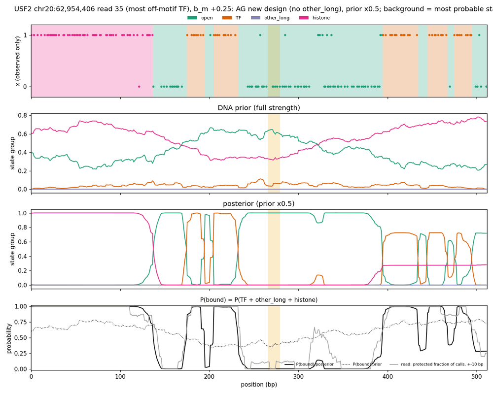
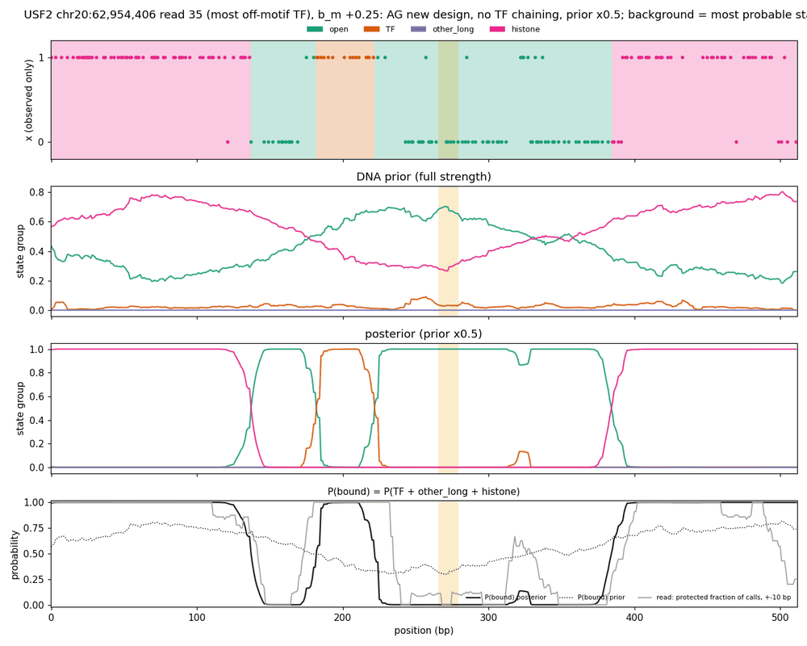
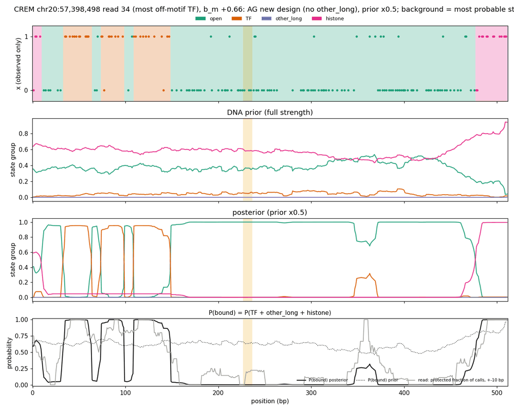
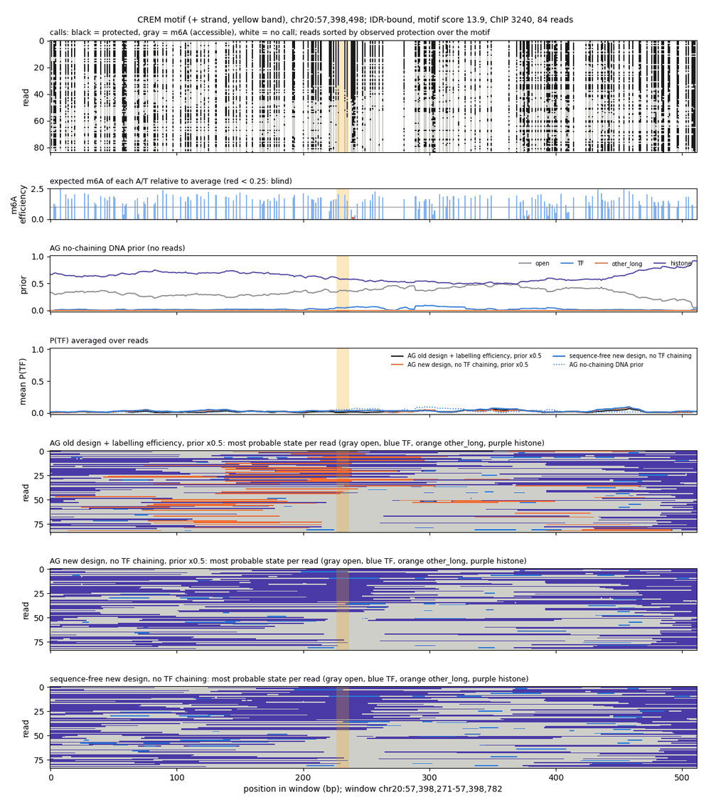

# Summary

**Design under test** (from the [nucleosome lengths note](fiber-nucleosome-lengths-and-edges.md)):
- no other_long;
- 147 bp histone with a 35 bp log-odds taper and an edge floor of 0.2;
- 10 bp TF spacers;
- labelling-efficiency emissions with ε = 0.003;
- the 2% molecule-rate filter.

It was trained with the AlphaGenome prior (`ag_nool`) and with a sequence-free prior: `prior.architecture=constant`, one learned potential per state group. Val chr8/chr20, prior ×0.5 for AG unless noted.

**1. The design regresses on every ChIP metric.**
- Mean IDR AUROC is 0.685 for AG and 0.699–0.704 sequence-free, against 0.753 for the old-design labelling-efficiency model `ag_eff_s05`.
- Off-motif TF bases are about 16–24 per read-kb, against 5.0.
- Posteriors show why: protected stretches of 60–120 bp, which other_long used to take, become chains of 2–4 TFs joined by spacers. Half of all TF bases sit in chains longer than 60 bp, against 2.4% for `ag_eff_s05`.

**2. A stronger prior occupancy KL pins the prior but not the posterior.**
- At KL weight 300 or 3000, prior TF occupancy falls from 3.1% (AG) and 2.2% (sequence-free) to 0.6–0.8%, on the 0.67% target.
- Posterior TF falls only to about 2%, and AUROC gains just +0.01–0.02.
- The TF calls are driven by the reads, not the prior.

**3. Forbidding TF chaining recovers most of the loss** (`spacer_repeat_probability = 0`, KL 10).
- The exit spacer can then only lead to open, so two TFs are at least 21 bp apart.
- Chains longer than 40 bp drop from about 50% to about 1% of TF bases.
- Mean AUROC: 0.725 (AG) and 0.738 (sequence-free).
- Matched AUPRC: 0.486 and 0.482, against 0.494 for `ag_eff_s05`.
- Off-motif TF bases: 8.7 and 9.8 per read-kb.
- In the figures, the former chains become histone or a single TF.

**4. Sequence prior.** In every variant of this design, AG ≈ constant prior.
- AG at ×0.5 is marginally better on AUPRC and off-motif TF.
- The constant prior is marginally better on AUROC.
- Full-strength AG is worse than ×0.5.

Even the best new-design model does not beat the old-design AG models (`ag_eff_s05`; `ag_sptf_s05` has the best AUPRC, 0.513).

# Key Points

Means over 9 TFs (CTCF, NRF1, USF2, CREM, RFX5, EBF1, PAX5, SPI1, YY1), val reads:

| model | prior | mean AUROC | AUROC, accessible reads | ρ within bound | matched AUPRC | on-motif share of TF | off-motif TF / read-kb | TF base share | TF bases in chains > 60 bp |
|---|---|---|---|---|---|---|---|---|---|
| phase-type | — | 0.809 | 0.685 | 0.165 | 0.485 | 0.23 | 38.6 | — | — |
| bias-corrected phase-type | — | 0.734 | 0.636 | 0.162 | 0.469 | 0.26 | 17.3 | 0.024 | 0.33 |
| `ag_sptf_s05` (old design, no efficiency) | AG | 0.790 | 0.678 | 0.204 | 0.513 | 0.33 | 6.4 | — | — |
| `ag_eff_s05` (old design) | AG | 0.753 | 0.644 | 0.210 | 0.494 | 0.38 | 5.0 | 0.008 | 0.024 |
| `ag_nool_s05`, KL 10 | AG | 0.685 | 0.627 | 0.165 | 0.464 | 0.28 | 16.4 | 0.023 | 0.50 |
| `ag_nool` (prior ×1) | AG | 0.633 | 0.590 | 0.146 | 0.441 | 0.26 | 28.8 | — | — |
| `const_nool`, no KL | constant | 0.699 | 0.625 | 0.146 | 0.462 | 0.27 | 23.8 | — | — |
| `const_kl`, KL 10 | constant | 0.704 | 0.631 | 0.153 | 0.467 | 0.27 | 19.7 | 0.027 | 0.45 |
| `ag_kl300_s05` | AG | 0.694 | 0.634 | 0.163 | 0.468 | 0.29 | 12.6 | 0.018 | 0.42 |
| `ag_kl3000_s05` | AG | 0.709 | 0.639 | 0.161 | 0.471 | 0.29 | 11.9 | 0.017 | 0.39 |
| `const_kl300` | constant | 0.715 | 0.640 | 0.168 | 0.475 | 0.29 | 12.1 | 0.017 | 0.37 |
| `const_kl3000` | constant | 0.716 | 0.641 | 0.165 | 0.474 | 0.30 | 11.3 | 0.016 | 0.36 |
| **`ag_nochain_s05`**, KL 10 | AG | 0.725 | 0.647 | 0.190 | **0.486** | **0.33** | **8.7** | 0.013 | 0.002 |
| `ag_nochain` (prior ×1) | AG | 0.715 | 0.639 | 0.163 | 0.475 | 0.31 | 13.3 | — | — |
| **`const_nochain`**, KL 10 | constant | **0.738** | **0.648** | **0.196** | 0.482 | 0.32 | 9.8 | 0.014 | 0.002 |

Prior and posterior group occupancy (mean over val reads):

| model | prior TF | posterior TF | posterior histone |
|---|---|---|---|
| `ag_eff` (old) | 1.8% (+4.4% other_long) | 1.3% (×0.5) | 64% (+7% other_long) |
| `ag_nool` | 3.1% | 2.7% (×0.5) | 71% |
| `ag_kl300` / `ag_kl3000` | 0.8% / 0.7% | — / 2.0% (×0.5) | — / 72% |
| `const_kl` | 2.2% | 3.3% | 71% |
| `const_kl300` / `const_kl3000` | 0.8% / 0.6% | — / 2.0% | — / 72% |
| `ag_nochain` | 2.2% | 1.7% (×0.5) | 73% |
| `const_nochain` | 1.5% | 1.9% | 73% |



*`ag_nool`, USF2 window read 35: the protected stretches at 175-235 bp and 395-490 bp are called as
chains of TFs joined by spacers.*



*`ag_nochain`, same read: the 395-490 bp stretch becomes histone and 175-235 bp a single TF.*



*`ag_nool`, CREM window read 34 (b_m +0.66): an ~115 bp nucleosome-like stretch called as three TFs.*



*CREM site, all reads: old design (other_long, orange), `ag_nochain` and `const_nochain`; without
chaining, the former other_long stretches are histone.*

# Details

## Why the KL could not fix it

The objective adds w · KL(target ‖ batch-averaged prior group occupancy) to the per-read NLL, which
is about 65 nats.
- **Weight 10:** the KL was about 0.01, so the penalty was about 0.1 nats per read. The TF potential's
  likelihood gradient is about 512 × (posterior TF − prior TF) ≈ 5 nats per read. So weight 10 barely
  bound.
- **Weights 300 and 3000** were chosen to bracket the balance point. They did pin the prior TF
  occupancy to target, but the posterior still holds about 2% TF.
- So the reads contain about 1-2% of positions where TF is the best explanation available in this
  state set. They are mostly 60-120 bp stretches that a fixed 147 bp histone cannot cover without
  absorbing m6A at both ends.

## No-chaining topology

`spacer_repeat_probability = 0` removes the exit-spacer → TF edge, which was already supported
(`FixedBlockTransition`; the tests cover q = 0 stationary occupancies). No code change was needed.
- **Before:** a TF → spacer → TF link cost log(1/0.05) ≈ 3 nats.
- **Now:** a second TF needs exit spacer (10) + ≥ 1 open + entry spacer (10), plus the open → entry
  rate (0.0013, about 6.6 nats), with the ≥ 21 bp gap emitted as open.

**What remains:** 43% of TF bases sit in runs ≥ 35 bp (12% for `ag_eff_s05`), so single TF calls still
reach the 40 bp maximum on some short protected stretches.

## Constant prior

`ConstantGroupPrior` gives one learned potential per state group, applied at every position with
global normalization; the initial distribution is the stationary distribution plus the potentials.
- Training takes about 40 min on one GPU, against about 3 h for AG.
- It has no DNA input, so it is a clean "no sequence" control for the same emissions and transitions.

```bash
S=/scratch/users/diamant; W=$S/fiber_eval_work
EFF=/scratch/groups/btrippe/ndiamant/fiberseq/GM12878/h5_ont_polarity/active_efficiency_rates.h5
# training (each run dir has train.sbatch + code_state.patch); e.g.
sbatch $S/2026-11-13_fiber_single_tf_tapered147_edge35_nool_spacer10_nochain_efficiency_eps003_rate002_constant_prior_kl10/train.sbatch
# val inference (prior x1, x0.5, prior-only)
sbatch --dependency=afterok:<train> $W/infer_variant_val_extra_any.sbatch const_nochain <run dir> "--efficiency-path $EFF"
# evaluation of all variants
sbatch $W/analyze_kl_val.sbatch          # 52279621 -> idr_summary_kl2_val.tsv, kernel_ref/specificity_kl2/, tf_run_lengths_kl2_val.txt
# figures
python $W/const_panels.py chr20; python $W/ag_nool_panels.py; python $W/ag_nochain_panels.py
```

Slurm jobs:
- training: AG 52232384, 52257883, 52257917, 52258338; sequence-free 52235320, 52244058, 52257889, 52257933, 52258340;
- evaluation: 52244102 and 52279621.

Figures were resized and quantized with Pillow.

# Related Notes

- [Nucleosome lengths and edges](fiber-nucleosome-lengths-and-edges.md): The analysis behind
  dropping other_long and the 35 bp taper; its open question on linkers and edges is answered in part
  here.
- [Specificity metrics and debiased kernel](fiber-specificity-metrics-debiased-kernel.md): The
  matched AUPRC and off-motif metrics used here.
- [Molecule-efficiency cuts](fiber-molecule-efficiency-cuts.md): The 2% filter used in all runs.
- [TF spacer and TF target](../2026-11-12/fiber-tf-spacer-and-tf-target.md): The original spacer
  design with re-entry probability 0.05, changed here to 0.
- [Labelling-efficiency emissions](../2026-11-12/fiber-labelling-efficiency-emissions.md): The
  old-design `ag_eff` reference model.

# Open Questions

- **Combine the fixes:** does no chaining plus KL 300 close the remaining gap to `ag_eff_s05`?
- **Shorter histone:** would a histone with a 100-147 bp duration range and the same taper, or a
  tight 80-120 bp other_long, take the remaining 35-40 bp TF runs?
- **TF maximum:** should it drop from 40 bp (CTCF footprints are about 35-40 bp, so check per TF)?
- **Sequence prior:** why does it add nothing here? The old-design AG models were better than any
  sequence-free model, but no old-design constant-prior control exists. A constant-prior version of
  `ag_sptf` would separate "sequence helps" from "the old state set helps".
