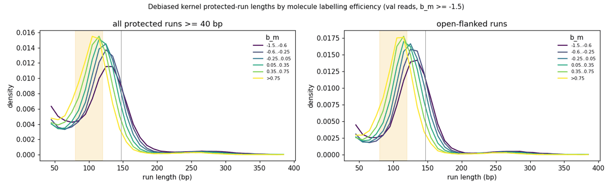
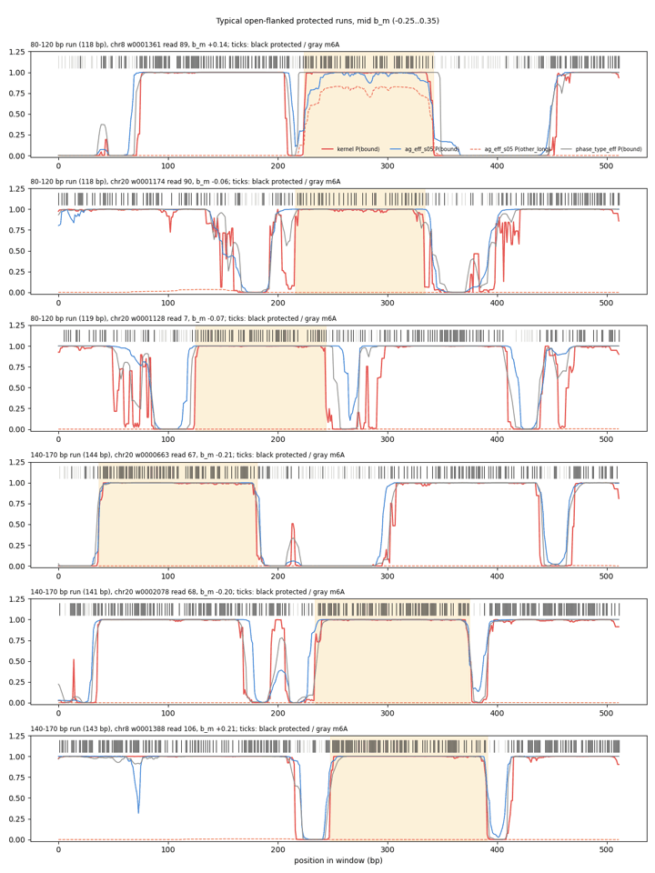
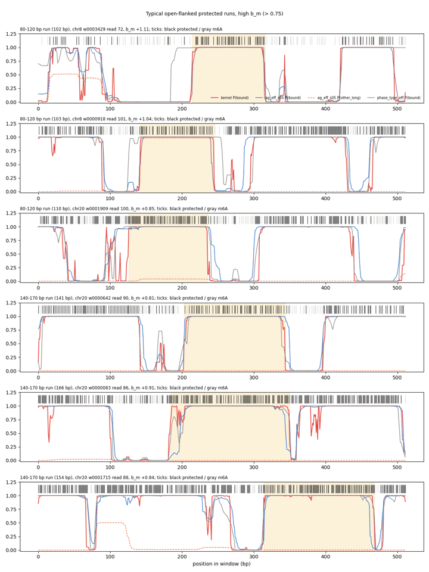
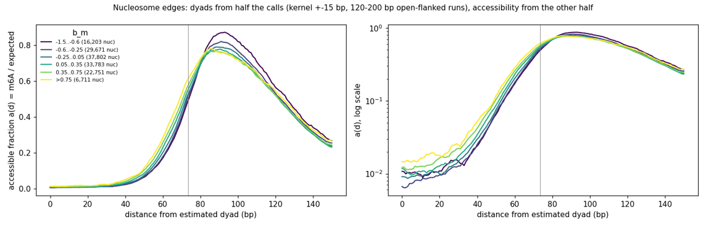

# Summary

**Question** (user): are there real short (about 100 bp) nucleosome-like particles that need a
state of their own, a variable-length nucleosome or a tight 80-100 bp other_long? Or does the
apparent shortening come from labelling, so that a fixed 147 bp nucleosome with softer edges is
enough? Both analyses use the model-free debiased kernel of the
[specificity note](fiber-specificity-metrics-debiased-kernel.md), on val reads with b_m ≥ −1.5
(about the [2% filter](fiber-molecule-efficiency-cuts.md)).

**1. Protected-run lengths** (kernel ±7 bp; runs of P(bound) > 0.5 bounded by P < 0.5, open-flanked
= flanks < 0.2):
- There is one peak per b_m bin, and it slides smoothly from about 135 bp at low labelling to about
  110 bp at high labelling. There is no separate 80-120 bp mode at typical b_m.
- The 80-120 bp share rises from 0.26 to 0.51 with b_m, and the 130-170 bp share falls from 0.39
  to 0.19.
- The kernel trims about 5-7 bp per run end, from nearby m6A within the window (inferred), so peaks
  near 125-135 bp are consistent with 147 bp nucleosomes.

**2. What the models call open-flanked 80-120 bp runs:**
- The AG labelling-efficiency model calls them other_long increasingly with b_m (0.33 → 0.66),
  with histone falling from 0.64 to 0.31.
- The bias-corrected phase-type, which has no other_long, calls them histone (0.97 → 0.79), with
  TF leakage rising to 0.18 at high b_m.

So other_long mostly absorbs nucleosomes that look shorter on well-labelled molecules.

**3. Nucleosome edges** (dyads from half of each read's calls, accessibility from the other half):
- **Shape:** the accessible fraction rises roughly exponentially from about 40 bp to 75 bp from
  the dyad (an e-fold per about 12 bp), so it is straight on a log scale.
- **Edge accessibility:** at the canonical edge (73.5 bp) it is already 0.5-0.6.
- **Labelling:** the edge moves about 7 bp inward per side from low to high b_m.
- **Core** (0-40 bp from the dyad): the accessible fraction is 1.1-2.2% and *rises* with b_m. Core
  m6A therefore scales with efficiency rather than being a constant false-call floor. Raw core
  m6A is about 0.4% on lightly labelled reads, 0.7% at typical labelling and 1.7% on heavily
  labelled ones.

**Decisions and recommendations:**
- **Drop other_long** (user decision).
- **Keep the 147 bp tapered nucleosome** with its log-odds ramp, which matches the exponential
  shape, but widen the taper to about 35 bp and give the edge its own floor of about 0.2.
- **ε:** the user had agreed on ε = 0.015 from the SMFNet calibration. The core data suggest
  ε ≈ 0.003, or ε learned within [0, 0.02], because a constant 0.015 would overpredict core m6A
  about fourfold on lightly labelled reads. SMFNet's 1.8-2.5% "protected" sites likely include
  edges. Pending the user's choice.

# Key Points

- **Protected-run lengths, open-flanked:**

  | b_m bin | runs | mode 100-250 bp | median | share 80-120 | share 130-170 | share ≥ 250 |
  |---|---|---|---|---|---|---|
  | −1.5 to −0.6 | 35.6k | 135 | 128 | 0.26 | 0.39 | 0.035 |
  | −0.6 to −0.25 | 69.9k | 125 | 127 | 0.30 | 0.39 | 0.028 |
  | −0.25 to 0.05 | 99.8k | 125 | 123 | 0.36 | 0.33 | 0.024 |
  | 0.05 to 0.35 | 95.7k | 115 | 118 | 0.43 | 0.27 | 0.018 |
  | 0.35 to 0.75 | 71.4k | 115 | 112 | 0.51 | 0.19 | 0.014 |

  The > 0.75 bin is in the figure but its summary row was not printed; it continues the trend.
- **Model calls,** mean group probability over open-flanked runs:

  | b_m bin | 80-120 bp: AG other_long / histone | 80-120 bp: phase-type histone / TF | 130-170 bp: AG histone |
  |---|---|---|---|
  | −1.5 to −0.6 | 0.33 / 0.64 | 0.97 / 0.02 | 0.97 |
  | −0.25 to 0.05 | 0.41 / 0.56 | 0.95 / 0.04 | 0.97 |
  | 0.35 to 0.75 | 0.56 / 0.41 | 0.88 / 0.10 | 0.98 |
  | > 0.75 | 0.66 / 0.31 | 0.79 / 0.18 | 0.98 |

- **Edge profile:**

  | b_m bin | nucleosomes | median run | core a, 0-40 bp | a at 60 | a at 70 | a at 80 | half-rise from dyad |
  |---|---|---|---|---|---|---|---|
  | −1.5 to −0.6 | 16,203 | 138 | 0.013 | 0.17 | 0.39 | 0.70 | 63 bp |
  | −0.6 to −0.25 | 29,671 | 136 | 0.011 | 0.18 | 0.40 | 0.69 | 61 bp |
  | −0.25 to 0.05 | 37,802 | 135 | 0.013 | 0.20 | 0.43 | 0.69 | 60 bp |
  | 0.05 to 0.35 | 33,783 | 134 | 0.015 | 0.23 | 0.46 | 0.70 | 58 bp |
  | 0.35 to 0.75 | 22,751 | 132 | 0.018 | 0.26 | 0.49 | 0.71 | 57 bp |
  | > 0.75 | 6,711 | 131 | 0.022 | 0.29 | 0.53 | 0.73 | 56 bp |



*One peak per b_m bin, sliding from about 135 to about 110 bp as labelling rises; no separate
80-120 bp mode at typical b_m.*



*Mid b_m (−0.25 to 0.35): 80-120 bp open-flanked runs (top three) look like ordinary nucleosomes
with somewhat methylated edges; the AG model gives one of them other_long 0.8. The 140-170 bp runs
(bottom three) are histone in both models.*



*High b_m (> 0.75): the same pattern with more edge m6A.*



*Accessible fraction by distance from the estimated dyad (linear, left; log, right). It rises
roughly exponentially from about 40 to 75 bp and is about 0.5 at the canonical edge (grey line);
heavier labelling moves the edge about 7 bp inward and raises core accessibility.*

# Details

## Current tapered-edge parametrization (OrderedGroupSMFEmissions)

- **Ramp:** histone microstates get a weight w = min(distance from the nearer end / edge_width, 1),
  with edge_width = 25 in the fiber runs. logit p = w · logit p_core + (1 − w) · logit p_edge, a
  linear ramp in log-odds.
- **Edge value:** p_edge is one learned value per tapered group, mapped into [closed_band[0] = 0.45,
  p_core].
- **Labelling:** with efficiency, the m6A rate is (1 − p) · e.
- **Learned values,** AG efficiency model: p_core ≈ 0.977 and p_edge ≈ 0.61 (σ(raw) = 0.16). The floor
  is not yet binding; with other_long removed it probably would be.
- **Log-odds vs linear:** near the core, logit p ≈ −log(1 − p), so a log-odds ramp is close to
  exponential decay of accessibility. That matches the measured shape and site-exposure
  measurements (Polach and Widom). A ramp linear in probability would leave too much accessibility
  deep inside.

## Method notes

- **Kernel:** per-call LLR protected vs accessible, using the train-chromosome context table, β
  (efficiency 0.53), ε = 0.02 and b_m. See the specificity note.
- **Edges, avoiding circularity.** Run boundaries are set by the same m6A they would be used to
  profile. So each read's informative calls were split at random:
  - **set A** found nucleosomes: kernel ±15 bp, 120-200 bp runs, 15 bp flanks < 0.2, dyad = run
    midpoint;
  - **set B** measured a(d) = Σ m6A / Σ e at |d| ≤ 150 bp.

  Dyad errors blur the profile, so true edges are somewhat sharper than measured.

```bash
K=/scratch/users/diamant/fiber_eval_work/kernel_ref
sbatch $K/run_lengths.sbatch   # 52224594 -> run_lengths/
sbatch $K/nuc_edges.sbatch     # 52228513 -> nucleosome_edges/
```

Figures were resized and quantized with Pillow.

# Related Notes

- [Specificity metrics and debiased kernel](fiber-specificity-metrics-debiased-kernel.md): The
  kernel used here.
- [Molecule-efficiency cuts](fiber-molecule-efficiency-cuts.md): Why reads below b_m −1.5 are
  excluded.
- [Labelling-efficiency emissions](../2026-11-12/fiber-labelling-efficiency-emissions.md): The AG
  model whose other_long use is examined.
- [other_long footprint reads and linkers](../2026-11-11/fiber-other-long-footprint-reads-and-linkers.md):
  The earlier raw-rate version of the length shift.
- [16 kb spec run, emission head (SMFNet)](../../smfnet/2026-11-13/fiberseq-16kb-spec-run-emission-head.md):
  The protected-site calibration (1.8-2.5%) that suggested ε = 0.015.

# Open Questions

- **ε:** fixed at 0.003, or learned within [0, 0.02]? (User to decide.)
- **Linkers:** does a 35 bp taper with a 0.2 edge floor swallow linkers between neighbouring
  nucleosomes? Check open occupancy and kernel agreement in linkers after training.
- **Edge shape:** if the edge saturates at the new floor, add a learned ramp exponent (w^γ).

# Sources

- Scripts and outputs in the frontmatter.
- Polach KJ, Widom J. "Mechanism of protein access to specific DNA sequences in chromatin: a
  dynamic equilibrium model for gene regulation." J Mol Biol 1995. (Site-exposure decay with depth
  into the nucleosome; cited from memory, not re-checked here.)
