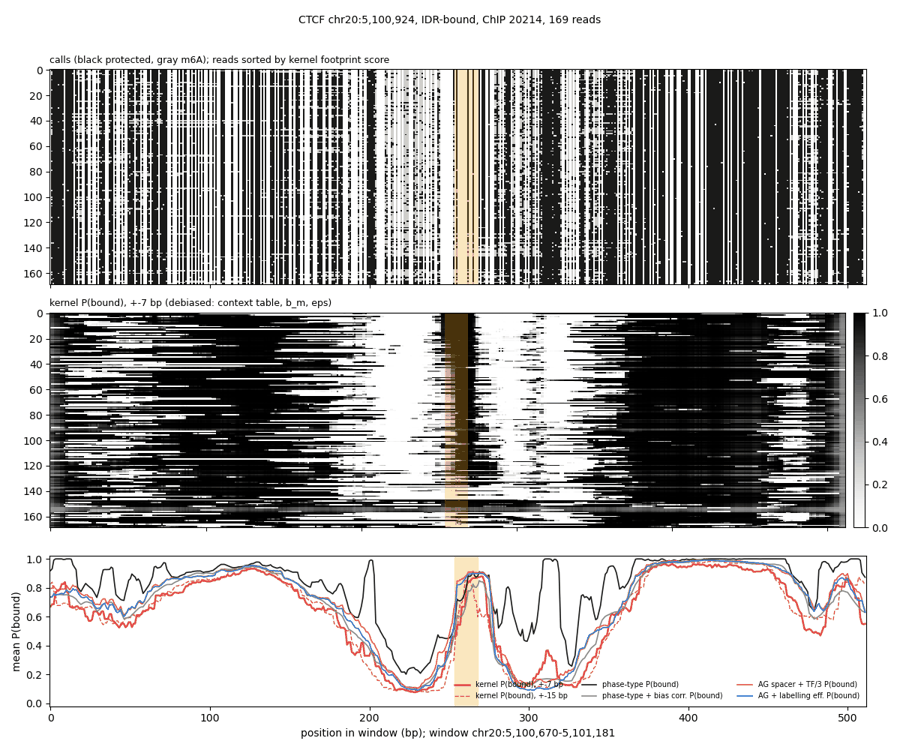
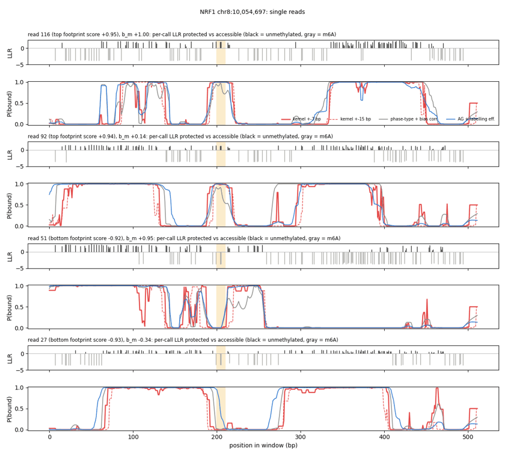
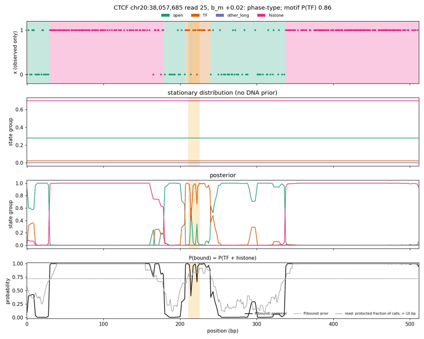
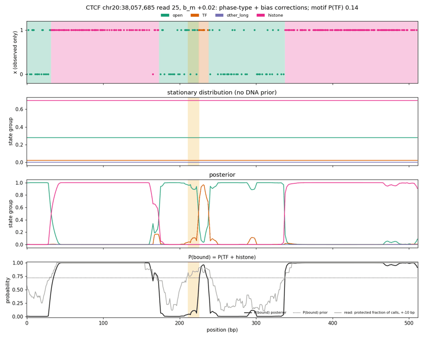

# Summary

**Bias-corrected phase-type baseline.** This is the fixed phase-type HMM with the
labelling-efficiency emissions of the [efficiency note](../2026-11-12/fiber-labelling-efficiency-emissions.md).
It has no DNA prior. Only its ±3 bp context table and efficiency logit are learned, on CPU, with
`prior.architecture=fixed`. On the old ChIP metrics it is clearly worse than plain phase-type:
- raw AUROC: val 0.736 vs 0.809, train 0.752 vs 0.820;
- within-bound ρ: val 0.162 vs 0.164, train 0.232 vs 0.258.

**Why** (measured): plain phase-type's open state emits m6A with probability 0.95 per call. Under
it, six unmethylated calls in a row as open DNA have likelihood 1.6 × 10⁻⁸, so any short
protection is forced into TF. That catches real footprints, and also the gaps between m6A in
accessible DNA. The corrected model learned an efficiency of 0.57, so the same six calls have
likelihood 0.009 at typical labelling (0.23 at b_m −1.5). That is comparable to TF's entry cost,
and with no DNA prior, open often wins.

The user judged the corrected model the better state caller from the per-read plots, and asked
whether the metrics were rewarding the wrong thing.

**New metrics,** val, five models:
- **AUPRC, strong bound vs accessibility-matched unbound motifs.** Plain phase-type's lead
  disappears. On footprinting TFs the AG models lead (CTCF: the labelling-efficiency AG model
  0.835, phase-type 0.779). The bias-corrected phase-type beats plain on CTCF, NRF1 and USF2. On TFs
  without footprints every model is near prevalence and motif score alone wins.
- **Off-motif TF calls,** TF-called bases more than 5 bp from any of 100 motifs:

  | model | per read-kb |
  |---|---|
  | plain phase-type | 38.6 |
  | AG ol001 | 25.6 |
  | bias-corrected phase-type | 17.3 |
  | spacer + TF/3 | 6.4 |
  | + labelling efficiency | 5.0 |

  The on-motif enrichment runs 1.13 → 1.84 in the same order. Plain phase-type is the least
  specific caller by a wide margin.
- **A model-free debiased kernel reference.** Per-call log-likelihood ratios, protected vs
  accessible, use a context table, efficiency and ε fit on train chromosomes only. Summed over
  ±7 bp they give a kernel P(bound).
  - Its read-averaged profile tracks both bias-corrected models closely, while plain phase-type
    runs above all of them in open DNA.
  - Its confident-footprint reads separate strong-bound from matched unbound sites in the
    footprint screen's order: CTCF 37×, NRF1 13×, CREM 7×, RFX5 6×, USF2 4×, SPI1 2.5×, and EBF1,
    PAX5 and YY1 at about 1×.

**Conclusion** (inferred): the old bound-vs-unbound AUROCs on mean P(TF) mostly measure how readily
a model turns protection near motifs into TF. They reward over-calling. For model selection,
report accessibility-matched AUPRC, off-motif TF calls and the within-bound ranking alongside them.

# Key Points

- **Old metrics, val / train means over nine TFs:**

  | | plain phase-type | bias-corrected | AG spacer + TF/3, prior × 0.5 |
  |---|---|---|---|
  | raw AUROC | 0.809 / 0.820 | 0.736 / 0.752 | 0.790 / 0.812 |
  | accessibility-controlled AUROC | 0.683 / 0.690 | 0.637 / 0.643 | 0.678 / 0.701 |
  | protected-read AUROC | 0.826 / 0.839 | 0.757 / 0.779 | 0.803 / 0.823 |
  | within-bound ρ | 0.164 / 0.258 | 0.162 / 0.232 | 0.203 / 0.280 |

  The largest losses are USF2 (0.85 → 0.73 val raw), CREM (0.84 → 0.70) and SPI1 (0.82 → 0.68);
  CTCF and NRF1 lose 0.01-0.02. The corrected model calls TF on 2.4% of bases (plain 5.0%), but
  with no TF cap 35% of those bases are in runs ≥ 35 bp.
- **Open-state calibration,** corrected model (efficiency 0.57, open protected fraction 0.05):

  | b_m | P(m6A per call \| open) | P(6 unmethylated calls \| open) |
  |---|---|---|
  | +1.0 | 0.74 | < 0.001 |
  | 0 | 0.54 | 0.009 |
  | −1.0 | 0.31 | 0.11 |
  | −1.5 | 0.22 | 0.23 |
  | plain phase-type (fixed) | 0.95 | 1.6 × 10⁻⁸ |

  The fixed TF occupancy of 0.02 was implicitly tuned against the 0.95 emission, so a corrected
  baseline with the old occupancies misses some footprints. Proposed (not run): learn the TF
  occupancy and emission bands along with the bias terms.
- **AUPRC,** strong bound (ChIP ≥ median of bound) vs accessibility-matched unbound, 3:1, 100
  resamples, val. Prevalence is 0.25-0.36.

  | TF | plain PT | corrected PT | AG ol001 | AG spacer + TF/3 | AG + efficiency | motif score | kernel |
  |---|---|---|---|---|---|---|---|
  | CTCF | 0.779 | 0.797 | 0.766 | 0.810 | **0.835** | 0.726 | 0.791 |
  | NRF1 | 0.716 | 0.743 | 0.731 | **0.753** | 0.752 | 0.662 | 0.649 |
  | USF2 | 0.520 | 0.557 | 0.633 | **0.656** | 0.604 | 0.570 | 0.555 |
  | CREM | 0.556 | 0.537 | 0.627 | 0.620 | 0.568 | **0.752** | 0.675 |
  | RFX5 | 0.410 | 0.370 | 0.446 | 0.441 | 0.428 | **0.539** | 0.385 |
  | EBF1 | 0.330 | 0.348 | 0.352 | 0.371 | 0.355 | **0.429** | 0.356 |
  | PAX5 | 0.307 | 0.292 | 0.342 | 0.302 | 0.284 | **0.449** | 0.275 |
  | SPI1 | 0.403 | 0.280 | 0.374 | 0.367 | 0.329 | **0.647** | 0.342 |
  | YY1 | 0.345 | 0.298 | 0.303 | 0.297 | 0.288 | **0.754** | 0.361 |

- **Off-motif TF calls,** val, all reads; the motif mask covers 20.7% of window bases:

  | model | on-motif share of TF bases | enrichment | off-motif TF bases per read-kb | off-motif TF mass per read-kb |
  |---|---|---|---|---|
  | plain phase-type | 0.234 | 1.13 | 38.6 | 44.7 |
  | bias-corrected phase-type | 0.264 | 1.28 | 17.3 | 25.4 |
  | AG ol001, × 0.5 | 0.237 | 1.15 | 25.6 | 34.9 |
  | AG spacer + TF/3, × 0.5 | 0.333 | 1.61 | 6.4 | 10.2 |
  | AG + labelling efficiency, × 0.5 | 0.380 | 1.84 | 5.0 | 8.6 |

  Some off-motif TF calls are real binding by TFs outside the set, so this is a comparison between
  models, not an error rate.



*CTCF chr20:5,100,924: the read-averaged kernel P(bound) (red) matches the bias-corrected models
(grey, blue) at the footprint, the depleted regions and the flanking nucleosomes. Plain phase-type
(black) runs well above them in open DNA.*



*NRF1 chr8:10,054,697: the top-scoring reads are clean footprints that both corrected models
call. Bottom-scoring reads have m6A in the motif. The kernel (no duration constraints) shows short
spurious bumps where a few unmethylated calls line up.*




*CTCF chr20:38,057,685, read 25 (b_m +0.02): six unmethylated calls flanked by m6A over the motif.
Plain phase-type calls TF (0.86); the corrected model calls the motif open and starts TF 10 bp
later, a footprint the corrected baseline misses.*

# Details

## Kernel reference

- **Fit** (train-benchmark windows chr2, 11, 12, 17, 19, 202M calls):
  - Model: logit P(m6A) = f[±3 bp context] + a[neighbourhood accessibility bin × b_m bin].
  - Neighbourhood accessibility is the m6A fraction of all other calls within ±25 bp across the
    window's reads.
  - A first version used the site's own pileup, which absorbed the context bias (f range ±0.1). It
    was replaced.
- **Fitted values:**
  - f: AAAAAAA −5.1, GC-flanked contexts about +1. f correlates at 0.98 with the val-chromosome
    footprint-screen table, at matched read openness.
  - β: efficiency of accessible DNA 0.53, against 0.57 for the corrected phase-type and 0.50 for the
    AG efficiency model.
  - ε: fitted at 0.058 at the 5% least accessible neighbourhoods. That is an upper bound, since
    those neighbourhoods still contain linkers.
- **ε choice.** SMFNet's calibration of protected DNA measures about 0.02, so the metrics were
  rerun with ε = 0.02. Results barely changed:
  - CTCF confident-footprint ratio 31 → 37;
  - kernel AUPRCs within 0.05.

  The ε = 0.02 numbers are quoted above.
- **Per-call LLR:** m6A gives log ε − log e; unmethylated gives log(1 − ε) − log(1 − e), with
  e = σ(β + f + b_m).
- **Kernel P(bound) and read classes:**
  - P(bound at t) = σ(Σ LLR over ±7 bp), under a 50:50 prior.
  - Positions with no informative call within ±7 bp are missing (they would sit at 0.5).
  - Confident footprint: motif P(bound) > 0.8 and both 10-30 bp flanks < 0.2. Confident open: motif
    P(bound) < 0.2.
- **Kernel read check,** share of confident footprints among confident reads (ε = 0.02):

  | TF | CTCF | NRF1 | CREM | RFX5 | USF2 | SPI1 | YY1 | EBF1 | PAX5 |
  |---|---|---|---|---|---|---|---|---|---|
  | strong bound | 0.227 | 0.160 | 0.051 | 0.060 | 0.052 | 0.011 | 0.023 | 0.027 | 0.006 |
  | matched unbound | 0.006 | 0.013 | 0.007 | 0.010 | 0.013 | 0.004 | 0.029 | 0.031 | 0.012 |
  | ratio | 37 | 13 | 7.0 | 5.9 | 3.8 | 2.5 | 0.8 | 0.9 | 0.5 |

- **Limits:**
  - It is overconfident on single reads, because it assumes one state per ±7 bp.
  - It says "protected", not "TF"; only the flank contrast tells them apart.
  - It shares the emission form with the corrected models, so agreement shows consistency, not
    truth.

## Command provenance

```bash
S=/scratch/users/diamant; W=$S/fiber_eval_work; K=$W/kernel_ref
sbatch $S/2026-11-12_fiber_phase_type_efficiency_context3/train.sbatch      # 52115118 (CPU; later moved to hns,akundaje,stat)
sbatch --dependency=afterok:52115118 $W/infer_pt_eff.sbatch                 # 52115120, val + train windows
sbatch --dependency=afterok:52115120 $W/analyze_pt_eff.sbatch               # 52115121
python $W/compare_pt_debias.py                                              # phase-type with / without corrections
sbatch $K/fit.sbatch                                                        # 52212192 -> reference_bias.npz
sbatch $K/specificity.sbatch                                                # 52213255 (eps 0.058)
sbatch $K/specificity_eps002.sbatch                                         # 52215202 (KERNEL_EPS=0.02; also plot_kernel_sites.py)
```

Motif mask: 91 footprint-screen PWMs (`tf_screen/motifs.json`) plus the nine benchmark PWMs, at
FPR 1e-5 on both strands, ±5 bp. FPR 1e-4 with ±10 bp covered 53% of bases and was dropped.
Figures were resized and quantized with Pillow.

# Related Notes

- [Labelling-efficiency emissions](../2026-11-12/fiber-labelling-efficiency-emissions.md): The
  emission form; the AG efficiency model.
- [Spacer + TF/3](../2026-11-12/fiber-tf-spacer-and-tf-target.md): The AG comparison model.
- [IDR-labelled benchmark](../2026-11-12/fiber-idr-chip-benchmark.md): The metrics questioned here.
- [16 kb spec run, emission head (SMFNet)](../../smfnet/2026-11-13/fiberseq-16kb-spec-run-emission-head.md):
  The protected-DNA calibration (about 2%) behind ε = 0.02, and a saturation failure the HMM
  avoids: its accessible fractions are shared per state, not free per site.
- [Molecule-efficiency cuts](fiber-molecule-efficiency-cuts.md): The b_m filter chosen alongside.

# Open Questions

- **Fair baseline:** does a corrected phase-type with learned TF occupancy and emission bands
  recover the missed footprints without bringing back gap calls?
- **ε in the HMM:** does a nonzero ε (about 0.015, fixed or learned) stop lightly labelled reads
  flipping to open, since protected-DNA m6A is mostly a constant floor? See the SMFNet note.
- **Per-read calibration:** predicted vs observed m6A at confidently called histone positions, by
  b_m quintile, as in the SMFNet note.
- **Train chromosomes:** the specificity metrics have not been run there yet.

# Sources

- Runs, code and outputs in the frontmatter.
