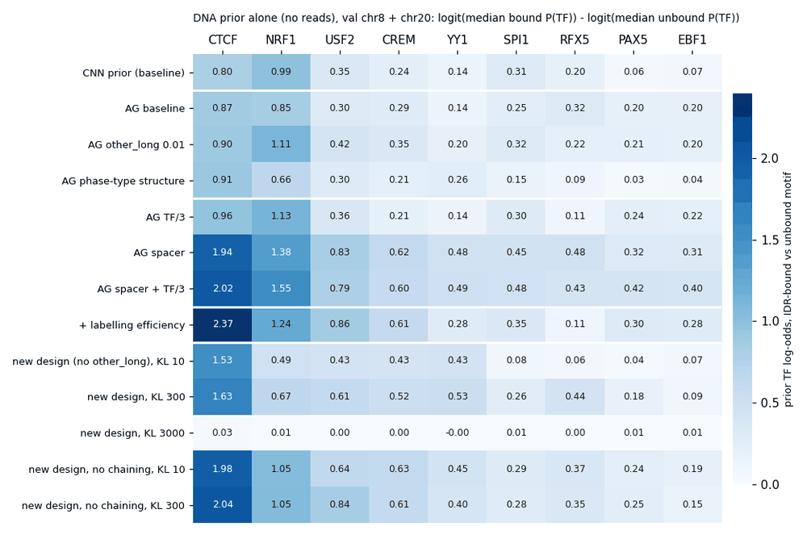
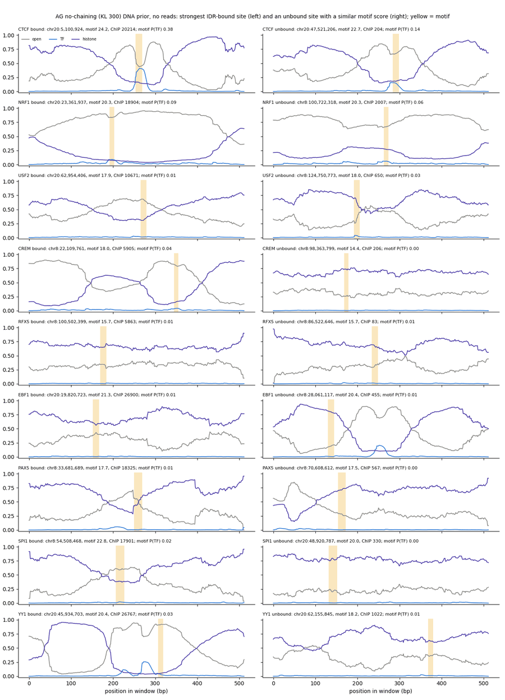

# Summary

**New standing metric** (user decision): for every sequence-conditioned model, report the prior TF
log-odds per benchmark TF next to the posterior ChIP benchmark.
- **Inputs:** the prior's mean P(TF) over each motif, from prior-only marginals with no reads.
- **Definition:** log-odds = logit(median at IDR-bound motifs) − logit(median at unbound motifs).
  This is the shift the prior adds to a posterior's log-odds of TF.
- **Where it lives:** smf_hmm `evaluation/tf_chip/prior_tf_log_odds.py`, also recorded in smf_hmm
  `AGENTS.md`.
- **No post hoc prior adjustments** (e.g. a higher prior scale for TF): fixes must come from training
  or design.

**Why it matters:** the posterior benchmark is dominated by the reads and hid large changes in the prior.
- **KL 3000** with TF chaining collapsed the prior to log-odds ≈ 0 for every TF. Its posterior still
  scored AUROC 0.709.
- **AG ≈ constant prior** in the new design (see the
  [chaining note](../2026-11-13/fiber-no-other-long-tf-chaining.md)). This is partly because the
  prior's TF signal shrank.

**Refined design takeaways:**

1. **Several design changes degraded the prior's TF signal; the KL strength matters only at the
   extreme.** Across the AG lineage:
   - **TF spacers made the prior sharp:** CTCF 0.87 → 1.94, NRF1 0.85 → 1.38, USF2 0.30 → 0.83,
     CREM 0.29 → 0.62. TF/3 alone does not. Spacer + TF/3 (`ag_sptf`) is the best prior overall.
   - **Labelling-efficiency emissions** cost RFX5 (0.43 → 0.11), YY1 (0.49 → 0.28) and NRF1
     (1.55 → 1.24), while CTCF rose (2.02 → 2.37).
   - **Dropping other_long with TF chaining allowed** cost a lot: NRF1 0.49, and SPI1, RFX5, PAX5 and
     EBF1 all ≤ 0.08.
   - **KL 3000** (with chaining) erased the prior's TF signal entirely.
   - **No chaining** recovers most of the loss, and KL 10 vs KL 300 hardly differ. NRF1 (1.05 vs
     1.55), SPI1, PAX5 and EBF1 (each 0.15-0.25 lower) stay below `ag_sptf`.
   - **Next:** find which of the remaining changes costs NRF1 and the weaker TFs: labelling
     efficiency, and the new emission and filter settings (35 bp taper with its 0.2 floor, ε = 0.003,
     2% filter).
2. **No chaining should be the default** (`spacer_repeat_probability = 0`). It removes the TF-chain
   errors (TF bases in chains > 60 bp: 50% → 0.2%). It roughly halves off-motif TF calls and improves
   posterior AUROC by about +0.04. It also restores most of the prior's TF log-odds, so it helps
   both prior and posterior.
3. **Bring back other_long, regularized to be rare.** With no chaining, the remaining errors are single
   30-40 bp TF calls on short protected stretches (about 45% of TF bases in runs ≥ 35 bp vs 12% in the
   old design). These are mostly nucleosomes that look shorter on well-labelled reads, which the 147 bp
   tapered histone cannot fit. A rare other_long between the TF maximum and the histone length should
   take them. Proposed: about 45-130 bp, occupancy target about 2%, no chaining. Train the
   sequence-free model first, then AG, and judge both the posterior benchmark and the prior log-odds.

# Key Points



*Prior TF log-odds per TF. Spacers (rows 6-7) made the prior sharp. Labelling efficiency, dropping
other_long and KL 3000 each eroded it, and no chaining (bottom rows) recovers most but not NRF1 or the
weakest TFs.*

Prior TF log-odds (IDR-bound vs unbound motif), val chr8 + chr20:

| prior | CTCF | NRF1 | USF2 | CREM | YY1 | SPI1 | RFX5 | PAX5 | EBF1 |
|---|---|---|---|---|---|---|---|---|---|
| CNN prior (baseline) | 0.80 | 0.99 | 0.35 | 0.24 | 0.14 | 0.31 | 0.20 | 0.06 | 0.07 |
| AG baseline (`ag_kl10`) | 0.87 | 0.85 | 0.30 | 0.29 | 0.14 | 0.25 | 0.32 | 0.20 | 0.20 |
| AG other_long 0.01 (`ag_ol001`) | 0.90 | 1.11 | 0.42 | 0.35 | 0.20 | 0.32 | 0.22 | 0.21 | 0.20 |
| AG phase-type structure (`ag_pt`) | 0.91 | 0.66 | 0.30 | 0.21 | 0.26 | 0.15 | 0.09 | 0.03 | 0.04 |
| AG TF/3 (`ag_tf0067`) | 0.96 | 1.13 | 0.36 | 0.21 | 0.14 | 0.30 | 0.11 | 0.24 | 0.22 |
| AG spacer (`ag_sp`) | 1.94 | 1.38 | 0.83 | 0.62 | 0.48 | 0.45 | 0.48 | 0.32 | 0.31 |
| **AG spacer + TF/3 (`ag_sptf`)** | 2.02 | **1.55** | 0.79 | 0.60 | **0.49** | **0.48** | 0.43 | **0.42** | **0.40** |
| + labelling efficiency (`ag_eff`) | **2.37** | 1.24 | **0.86** | 0.61 | 0.28 | 0.35 | 0.11 | 0.30 | 0.28 |
| new design, KL 10 (`ag_nool`) | 1.53 | 0.49 | 0.43 | 0.43 | 0.43 | 0.08 | 0.06 | 0.04 | 0.07 |
| new design, KL 300 | 1.63 | 0.67 | 0.61 | 0.52 | 0.53 | 0.26 | 0.44 | 0.18 | 0.09 |
| new design, KL 3000 | 0.03 | 0.01 | 0.00 | 0.00 | −0.00 | 0.01 | 0.00 | 0.01 | 0.01 |
| new design, no chaining, KL 10 | 1.98 | 1.05 | 0.64 | **0.63** | 0.45 | 0.29 | 0.37 | 0.24 | 0.19 |
| new design, no chaining, KL 300 | 2.04 | 1.05 | 0.84 | 0.61 | 0.40 | 0.28 | 0.35 | 0.25 | 0.15 |

- **Prior-only AUROC** (bound vs unbound) for the newest AG prior (no chaining, KL 300):
  - CTCF 0.90, NRF1 0.85, USF2 0.84, CREM 0.83;
  - YY1 0.74, RFX5 0.70, SPI1 0.69, PAX5 0.67, EBF1 0.61.

  For 6 of the 9 TFs this beats the posterior AUROC (prior ×0.5). Part of it is probably accessibility
  context that AG learned, not footprint evidence (inferred, not tested). The full table is in
  `val_ag_priors.tsv`.
- **Absolute levels are small.** With KL 300, median prior P(TF) at bound motifs is 0.05 for CTCF and
  about 0.01 for the others; unbound motifs sit at about 0.007. KL 300 halves bound and unbound alike,
  so the contrast is unchanged from KL 10.
- **For the weaker TFs the prior contrast is 0.15-0.6 nats in every model,** much less than the
  evidence from a footprint's worth of calls. The SPI1 footprint at chr8:54,508,468 is called
  histone/open by every model.



*No-chaining KL 300 AG prior, no reads: the strongest IDR-bound site (left) and an unbound site with a
similar motif score (right) per TF. CTCF and YY1 get a visible TF bump; the YY1 bump sits about 40 bp
off the motif. The other TFs get ≤ 0.04, and the prior mainly encodes the open/histone landscape.*

# Details

## Metric definition

`evaluation/tf_chip/prior_tf_log_odds.py OUTPUT_TSV --analysis <analysis dir> --prior <name>_prior ... <dataset dirs>`
- **Per site:** mean prior-only P(TF) over the motif. Prior-only marginals are written by
  `smf_hmm.cli.infer_posterior --prior-only` and are the same for every read, so row 0 of each window
  is used.
- **Labels:** `idr_label` from `analyze_covariation.py --idr-peaks`: bound = IDR summit ≤ 100 bp,
  unbound = none within 1 kb, ambiguous sites dropped.
- **Per TF:** medians at bound and unbound sites, log_odds = logit(median bound) − logit(median
  unbound), and the rank-based prior-only AUROC. Medians make log_odds the logit difference of
  typical sites; logit is monotone, so the median of per-site logits gives the same value.

```bash
cd ~/repos/smf_hmm
V=/scratch/users/diamant/gm12878_validation/covariation_windows_v2
python -m evaluation.tf_chip.prior_tf_log_odds /scratch/users/diamant/fiber_eval_work/prior_log_odds/val_ag_priors.tsv \
  --analysis analysis_idr_nc300 \
  $(for p in cnn_kl10 ag_kl10 ag_ol001 ag_pt ag_sp ag_tf0067 ag_sptf ag_eff ag_nool ag_kl300 ag_kl3000 ag_nochain ag_nochain300; do echo --prior ${p}_prior; done) \
  $V/chr20-512-valid90-reads10-flank128 $V/chr8-512-valid90-reads10-flank128
python /scratch/users/diamant/fiber_eval_work/prior_log_odds/plot_log_odds.py       # heatmap
python /scratch/users/diamant/fiber_eval_work/prior_at_motifs.py                     # box plots + gallery (smf_clean env)
```

The `hmm` Python environment runs the script; its AUROC uses scipy ranks, not sklearn. Figures were
resized and quantized with Pillow.

## Why the KL is not simply "too harsh"

- **KL 10 vs 300 under no chaining:**
  - prior log-odds are within about 0.2 for every TF;
  - posteriors are similar: AUROC 0.725 vs 0.723, matched AUPRC 0.486 vs 0.488.
- **KL 3000 with chaining:** with the 60-120 bp stretches explained by TF chains, the only way to meet
  the occupancy target was to remove TF from the prior everywhere (inferred).
- **Untested:** whether KL 3000 without chaining would also collapse the prior.

# Related Notes

- [No other_long, TF chaining, KL sweep, constant prior](../2026-11-13/fiber-no-other-long-tf-chaining.md):
  The runs and posterior benchmarks behind takeaways 2 and 3.
- [Nucleosome lengths and edges](../2026-11-13/fiber-nucleosome-lengths-and-edges.md): Why
  other_long was dropped; takeaway 3 brings back a narrower, rarer version.
- [TF spacer and TF target](../2026-11-12/fiber-tf-spacer-and-tf-target.md): The spacer change
  that, by this metric, made the biggest improvement to the prior.
- [Labelling-efficiency emissions](../2026-11-12/fiber-labelling-efficiency-emissions.md): The
  `ag_eff` model, whose prior lost RFX5, YY1 and NRF1 contrast.

# Open Questions

- **Which change costs NRF1 and the weaker TFs?** Compare spacer + TF/3 + no chaining with and
  without labelling efficiency, and the new-design emission and filter settings one at a time, all
  with other_long kept.
- **Does a rare other_long (takeaway 3) restore the prior contrast** lost when other_long was
  dropped?
- **Is the prior-only AUROC footprint-specific or accessibility context?** Evaluate it on the
  accessibility-matched AUPRC site set.
