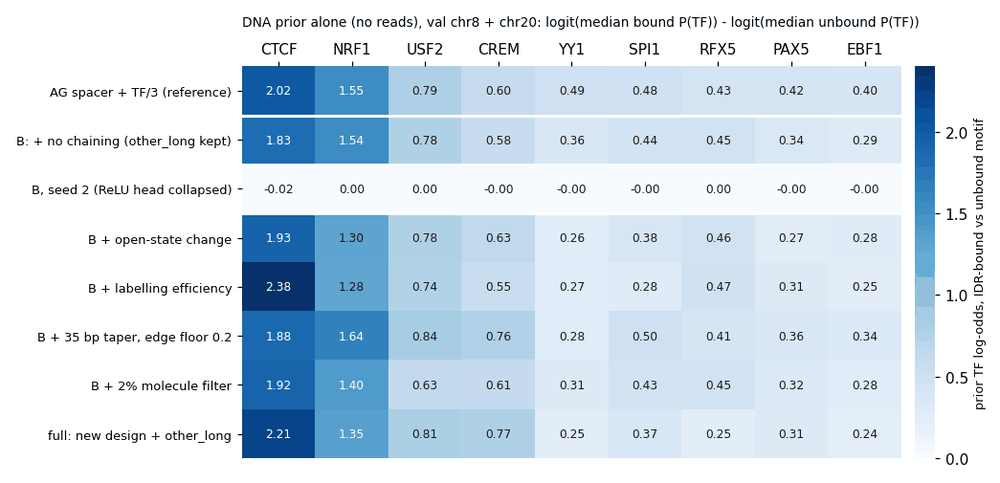

# Summary

**Goal.** Find which design change between the best prior (AG spacer + TF/3, `ag_sptf`) and the
2026-11-13 design costs the prior its TF signal, measured by prior TF log-odds (see the
[prior log-odds note](../2026-11-14/fiber-prior-tf-log-odds-and-design-takeaways.md)).

**Ablation design.** All runs share a base B:
- spacer + TF/3 with no TF chaining;
- other_long 40-100 bp at a 1% target;
- KL 10.

Each variant adds one change: the open-state settings, labelling efficiency (ε 0.003), the 35 bp taper
with edge floor 0.2, the 2% molecule filter, or all of them ("full"). B was rerun with a second seed.

**Main finding: the seed replicate collapsed.** Its prior has log-odds 0.00 for every TF and
prior-only AUROC 0.46, with nothing else changed.

**Cause: a dying-ReLU collapse of the trainable prior head.** The head is AG features → adapters →
conv → ReLU → conv → ReLU → linear.
- **Seed 2:** all 128 first-layer units are inactive at every validation position. The prior's
  potentials are exactly constant (SD 0), so this "AG" model is a constant prior.
- **The KL 3000 run** from 2026-11-13 died the same way in its second layer: 100% of units inactive,
  median pre-activation −174.
- **Every surviving run** has 77-88% of first-layer units and 48-69% of second-layer units never
  active. The output is carried by a few units with huge weights firing at under 1% of positions.

So the per-TF differences between single runs are confounded by how much of the head survived.

**Ablation results** (single seed; read as tentative):
- **No chaining with other_long kept** is roughly neutral against `ag_sptf`: mean prior log-odds 0.74
  vs 0.80, matched AUPRC 0.514 vs 0.513.
- **Labelling efficiency** again raises CTCF and lowers NRF1, SPI1 and YY1 in the prior. It also lowers
  posterior AUROC by about 0.03. This matches the earlier `ag_sptf` → `ag_eff` comparison, so it is the
  most credible effect.
- **Putting other_long back** into the new design restores the posterior (full: AUROC 0.750, AUPRC 0.501,
  vs 0.723 and 0.488 without it).
- **The other three changes** (open state, taper and edge floor, filter) look small.
- **The collapsed seed-2 model has the best posterior AUROC (0.790).** The posterior ChIP benchmark
  does not need, and may not reward, a TF-informative prior.

**Change made** (user decision): the ReLU stack was replaced by AlphaGenome-style pre-activation
residual blocks, h + conv(gelu(RMSNorm(h))), in both the AG and CNN priors. A per-epoch
`prior_potential_sd/<group>` metric now flags a collapsed (constant) prior.

**GELU-head results** (added after the runs finished): three seeds of B.
- **No collapse:** mean prior log-odds 0.74 / 0.71 / 0.71, the same quality as the surviving ReLU B
  (0.74).
- **Reproducible:**
  - the seed-to-seed SD of mean log-odds is 0.019;
  - per TF it is 0.02-0.04, except CTCF (0.09) and RFX5 (0.11);
  - posterior AUROC is 0.768-0.769 and matched AUPRC 0.514-0.515 across seeds.
  - So per-TF prior differences of about 0.1 or more between designs are now readable, given two or
    more seeds.
- **The sequence prior lowers the posterior ChIP benchmark.**
  - All three healthy GELU priors give posterior AUROC 0.769, against 0.790 for the collapsed (constant)
    seed-2 prior: worse for YY1, PAX5, NRF1 and CREM, never better.
  - At full prior strength (×1) AUROC falls further, to 0.741, and off-motif TF more than doubles
    (14.4 vs 6.0 per read-kb).
  - The seed noise is about 0.001, so this is not chance.
  - The prior ranks bound above unbound motifs (prior-only AUROC 0.72), yet adding it to the reads
    hurts. Why is unresolved.

# Key Points



*Prior TF log-odds per TF for the ablation (single seed each). The seed-2 replicate of B is all zeros
because its prior head collapsed, which makes the differences between the other rows hard to
interpret.*

**Posterior benchmark** (prior ×0.5, means over 9 TFs):

| model | AUROC | AUROC, accessible reads | matched AUPRC | off-motif TF / read-kb | TF bases in runs ≥ 35 bp |
|---|---|---|---|---|---|
| `ag_sptf` (reference) | 0.790 | 0.678 | 0.513 | 6.4 | 5.6% |
| new design, no chaining, KL 300 (no other_long) | 0.723 | 0.651 | 0.488 | 7.1 | 48% |
| B | 0.773 | 0.672 | 0.514 | 5.9 | 2.4% |
| **B, seed 2 (collapsed prior)** | **0.790** | 0.667 | 0.508 | **4.8** | 0.0% |
| B + open | 0.772 | 0.666 | 0.511 | 6.0 | 2.7% |
| B + efficiency | 0.742 | 0.644 | 0.495 | 4.4 | 9.0% |
| B + edges | 0.774 | 0.671 | 0.513 | 5.6 | 2.7% |
| B + filter | 0.769 | 0.667 | 0.508 | 5.8 | 2.9% |
| full (new design + other_long) | 0.750 | 0.650 | 0.501 | 4.5 | 6.3% |

**Dead units in the prior head** (48 chr20 val windows, 24.6k positions; "never active" = ≤ 0 at
every position; "spread" = SD of the TF potentials across positions):

| run | first conv layer: never active | second conv layer: never active | second layer: mean active fraction | TF spread |
|---|---|---|---|---|
| `ag_sptf` | 84% | 51% | 0.067 | 0.86 |
| `ag_eff` | 88% | 49% | 0.060 | 0.74 |
| new design, KL 10 | 83% | 63% | 0.060 | 0.75 |
| new design, no chaining, KL 300 | 88% | 69% | 0.018 | 0.56 |
| **new design, KL 3000** | 75% | **100%** | 0 | **0** |
| ablation B / open / edges / filter / efficiency / full | 77-86% | 48-57% | 0.06-0.07 | 0.84-1.08 |
| **ablation B, seed 2** | **100%** | 99% | 0.008 | **0** |

**Seed-2 weights and timing.** Its conv weights stayed near initialization scale (RMS 0.03, vs about
0.10 in B). Its output layer relies on one always-on second-layer unit. Training history:
- epochs 0-4 track B;
- at step 1783 (epoch 3.8) prior entropy drops 4.35 → 3.82 in one step;
- during epoch 5, validation loss rises (66.0 → 67.0) while B's keeps falling;
- the loss is frozen at 64.26 from about epoch 20 (B reaches 62.58).

**GELU head, three seeds of B** (Slurm 52468214/18/22, evaluation 52468241): prior TF log-odds

| prior | CTCF | NRF1 | USF2 | CREM | YY1 | SPI1 | RFX5 | PAX5 | EBF1 | mean | prior-only AUROC (mean) |
|---|---|---|---|---|---|---|---|---|---|---|---|
| `ag_sptf` (ReLU) | 2.02 | 1.55 | 0.79 | 0.60 | 0.49 | 0.48 | 0.43 | 0.42 | 0.40 | 0.80 | 0.76 |
| B (ReLU) | 1.83 | 1.54 | 0.78 | 0.58 | 0.36 | 0.44 | 0.45 | 0.34 | 0.29 | 0.74 | 0.73 |
| B seed 2 (ReLU, collapsed) | −0.02 | 0.00 | 0.00 | 0.00 | 0.00 | 0.00 | 0.00 | 0.00 | 0.00 | 0.00 | 0.46 |
| GELU seed 0 | 1.84 | 1.40 | 0.65 | 0.77 | 0.27 | 0.48 | 0.57 | 0.38 | 0.33 | 0.74 | 0.72 |
| GELU seed 1 | 1.67 | 1.41 | 0.68 | 0.80 | 0.23 | 0.45 | 0.49 | 0.36 | 0.32 | 0.71 | 0.72 |
| GELU seed 2 | 1.70 | 1.37 | 0.73 | 0.82 | 0.31 | 0.48 | 0.35 | 0.34 | 0.29 | 0.71 | 0.72 |
| GELU seed SD | 0.09 | 0.02 | 0.04 | 0.03 | 0.04 | 0.02 | 0.11 | 0.02 | 0.02 | 0.02 | 0.004 |

**GELU head, posterior benchmark** (means over 9 TFs):

| model | AUROC | AUROC, accessible reads | ρ within bound | matched AUPRC | off-motif TF / read-kb |
|---|---|---|---|---|---|
| GELU seeds 0/1/2, prior ×0.5 | 0.769 / 0.768 / 0.769 | 0.672 / 0.671 / 0.673 | 0.19 | 0.514 / 0.514 / 0.515 | 6.0 |
| GELU seeds 0/1/2, prior ×1 | 0.741 / 0.738 / 0.743 | 0.649 / 0.646 / 0.649 | 0.12 | 0.488-0.492 | 14.4 |
| B (ReLU), prior ×0.5 | 0.773 | 0.672 | 0.19 | 0.514 | 5.9 |
| B seed 2 (constant prior), prior ×0.5 | **0.790** | 0.667 | 0.20 | 0.508 | **4.8** |

TF run lengths at ×0.5 are the same for the GELU seeds and ReLU B: median 12 bp, 3% of TF bases in runs
≥ 35 bp, no chains.

# Details

## Why the units die (inference, not yet tested)

- **The targets are sparse.** TF and other_long potentials must be high at a few positions and low
  almost everywhere. Once a unit feeds those outputs, its gradient at the many non-TF positions pushes
  its pre-activation and bias down. Healthy runs end with second-layer pre-activation medians of
  −4 to −7.
- **There is no recovery.** A ReLU unit that is ≤ 0 everywhere gets zero gradient. With no
  normalization or residual path in the head, losing every unit in one layer leaves only the output
  biases, a constant prior. Adam at learning rate 1e-3 with clip 1.0 can apparently make the decisive
  step (seed 2, about epoch 4).
- **A strong occupancy KL accelerates it.** The cheapest way to meet fixed group targets is to switch
  every unit off. The KL 300 survivor is the most collapsed (1.8% mean activity), and KL 3000 died
  fully.

## Consequences for earlier conclusions

- **"KL 3000 erased the prior"** (2026-11-14 note) is this collapse; the KL is a trigger, not a
  separate mechanism.
- **Per-TF prior differences between single runs** (design lineage, ablation rows) mix design effects
  with head survival. Only effects that repeat across independent comparisons (labelling efficiency;
  spacers) are trustworthy for now.
- **AG ≈ constant prior** in the posterior benchmark: a collapsed AG prior *is* a constant prior, and
  surviving priors carry little TF signal through few units.

## New head (smf_hmm, uncommitted at time of writing)

```
AG scales → LayerNorm → linear adapters (64 each) → concat
  → linear input projection to D (= conv_features width, 128)
  → one GeluConvBlock per conv_features entry: h = h + conv_k9(gelu(RMSNorm(h)))   (block conv zero-initialized: identity at start)
  → gelu(RMSNorm(h)) → output layer (zero-initialized) → per-state potentials
```

- **Design choices:**
  - AlphaGenome's sigmoid-approximation GELU;
  - per-position RMSNorm instead of AG's RMS batch norm, so there are no batch statistics;
  - no weight standardization, since the head is shallow.
- **Config:** `conv_features` now means one block per entry with one shared width.
- **Compatibility:** checkpoints from the ReLU head do not load with the new code.
- **New metric:** training and validation log `prior_potential_sd/<group>`, the SD of the prior's
  potentials along the sequence per state group. It is 0 for a prior that ignores the DNA.
- **Tests:** 480 pass, including the block as identity at init, a gradient through a silent trunk, the
  width check, and the spread metric. A 1-epoch GPU smoke run trained.

## Commands

```bash
S=/scratch/users/diamant; W=$S/fiber_eval_work
# ablation (each run dir has train.sbatch: akundaje,owners --requeue; clears checkpoints at start)
sbatch $S/2026-11-14_fiber_ablation_sptf_nochain_<variant>_alphagenome_bf16/train.sbatch
sbatch --dependency=afterok:<train> $W/infer_variant_val_extra_any.sbatch abl_<variant> <run dir> "[--efficiency-path ...rates.h5 for eff/full]"
sbatch --dependency=afterok:<all inferences> $W/analyze_abl_val.sbatch      # 52360845
python $W/prior_log_odds/plot_log_odds_ablation.py                           # heatmap above
# collapse diagnostic (GPU; loads checkpoints with smf_hmm load_best_hmm_checkpoint)
sbatch --wait $W/prior_collapse/dead_units.sbatch                            # run dir names as arguments
# GELU head, B with seeds 0-2 (L40S), then
sbatch --dependency=afterok:<inferences> $W/analyze_gelu_val.sbatch          # 52468241
```

The wandb history was read from the local `.wandb` files with `wandb.sdk.internal.datastore`. The
figure was resized and quantized with Pillow.

# Related Notes

- [Prior TF log-odds and design takeaways](../2026-11-14/fiber-prior-tf-log-odds-and-design-takeaways.md):
  Defined the metric and proposed this ablation; its KL 3000 conclusion is revised here.
- [No other_long, TF chaining, KL sweep, constant prior](../2026-11-13/fiber-no-other-long-tf-chaining.md):
  The runs where AG ≈ constant prior, now partly explained by head collapse.
- [Labelling-efficiency emissions](../2026-11-12/fiber-labelling-efficiency-emissions.md): The
  efficiency trade-off seen again in this ablation.

# Open Questions

- **Why does a TF-informative sequence prior lower the posterior ChIP AUROC** (0.769 healthy vs 0.790
  constant, reproducible across seeds)? Candidates (untested):
  - the prior's open/histone landscape pulls footprints at bound sites toward open;
  - prior TF mass near but off the motif;
  - the benchmark rewards something the prior works against.

  A sequence-free (constant-prior) version of B, with identical emissions and transitions, would make
  the comparison exact.
- **Ablation rerun:** rerun the variants with the GELU head and two or more seeds. The seed SD (about
  0.02 per TF, up to 0.1 for CTCF and RFX5) makes differences of about 0.1 readable. On single ReLU
  seeds, the NRF1 drops from efficiency (−0.26) and the open-state change (−0.24) are the candidates
  most likely to be real.

# Sources

- Scripts, run directories, Slurm jobs and outputs listed in the frontmatter.
- AlphaGenome conv block structure: smf_hmm `smf_hmm/alphagenome_encoder.py` (`_conv_block`, `gelu`).
