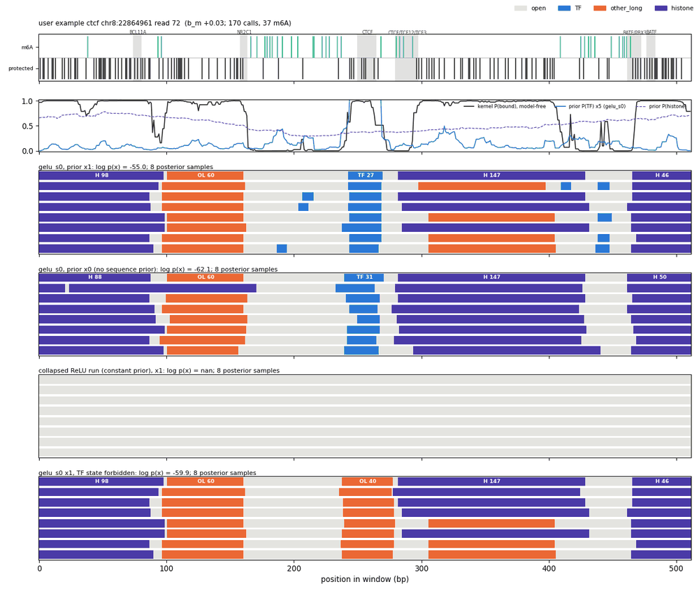

# Summary

**Question** (user): the per-read posterior figures show histone segments much shorter than 147 bp, for
example about 6 bp at 300-306 in CTCF chr8:22,864,961 read 72. Is the minimum histone length violated?

**Answer: no.** The model cannot produce them; they come from how the figure's background is drawn.

- **Transition structure.** The histone block has 147 chain states and one entry state. The exact
  segment-duration distribution (absorbing-chain calculation from the stationary inflow) puts
  probability 1.0 on 147 bp.
- **The only short histones are at window edges.** 69% of the stationary initial mass sits on histone
  states past the entry, so a window can start partway through a nucleosome; window ends truncate the
  same way.
- **Sampled paths.** In 50 posterior path samples per read for the user's examples, every interior
  histone is exactly 147 bp (under prior ×1, ×0 and with TF forbidden).
- **Where the short segment comes from.** In read 72 the posterior mixes two explanations of 282-430:
  a histone at 282-429 (P ≈ 0.44), or other_long at 298-398 plus TFs at 410-418 and 439-448
  (P ≈ 0.55). The plotting helper colours each position by the group with the highest marginal, so it
  shows "histone" for the few positions before other_long begins.

**Recommendation.** Draw sampled or MAP paths, not argmax-of-marginals, when judging segment lengths. The
new path-view figures (`plot_paths.py`) do this and label every segment's length.

# Key Points



*Eight posterior path samples per setting. Histones are always 147 bp (or truncated at the window
edge); the 282-430 region alternates between one histone and other_long + TF.*

- **Segment durations under the transition structure** (gelu_s0):

  | group | microstates | minimum duration | maximum duration | mean | stationary mass |
  |---|---|---|---|---|---|
  | histone | 147 | 147 | 147 | 147 | 0.69 |
  | other_long | 100 | 40 | 100 | 58.6 | 0.010 |
  | TF | 40 | 8 | 40 | 17.7 | 0.0067 |
  | open (incl. spacers) | 21 | 1 | — | 55.9 | 0.29 |

- **Read 72, segments** (start + length):
  - Viterbi: histone 0+88, open, other_long 97+64, open, TF 244+25, open, other_long 306+99, open,
    TF 439+9, open, histone 465+47.
  - Argmax-of-marginals: also shows "histone 300+6".
  - Samples: e.g. histone 282+147, or other_long 298+100 + TF 410+8 + TF 439+9.

# Details

- **Transition costs.** Log transition probabilities out of the plain open state: stay −0.019; histone
  entry −4.11; TF entry spacer −6.63; other_long entry −7.42.
- **Histone exits.** A histone exits only into open, so two nucleosomes are separated by at least one
  open position.

```bash
T=/scratch/users/diamant/fiber_eval_work/tf_mechanism
MODELS=gelu_s0 sbatch $T/gpu_diagnostics.sbatch structure synthetic examples                 # 52505020
MODELS=collapsed CODE_DIR=$T/smf_hmm_head sbatch $T/gpu_diagnostics.sbatch synthetic examples  # 52505021 (pre-GELU checkout for the ReLU run)
python $T/plot_paths.py
```

# Related Notes

- [TF nub mechanism overview](fiber-tf-nub-mechanism-overview.md): The investigation this check belongs to.

# Open Questions

- Should `smf_hmm.plot` default to a sampled/MAP background? (Not changed here.)

# Sources

- Scripts and outputs in the frontmatter.
