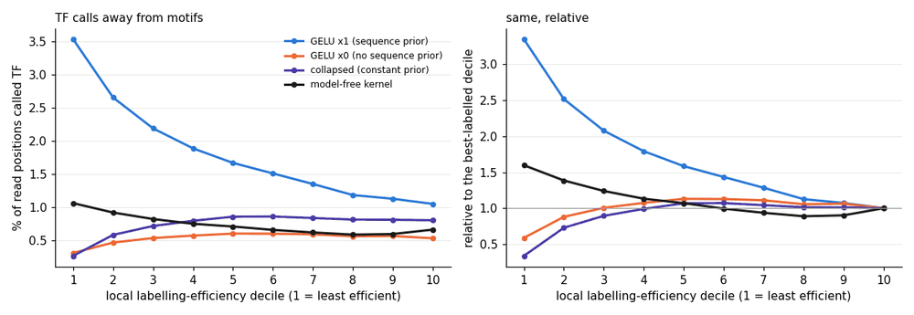
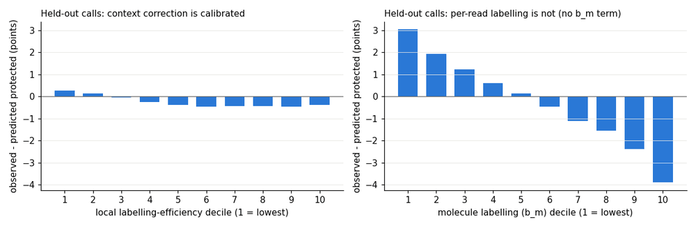

# Summary

**Observation.** The AG prior's TF bumps and many off-motif TF calls sit in poorly labelled sequence,
mostly A/T tracts.
- Prior TF peaks have mean context efficiency 0.77 vs 1.05 overall.
- Blind contexts are 1.8× over-represented at peaks.
- The prior's TF rises 2.6-2.8× from the best- to the worst-labelled decile.
- Per-window Spearman between prior TF and local efficiency is −0.32, negative in 93% of windows.

**Hypothesis.** The m6A context correction is insufficient, so poorly labelled DNA looks protected.

**Result: the emission side is calibrated, and the association is produced by the sequence prior.**

1. **Held-out calls are well predicted.** Each read's calls were split in half; posteriors from half A
   predicted the protection of half B. Observed minus predicted stays within ±0.5 percentage points in
   every local-efficiency and site-efficiency decile.
2. **Without the sequence prior, TF calls fall in poorly labelled DNA** (to 0.59× the best decile for
   GELU ×0, 0.34× for the collapsed model). The correction makes those sites uninformative, as intended.
3. **With the prior, TF calls rise 3.3×** from the best- to the worst-labelled decile, against 1.6× for
   the model-free kernel's TF-length runs. The prior multiplies TF calls 11× in the worst decile and
   2× in the best.
4. **Homopolymers.** Beyond 6 bp, A/T runs are labelled less than the 7-mer correction predicts (O/E
   0.6 at 8-9 bp, 0.3-0.5 at ≥ 10 bp). They are only about 1% of called sites and nearly blind
   anyway; held-out protection there is under-predicted by only 0.3-0.5 points. Real but minor.
5. **Labelling-efficiency emission.** It reduces, but does not remove, the prior's efficiency tracking
   (per-window Spearman −0.26 to −0.29 vs −0.31 to −0.33 for additive-offset models).

6. **The prior is unconstrained there.** Mean posterior P(TF) is only 5-9% above the prior's in every
   decile (lowest: 0.0405 vs 0.0370). That alone says nothing about constraint: at a maximum-likelihood
   fixed point the average posterior matches the prior everywhere.

   The informative measure is how strongly the posterior follows the prior: ×1 vs ×0 TF calls differ 11×
   in the worst-labelled decile but 2× in the best. In informative DNA the reads push back when the prior
   raises TF where they show accessibility. In poorly labelled DNA raising the prior raises the posterior
   almost one-for-one, so training has no restoring force there.

   The prior's TF on such sequence is then set by extrapolation of the shared AlphaGenome features and
   head weights from other sequence. The only remaining check is the occupancy KL, which limits total TF
   mass but not where it sits.

**Interpretation (inferred).** The prior learned "TF on poorly labelled, A/T-rich sequence", and the
reads there are too uninformative for training to correct it. Possible routes:
- weak positive evidence: kernel TF-length runs rise 1.6× there;
- generalization of AG features from informative contexts.

So the TF calls in low-efficiency stretches are prior-driven, low-information calls rather than an
emission bias.

# Key Points



*Off-motif TF calls by local-efficiency decile: with the prior (blue) they rise steeply in poorly
labelled DNA; the same emissions without the prior (orange), the constant-prior run (purple) and the
model-free kernel (black) do not.*



*Held-out calls: the context correction is calibrated across efficiency deciles (left), but per-read
labelling is not, because design B has no b_m term (right; see the under-methylated-reads note).*

- **Positions called TF away from motifs** (25% sample of read-positions; off benchmark and strong
  footprinting motifs):

  | local efficiency decile | GELU ×1 | GELU ×0 | collapsed | kernel TF-length runs | ×1 / ×0 |
  |---|---|---|---|---|---|
  | 1 (≤ 0.50) | 3.53% | 0.32% | 0.27% | 1.07% | 11.2 |
  | 2 | 2.65% | 0.47% | 0.59% | 0.92% | 5.6 |
  | 3 | 2.19% | 0.54% | 0.72% | 0.83% | 4.1 |
  | 5 | 1.67% | 0.61% | 0.86% | 0.71% | 2.8 |
  | 10 (> 1.73) | 1.05% | 0.54% | 0.81% | 0.67% | 2.0 |

- **Held-out calibration** (8.2M held-out calls, every 8th val window):
  - overall observed protected 0.837 vs predicted 0.840;
  - by local efficiency, the deviation stays within −0.5 to +0.25 points;
  - by run length, −0.6 to +0.5 points.
- **Sequence at prior TF peaks** (±7 bp):
  - A/T-tract share 11.6% vs 5.1%; the model's own learned offset +0.83 vs +0.11.
  - The 20 most enriched 7-mers are A/T runs (GAAAAAA, TTTTTTC, …) with learned offsets +2 to +4.
  - Enrichment correlates with the learned offset across 1,589 contexts (Spearman +0.78).
- **Homopolymer O/E** (observed m6A ÷ 7-mer efficiency × local accessibility):

  | run length | 1-3 bp | 4-6 bp | 7 bp | 8-9 bp | ≥ 10 bp |
  |---|---|---|---|---|---|
  | O/E | 0.83-0.98 | 0.90-1.26 | 0.80 | 0.60-0.64 | 0.28-0.47 |

# Details

- **Why held-out calibration rather than posterior-selected calibration.** Selecting positions by the
  posterior state and then checking those same calls is circular: open is selected for accessible-
  looking calls. Our first attempt failed this way (−0.08 to −0.17 everywhere). The split-half design
  takes states from half A and outcomes from half B.
- **Predicted protection.** It is Σ_k P(state k | half A) · e_k(protected | context), from the model's
  own emissions including the context offsets.
- **Additive offsets.** With the additive offset form, a protected call at a context with offset +3
  gives only 0.06 nats of TF-over-open evidence, so blind sites are already nearly uninformative.

```bash
T=/scratch/users/diamant/fiber_eval_work/tf_mechanism
MODELS=gelu_s0 sbatch $T/gpu_diagnostics.sbatch reads heldout                                  # 52505759
MODELS=collapsed CODE_DIR=$T/smf_hmm_head sbatch $T/gpu_diagnostics.sbatch reads               # 52505761
python $T/causal_chain.py; python $T/heldout_calibration.py
P=/scratch/users/diamant/fiber_eval_work/prior_tf_bumps
python $P/bias_vs_bumps.py; python $P/efficiency_tracking.py; python $P/homopolymer_test.py
```

# Related Notes

- [TF nub mechanism overview](fiber-tf-nub-mechanism-overview.md): All hypotheses together.
- [Prior ablation and ReLU-head collapse](../2026-11-15/fiber-prior-ablation-and-relu-head-collapse.md):
  The gelu_s0 and collapsed models.
- [Specificity metrics and debiased kernel](../2026-11-13/fiber-specificity-metrics-debiased-kernel.md):
  The kernel reference.

# Open Questions

- Why does the prior learn TF where reads are uninformative? Weak true signal plus extrapolation, or
  something in the objective? Tying the TF potentials (overview note, fix trials) addresses part of
  it.
- Should the correction add a run-length term for A/T runs ≥ 7 bp? Low priority given its size.

# Sources

- Scripts and outputs in the frontmatter.
