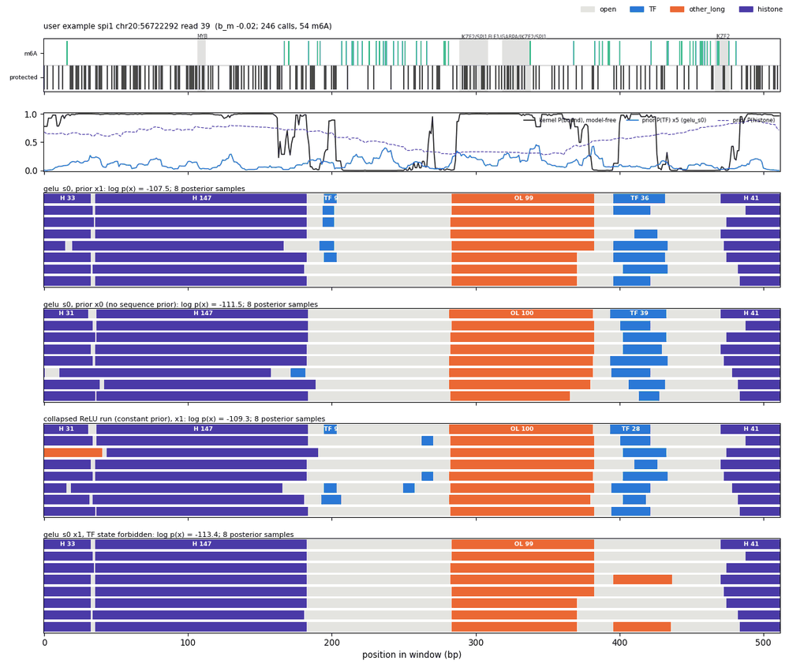
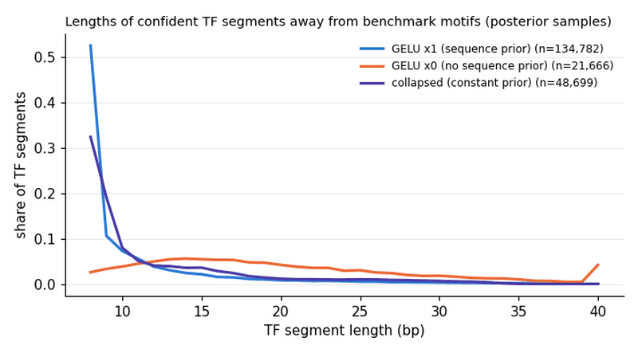
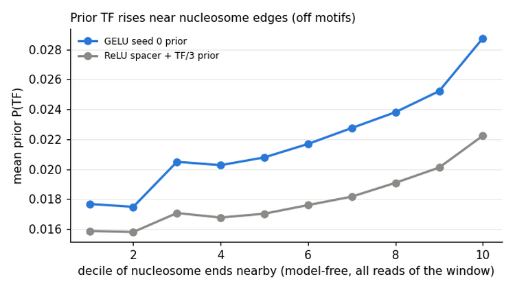

# Summary

**Hypothesis** (user): many off-motif TF calls look like nucleosomes split into other_long + TF. Either
the prior learns nucleosome-edge locations and puts TF mass there, or the emissions/transitions
fragment nucleosomes.

**Result: both happen and the prior contribution dominates, but adjacency to nucleosomes is only
mildly enriched once its 62% baseline is counted (see item 1).**
1. **Most prior-added TF calls sit next to nucleosomes.**
   - Per 1,000 reads, confident TF segments within 30 bp of a histone/other_long segment number 376
     with the prior (GELU ×1), against 54 for the same emissions without it (×0) and 125 for the
     constant-prior run.
   - 72% of off-benchmark ×1 TF segments are such adjacent calls. Their neighbour is a histone in 75%
     of cases, other_long in 25%.
   - **Baseline (added 2026-11-16):** 62% of open positions in the same sampled paths are within 30 bp
     of a histone/other_long segment, because linkers are short. Adjacency itself is therefore only
     mildly enriched (1.1-1.3× for prior-added calls). Most of the 7× excess over ×0 is the prior adding
     TF calls throughout accessible DNA, much of which happens to lie near a nucleosome.
   - **By labelling efficiency:**

     | efficiency quintile | prior-added calls beside a nucleosome-like segment | kernel support (×1) | exactly 8 bp (×1) |
     |---|---|---|---|
     | 1 (least efficient) | 69% | 39% | 66% |
     | 2-4 | 78-80% | 62-68% | 45-49% |
     | 5 (most efficient) | 63% | 57% | 58% |

     The A/T-rich, poorly labelled nubs are a separate group: almost entirely prior-made (about 150× the
     ×0 rate) and not especially nucleosome-associated.
2. **They are minimum-length nubs.**
   - The median ×1 TF segment is 8 bp, the shortest the TF state allows; 53% of confident off-motif
     ×1 TF segments are exactly 8 bp. At ×0 the lengths peak around 14 bp.
   - The commonest total span is nucleosome + gap + TF = 160-180 bp, i.e. a 147 bp histone, an open
     gap of 11-20 bp, and an 8 bp TF.
   - The gap is at its 11 bp minimum in 12% of cases at ×1 (8-9% without the prior), then declines.
3. **The gaps are genuinely accessible:** 0.45-0.47 m6A per call, kernel P(bound) about 0.25. So these
   are not continuous protected stretches cut by the spacer rule but short protected bits just beyond
   a nucleosome end.
4. **The nubs themselves are partly protected.**
   - Held-out calls inside confident off-benchmark TF calls are 91.5% protected (TF on benchmark
     motifs 92.5%, histone 96.5%, open 38%).
   - But only 52-61% of ×1 TF segments are kernel-supported, against 93% at ×0, so many prior-added
     nubs have little read support.
   - Each TF-called base buys a median 0.19 nats; with TF forbidden, 69% of TF positions become open.
5. **The prior's TF tracks nucleosome edges.** Within windows, off motifs, logit prior P(TF) rises
   +0.18 SD per SD of model-free nucleosome-end density, independent of occupancy (+0.12) and labelling
   efficiency (−0.33). Mean prior TF rises 1.6× across edge-density deciles.
6. **The emissions also fragment noisy nucleosome-length stretches** (no prior involved). In synthetic
   reads (flanks open, centred stretch of length L):
   - **Clean stretches:** ≤ 40 bp → TF, 40-110 → other_long, 120-170 → one histone, 180-240 →
     histone + other_long. Never TF + other_long.
   - **With 10% m6A inside** (protection 0.9):
     - 140 bp → other_long 61 + open;
     - 180-210 bp → histone + an 11-41 bp open gap + a 25-33 bp TF.
   - The cause is the strict histone emission (protection 0.98; an internal m6A costs about 3.9 nats
     vs 0.6 in open DNA). The constant-prior model behaves identically.
   - In the user's SPI1 chr20 read 39, every setting calls other_long 284-383 + open 383-396 + TF
     396-432. That is a 148 bp protected run (kernel) whose only break is a cluster of m6A calls at
     385-395.

7. **The reads show no excess of short protected remnants beside nucleosomes.** In the model-free kernel,
   open-flanked 8-40 bp protected runs occur per kb of accessible DNA at:
   - 1.64 when 11-30 bp from a nucleosome end in the same read;
   - 1.74 at 31-80 bp;
   - 1.67 farther away.

   The model's 7× excess of TF beside nucleosomes therefore has no counterpart at kernel resolution.
   Caveat: the ±7 bp kernel may merge a remnant within about 15 bp of a nucleosome into the nucleosome
   run, hiding the closest ones.

**Interpretation (inferred).** Real nucleosome footprints are not a fixed 147 bp of uniform protection.
Shortened ones (on heavily labelled reads), longer ones (linker histone / chromatosome-like ~167 bp),
partly unwrapped ones and ones with internal m6A all leave short protected remnants beside a 147 bp
histone, and the TF state can absorb those remnants. But item 7 shows no excess of such remnants beside
nucleosomes in the reads at kernel resolution. So most of the prior-added nubs beside nucleosomes reflect
the prior's learned placement (nucleosome borders, A/T-rich sequence) rather than a data feature, while the
confident ones (P > 0.8, 91.5% held-out protection) are real protection.

# Key Points



*SPI1 chr20:56,722,292 read 39: every setting splits the 284-432 protected run into other_long + open +
TF. Forbidding TF turns the TF part into open or a second other_long, never a histone.*



*Confident off-motif TF segments: with the prior, about half are exactly 8 bp (the minimum); without it
the lengths are broad around 14 bp.*



*Prior P(TF) rises with the model-free density of nucleosome ends nearby (off motifs).*

- **Confident interior TF segments per 1,000 reads** (one posterior sample per read; 259k val reads):

  | category | GELU ×1 | GELU ×0 | collapsed ×1 |
  |---|---|---|---|
  | adjacent to histone/other_long (≤ 30 bp) | 376 | 54 | 125 |
  | isolated, kernel-supported | 75 | 27 | 48 |
  | isolated, not kernel-supported | 69 | 2.2 | 15 |
  | on benchmark motif | 183 | 63 | 97 |

- **Span of adjacent TF + gap + neighbour, GELU ×1** (number of segments):

  | span (bp) | count |
  |---|---|
  | 60-90 | 8.2k |
  | 90-120 | 14.8k |
  | 120-140 | 12.8k |
  | 140-160 | 3.6k |
  | **160-180** | **20.8k** |
  | 180-220 | 10.8k |
  | 220-300 | 13.4k |

- **Within-window regression of logit prior P(TF)** (per SD, off motifs):

  | prior | edge density | occupancy | efficiency |
  |---|---|---|---|
  | GELU seed 0 | +0.18 | +0.12 | −0.33 |
  | ReLU spacer + TF/3 | +0.13 | +0.06 | −0.27 |

# Details

- **Samples.** One posterior path sample per read, every 2nd val window (chr20 + chr8), for GELU ×1, ×0
  and the collapsed run. "Confident" = more than half the segment has marginal P(TF) > 0.5.
- **Kernel.** Debiased kernel P(bound) ±7 bp from the read's own calls and b_m.
- **Model-free nucleosome map.** Kernel ±15 bp runs of 120-200 bp with open flanks (< 0.2 over 15 bp),
  pooled over a window's reads: occupancy, end density (±10 bp).
- **TF-forbidden model.** TF potentials set to −1e9, with global normalization recomputed.
  - Reads with TF calls: median Δ log p = 2.6 nats (1.1 for 1-10 TF bases).
  - Reads without TF calls: −0.79 (they fit better without TF).

```bash
T=/scratch/users/diamant/fiber_eval_work/tf_mechanism
python $T/segments.py; python $T/edges/prior_vs_edges.py; python $T/plot_paths.py
```

# Related Notes

- [TF nub mechanism overview](fiber-tf-nub-mechanism-overview.md): All hypotheses and the fix trials.
- [Spacer and duration shaping](fiber-tf-nubs-spacer-and-duration-shaping.md): Why the nubs are exactly
  8 bp.
- [Nucleosome lengths and edges](../2026-11-13/fiber-nucleosome-lengths-and-edges.md): Shortened
  nucleosomes on heavily labelled reads and the wide exponential edges.

# Open Questions

- Are the 160-180 bp spans chromatosomes (linker histone H1)? A test would be enrichment in H1-rich
  regions; not done.
- Would a variable-length or longer-edged histone absorb the remnants better than the TF state?

# Sources

- Scripts and outputs in the frontmatter.
