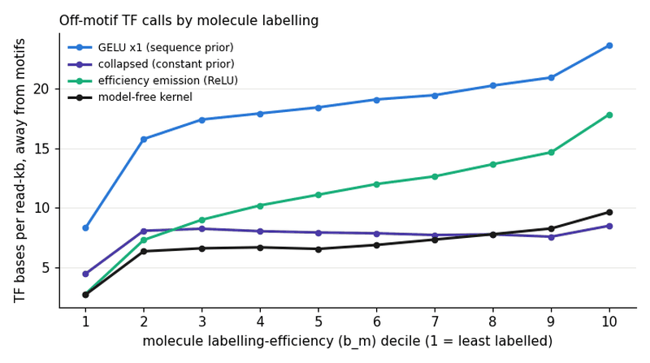
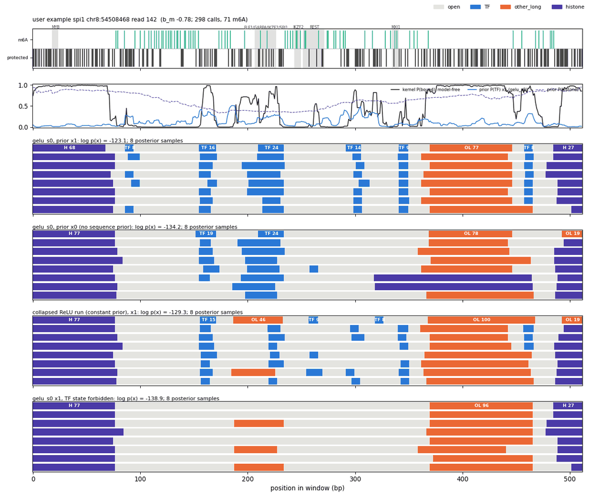

# Summary

**Hypothesis** (user): super-undermethylated reads seem problematic. Do they produce the spurious
TF-length calls?

**Result, for TF calls: no.** Off-motif TF calls *increase* with molecule labelling b_m in every HMM. The
lightest decile has the fewest, e.g. GELU 8.3 vs 18-24 TF bases per read-kb elsewhere.
- **The constant-prior run tracks the model-free kernel** across b_m (7.7-8.5 vs 6.3-9.6 per read-kb);
  the AG-prior models run about 2.3× above it at every b_m.
- **The labelling-efficiency emission** matches the kernel on light reads (2.7 vs 2.7) but rises to 17.9 on
  the heaviest decile.

**What is wrong with under-methylated reads.**
1. **Long protected states.** In the lightest decile (6% m6A), GELU calls 58 other_long bases per
   read-kb, against 25 for the efficiency model. Unlabelled linkers merge nucleosomes into long
   protected states. Base B has no molecule filter, so this decile also holds the reads the 2% filter
   would drop.
2. **Per-read miscalibration** (held-out calls, no b_m term in design B):
   - the lightest decile is 3.0 points more protected than predicted, the heaviest 3.9 points less;
   - lightly labelled reads look protected, heavily labelled ones accessible.
3. **Chance gaps on light reads.** In the user's SPI1 chr8 read 142 (b_m −0.78), TF calls sit on short
   kernel-protected gaps in an accessible region, as expected by chance when labelling is light.
   GELU ×1 adds more on top of ×0.

**Also.** other_long climbs steeply with b_m (about 50 → 186 per read-kb), the "shortened nucleosome on
heavily labelled reads" effect from the 2026-11-13 nucleosome note. TF calls rise with b_m too.

**Fix under test.** The labelling-efficiency emission with the 2% molecule-rate filter, with the GELU head
(fix trials, overview note).

# Key Points



*Off-motif TF calls by b_m decile: no excess on lightly labelled reads; the constant-prior run follows
the model-free kernel, the AG prior adds about 2.3× at every b_m.*



*A lightly labelled read (b_m −0.78): TF calls sit on short kernel-protected gaps; the sequence prior
(top block) adds several more than ×0 or the constant prior.*

- **Per read-kb, away from benchmark motifs:**

  | b_m decile | m6A frac | GELU TF | collapsed TF | efficiency TF | kernel TF-length runs | GELU other_long | efficiency other_long |
  |---|---|---|---|---|---|---|---|
  | 1 (< −0.96) | 0.06 | 8.3 | 4.4 | 2.7 | 2.7 | 57.9 | 25.2 |
  | 2 | 0.12 | 15.8 | 8.1 | 7.3 | 6.3 | 53.8 | 41.4 |
  | 5 | 0.16 | 18.5 | 7.9 | 11.1 | 6.5 | 67.8 | 67.1 |
  | 10 (> 0.57) | 0.27 | 23.7 | 8.5 | 17.9 | 9.6 | 186.0 | 162.7 |

- **Held-out observed − predicted protection by b_m decile** (points):

  | decile | 1 | 2 | 3 | 4 | 5 | 6 | 7 | 8 | 9 | 10 |
  |---|---|---|---|---|---|---|---|---|---|---|
  | Δ | +3.0 | +1.9 | +1.2 | +0.6 | +0.1 | −0.5 | −1.1 | −1.6 | −2.4 | −3.9 |

# Details

- **Reads and calls.** 259k val reads (every 2nd window of chr20 + chr8). TF/other_long-called =
  marginal P > 0.5, more than 20 bp from benchmark motifs.
- **Kernel TF-length runs.** Debiased kernel P(bound) ±7 bp > 0.5 for 10-45 bp, with both 10 bp flanks
  < 0.2.

```bash
python /scratch/users/diamant/fiber_eval_work/tf_mechanism/bm/tf_by_bm.py
python /scratch/users/diamant/fiber_eval_work/tf_mechanism/heldout_calibration.py
```

# Related Notes

- [TF nub mechanism overview](fiber-tf-nub-mechanism-overview.md): All hypotheses together.
- [Molecule-efficiency cuts](../2026-11-13/fiber-molecule-efficiency-cuts.md): The 2% filter and why the
  bottom ~5% of reads are uninformative.
- [Labelling-efficiency emissions](../2026-11-12/fiber-labelling-efficiency-emissions.md): The b_m
  emission form.

# Open Questions

- Does the efficiency + filter retrain fix the miscalibration without the high-b_m TF rise seen in
  abl_eff (ReLU)?

# Sources

- Scripts and outputs in the frontmatter.
