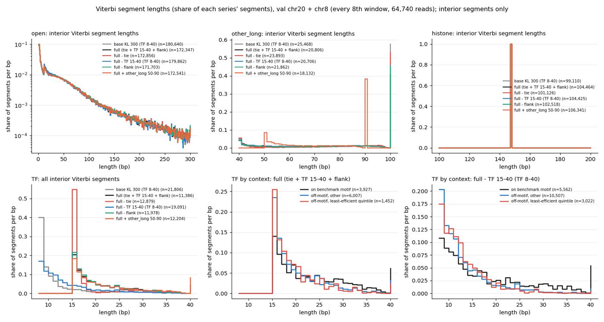
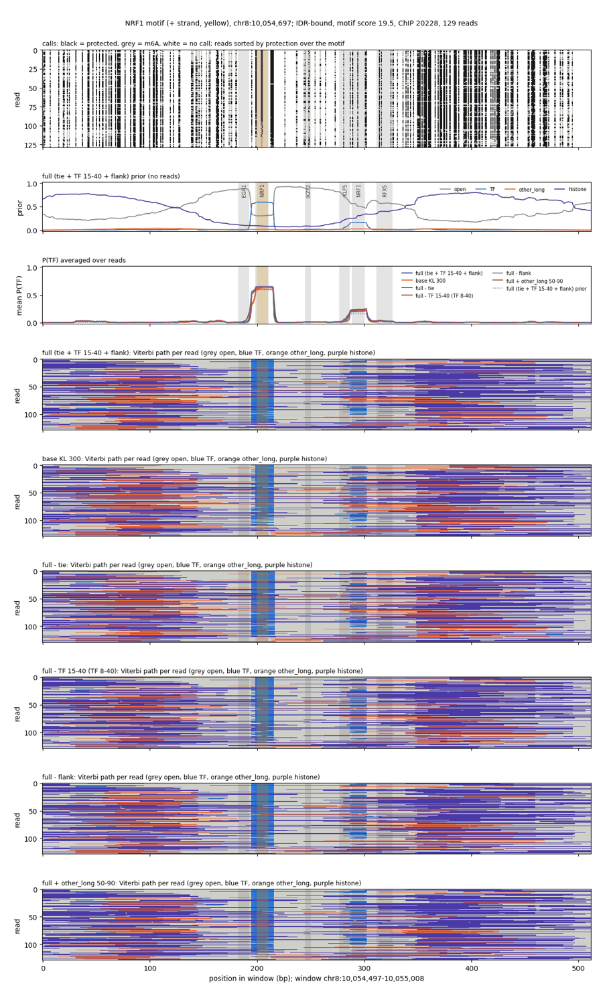

# Summary

**Design.** Round 2 starts from the round-1 results. It uses the same base: GELU design B, prior occupancy
KL 300, spacer + TF/3, no TF chaining, open band [0.05, 0.45]. All runs use seed 0, val chromosomes only
(chr20, chr8) and prior ×1.
- **full** = A1 + A2 + A3:
  - A1: TF and other_long chain states share one prior potential each (`tied_blocks=[TF,other_long]`);
  - A2: TF 15-40 bp;
  - A3: histone taper 40 bp with edge floor 0.2.

  other_long stays at 40-100 bp.
- **Leave-one-outs:** full − tie, full − TF 15-40 (so TF 8-40), full − flank (taper 25 bp).
- **full + other_long 50-90.** The 10 bp margins from TF's 40 bp maximum and the histone's ~100 bp fuzzy
  edge were meant to make other_long distinct. Occupancy target stays at 1%.

**Results.**
- **The full model is the best configuration so far on most metrics:**
  - AUROC 0.764 (base 0.744; best single change A2 0.756);
  - accessible-read AUROC 0.681;
  - mean prior TF log-odds 1.01 (base 0.83; best round-1 0.94);
  - off-motif TF 5.65 per read-kb (base 6.18).

  The round-1 gains mostly add up. CREM rises 0.740 → 0.825, NRF1 0.840 → 0.868, PAX5 0.674 → 0.697.
- **Matched AUPRC does not move:** 0.519-0.531 across all six runs, base 0.525. The improvement is in
  ranking bound vs unbound sites by accessibility and prior, not in precision at matched recall.
- **Each part contributes:**
  - **Tie** controls the minimum-length pile-up. Without it, 55% of Viterbi TFs sit at exactly 15 bp
    (full: 20%). It also costs CREM AUROC (0.825 → 0.786) and prior log-odds (1.01 → 0.96).
    Without tying, ρ within bound sites is higher (0.225 vs 0.213) and NRF1's bound-motif TF calls are
    longer (median 25 vs 19 bp).
  - **TF 15-40** (vs 8-40, with tying) removes the remaining 8 bp nubs:
    - 17% of TFs at 8 bp without it;
    - off-motif TF runs 212 vs 123 per 1,000 reads;
    - kernel-supported 86% vs 92%;
    - AUROC +0.007, NRF1 AUROC +0.015.
  - **Flank** lowers off-motif TF (5.97 → 5.65) and the other_long cap pile-up (46% → 40% at 100 bp),
    for AUROC +0.005. AUPRC is 0.003 lower with it, within noise.
- **other_long 50-90 again piles at its ends:**
  - 38% of its segments are exactly 90 bp and 8.5% exactly 50 bp;
  - TFs at the 40 bp cap double (4.1% → 8.4%): stretches of 40-50 bp now go to TF;
  - off-motif TF +0.75, AUPRC −0.009.

  Together with round 1's 45-80 run, this indicates other_long collects whatever its neighbours cannot
  hold, wherever its limits are. Moving the limits does not make it a distinct state.
- **Open-state overdispersion is still not modelled.** Runs of ≥ 8 protected calls in open DNA are
  1.39-1.45× the open emission's expectation in the TF-15 runs (base 1.31; full − TF 15-40 1.26). Raising
  the TF minimum leaves more short protected clusters in open, which matches the
  [overdispersion note](../2026-11-16/fiber-open-state-overdispersion.md): 8 bp TFs were patching them.
- **Histones are always exactly 147 bp** in interior Viterbi segments, as designed.

**Recommendation.** Adopt **full** as the new base. The next lever is not other_long's range. Two
candidates (proposals, untested):
- a protection-cluster component in the open state, for the overdispersion;
- a variable-length / partially unwrapped nucleosome for the 80-146 bp stretches that pile at
  other_long's cap.

# Key Points

| run | AUROC | accessible-read AUROC | protected-read AUROC | ρ within bound | matched AUPRC | on-motif share | off-motif TF / read-kb | prior TF log-odds (mean) |
|---|---|---|---|---|---|---|---|---|
| base KL 300 | 0.744 | 0.666 | 0.766 | 0.208 | 0.525 | 0.331 | 6.18 | 0.83 |
| **full** | **0.764** | **0.681** | **0.780** | 0.213 | 0.528 | 0.353 | **5.65** | **1.01** |
| full − tie | 0.761 | 0.677 | 0.777 | **0.225** | 0.526 | **0.360** | 5.73 | 0.96 |
| full − TF 15-40 | 0.757 | 0.673 | 0.774 | 0.204 | 0.527 | 0.345 | 5.80 | 0.97 |
| full − flank | 0.759 | 0.678 | 0.776 | 0.215 | **0.531** | 0.342 | 5.97 | 0.96 |
| full + OL 50-90 | 0.761 | 0.677 | 0.778 | 0.219 | 0.519 | 0.356 | 6.40 | 0.97 |

| run | off-motif TF runs / 1,000 reads | kernel-supported | Viterbi TFs at the minimum | TF at 40 bp | Viterbi TF median | CTCF / NRF1 median at bound motifs | OL at its max / min | OL median | open overdispersion ≥ 8 / ≥ 12 |
|---|---|---|---|---|---|---|---|---|---|
| base | 269 | 82% | 40% (8 bp) | 0.7% | 9 | 30 / 25 | 58% (100) / 5% | 100 | 1.31 / 1.52 |
| full | 123 | 92% | 20% (15 bp) | 4.1% | 19 | 28 / 19 | 40% / 4.5% | 86 | 1.43 / 1.49 |
| full − tie | 139 | 92% | 55% (15 bp) | 3.1% | 15 | 32 / 25 | 53% / 5.5% | 100 | 1.39 / 1.42 |
| full − TF 15-40 | 212 | 86% | 17% (8 bp) | 2.1% | 12 | 29 / 15 | 41% / 4.4% | 87 | 1.26 / 1.43 |
| full − flank | 132 | 92% | 22% (15 bp) | 3.4% | 18 | 28 / 19 | 46% / 4.0% | 91 | 1.45 / 1.53 |
| full + OL 50-90 | 125 | 94% | 18% (15 bp) | 8.4% | 19 | 31 / 22 | 38% (90) / 8.5% (50) | 77 | 1.44 / 1.52 |

- **Per-TF AUROC:**

  | TF | base | full | − tie | − TF 15-40 | − flank | + OL 50-90 |
  |---|---|---|---|---|---|---|
  | CTCF | 0.866 | 0.868 | 0.868 | 0.870 | 0.866 | 0.868 |
  | NRF1 | 0.840 | 0.868 | 0.874 | 0.853 | 0.862 | 0.856 |
  | CREM | 0.740 | 0.825 | 0.786 | 0.771 | 0.815 | 0.815 |
  | USF2 | 0.793 | 0.788 | 0.786 | 0.796 | 0.783 | 0.784 |
  | RFX5 | 0.738 | 0.753 | 0.756 | 0.751 | 0.760 | 0.753 |
  | SPI1 | 0.722 | 0.746 | 0.744 | 0.743 | 0.742 | 0.737 |
  | EBF1 | 0.734 | 0.731 | 0.727 | 0.735 | 0.730 | 0.722 |
  | PAX5 | 0.674 | 0.697 | 0.696 | 0.684 | 0.684 | 0.692 |
  | YY1 | 0.590 | 0.599 | 0.617 | 0.610 | 0.587 | 0.621 |

- **Prior TF log-odds per TF** (IDR-bound vs unbound, prior only):

  | TF | base | full | − tie | − TF 15-40 | − flank | + OL 50-90 |
  |---|---|---|---|---|---|---|
  | CTCF | 1.97 | 2.56 | 2.49 | 2.58 | 2.50 | 2.63 |
  | NRF1 | 1.71 | 1.68 | 1.51 | 1.73 | 1.79 | 1.65 |
  | USF2 | 0.99 | 1.08 | 1.17 | 1.02 | 0.92 | 0.93 |
  | CREM | 0.78 | 0.87 | 0.90 | 0.86 | 0.73 | 0.80 |
  | RFX5 | 0.43 | 0.75 | 0.70 | 0.52 | 0.67 | 0.63 |
  | SPI1 | 0.49 | 0.66 | 0.55 | 0.59 | 0.66 | 0.64 |
  | PAX5 | 0.35 | 0.57 | 0.44 | 0.47 | 0.49 | 0.52 |
  | EBF1 | 0.48 | 0.54 | 0.51 | 0.52 | 0.52 | 0.49 |
  | YY1 | 0.28 | 0.37 | 0.36 | 0.39 | 0.33 | 0.42 |
  | mean | 0.83 | 1.01 | 0.96 | 0.97 | 0.96 | 0.97 |



*Without tying, TF lengths spike at the 15 bp minimum (red). With 8-40 bp, 8 bp nubs remain (blue).
other_long piles at whatever its maximum is (100, or 90 and 50 for the 50-90 run).*



*At a strongly bound NRF1 motif (chr8:10,054,697, 129 reads), all six models call TF over the motif in
most reads and have nearly the same read-averaged P(TF), also at the second NRF1 match about 90 bp
downstream. The ablations change TF calls mainly away from strong motifs.*

# Details

- **Off-motif metrics.** "off-motif TF / read-kb" and "on-motif share" in the first table come from
  `kernel_ref/specificity_metrics.py`, as in round 1. The scorecard's variant also excludes strong
  footprinting-motif matches. It falls 7.39 (base) → 6.73 (full); the leave-one-outs are 6.68-6.88 and
  the 50-90 run 7.33.
- **Viterbi metrics.** Columns from "Viterbi TFs at the minimum" to "OL median" come from
  `viterbi_stats.py` on every 8th val window. "Off-motif TF runs" and "kernel-supported" come from
  `nub_scorecard.py` on every 4th window.
- **Overdispersion.** Each run uses its own Viterbi open segments, learned open protection (0.45 in every
  run; wandb summary) and context offsets. Inside open DNA, protected calls are over-predicted at ×1 in
  every run: observed 0.39-0.41 vs open emission 0.43.
- **Panels.** I made the per-read panels with the new repo script `evaluation.tf_chip.plot_model_comparison`
  (smf_hmm c507df7):
  - one site overview per TF and val chromosome;
  - 4 reads × 6 models per site, with the Viterbi path as background and footprinting-motif matches
    marked;
  - one montage per site, reads chosen from the full model.

  I have inspected only the NRF1 chr8 overview and the SPI1 chr20 montage at full size.

```bash
S=/scratch/users/diamant; W=$S/fiber_eval_work; T=$W/tf_mechanism
for v in full full_minus_tie full_minus_tf15 full_minus_flank full_ol50_90; do
  j=$(sbatch --parsable $S/2026-11-17_fiber_abl3_${v}_kl300_alphagenome_bf16/train.sbatch)
  sbatch --job-name=val_r2_$v --dependency=afterok:$j $W/infer_variant_val_extra_any.sbatch r2_$v $S/2026-11-17_fiber_abl3_${v}_kl300_alphagenome_bf16
  # + MODELS=r2_$v $T/viterbi_lengths.sbatch after inference
done
sbatch $W/analyze_r2_val.sbatch          # IDR benchmark, prior log-odds, specificity (after all inference)
sbatch $T/r2_readouts.sbatch             # scorecard, viterbi_stats.py, open_overdispersion.py per run
SET=r2 python $T/plot_viterbi_lengths.py # figures/viterbi_lengths_r2{,_proportion}.png
sbatch $T/plot_model_comparison.sbatch $S/gm12878_validation/r2_ablation_panels \
  --model "r2_full=$S/2026-11-17_fiber_abl3_full_kl300_alphagenome_bf16:full (tie + TF 15-40 + flank)" \
  --model "fix_kl300=$S/2026-11-16_fiber_gelu_B_kl300_alphagenome_bf16:base KL 300" ...  # + the four variants
```

# Related Notes

- [Ablation round 1](../2026-11-16/fiber-ablation-round1-tie-tf-length-histone-other-long-open.md): The single
  changes combined here, and the first other_long narrowing (45-80) that also re-piled.
- [Open-state overdispersion](../2026-11-16/fiber-open-state-overdispersion.md): Why removing 8 bp TFs leaves
  more clustered protection in open.
- [Short TF calls: sparsity vs dissociation](../2026-11-16/fiber-short-tf-calls-sparsity-vs-dissociation.md):
  Why a 15 bp minimum was expected to cost little; NRF1's under-determined lengths.
- [TF nub mechanism overview](../2026-11-16/fiber-tf-nub-mechanism-overview.md): The problem these ablations
  address.

# Open Questions

- What state should hold 80-146 bp protected stretches? other_long piles at its maximum in every range
  tried (100, 80, 90). A variable-length or partially unwrapped nucleosome is the obvious candidate
  (untested).
- Can the open state represent clustered protection, e.g. a short "bumpy open" sub-state with higher
  protection and no motif-driven prior, without reintroducing TF nubs?
- Why does tying shorten NRF1's bound-motif TF calls (25 → 19 bp) while raising its AUROC? NRF1's motif
  leaves few callable A/T, so the length is weakly determined either way.
- AUPRC has not moved across two rounds (0.517-0.531). Is it limited by the benchmark labels or by the
  TFs that do not footprint?

# Sources

- Runs, jobs and outputs in the frontmatter.
