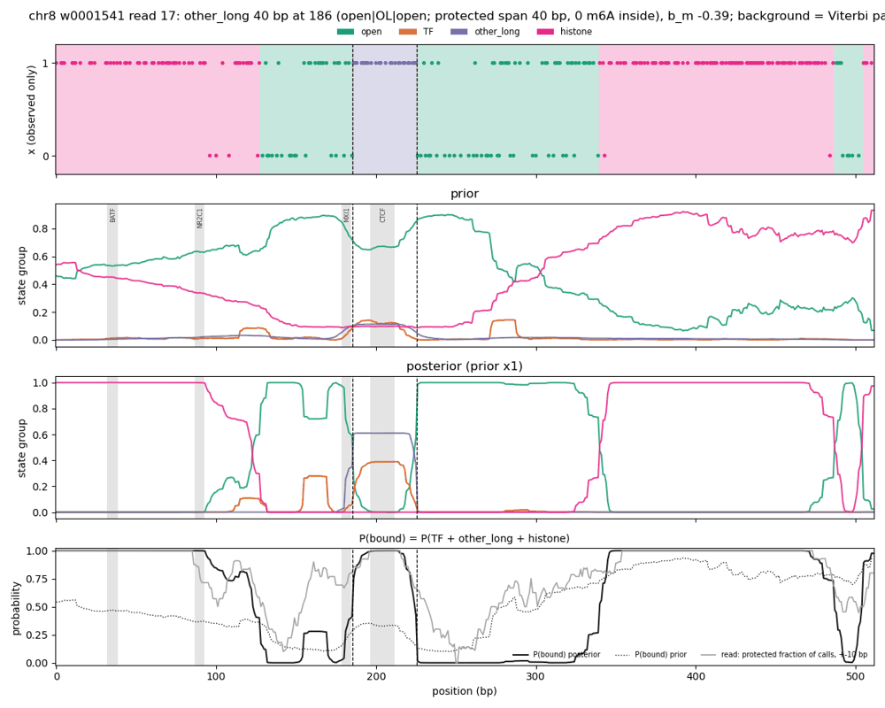
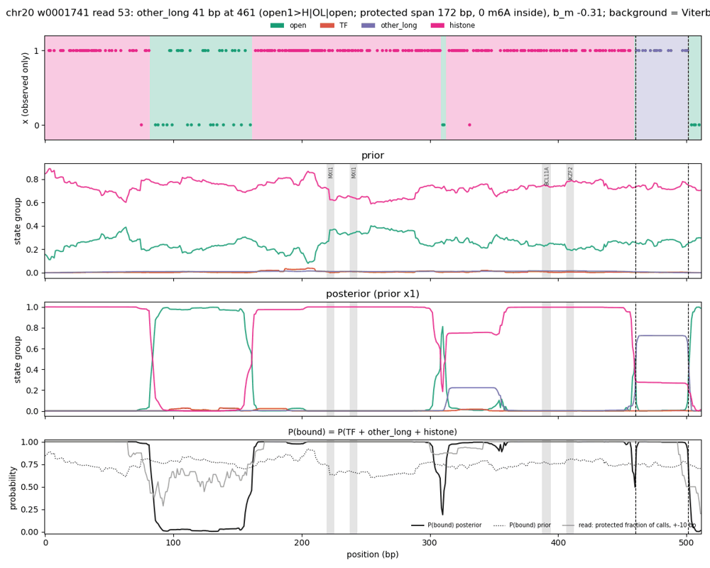

# Summary

**Question.** In every range tried (40-100, 45-80, 50-90), other_long Viterbi segments pile up at both
ends. What fills each end? The model is the new base `r2_full`
([round 2](fiber-ablation-round2-full-model-leave-one-out.md)): other_long 40-100 bp, TF 15-40 bp,
histone exactly 147 bp.

**Method.** For every interior other_long segment, I recorded:
- its neighbouring Viterbi states, noting a short open gap before a histone;
- its calls and m6A inside;
- the model-free **protected span**: the distance between the nearest m6A calls outside the segment;
- the read's labelling efficiency b_m and overlap with footprinting-motif matches.

I then plotted 16 reads with 40-42 bp segments, chosen across neighbour patterns and b_m terciles, one per
window.

**Results.** Of 20,806 segments, 1,729 (8%) are 40-42 bp and 8,382 (40%) sit at the 100 bp cap.
- **Short, between open DNA (42% of short calls): TF-like patches just longer than 40 bp.**
  - The median protected span is 44 bp, and 91% are 41-60 bp.
  - Half overlap a footprinting-motif match.
  - Median b_m is 0.
  - One example sits on a CTCF motif with a split posterior (about 0.6 other_long / 0.4 TF).

  TF cannot hold them (maximum 40), so other_long takes them at its minimum. Possible sources (inferred):
  - CTCF with flanking protection;
  - neighbouring TFs, which cannot be called back to back because each TF needs 10 bp open spacers;
  - a footprint stretched in a lightly labelled read.
- **Short, next to a nucleosome (58% of short calls): nucleosome footprints longer than 147 bp.**
  - The other_long sits 1-5 bp from a 147 bp histone. The model must pass through open between blocks,
    which leaves the gap.
  - In half (span ≥ 147) no m6A separates them, so the protected stretch is about 160-190 bp: a
    nucleosome plus 20-40 bp of extra protection. This may be linker-histone chromatosomes (~165-170 bp);
    speculative.
  - In 38%, one or two m6A calls separate a 41-60 bp patch from the nucleosome.
  - The posterior is typically split about 0.7 other_long / 0.3 histone.
  - These reads are lightly labelled (median b_m −0.42).
- **At the 100 bp cap: short nucleosomes.** Protected spans are 104-113 bp (IQR; median 108). 83% sit
  between open DNA. The fixed 147 bp histone cannot hold them.

**Interpretation.** other_long collects three overflows:
- TF footprints over 40 bp;
- nucleosome footprints under 147 bp;
- nucleosome footprints over 147 bp.

A variable-length tapered nucleosome (100-147 or 100-190 bp) should absorb the cap pile-up and most
nucleosome-adjacent short calls. What remains in other_long would mostly be the isolated 41-60 bp
patches, which shows whether it needs to exist as its own state. Planned next runs: base + histone
100-147 and base + histone 100-190.

# Key Points

| other_long segments | n | median protected span | span 41-60 bp | span ≥ 147 bp | median b_m | footprinting-motif overlap |
|---|---|---|---|---|---|---|
| 40-42 bp, between open DNA | 734 | 44 bp | 91% | 0% | 0.00 | 51% |
| 40-42 bp, 1-5 bp from a histone | 995 | 129 bp | 38% | 49% | −0.42 | 31% |
| at the 100 bp cap | 8,382 | 108 bp (IQR 104-113) | – | – | +0.31 | – |



*A 40 bp other_long between open DNA covers a CTCF motif. Its protected span is 40 bp with no m6A, and
the posterior splits between other_long and TF: a TF-like footprint at the edge of TF's length limit.*



*A 41 bp other_long separated by 1 bp of open from a 147 bp histone. The protected stretch is 172 bp
with no m6A, so a 147 bp nucleosome plus a minimum-length other_long fills it.*

# Details

- **Definitions.**
  - "Next to a histone": the neighbour on either side is an open run of ≤ 12 bp followed by a histone.
    Observed gaps are 1-5 bp.
  - "Protected span": distance between the nearest m6A calls outside the segment, or the window edge if
    there is none. It ignores m6A calls inside the segment; 30% of short segments have any.
- **Read choice.** Round-robin over the 5 most common neighbour patterns × b_m tercile, one segment per
  window, seed 0. The 16 figures and a montage are in `short_ol/r2_full_x1/reads/`.

```bash
T=/scratch/users/diamant/fiber_eval_work/tf_mechanism
sbatch -p hns,normal -t 01:00:00 -c 2 --mem=32G --wrap "cd $T && JAX_PLATFORMS=cpu python short_other_long.py"
# env: CONFIG=r2_full_x1 POSTERIOR=r2_full SHORT_MAX=42 N_READS=16 (defaults)
```

# Related Notes

- [Ablation round 2](fiber-ablation-round2-full-model-leave-one-out.md): The base model, and other_long 50-90
  re-piling at both ends.
- [Ablation round 1](../2026-11-16/fiber-ablation-round1-tie-tf-length-histone-other-long-open.md):
  other_long 45-80 re-piling at its cap.
- [Short TF calls: sparsity vs dissociation](../2026-11-16/fiber-short-tf-calls-sparsity-vs-dissociation.md):
  CTCF has real long footprints; why TF lengths are kept ≤ 40.

# Open Questions

- Are the 160-190 bp protected stretches chromatosomes, or a nucleosome plus a neighbouring bound
  protein? Nucleosome positions or H1 ChIP could tell them apart.
- Do the isolated 41-60 bp patches cluster at CTCF and other long-footprint motifs, or are they mostly
  pairs of neighbouring TFs?
- How much of the nucleosome-adjacent excess is caused by light labelling (b_m −0.42), which hides the
  m6A that would separate neighbouring footprints?

# Sources

- Script, outputs and jobs in the frontmatter.
