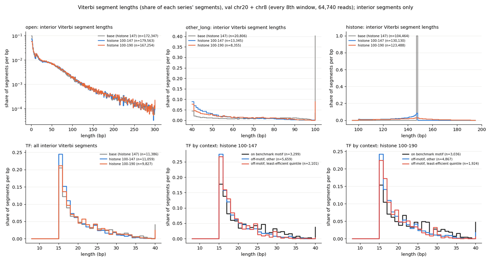

# Summary

**Motivation.** The [short other_long note](fiber-short-other-long-calls.md) found three sources of
other_long's pile-ups: nucleosome footprints under 147 bp (the 100 bp cap), nucleosome footprints over
147 bp (other_long at its minimum beside a histone), and TF-like patches of 41-60 bp. These runs let the
nucleosome take the first two.

**Implementation** (smf_hmm `FixedBlockSpec`):
- **Exit tail.** The last `exit_tail_length` chain states form a deterministic tail that every visit
  ends with. With a 40-state tail, the 40 bp emission taper sits at both ends of every nucleosome,
  whatever its length; emissions are unchanged.
- **Peaked lengths.** `duration_mode` / `duration_scale` set zero-bias durations
  P(d) ∝ exp(−|d − mode| / scale) on [min, max]. Transitions are frozen, and the existing truncated
  geometric would make the shortest length the most likely.
- **Tying.** Histone potentials are tied, like TF and other_long, so the sequence prior places
  nucleosomes but cannot reshape their length. For a fixed 147 bp histone, tying is a no-op.
- **Tests.** Length distributions, tail topology under random biases, stationary occupancy, validation,
  CLI taper and checkpoint round-trip; full suite 506 passed.

**Runs.** Each is the base `r2_full` with only the histone changed: 100-147 bp or 100-190 bp, mode 147,
scale 15, 40-state tail. other_long stays at 40-100 bp. Seed 0, val chromosomes only, prior ×1.

**Results.**
- **100-190 is as good as or better than the base on every main metric:**
  - AUROC 0.765 (base 0.764); accessible-read AUROC 0.687 (best so far);
  - matched AUPRC 0.535 (best so far; base 0.528);
  - off-motif TF 4.78 per read-kb (base 5.65, −15%);
  - mean prior TF log-odds 1.09 (base 1.01).

  Per TF, RFX5 and YY1 gain about 0.018 AUROC, while CREM (−0.017), NRF1 (−0.009) and CTCF (−0.007)
  lose a little.
- **100-147 costs AUROC:** 0.743 (−0.021), with every TF lower (USF2 −0.035, SPI1 −0.032). It is not
  benchmark-neutral, despite better AUPRC (0.532), off-motif TF (5.18) and prior log-odds (1.10). Why
  the short-only version hurts AUROC is unexplained.
- **other_long mostly disappears with 100-190:**
  - 130 vs 323 segments per 1,000 reads;
  - at the 100 bp cap 9% vs 40%;
  - its remaining short calls are almost all TF-like patches (93% with a protected span of 41-60 bp,
    1.5% ≥ 147 bp, vs 28% in the base).

  With 100-147, the cap pile-up also goes (3%), but 31% of short other_long still has a span ≥ 147: the
  nucleosomes that are too long remain.
- **Nucleosome lengths largely follow the duration prior.**

  | | median length | at 147 bp | under 147 bp | over 147 bp |
  |---|---|---|---|---|
  | 100-147 prior | 138 | 6.7% | 93% | – |
  | 100-147 Viterbi | 136 | 8.4% | 92% | – |
  | 100-190 prior | 147 | 3.5% | 49% | 48% |
  | 100-190 Viterbi | 142 | 3.0% | 60% | 37% |

  The reads move lengths somewhat shorter, but the distribution is about as broad as the prior. The
  tapered edges, which tolerate m6A down to protection 0.2, probably leave boundaries weakly determined
  (inferred). So individual nucleosome lengths should not be read as measurements.
- **Two scorecard metrics got worse:**
  - off-motif TF calls are more concentrated in the worst-labelled decile (5.5× the best decile vs
    2.4×);
  - kernel support of off-motif TF runs is 86% (base 92%), although there are fewer of them (116 vs 123
    per 1,000 reads).

**Recommendation.** Adopt histone 100-190 as the next base if a tighter length prior keeps its gains.
Candidate next steps (untested):
- a tighter scale (e.g. 8 bp) or a learned length distribution, so lengths are not prior-dominated;
- TF 15-60 (or a separate 40-60 bp TF block) for the remaining 41-60 bp patches, many at CTCF;
- removing other_long, now down to 130 segments per 1,000 reads.

# Key Points

| run | AUROC | accessible-read AUROC | protected-read AUROC | ρ within bound | matched AUPRC | on-motif share | off-motif TF / read-kb | prior TF log-odds (mean) |
|---|---|---|---|---|---|---|---|---|
| base r2_full (histone 147) | 0.764 | 0.681 | 0.780 | 0.213 | 0.528 | 0.353 | 5.65 | 1.01 |
| histone 100-147 | 0.743 | 0.674 | 0.761 | **0.222** | 0.532 | 0.346 | 5.18 | **1.10** |
| histone 100-190 | **0.765** | **0.687** | **0.781** | 0.215 | **0.535** | **0.355** | **4.78** | 1.09 |

| run | TF runs / 1,000 reads | TF at 15 bp | TF median | other_long / 1,000 reads | other_long at 100 / at 40 | other_long median | histone / 1,000 reads | CTCF / NRF1 median at bound motifs |
|---|---|---|---|---|---|---|---|---|
| base | 177 | 20% | 19 | 323 | 40% / 4.5% | 86 | 1,621 | 28 / 19 |
| 100-147 | 172 | 25% | 17 | 207 | 3.4% / 8.9% | 49 | 2,018 | 27 / 16 |
| 100-190 | 152 | 21% | 18 | 130 | 8.9% / 7.7% | 56 | 1,915 | 27 / 21 |

| short other_long (40-42 bp) | n | isolated | next to a histone | protected span 41-60 / ≥ 147 |
|---|---|---|---|---|
| base | 1,729 | 734 | 995 | 61% / 28% |
| 100-147 | 2,924 | 1,041 | 1,883 | 61% / 31% |
| 100-190 | 1,369 | 830 | 539 | 93% / 1.5% |

- **Per-TF AUROC:**

  | TF | base | 100-147 | 100-190 |
  |---|---|---|---|
  | CTCF | 0.868 | 0.857 | 0.861 |
  | NRF1 | 0.868 | 0.850 | 0.859 |
  | CREM | 0.825 | 0.793 | 0.808 |
  | USF2 | 0.788 | 0.753 | 0.783 |
  | RFX5 | 0.753 | 0.747 | 0.771 |
  | SPI1 | 0.746 | 0.714 | 0.753 |
  | EBF1 | 0.731 | 0.710 | 0.729 |
  | PAX5 | 0.697 | 0.672 | 0.702 |
  | YY1 | 0.599 | 0.587 | 0.617 |

- **Prior TF log-odds per TF:**

  | TF | base | 100-147 | 100-190 |
  |---|---|---|---|
  | CTCF | 2.56 | 2.60 | 2.70 |
  | NRF1 | 1.68 | 2.16 | 1.81 |
  | USF2 | 1.08 | 1.17 | 1.26 |
  | CREM | 0.87 | 0.91 | 0.89 |
  | RFX5 | 0.75 | 0.99 | 0.85 |
  | SPI1 | 0.66 | 0.57 | 0.73 |
  | EBF1 | 0.54 | 0.59 | 0.56 |
  | PAX5 | 0.57 | 0.48 | 0.51 |
  | YY1 | 0.37 | 0.46 | 0.51 |
  | mean | 1.01 | 1.10 | 1.09 |



*Letting the nucleosome vary removes other_long's 100 bp pile-up (top middle) and spreads histone
lengths over the allowed range (top right). TF lengths barely change (bottom left).*

# Details

- **Short other_long breakdown.** Rerun with `short_other_long.py` (CONFIG=r3_hist100_{147,190}_x1).
  In 100-190, short calls "next to a histone" sit 5-12 bp away with m6A in between (protected span
  about 44 bp), not merged with it as in the base.
- **Scorecard.** `nub_scorecard.py`; off-motif TF there excludes footprinting-motif matches:
  - 6.05 (100-190) and 6.53 (100-147) vs 6.73 for the base;
  - low- vs high-efficiency ratio 5.46 / 4.97 vs 2.45;
  - kernel-supported 86% / 88% vs 92%.
- **Small spike at 100 bp.** About 1-1.5% of histones sit at the 100 bp minimum in both runs.
- **Code provenance.** Training ran from a code snapshot in each run directory, so a requeued job uses
  the same code. Inference and Viterbi ran from the live working tree, with the same transition code.

```bash
S=/scratch/users/diamant; W=$S/fiber_eval_work; T=$W/tf_mechanism
# histone spec in train.sbatch: {name:histone,min_duration:100,max_duration:190,occupancy:0.69,duration_mode:147,duration_scale:15.0,exit_tail_length:40}
#   + 'transition.tied_blocks=[TF,other_long,histone]'
sbatch $S/2026-11-17_fiber_hist100_190_kl300_alphagenome_bf16/train.sbatch   # after a 1-epoch smoke run
sbatch --dependency=afterok:<train> $W/infer_variant_val_extra_any.sbatch r3_hist100_190 $S/2026-11-17_fiber_hist100_190_kl300_alphagenome_bf16
MODELS=r3_hist100_190 sbatch --dependency=afterok:<train> $T/viterbi_lengths.sbatch
sbatch --dependency=afterok:<infer both> $W/analyze_r3_val.sbatch
python $T/viterbi_stats.py r2_full_x1 r3_hist100_147_x1 r3_hist100_190_x1; SET=r3 python $T/plot_viterbi_lengths.py
CONFIG=r3_hist100_190_x1 POSTERIOR=r3_hist100_190 python $T/short_other_long.py
python $T/nub_scorecard.py $T/scorecard_r3.tsv r3_hist100_147 r3_hist100_190
```

# Related Notes

- [Short other_long calls](fiber-short-other-long-calls.md): The diagnosis these runs act on.
- [Ablation round 2](fiber-ablation-round2-full-model-leave-one-out.md): The base model.
- [Open-state overdispersion](../2026-11-16/fiber-open-state-overdispersion.md): Still unmodelled; not
  measured here.

# Open Questions

- Why does the short-only nucleosome (100-147) lower AUROC for every TF while improving AUPRC and
  off-motif TF?
- How much of the length spread is prior? A tighter scale would show whether the gains need flexible
  lengths or just the long side.
- Why are off-motif TF calls now more concentrated in poorly labelled DNA?

# Sources

- Runs, jobs and outputs in the frontmatter.
