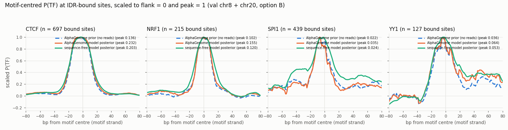
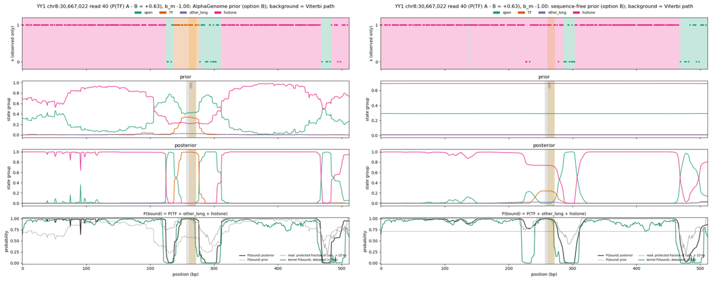
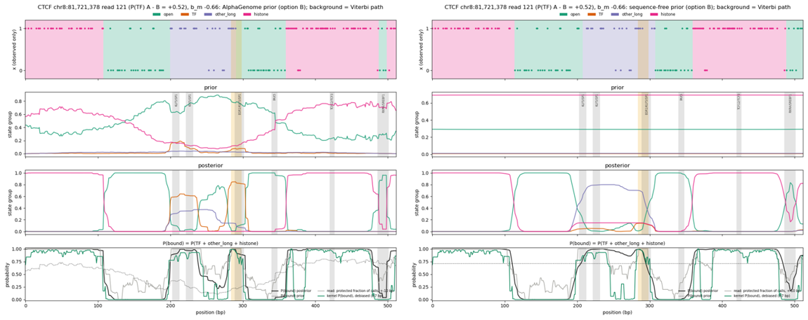
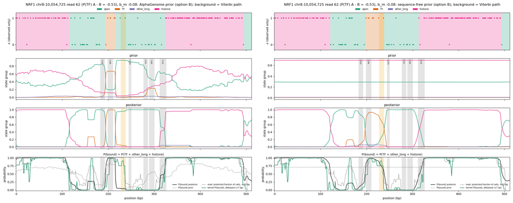

# Summary

**Question.** Does the AlphaGenome sequence prior help the current model, and what drives the
posterior-metric differences between a model with it and one without?

**Runs.** Options A (other_long 40-100) and B (other_long 61-100) of the
[current design](fiberseq-model-components.md) were retrained with a sequence-free prior: one learned
potential per state group, no DNA input. Everything else is identical, including the KL weight 300 to
the same occupancy targets. Val chromosomes only, prior ×1.

**Results.** The two kinds of prior win on different metrics.
- **Sequence-free is better on:**
  - raw AUROC (B: 0.797 vs 0.774; A: 0.774 vs 0.768);
  - protected-read AUROC (B: 0.808 vs 0.789);
  - off-motif TF (B: 4.72 vs 6.12 per read-kb).

  YY1 accounts for most of the gap (0.708 vs 0.637), then RFX5 and CREM.
- **AlphaGenome is better on:**
  - accessibility-stratified AUROC (A: 0.688 vs 0.670);
  - ρ within bound sites (B: 0.246 vs 0.230; A: 0.232 vs 0.206);
  - matched AUPRC (A: 0.538 vs 0.496; B: 0.520 vs 0.503).

  That is, the comparisons at matched accessibility and the ranking among bound sites.

**What drives the differences.**
- **The disagreement follows the prior.** The site-level difference in motif P(TF) (AlphaGenome minus
  sequence-free) correlates with the AlphaGenome prior's P(TF) at the motif: 0.76 at bound sites and
  0.58 at unbound ones.
- **Unbound motifs the prior raises carry real protection from other factors.** The quintile of unbound
  sites raised most has the most kernel-confirmed footprints (mean confident-footprint share 0.021, vs
  0.001-0.008) and the highest prior P(TF) (0.025, vs 0.005).
  - A YY1 "unbound" motif overlapping a CTCF motif carries a ~50 bp CTCF footprint.
  - A CTCF "unbound" motif sits in a GC-rich SP1/KLF/EGR cluster.

  The prior's TF bump turns these footprints into confident TF calls, while the sequence-free model
  splits them between other_long and histone. The benchmark scores P(TF) at the YY1 or CTCF motif, so
  another factor's footprint counts as a false positive.
- **Bound motifs the prior lowers have a stronger neighbouring motif.** At a bound NRF1 motif 25 bp from
  a stronger NRF1 match, the prior places the TF call on the neighbour. The sequence-free model's TF
  call covers the benchmark motif; the kernel shows protection spanning both.
- **Where the read has a footprint, the prior helps.** 96.5% of the bound sites it raises most have
  kernel-confirmed footprints.
- **The prior's TF bump has the footprint's width and shape, not the motif's.** At bound sites it matches
  the sequence-free model's posterior, which only sees reads:
  - half-max width (CTCF 31 vs 34 bp; NRF1 23 vs 24 bp), much wider than the motifs;
  - asymmetry (CTCF extends 5′ of the motif, YY1 3′).

  So the spread beyond the motif reflects footprints being wider than motifs. Repeated 1D sliding or
  search along the molecule is unlikely to explain it (reasoning in Details).

**Interpretation** (inferred from these examples and site-level statistics).
- **Specificity of the prior.** The AlphaGenome prior is a better TF *locator* where TFs footprint.
  It is not TF-specific: the model has one generic TF state, and the prior raises P(TF) wherever some
  factor is likely bound. On a per-TF benchmark this costs raw AUROC at TFs whose unbound motifs often
  sit in other factors' sites (YY1, RFX5, CREM).
- **Why sequence-free wins raw AUROC.** It scores motifs more by the read evidence of protection at
  that exact position, which tracks ChIP binding more uniformly. It loses where accessibility-matched or
  within-bound comparisons need motif-level discrimination.
- **The metric gap is partly a benchmark artefact.** Some of the prior's "false positives" are true
  footprints of other factors at unbound motifs. A generic-TF model cannot be scored per TF without
  this confusion.

# Key Points

| metric | option A, AlphaGenome | option A, sequence-free | option B, AlphaGenome | option B, sequence-free |
|---|---|---|---|---|
| IDR AUROC | 0.768 | 0.774 | 0.774 | **0.797** |
| accessibility-stratified AUROC | 0.688 | 0.670 | **0.690** | 0.686 |
| protected-read AUROC | 0.783 | 0.786 | 0.789 | **0.808** |
| ρ within bound sites | 0.232 | 0.206 | **0.246** | 0.230 |
| matched AUPRC | **0.538** | 0.496 | 0.520 | 0.503 |
| off-motif TF / read-kb | 4.69 | **3.78** | 6.12 | 4.72 |
| prior TF log-odds | 1.08 | 0.00 | **1.19** | 0.00 |

- **Per-TF AUROC (option B):**

  | TF | AlphaGenome | sequence-free | AlphaGenome prior-only AUROC |
  |---|---|---|---|
  | CTCF | 0.880 | 0.884 | 0.892 |
  | NRF1 | 0.877 | 0.890 | 0.866 |
  | USF2 | 0.785 | 0.799 | 0.811 |
  | CREM | 0.793 | 0.814 | 0.834 |
  | RFX5 | 0.766 | 0.804 | 0.728 |
  | SPI1 | 0.763 | 0.778 | 0.768 |
  | EBF1 | 0.737 | 0.753 | 0.704 |
  | PAX5 | 0.731 | 0.746 | 0.758 |
  | YY1 | 0.637 | 0.707 | 0.704 |

- **Per-TF metrics (option B), AlphaGenome / sequence-free.** Better value in bold.

  | TF | bound / unbound | AUROC | stratified AUROC | protected-read AUROC | ρ within bound | matched AUPRC |
  |---|---|---|---|---|---|---|
  | CTCF | 697 / 1044 | 0.880 / **0.884** | **0.827** / 0.817 | 0.887 / **0.890** | **0.284** / 0.269 | **0.849** / 0.827 |
  | NRF1 | 215 / 1285 | 0.877 / **0.890** | **0.785** / 0.764 | 0.912 / **0.918** | 0.515 / **0.524** | **0.785** / 0.761 |
  | USF2 | 76 / 528 | 0.785 / **0.799** | 0.669 / **0.671** | 0.800 / **0.814** | **0.352** / 0.347 | 0.622 / 0.624 |
  | CREM | 80 / 218 | 0.793 / **0.814** | 0.683 / **0.692** | 0.815 / **0.830** | 0.411 / **0.437** | **0.566** / 0.545 |
  | RFX5 | 23 / 1080 | 0.766 / **0.804** | 0.709 / **0.722** | 0.773 / **0.806** | **−0.067** / −0.128 | **0.463** / 0.450 |
  | SPI1 | 439 / 1065 | 0.763 / **0.778** | **0.692** / 0.676 | 0.767 / **0.780** | **0.234** / 0.208 | **0.403** / 0.364 |
  | EBF1 | 438 / 1443 | 0.737 / **0.753** | 0.689 / **0.694** | 0.742 / **0.756** | **0.382** / 0.362 | **0.392** / 0.384 |
  | PAX5 | 195 / 877 | 0.731 / **0.746** | **0.645** / 0.608 | 0.747 / **0.756** | **0.074** / 0.037 | **0.315** / 0.288 |
  | YY1 | 127 / 272 | 0.637 / **0.707** | 0.510 / **0.532** | 0.655 / **0.722** | **0.032** / 0.013 | 0.287 / 0.286 |

  - Sequence-free wins raw and protected-read AUROC for every TF. The gap is tiny for CTCF and largest
    for YY1 and RFX5.
  - The prior wins matched AUPRC for 6 of 9 TFs, and ρ within bound for 7 of 9.
  - The prior wins stratified AUROC for the TFs with strong, motif-specific footprints (CTCF, NRF1,
    SPI1, PAX5) and loses slightly for the weak ones. RFX5 has only 23 bound sites.

- **Footprint shape at bound sites.** Motif-centred P(TF), strand-aligned, averaged over IDR-bound sites
  (val, option B). Width is the full width at half maximum above the flank level; centre of mass and
  the right / left mass ratio are taken within ±60 bp; "+" is 3′ of the motif.

  | TF | track | half-max width | centre of mass | right / left mass |
  |---|---|---|---|---|
  | CTCF | AlphaGenome prior | 31 bp | −2.5 bp | 0.73 |
  | CTCF | AlphaGenome posterior | 34 bp | −2.6 bp | 0.75 |
  | CTCF | sequence-free posterior | 34 bp | −2.5 bp | 0.77 |
  | NRF1 | AlphaGenome prior | 23 bp | +0.6 bp | 1.10 |
  | NRF1 | AlphaGenome posterior | 24 bp | −0.3 bp | 1.12 |
  | NRF1 | sequence-free posterior | 29 bp | −1.2 bp | 1.05 |
  | YY1 | AlphaGenome prior | 31 bp | +8.1 bp | 1.21 |
  | YY1 | AlphaGenome posterior | 33 bp | +10.3 bp | 1.37 |
  | YY1 | sequence-free posterior | 41 bp | +10.4 bp | 1.51 |

  At unbound motifs the prior's bump is low and broad: at NRF1, peak 0.010 over a flank of 0.008, about
  110 bp half-max width. That looks like regional sequence context (promoters, CpG islands), not a
  footprint.



*At bound CTCF and NRF1 motifs, the prior's TF bump (dashed) has the same width and asymmetry as the
posterior of a model that never sees sequence (green). The prior has learned the footprint's extent
around the motif. SPI1 and YY1 show the same core with noisier flanks; YY1's protection extends 3′.*

- **Site-level disagreement vs read evidence (option B).** Sites are binned by quintile of (AlphaGenome
  − sequence-free) motif P(TF); the kernel confident-footprint share is from
  `specificity_metrics.py`.

  | sites | quintile | mean kernel footprint share | sites with any confident footprint | mean prior P(TF) |
  |---|---|---|---|---|
  | unbound | most AlphaGenome-lower | 0.008 | 20% | 0.006 |
  | unbound | middle (3) | 0.001 | 4% | 0.005 |
  | unbound | most AlphaGenome-higher | 0.021 | 18% | 0.025 |
  | bound | most AlphaGenome-lower | 0.011 | 28% | 0.010 |
  | bound | middle (3) | 0.010 | 24% | 0.013 |
  | bound | most AlphaGenome-higher | 0.342 | 97% | 0.224 |



*YY1 "unbound" motif at chr8:30,667,022, read 40; AlphaGenome model left, sequence-free right; green
line = kernel P(bound). The motif overlaps a CTCF match, and the kernel shows a ~50 bp footprint. The
prior's TF bump makes it confident TF (left); the sequence-free model gives the region mostly to
histone, with a little TF (right).*



*CTCF "unbound" motif at chr8:81,721,378 (SP1/KLF/EGR cluster), read 121. The kernel confirms
protection over the motif; the AlphaGenome model calls TF there, the sequence-free model other_long.*



*Bound NRF1 motif at chr8:10,054,725 (yellow), read 62, 25 bp from a stronger NRF1 match. The kernel
shows protection over both. The AlphaGenome model's TF call sits on the stronger neighbour, where its
prior is 0.65, leaving the benchmark motif near 0; the sequence-free model's TF call covers it.*

# Details

- **Site selection for the plots.** From site table `analysis_idr_r6` (option B models), sites with
  ≥ 20 covering reads. Per TF:
  - the bound sites with the most negative (AlphaGenome − sequence-free) motif P(TF);
  - the unbound sites with the most positive.

  20 sites in all: YY1 5, RFX5 4, CREM 2, SPI1 3, CTCF 3, NRF1 3 (`seqfree/disagreement_sites.tsv`).
- **Read selection.** `--read-choice disagreement` takes the two reads with the largest difference
  in motif ±10 bp P(TF) in each direction. All 20 montages are in
  `/scratch/users/diamant/gm12878_validation/seqfree_disagreement/montages/`.
- **Caveats.**
  - These are the most extreme sites, chosen to show mechanisms, not their prevalence; the quintile
    table is the population-level check.
  - The "another factor's footprint" reading of unbound sites rests on motif overlaps and kernel
    protection, not on ChIP for the other factor.
- **Not checked:** whether the gap closes on ChIP-based labels that ignore motif identity (any IDR
  peak of any TF).
- **Why the bump is wider than the motif** (inferred, not tested). Several mechanisms can make the
  protected stretch wider than the motif's base contacts:
  - the protein's own footprint is larger than its contacts;
  - the methyltransferase is sterically excluded next to a bound protein;
  - partners add protection on one side, e.g. cohesin at CTCF.

  The TF state also lasts 15-60 bp, so short motifs such as NRF1's (11 bp) get at least 15 bp. In a
  single read, the prior can look wider than that read's footprint because it averages over footprint
  positions and lengths across reads and sites.
- **Why sliding is unlikely to explain the bump.**
  - Facilitated diffusion moves a TF over tens to hundreds of bp within milliseconds per encounter.
  - Fiber-seq labelling runs for minutes, and an A stays unmethylated only if it is covered for much of
    that time.
  - A sliding TF would therefore barely change any single base's methylation and leave no footprint.
  - The prior also never sees reads; it learns a population average from sequence.

  Flexible binding registers, or dissociation and rebinding during labelling, would fit the data better.
  How much CTCF's position varies between reads is tested in
  [CTCF footprint position across reads](../2026-11-19/fiber-ctcf-footprint-position-variability.md): positions vary about 2× the read-noise null, mostly from merging with adjacent protection; isolated footprints still vary 1.8×, mainly at the 3′ edge.
- **Profiles:** `fiber_eval_work/seqfree/motif_profiles.py`, which writes `seqfree/profiles.tsv.gz`, and
  `seqfree/plot_profiles.py`.

```bash
S=/scratch/users/diamant; W=$S/fiber_eval_work
# runs: train.sbatch of options A/B with prior.architecture=constant
sbatch $S/2026-11-18_fiber_hist190_tf60_kl300_constant_prior/train.sbatch
sbatch $S/2026-11-18_fiber_hist190_tf60_ol61_kl300_constant_prior/train.sbatch
sbatch $W/analyze_r6_val.sbatch   # IDR, prior log-odds, specificity for r6_* and options A/B
# site deltas and site choice: inline Python over analysis_idr_r6 + the option-B prior (seqfree/site_deltas_optionB.tsv.gz)
sbatch $W/tf_mechanism/plot_model_comparison.sbatch $S/gm12878_validation/seqfree_disagreement \
  --model "r5_tf60_ol61=$S/2026-11-17_fiber_hist190_tf60_ol61_kl300_alphagenome_bf16:AlphaGenome prior (option B)" \
  --model "r6_ol61_const=$S/2026-11-18_fiber_hist190_tf60_ol61_kl300_constant_prior:sequence-free prior (option B)" \
  --site-keys $W/seqfree/disagreement_sites.tsv --read-choice disagreement
```

# Related Notes

- [Fiber-seq HMM components](fiberseq-model-components.md): The design compared here, and the metric
  definitions.
- [ReLU collapse and GELU head](../2026-11-15/fiber-prior-ablation-and-relu-head-collapse.md): The
  first observation that a constant prior beat informative priors on AUROC (0.796 vs 0.741 at prior ×1).
- [other_long 61-100](fiber-tf60-other-long-61-100.md): Option B, and its off-motif TF calls.

# Open Questions

- Would a motif-agnostic or multi-TF evaluation (bound = any IDR peak of any factor) remove the
  sequence-free model's AUROC advantage?
- Would TF-specific states (or a TF-identity output of the prior) keep the prior's footprint locating
  without counting other factors' footprints at a benchmark TF's motif?
- Can the prior be kept from assigning a footprint to one of two neighbouring motifs, e.g. by scoring
  P(TF) over a window rather than the exact motif?

# Sources

- Runs, jobs and outputs in the frontmatter.
