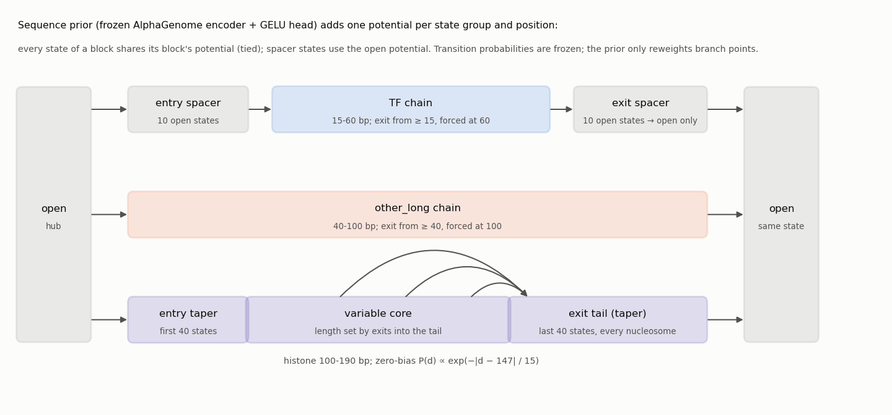
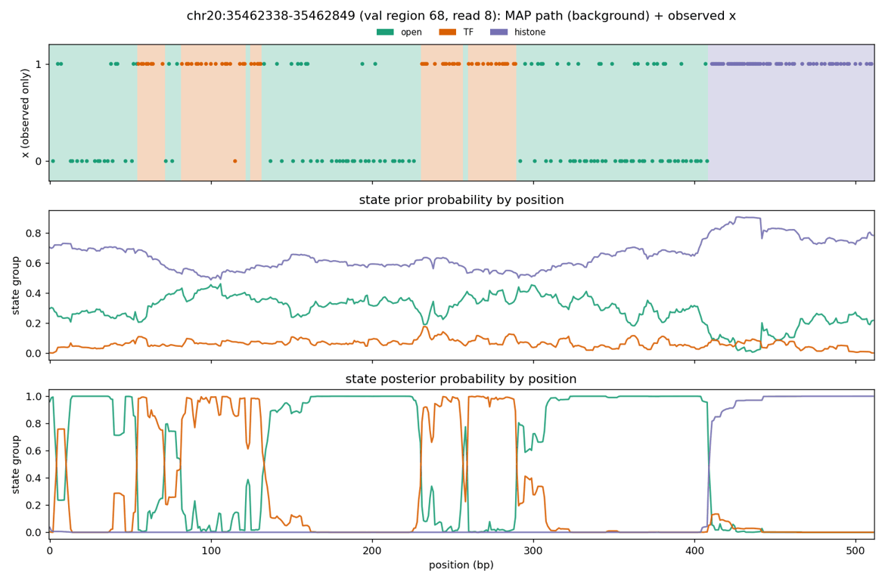
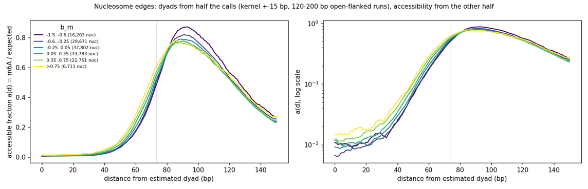
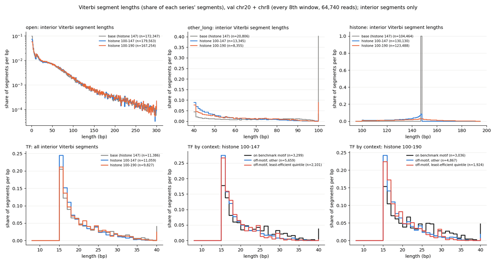
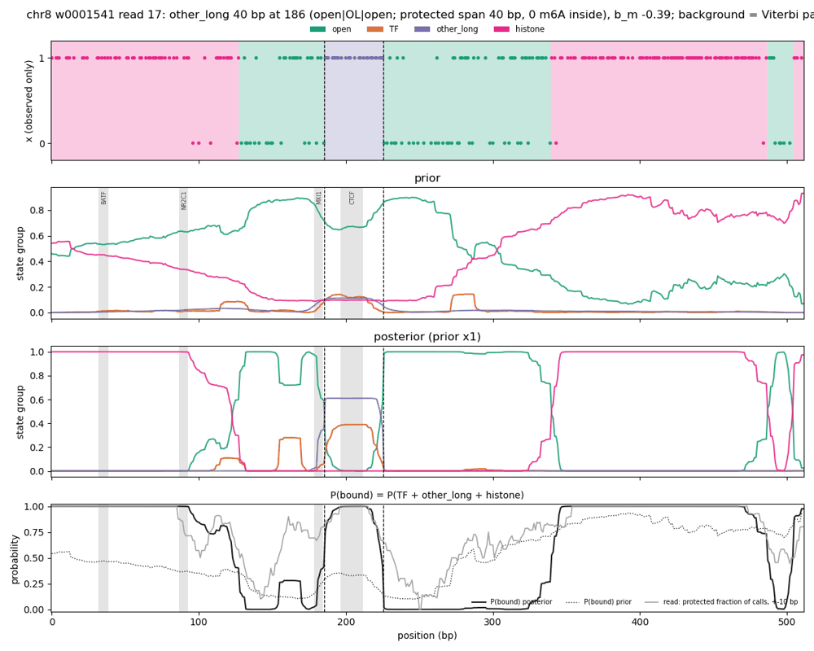
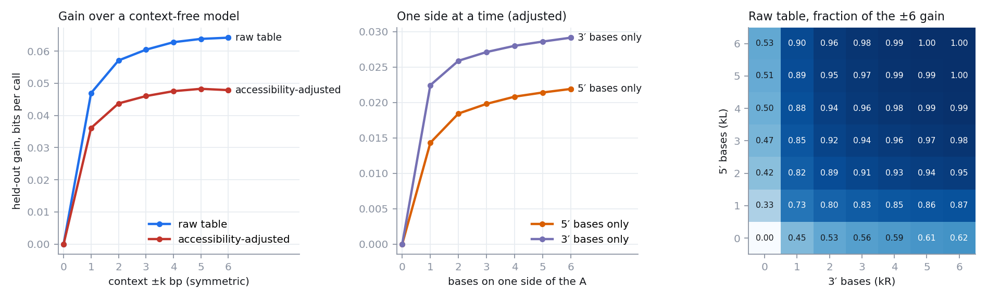
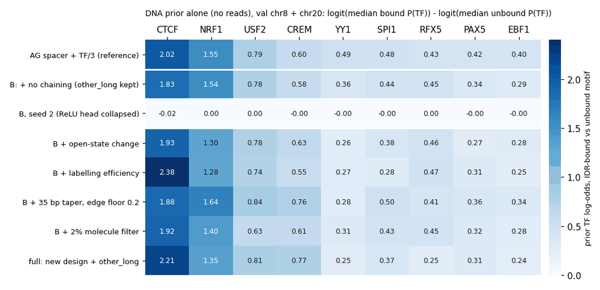
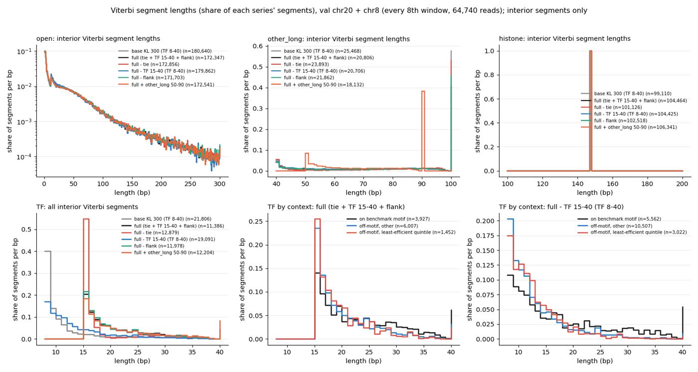

# Summary

**What this is.** A concise description of the current GM12878 Fiber-seq HMM. Each component gets what
it is, why it is there, and the key evidence for it. The development history is in the
[long report](../2026-11-17/fiberseq-model-report.md) and the notes it links.

**Conventions.**
- Metrics are on the validation chromosomes (chr8, chr20), with the trained prior as is (prior ×1).
- The test chromosomes (chr1, chr3, chr6) were never evaluated.
- "Base" means the first Fiber-seq model (2026-10-22): the mESC SMF design applied to m6A calls unchanged.

**The model in one paragraph.** Each read is a sequence of A/T calls: m6A (accessible) or unmethylated
(protected). A hidden-state chain explains them with four state groups: open, TF, other_long and
histone (nucleosome).
- **Transitions** are fixed: each protected element is a chain of microstates with a frozen length
  distribution.
- **Emissions** give each group a learned protection probability inside a band, plus a learned
  correction for m6A sequence-context bias.
- **A sequence prior** (a frozen AlphaGenome encoder with a small trained head) adds one potential per
  state group and position, so the DNA can favour, e.g., TF at a motif.
- **Training** maximises read likelihood, with a strong penalty keeping the prior's state occupancy at
  fixed targets.

*The open state feeds three blocks. TF is entered and left through 10 bp open spacers. other_long is a
single length-capped chain. The histone has a variable core that always ends in a 40-state tapered exit
tail. The prior adds one tied potential per block.*

**Components** (§1-9 below):

| # | component | in one line |
|---|---|---|
| 1 | single TF state with a protection floor | one TF state that must look protected, instead of four groups that absorbed labelling variation |
| 2 | open spacers around TF | every TF call is flanked by ≥ 10 bp of open DNA and cannot chain into the next |
| 3 | TF length 15-60 bp | no 8 bp "nubs"; long CTCF-like footprints fit in TF |
| 4 | flexible nucleosome with fuzzy edges | 100-190 bp, peaked at 147 bp, with 40 bp tapered edges at both ends |
| 5 | rare other_long | a 1% catch-all for protected stretches between TF and nucleosome; two range options remain |
| 6 | context-bias correction | a learned ±3 bp m6A context offset shared by all states |
| 7 | AlphaGenome encoder prior with a residual GELU head | a frozen pretrained DNA encoder; a head that does not die |
| 8 | tied prior potentials | the prior says where each element is, not how long it is |
| 9 | occupancy targets with strong regularization | the prior's state occupancy pinned to realistic targets (KL weight 300) |

**Overall effect** (§10):
- accessibility-stratified AUROC 0.629 → 0.688-0.690;
- within-bound ρ 0.111 → 0.232-0.246;
- prior TF log-odds 0.38 → 1.08-1.19;
- off-motif TF 4.7-6.1 per read-kb, vs 38.6 for the phase-type baseline.

Raw AUROC (0.768-0.774) is still below phase-type (0.809), which over-calls TF.

# Key Points

## Model definition

**Observations and states.**
- **Calls:** for read $r$, $x_{r,t} \in \lbrace 0, 1 \rbrace$ at each called A/T position $t$, where 1 = no m6A
  (protected) and 0 = m6A (accessible); other positions are missing.
- **Hidden states:** $z_t \in \lbrace 1, \dots, K \rbrace$, each in a group $g(z_t) \in$ {open, TF, other_long,
  histone}. $K = 371$ for the TF 15-60 models.

**Emissions.** Each group has one protection log-odds $\ell_g$, kept inside a band by a sigmoid
reparameterisation, plus a context offset $c$ (§6):

$$
P(x_t = 1 \mid z_t = k, s) = \sigma\big(\ell_{k} + c(s_{t-3..t+3})\big), \qquad
\ell_g = a_g + (b_g - a_g)\,\sigma(\theta_g).
$$

- Bands $[\sigma(a_g), \sigma(b_g)]$: open [0.05, 0.45]; TF [0.85, 0.995]; other_long and histone
  [0.45, 0.995].
- Histone states interpolate $\ell$ toward a learned edge value near the ends (§4).

**Prior.** Global normalization over whole paths:

$$
p(z \mid s) = \frac{1}{Z(s)}\; p_A(z)\, \exp\Big(\sum_t \phi_{g(z_t)}(s, t)\Big),
$$

- $p_A$ is the frozen transition chain.
- $\phi$ is the network's potential for the group of $z_t$ at position $t$ (tied per group, §8).
- $Z(s)$ normalizes over all paths.

With $\phi = 0$ the model is the plain HMM.

**Objective.**

$$
\mathcal{L} = -\frac{1}{R} \sum_r \log p(x_r \mid s_r)
  + \lambda\, \mathrm{KL}\big(\pi^\star \,\|\, \bar\pi_\phi\big), \qquad \lambda = 300,
$$

- $\bar\pi_\phi$ is the prior's group occupancy (prior-only marginals, averaged over the batch).
- $\pi^\star$ = (open 0.2933, TF 0.0067, other_long 0.01, histone 0.69) (§9).

## 1. Single TF state with a protection floor

- **What.** One TF block replaces the base model's four TF groups (short/long × strong/weak). Its
  protection probability is bounded below at 0.85; it learns 0.94.
- **Why.** In the base model the weak TF groups did not model footprints; they modelled labelling.
  - TF_short_weak sat exactly on its band floor (0.550), and open learned 0.091.
  - The DNA-only prior learned the m6A context bias: prior P(open) rose from 0.000 to 0.262 across
    labelling-efficiency deciles.
  - In the mESC SMF work the apparent multi-TF ChIP gain came from an inflated occupancy target, not
    from the weak groups.

  A floor of 0.85 keeps TF clearly distinct from open (≤ 0.45), so a TF call needs real protection.
- **Evidence:** [base model diagnosis](../2026-10-30/fiber-hmm-enzyme-bias-diagnostic.md);
  [SMF KL-target finding](../2026-11-04/controlled-chip-metrics-and-context-offsets.md).

## 2. Open spacers around TF

- **What.** TF is entered only through a chain of 10 open-group states and left only through another 10,
  which return to open with no re-entry (repeat probability 0). Every TF call therefore has ≥ 10 bp of
  open DNA on each side, and two TF calls are ≥ 21 bp apart. Spacer states use the open state's
  emission and prior potential.
- **Why.**
  - **Chaining.** Without spacers the sequence prior chains length-capped TF calls through open gaps of
    a few bp. With an AlphaGenome prior on a phase-type structure, 22% of TF bases were in chains longer
    than 100 bp, against 2.2% for phase-type.
  - **No other_long.** In a model without other_long, TF chains took its place. Forbidding re-entry
    recovered most of the loss (AUROC 0.633 → 0.715).
- **Evidence:**
  - spacers alone: AUROC 0.716 → 0.769;
  - prior TF log-odds 0.44 → 0.76 (CTCF 0.87 → 1.94);
  - TF bases in chains > 40 bp: 8%, vs 26% for phase-type.
  - Notes: [chaining with a TF cap](../2026-11-12/fiber-ag-phase-type-structure-run.md);
    [spacers](../2026-11-12/fiber-tf-spacer-and-tf-target.md);
    [no chaining](../2026-11-13/fiber-no-other-long-tf-chaining.md).

*Without spacers, capped TF blocks chain through open gaps of a few bp under a diffuse TF prior (one
read, AlphaGenome prior with phase-type states).*

## 3. TF length 15-60 bp

- **What.** TF durations run from 15 to 60 bp (base: 8-25 and 20-40 bp groups), with a truncated
  geometric zero-bias distribution.
- **Why the 15 bp minimum.**
  - 8 bp TF "nubs" patched clustered protection in accessible DNA, which one open state cannot model:
    runs of ≥ 8 protected calls are 1.3-1.5× its expectation.
  - Short calls at weak-footprint TFs looked like background: at bound motifs of SPI1, USF2, PAX5,
    EBF1, RFX5, CREM and YY1, motif spans are about 80% mixed, as at unbound motifs.
  - Raising the minimum cut off-motif TF runs from 269 to 151 per 1,000 reads, raised kernel support
    from 82% to 92%, and raised AUROC from 0.744 to 0.756.
- **Why the 60 bp maximum.**
  - With a 40 bp cap, 41-60 bp protected patches went to other_long; 27% of the isolated ones sat on
    bound CTCF.
  - TF calls now sit at the cap 0.2% of the time, vs 2.5% before.
  - Whether TF actually uses 41-60 bp depends on other_long (§5).
- **Evidence:** [open overdispersion](../2026-11-16/fiber-open-state-overdispersion.md);
  [short TF calls](../2026-11-16/fiber-short-tf-calls-sparsity-vs-dissociation.md);
  [ablation round 1](../2026-11-16/fiber-ablation-round1-tie-tf-length-histone-other-long-open.md);
  [short other_long calls](../2026-11-17/fiber-short-other-long-calls.md);
  [TF 15-60](../2026-11-17/fiber-tf-15-60.md).

## 4. Flexible nucleosome with fuzzy edges

**What.** The histone block lasts 100-190 bp, with zero-bias durations

$$
P(d) \propto \exp\!\big(-|d - 147| / 15\big), \qquad 100 \le d \le 190 .
$$

- **Exit tail.** The variable core exits into a deterministic 40-state tail that ends every nucleosome.
- **Tapered edges.** The first 40 and last 40 states ramp their protection log-odds linearly toward a
  learned edge value, which lies in [logit 0.2, $\ell_\text{histone}$]:

  $$
  \ell_k = \ell_\text{edge} + \min(d_k / 40,\, 1)\,(\ell_\text{histone} - \ell_\text{edge}),
  $$

  where $d_k$ is the state's distance from the nearer end of the chain. Because of the exit tail, both
  edges are tapered whatever the length.
- **Base model, for comparison:** histone ≥ 130 bp with no taper. The mESC work then fixed it at 147 bp
  with a 25 bp taper.

**Why.**
- **Edges are wide.** Model-free, accessibility rises roughly exponentially from about 40 to 75 bp from
  the dyad. A 40 bp taper with a 0.2 floor lowered off-motif TF (6.18 → 5.84).
- **Fixed lengths overflowed into other_long.**
  - Short nucleosomes went to other_long's 100 bp cap (protected spans 104-113 bp).
  - Over-long footprints (about 160-190 bp, a nucleosome plus 20-40 bp) became other_long at its
    minimum beside a histone.

**Evidence.** Letting the length vary (100-190 bp):
- other_long 323 → 130 segments per 1,000 reads; other_long at the cap 40% → 9%;
- matched AUPRC 0.528 → 0.535; off-motif TF 5.65 → 4.78;
- prior log-odds 1.01 → 1.09; AUROC unchanged (0.765).

A short-only version (100-147 bp) cost 0.02 AUROC.

**Caveat.** Individual nucleosome lengths largely follow this duration prior (Viterbi median 142 bp),
so they should not be read as measurements.

Notes: [nucleosome edges](../2026-11-13/fiber-nucleosome-lengths-and-edges.md);
[variable nucleosome](../2026-11-17/fiber-variable-length-nucleosome.md).

*Accessible fraction by distance from the estimated dyad: the edge is wide (about 40-75 bp from the
dyad) and roughly exponential, which the 40 bp taper approximates.*

*With a variable nucleosome, other_long's 100 bp pile-up disappears (top middle) and histone lengths
spread over 100-190 bp (top right).*

## 5. Rare other_long, with two range options

**What.** A catch-all block for protected stretches longer than a TF footprint but unlike a nucleosome.
Its occupancy is 1%; in the base model it was 8%, and in the first AlphaGenome models 10%.

**Why rare.** At 10%, other_long absorbed 16% of positions and many CTCF footprints: footprint-read
P(TF) at CTCF was 0.49, vs 0.72 for phase-type. At 1%, it is 0.54.

**Why it is still there.** Removing it made TF chains take its place, and the remaining 61-99 bp calls
look like sub-nucleosomal particles (inferred from examples).

**Open choice of range:**

| option | other_long | effect |
|---|---|---|
| A | 40-100 bp (overlaps TF) | TF barely uses 41-60 bp (0.7% of TF calls), because other_long's duration prior is 4-5× more likely there; the patches stay other_long or split between the two |
| B | 61-100 bp | TF is the only state for 41-60 bp: 9.1% of TF calls exceed 40 bp, 59% of those on bound motifs (49% CTCF). Best AUROC, ρ and prior, but CTCF-unrelated 40-60 bp patches become confident TF calls too (lower CREM / YY1 AUPRC, more off-motif TF), and other_long piles at 61 bp |

Notes: [other_long and linkers](../2026-11-11/fiber-other-long-footprint-reads-and-linkers.md);
[TF 15-60](../2026-11-17/fiber-tf-15-60.md);
[other_long 61-100](fiber-tf60-other-long-61-100.md).

*With option A, an isolated 40 bp protected patch over a CTCF motif splits between other_long and TF:
the case option B was designed for.*

## 6. Context-bias correction

- **What.** A learned offset $c$ for each ±3 bp context (4⁷ = 16,384 entries, centred), added to every
  state's emission log-odds. It absorbs the m6A sequence-context bias without moving the states.
- **Why.**
  - The bias is large. Per-site m6A rates run from 0.002 (`AA[A]AA`) to 0.24 (`CC[A]GC`), so the 95th
    percentile context has 64× the odds of the 5th.
  - ±3 bp captures 95% of the best held-out gain, and one table serves both strands.
  - Without a correction, the base model put the bias into its states and its DNA prior (§1).
- **Evidence:** the bias analysis below. A Fiber-seq ablation of the offsets alone was not reported. In
  the mESC SMF data the offsets improved validation NLL slightly (12.337 vs 12.356).
- **Not included: per-read labelling efficiency** (enzyme concentration, b_m); see Open Questions.
- **Notes:** [context bias](../2026-10-30/fiberseq-m6a-sequence-context-bias.md);
  [context offsets](../2026-11-04/controlled-chip-metrics-and-context-offsets.md).

*Held-out gain from context levels off by ±3-4 bp, and the 3′ side carries more than the 5′ side.*

## 7. AlphaGenome encoder prior with a residual GELU head

**What.**
- **Encoder.** The DNA is encoded by AlphaGenome's frozen embedder and first 3 blocks, run at 1 bp
  resolution in bf16. It gives 4 feature scales with receptive fields of about ±9 to ±69 bp.
- **Adapters.** Each scale goes through LayerNorm and a linear map to 64 channels; the four are
  concatenated to 256.
- **Trained head.** A linear layer to 128, then two residual blocks, then a final RMSNorm + GELU, then a
  linear output to the group potentials $\phi$. Each block is

  $$
  h \leftarrow h + \mathrm{Conv}_9\big(\mathrm{GELU}(\mathrm{RMSNorm}(h))\big).
  $$

  The convolutions and the output are zero-initialised, so training starts from the plain HMM.
- **Training stability.** Gradient clipping at 1.0 and a weight EMA of 0.999.

**Why.**
- **The encoder.** In mESC SMF, the AlphaGenome prior improved validation NLL (12.208 vs 12.360 for a
  matched CNN) and the sequence prior.
- **The adapters and stability measures.** Without LayerNorm, training lagged the CNN. Without
  clipping, potentials reached about 3×10⁵.
- **The GELU head.** The original head (conv → ReLU) died: 77-88% of first-layer units were dead in
  surviving runs, and one replicate collapsed to a constant prior (prior log-odds 0.00 for every TF).
  The residual GELU head trains reproducibly: 3 seeds, prior log-odds SD 0.02.

**Notes:** [AlphaGenome prior](../2026-11-06/alphagenome-encoder-prior.md);
[ReLU collapse and GELU head](../2026-11-15/fiber-prior-ablation-and-relu-head-collapse.md).

*With the ReLU head, one replicate's prior log-odds is zero for every TF because its head died.*

## 8. Tied prior potentials

- **What.** All microstates of a block share one potential ($\phi$ depends only on the group), and
  spacer states use the open potential. The prior can say where a TF, other_long or nucleosome is
  likely, but cannot reshape its length distribution.
- **Why.** With per-microstate potentials, the prior learned a length preference. A −1.3 nat penalty at
  TF state 9 made 8 bp the preferred TF length, and 40% of Viterbi TF calls sat at the minimum.
- **Evidence:** tying cut TF calls at the minimum from 40% to 19% and raised prior log-odds from 0.83 to
  0.94. With the variable nucleosome, tying also keeps nucleosome length out of the prior's hands.
- **Notes:** [spacer and duration shaping](../2026-11-16/fiber-tf-nubs-spacer-and-duration-shaping.md);
  [ablation round 1](../2026-11-16/fiber-ablation-round1-tie-tf-length-histone-other-long-open.md);
  [ablation round 2](../2026-11-17/fiber-ablation-round2-full-model-leave-one-out.md).

*Without tying, more than half of TF calls sit at the 15 bp minimum (red); with tying, about 20% do
(black, the round-2 full model).*

## 9. Occupancy targets with strong prior regularization

**What.** The KL term in $\mathcal{L}$ pins the prior's average group occupancy to targets that match
what the reads support: open 0.2933, TF 0.0067, other_long 0.01, histone 0.69.
- **Weight 300**, against 3 in the base model and 10 later.
- **The targets equal the zero-bias stationary occupancies of the transition chain.**

**Why.**
- **Inflated targets create calls.** In mESC SMF, a TF target 3.5× the rate the reads support created a
  weak-TF floor.
- **The TF target was cut 3× (0.02 → 0.0067)** together with the spacers.
- **The other_long target 0.10 → 0.01** is §5.
- **Weight 10 was too weak.** At KL 10 the prior's TF occupancy drifted, and the prior put TF mass
  where reads are uninformative (poorly labelled, A/T-rich DNA).

**Evidence.** KL 10 → 300:
- matched AUPRC 0.488 → 0.525;
- off-motif TF 14.4 → 6.2 per read-kb;
- prior log-odds 0.74 → 0.83.

KL 3000 collapsed the prior (log-odds about 0), so the weight has an upper limit.

**Notes:** [SMF KL target](../2026-11-04/controlled-chip-metrics-and-context-offsets.md);
[spacers + TF/3](../2026-11-12/fiber-tf-spacer-and-tf-target.md);
[TF nub mechanism](../2026-11-16/fiber-tf-nub-mechanism-overview.md);
[prior log-odds](../2026-11-14/fiber-prior-tf-log-odds-and-design-takeaways.md).

## 10. Benchmark summary

Val chromosomes, prior ×1, 9 TFs (CTCF, NRF1, USF2, CREM, RFX5, EBF1, PAX5, SPI1, YY1).

| metric | phase-type (baseline) | first comparable neural model (AG KL 10, 11-10) | current, option A (other_long 40-100) | current, option B (other_long 61-100) |
|---|---|---|---|---|
| IDR AUROC | **0.809** | 0.700 | 0.768 | 0.774 |
| accessibility-stratified AUROC | 0.685 | 0.629 | 0.688 | **0.690** |
| AUROC, protected reads | **0.826** | 0.744 | 0.783 | 0.789 |
| ρ within bound sites | 0.165 | 0.111 | 0.232 | **0.246** |
| accessibility-matched AUPRC | 0.485 | not computed | **0.538** | 0.520 |
| off-motif TF per read-kb | 38.6 | not computed | **4.69** | 6.12 |
| prior TF log-odds (mean) | – | 0.38 | 1.08 | **1.19** |

- **Phase-type** is a fixed phase-type HMM without a sequence prior. Its AUROC rewards over-calling TF;
  with bias-corrected emissions it scores 0.734.
- **Metric definitions** are in the next subsection.

## Metric definitions

**Sites.**
- **Motif sites.** Each benchmark motif instance inside a val window (512 bp, ≥ 90% valid positions,
  ≥ 10 reads).
- **IDR labels,** from ENCODE conservative IDR peaks of the motif's own TF:
  - **bound:** a peak summit within 100 bp of the motif centre;
  - **unbound:** no summit within 1 kb;
  - **ambiguous:** in between, excluded everywhere.
- **Averaging.** Every metric is computed per TF and then averaged over the 9 TFs with equal weight.

**Per-site quantities.**
- **Site score** $ar p$: the model's posterior P(TF), averaged over all reads in the window, then over
  the motif's positions. P(TF) sums all TF states.
- **Accessibility** $a$: the fraction of calls that are m6A within ±25 bp of the motif, over all reads.
  It is model-free.
- **ChIP signal:** pooled ChIP-seq signal at the motif, summed over replicates within ±50 bp.

**The metrics.**

| metric | computed as |
|---|---|
| IDR AUROC | AUROC of $ar p$ for bound vs unbound sites (all reads) |
| accessibility-stratified AUROC | sites split into 5 quantile bins of $a$; AUROC within each bin; average weighted by each bin's number of bound × unbound pairs. Only compares sites of similar accessibility, so a model cannot win by scoring accessible sites high. All reads are used. |
| protected-read AUROC | as IDR AUROC, but each site's score averages P(TF) over the motif using only reads with ≥ 1 protected call inside the motif, on sites with ≥ 3 such reads. Asks whether the model tells TF footprints from other protection (mostly nucleosomes), regardless of how much TF it puts on unprotected reads. |
| ρ within bound sites | over bound sites only: partial Spearman correlation between ChIP signal and $ar p$, after linearly regressing the ranks of $a$ out of both ranks. Asks whether, among truly bound sites, more ChIP signal means more P(TF) beyond what accessibility explains. All reads are used, not only protected ones. |
| accessibility-matched AUPRC | positives: bound sites with ChIP ≥ the median of that TF's bound sites. Negatives: unbound sites drawn 3 per positive within 10 accessibility bins (deciles of the positives' $a$). Score $ar p$; average precision. 100 resamples (positives bootstrapped, negatives redrawn), averaged. A random score gives 0.25. Penalises TF calls at unbound sites of the same accessibility, which the AUROCs tolerate. |
| off-motif TF per read-kb | all val windows: positions with P(TF) > 0.5 that lie outside ±5 bp of every strong PWM hit, counted over reads and divided by read-kb (reads × 0.512 kb). The PWMs are 100 motifs (the 91 footprint-screen TFs plus the 9 benchmark motifs), at FPR 1e-5, both strands. A TF call longer than its motif also counts its flanks beyond ±5 bp. |
| prior TF log-odds | from the prior alone (prior-only marginals, no reads): each site's prior P(TF) averaged over the motif; logit(median over bound sites) − logit(median over unbound sites). How much the sequence prior alone moves TF log-odds at bound vs unbound motifs. |

- **Confidence intervals.** The val summaries also carry 95% paired bootstrap intervals (sites
  resampled within TF, 500 draws), not shown here.
- **Seed noise.** Across seeds the AUROC SD is about 0.001 and the log-odds SD about 0.02, so AUROC
  differences of ≥ 0.005 are probably real.
- **Code:**
  - `evaluation/tf_chip/analyze_covariation.py`: site scores, accessibility, IDR labels, AUROC helpers.
  - `fiber_eval_work/idr_split_summary.py`: pooled val metrics and the bootstrap.
  - `fiber_eval_work/kernel_ref/specificity_metrics.py`: matched AUPRC and off-motif TF.
  - `evaluation/tf_chip/prior_tf_log_odds.py`: prior TF log-odds.

# Details

- **Run configs:** option A is
  `/scratch/users/diamant/2026-11-17_fiber_hist190_tf60_kl300_alphagenome_bf16/train.sbatch`; option B
  is `.../2026-11-17_fiber_hist190_tf60_ol61_kl300_alphagenome_bf16/train.sbatch`. The flags are
  authoritative; the header comments are partly stale.
- **Code:** smf_hmm `nd/experiments`. The GELU head, tied blocks and variable-length histone are
  uncommitted.
  - Transitions: `FixedBlockTransition`, `FixedBlockSpec` (`duration_mode`, `duration_scale`,
    `exit_tail_length`).
  - Emissions: `OrderedGroupSMFEmissions`, `ContextLogitOffsets`.
  - Prior: `AlphaGenomePriorArchitecture`, `GeluConvBlock`.
  - Objective: `build_smf_read_objective`.
- **Training:** Adam (lr 1e-3), 100 epochs, seed 0. Training chromosomes chr2, 4, 5, 7, 9-19, 21, 22
  and X; checkpoints chosen on val.

# Related Notes

- [Fiber-seq model report](../2026-11-17/fiberseq-model-report.md): The full development history,
  rejected alternatives and metric lineage.
- [other_long 61-100](fiber-tf60-other-long-61-100.md): Option B in detail, with per-read montages.

# Open Questions

- **Per-read labelling efficiency (enzyme concentration).** Reads differ in labelling, and off-motif TF
  calls concentrate in poorly labelled DNA. A per-read efficiency term in the emissions (b_m) improved
  within-bound ranking but lowered AUROC and degraded the prior, and the per-read estimates were
  miscalibrated (±3-4 points). It is not in the current model. Should it come back in a better-calibrated
  form?
- **other_long's range** (§5). Option A leaves CTCF-like 41-60 bp footprints in other_long; option B
  turns any 41-60 bp protected patch into TF. A possible middle way is to keep the overlap but give TF
  a flatter length distribution, so the sequence prior decides.
- **Nucleosome length prior.** Lengths largely follow the 15 bp-scale prior. Would a tighter prior, or
  a spike at 147 bp plus a broad tail, keep the gains?
- **Clustered protection in open DNA** is still unmodelled.
- **Informative vs constant prior.** A sequence-free (constant) prior scores AUROC 0.796, above every
  informative prior. This is unexplained.

# Sources

- Notes and runs listed in the frontmatter and linked in each section.
