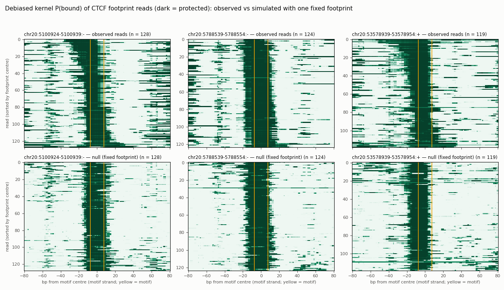
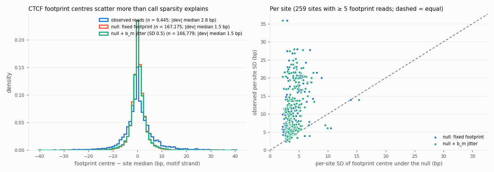
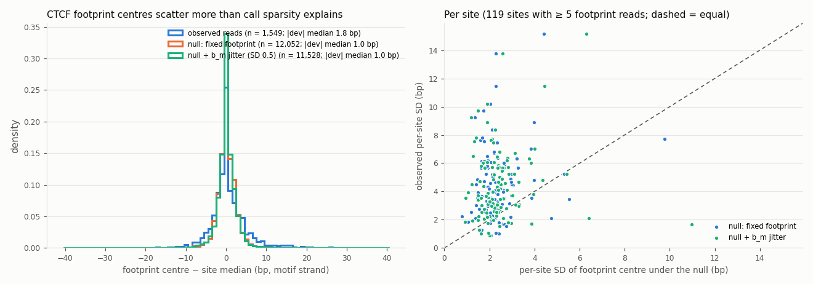

# Summary

**Question.** Does CTCF's footprint sit at the same place on every read, or does its position vary more
than read noise allows? This follows the
[sequence-free note](../2026-11-18/fiber-sequence-free-vs-alphagenome-prior.md): there the prior's TF
bump matched the footprint's width and asymmetry, which raised the question of positional flexibility.

**Data and footprint definition.**
- **Sites.** All IDR-bound CTCF motifs on chr20, one per locus: matches within 20 bp of a stronger one
  are dropped. That gives 285 loci; 259 have ≥ 5 footprint reads.
- **Footprint.** A read's footprint is read off the model-free debiased kernel P(bound) (±7 bp; see the
  [component report](../2026-11-18/fiberseq-model-components.md#model-free-check-the-debiased-kernel)):
  - the run of kernel > 0.5 through the motif;
  - bounded on both sides by kernel < 0.5, i.e. evidence of access rather than missing calls;
  - 15-80 bp long.

  Centre and edges are measured in motif coordinates, on the motif's strand.

**Null model.** Each site gets one consensus footprint (the median edges). Each footprint read is then
re-simulated 20 times:
- at its own A/T call positions within ±100 bp;
- with m6A probability ε = 0.02 inside the consensus and the read's expected accessible rate outside;
- then the same detection.

This reproduces the jitter from call sparsity, kernel smoothing and the read's labelling level. A
variant also perturbs the read's b_m (SD 0.5 logit) when generating the null, standing in for per-read
efficiency miscalibration.

**Results.**
- **Footprint shape:** median 30 bp, centred 2.5 bp 5′ of the motif centre (edges at about −17 and
  +12 bp). This matches the prior's and the posteriors' bump.
- **Positions vary far more than the null allows.**
  - Per-site SD of the footprint centre: 8.1 bp observed vs 3.3 bp null (3.7 with b_m jitter), a median
    ratio of 2.3-2.4; observed exceeds the null at 96-98% of sites.
  - The tails are heavy: 1% of footprint centres lie more than 34 bp from their site's median (null
    13 bp).
- **Most of that is adjacent protection.** Keeping only isolated footprints (10 bp beyond each edge
  confidently open, kernel < 0.2) halves the observed SD to 4.0 bp. Many "variable" footprints are CTCF
  merged with neighbouring protection: another protein, a nucleosome edge, or partner proteins.
- **Isolated footprints still vary 1.8× the null:** SD 4.0 vs 2.1-2.3 bp, an extra ~3.3 bp in
  quadrature, at 84-85% of sites.
  - The 3′ edge varies more than the 5′ edge (SD 6.1 vs 5.1 bp; both null 2.9-3.3).
  - The pooled distribution has an extra shoulder of footprints extending 3′.

**Interpretation** (inferred, not tested).
- **Residual a few bp.** Isolated CTCF footprints vary in position or extent by a few bp beyond
  measurement noise, and their 3′ edge is the variable one. That fits:
  - binding registers that shift slightly;
  - variable protection by partners or flanking contacts on one side.

  It does not need a footprint that slides along the DNA: a TF sliding during the minutes-long
  labelling would protect no single base long enough to leave one.
- **Unmodelled calibration.** Errors in the context table or in ε, which the null does not include,
  could also add some of the residual spread.
- **Large shifts.** Shifts of tens of bp are mostly not CTCF moving; they are neighbouring protection
  merging into the footprint.

# Key Points

| footprints | footprint reads | sites (≥ 5 reads) | per-site SD of centre, observed | null | null + b_m jitter | median ratio | sites with observed > null |
|---|---|---|---|---|---|---|---|
| all | 9,512 | 259 | 8.1 bp | 3.3 bp | 3.7 bp | 2.4 / 2.3 | 98% / 96% |
| isolated (open flanks) | 1,756 | 119 | 4.0 bp | 2.1 bp | 2.3 bp | 1.8 / 1.75 | 84% / 85% |

| footprints | median absolute deviation of centre (observed / null) | left-edge SD (observed / null / jitter) | right-edge SD (observed / null / jitter) | 90th / 99th percentile of \|centre − site median\| (observed / null) |
|---|---|---|---|---|
| all | 3.5 / 1.5 bp | 9.8 / 4.5 / 5.2 bp | 11.0 / 4.5 / 5.2 bp | 12.2 / 5.0 and 34.5 / 13.0 bp |
| isolated | 2.0 / 1.0 bp | 5.1 / 2.9 / 3.1 bp | 6.1 / 2.9 / 3.3 bp | 6.8 / 3.5 and 18.5 / 9.0 bp |



*Kernel P(bound) of every footprint read at the three chr20 CTCF sites with the most footprint reads,
rows sorted by footprint centre (top), next to the same reads re-simulated with one fixed footprint
(bottom). Observed edges drift by tens of bp between reads, mostly the 5′ edge at two of the sites;
under the null they stay tight. Yellow = motif.*



*All footprints. Left: each footprint's centre minus its site's median, observed (blue) vs the two
nulls; the observed distribution is about twice as wide and heavy-tailed. Right: per-site SD, observed
vs null. Nearly every site lies above the equality line.*



*Isolated footprints only (open 10 bp beyond each edge). The excess shrinks to about 1.8×; the remaining
asymmetric shoulder is footprints extending 3′.*

# Details

- **Footprint detection:** `footprint()` in the script.
  - Start at the motif position with the highest kernel value (it must exceed 0.5).
  - Extend while the kernel stays above 0.5; stop at a position below 0.5. A missing value (no
    informative call within ±7 bp) makes the edge unknown and the read is dropped.
  - Keep runs of 15-80 bp.
- **Simulation.**
  - Generation uses ε = 0.02 inside the consensus footprint and σ(β + f(context) + b_m) outside.
  - Only calls within ±100 bp of the motif are re-simulated; others are kept, but the detection only
    looks near the motif.
  - Decoding uses the read's recorded b_m. In the jitter variant, generation adds an N(0, 0.5²) offset
    per simulation.
- **Scope.** chr20 only, as a subset; the full chr20 run takes about 2 minutes. chr8 would roughly
  double the sites.
- **Caveats.**
  - The null assumes the kernel's calibration is right (ε, context table); miscalibration adds spread
    that the null does not have.
  - The "isolated" filter selects reads with well-labelled flanks, which may be a biased subset.

```bash
cd /scratch/users/diamant/fiber_eval_work/ctcf_position   # scripts copied in this note's folder
export JAX_PLATFORMS=cpu CHROMS=chr20 N_SIM=20
TAG=_base python footprint_position.py;  TAG=_jit05 BM_JITTER=0.5 python footprint_position.py
TAG=_clean CLEAN=1 python footprint_position.py;  TAG=_clean_jit05 CLEAN=1 BM_JITTER=0.5 python footprint_position.py
TAG=_base NULL_TAG=_jit05 python plot_position.py figs_all;  TAG=_clean NULL_TAG=_clean_jit05 python plot_position.py figs_clean
```

# Related Notes

- [Sequence-free vs AlphaGenome prior](../2026-11-18/fiber-sequence-free-vs-alphagenome-prior.md): The
  footprint-shape result that motivated this, and the sliding argument.
- [Fiber-seq HMM components](../2026-11-18/fiberseq-model-components.md): How the debiased kernel is
  computed.
- [Short TF calls: sparsity vs dissociation](../2026-11-16/fiber-short-tf-calls-sparsity-vs-dissociation.md):
  Earlier evidence that CTCF has real footprints, with rare partial ones.

# Open Questions

- **The 3′ edge.** Is its variation CTCF's own (zinc-finger usage, binding register) or a partner's?
  Splitting sites by motif strength, by an upstream motif module, or by cohesin ChIP could tell.
- **Calibration.** How much of the isolated-footprint excess survives a null with a recalibrated ε and
  context table, or with b_m re-estimated per read?
- **Other TFs.** Does NRF1, with a shorter motif, show the same pattern?

# Sources

- Scripts, outputs and jobs in the frontmatter.
