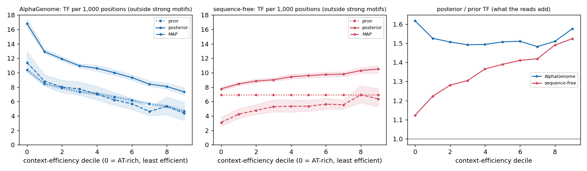
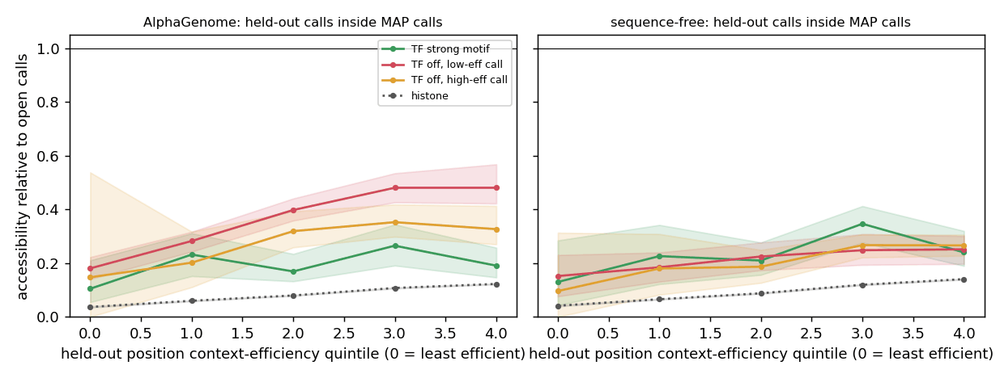

# Summary

**Question.** Fiber-seq m6A has two labelling biases: the enzyme's **sequence-context** preference (A/T-rich
contexts and A-runs label poorly) and **per-molecule labelling** (enzyme concentration, b_m). How
sensitive are the current option-B models' calls to each?

**Models and data.**
- **Models:** option B with the AlphaGenome prior and option B sequence-free (constant prior).
- **Data:** val chr8 + chr20 at prior ×1. Posteriors cover all 4,454 windows; MAP (Viterbi) covers every 8th
  window.

**Results.**
1. **Molecule labelling (within-window b_m tertiles).**
   - **TF calls are robust:** the TF share changes ≤ 1.07× (posterior) between the lowest and highest b_m
     tertile at the same loci.
   - **The open/histone balance is not:** open rises 1.9× from the lowest to the highest tertile in both
     models, against 1.23× for the b_m-corrected kernel. That is the expected cost of having no b_m term.
2. **Sequence context (deciles of local m6A efficiency).**
   - **The AlphaGenome prior tilts TF toward AT-rich, poorly labelled DNA:** prior P(TF) falls 2.2× from the
     least to the most efficient decile.
   - **The AlphaGenome posterior and MAP follow the prior:** the posterior is about 1.5× the prior in every
     decile, so the reads add a constant factor.
   - **The sequence-free model shows the opposite trend:** its posterior TF rises 1.36× with efficiency.
3. **The slope alone does not show bias.** The same picture arises whether the prior has learned real AT-rich
   biology or compensates for residual context bias. Held-out-call imputation cannot separate the two either:
   both predict the same reads.
4. **Held-out accessibility inside TF calls separates them.**
   - **Setup:** 20% of each read's calls were hidden and the reads re-decoded; hidden calls inside MAP TF calls
     were scored by their m6A rate relative to open calls, by the hidden position's own context efficiency.
   - **Result at efficient positions inside the call interior:**
     - AlphaGenome's off-motif TF calls in low-efficiency regions are 0.41 as accessible as open DNA;
     - AlphaGenome's strong-motif calls are 0.18;
     - the sequence-free model's comparable calls are 0.22.
   - **Interpretation** (a mixture reading, inferred): about 28% of those AlphaGenome calls look unprotected
     and about 70% look like real protection. Protected need not mean TF.
5. **Short off-motif TF calls.**
   - AlphaGenome's excess off-motif TF calls are mostly short (15-20 bp) and sit in closed, nucleosome-dense
     DNA, with weak kernel evidence.
   - At the same positions the sequence-free model calls open.
   - The AlphaGenome prior there has a TF floor 1.5× higher and a lower P(open).
6. **The kernel reference has residual context bias.** Inside *open* calls, held-out m6A is 0.52-0.56 of the
   reference's expectation in the least efficient quintile, rising to 1.06 in the most efficient. The relative
   measure corrects for it, but the debiased context table over-predicts m6A in AT-rich contexts by about 2×.

This confirms, for the current option-B model, the 11-16 finding that the off-motif TF excess in poorly labelled
DNA comes from the sequence prior rather than the emissions
([bias-correction note](../2026-11-16/fiber-tf-nubs-bias-correction.md)). It adds a direct measure of how much of
it is unprotected.

**Locked robustness checks** (decided with the user):
1. b_m within-window tertiles: element shares (posterior and MAP), with the kernel reference.
2. Context-efficiency deciles outside the strong-footprint mask: element shares (prior, posterior, MAP), and
   the posterior/prior ratio as the read-driven context dependence.
3. Held-out accessibility inside TF calls by position efficiency.

# Key Points

**1. Molecule labelling.** Element share by within-window b_m tertile:

| | low b_m | mid | high | high / low [95% CI] |
|---|---|---|---|---|
| open, AlphaGenome posterior | 18.1% | 27.1% | 34.4% | 1.90 [1.89, 1.92] |
| open, sequence-free posterior | 17.3% | 26.2% | 33.5% | 1.94 [1.92, 1.96] |
| open, kernel (1 − P(bound)) | 30.6% | 33.1% | 37.7% | 1.23 |
| TF, AlphaGenome posterior / MAP | 1.18 / 0.82% | 1.30 / 0.86% | 1.20 / 0.78% | 1.01 [0.99, 1.03] / 0.95 [0.90, 1.01] |
| TF, sequence-free posterior / MAP | 1.02 / 0.56% | 1.08 / 0.58% | 1.09 / 0.67% | 1.07 [1.05, 1.09] / 1.18 [1.08, 1.29] |
| other_long, AlphaGenome posterior | 1.56% | 1.35% | 2.63% | 1.69 [1.66, 1.73] |

**2. Sequence context.** TF per 1,000 positions outside the strong-footprint mask (20 TFs, FPR 1e-6, ±10 bp) by
context-efficiency decile; 0 = least efficient:

| | decile 0 | 2 | 4 | 6 | 8 | 9 | 9 / 0 |
|---|---|---|---|---|---|---|---|
| AlphaGenome prior | 10.4 | 7.9 | 7.1 | 6.2 | 5.4 | 4.7 | 0.45 |
| AlphaGenome posterior | 16.8 | 11.9 | 10.6 | 9.3 | 8.1 | 7.3 | 0.44 |
| AlphaGenome MAP | 11.4 | 8.0 | 7.0 | 5.7 | 5.3 | 4.4 | 0.38 |
| sequence-free prior | 6.9 | 6.9 | 6.9 | 6.9 | 6.9 | 6.9 | 1.00 |
| sequence-free posterior | 7.8 | 8.9 | 9.4 | 9.7 | 10.3 | 10.5 | 1.36 |
| sequence-free MAP | 3.1 | 4.8 | 5.3 | 5.6 | 6.9 | 6.4 | 2.05 |

Open share from the least to the most efficient decile:
- AlphaGenome posterior 16% → 34% (2.1×);
- sequence-free posterior 18% → 31% (1.7×);
- kernel-implied open 23% → 43% (1.9×);
- AlphaGenome prior 17% → 40% (2.4×).

The open/histone balance is therefore no more context-dependent than the debiased reference.



*The AlphaGenome posterior is about 1.5× its prior in every decile (right panel), so its AT-rich TF tilt comes
from the prior. The sequence-free model's reads add more TF in efficient contexts. Shaded: 95% window bootstrap.*

**3. Held-out accessibility inside MAP TF calls.** Accessibility of hidden calls relative to hidden calls inside
open calls, at efficient held-out positions (top two quintiles), call interior (≥ 3 bp from either end):

| | AlphaGenome | sequence-free |
|---|---|---|
| TF on a strong-footprint motif | 0.18 (n = 1,482) | 0.24 (n = 1,343) |
| TF off motif, low-efficiency call | **0.41** (n = 1,000) | 0.22 (n = 823) |
| histone | 0.11-0.12 | 0.12-0.14 |



*AlphaGenome's off-motif TF calls in low-efficiency regions (red) become about half as accessible as open DNA
at efficient positions. That is well above its strong-motif calls (green) but far below 1, so they are a mixture
of protected and unprotected calls. The sequence-free model's calls stay at its strong-motif level.*

**4. AlphaGenome's excess off-motif calls** (MAP, outside the strong mask, per read-kb):

| call length | AlphaGenome | sequence-free |
|---|---|---|
| ≤ 20 bp | 0.139 | 0.015 |
| 21-30 bp | 0.087 | 0.032 |
| > 30 bp | 0.051 | 0.075 |

For AlphaGenome's ≤ 20 bp off-motif calls:
- **Weak footprint evidence:**
  - only 7% show a clean kernel footprint (inside > 0.8, both flanks < 0.2), against 31% (AlphaGenome) and 41%
    (sequence-free) on strong motifs;
  - 23% show no protection inside (kernel < 0.5).
- **Placement:** 68% lie within 30 bp of a nucleosome call and 24% between two. Median local accessibility is
  0.16, against 0.38 at strong motifs.
- **Not other TFs' motifs:** the share overlapping any of the 100 PWMs is similar in both models (32-40%).
- **What the sequence-free model calls there, same read:** open 70%, histone 12%, TF 13%.
- **Prior at those positions:**

  | | P(open) | P(TF) | P(histone) |
  |---|---|---|---|
  | AlphaGenome | 0.25 | 0.0105 | 0.73 |
  | sequence-free | 0.29 | 0.0069 | 0.69 |

# Details

## Robustness checks (`robustness_checks.py`)

**Molecule labelling.**
- **b_m source:** the SMFNet per-molecule fit on 16 kb molecules
  ([labelling-efficiency note](../2026-11-12/fiber-labelling-efficiency-emissions.md)).
- **Within-window ranking:** reads are ranked by b_m inside each window (windows with ≥ 6 reads with a finite
  b_m), so each tertile covers the same loci. That removes locus-level biology but not molecule-level chromatin
  state.
- **Kernel reference:** mean debiased kernel P(bound) (±7 bp, ε = 0.02, with the read's b_m) over informative
  read positions. Part of its own 1.23× may be real molecule-level differences.
- **Thinning test deferred:** randomly dropping m6A on the same reads would be the causal version; deferred by
  the user.

**Sequence context.**
- **Efficiency measure:** local context efficiency is the mean of σ(β + f(context)) over A/T sites within ±10
  bp (kernel reference table, no b_m). Decile edges are over all window positions: 0.405, 0.474, …, 0.713.
- **Weighting:** the prior is weighted by the window's read count, so its position distribution matches the
  posterior's.
- **Motif-exclusion sensitivity:**
  - Excluding the strong-footprint motifs changes only the top two deciles; with them included, AlphaGenome MAP
    TF there is 7.3-8.5 instead of 4.4-5.3. The strong footprinters are GC-rich.
  - Excluding all 100 PWMs gives nearly the same numbers as the strong exclusion.
  - So the strong exclusion is used.

**Why the slope is not a bias test.**
- **Ambiguous source:** a prior slope that the posterior follows looks the same whether it is biology or
  learned compensation, because the reads are least informative exactly in AT-rich DNA.
- **No ground truth from the flat-prior model:** a flat-prior model has the least power there, so its trend is
  not ground truth either.
- **What the checks report instead:** the posterior/prior ratio by decile, which is the read-driven context
  dependence. A ratio rising toward AT-rich deciles would flag emission under-correction. Neither model shows
  one, apart from a slight AlphaGenome upturn in decile 0 (1.62 vs about 1.5).

## Held-out accessibility test

**Procedure.**
1. On every 8th val window, mask each observed A/T call with probability 0.2 (seeded per window, the same for
   both models).
2. Viterbi-decode the masked reads at prior ×1 (`Decoder` from `plot_model_comparison.py`).
3. Record every masked call with the MAP group at its position.

Masked calls did not inform the path, which avoids the selection that makes decoded TF calls look protected:
Viterbi TF calls rarely contain an observed m6A.

**Scores.**
- **O/E:** observed m6A over the sum of e = σ(β + f(context) + b_m).
- **A:** O/E relative to masked calls inside open calls in the same model and position-efficiency quintile.
  Quintile edges in ctx: 0.331, 0.558, 0.669, 0.728.
- **Call classes:**
  - TF on the strong mask;
  - off-motif TF whose mean ctx over its A/T sites is < 0.523 (low), 0.523-0.631 (mid) or ≥ 0.631 (high).
- **Intervals:** 200 window resamples.

**Mixture reading.** A_low = f · 1 + (1 − f) · A_strong gives f = (0.41 − 0.18) / (1 − 0.18) ≈ 0.28 in the
interior, and about 0.30-0.36 with edges included (quintiles 3 and 4).

**Caveats.**
- About 640-1,000 masked calls per cell, with intervals of about ±0.05.
- The strong-motif reference may itself include partial occupancy.
- The call class uses the call's mean ctx, which differs from the ±10 bp decile measure.
- Edge positions are more accessible in every class: AlphaGenome low-efficiency 0.63 and strong 0.41 at edges.
  AlphaGenome's low-efficiency calls are shorter, so they have more edge.

**Calibration of e.** Masked calls inside open calls show:
- O/E 0.56 (AlphaGenome run) and 0.52 (sequence-free run) in the least efficient quintile;
- 0.75 / 0.70, 0.91 / 0.89, 1.00 / 0.99 and 1.06 / 1.06 above it.

The kernel's context table therefore over-predicts m6A in AT-rich contexts even in open DNA.
- **Possible causes:** the blind A-runs, or 'open' calls there being partly protected; not resolved.
- **Relation to the 11-16 note:** that note found the *model's* held-out predictions calibrated within ±0.5
  points across efficiency for the earlier GELU model. The over-prediction here is in the kernel reference
  table, not the model's emissions.

## Commands

```bash
cd /home/users/diamant/repos/smf_hmm   # robustness_checks.py is uncommitted at writing; copy in scripts/
V=/scratch/users/diamant/gm12878_validation/covariation_windows_v2; T=/scratch/users/diamant/fiber_eval_work/tf_mechanism/viterbi
JAX_PLATFORMS=cpu python -m evaluation.tf_chip.robustness_checks /scratch/users/diamant/fiber_eval_work/robustness/optionB \
  $V/chr20-512-valid90-reads10-flank128 $V/chr8-512-valid90-reads10-flank128 \
  --model "r5_tf60_ol61:AlphaGenome" --model "r6_ol61_const:sequence-free" \
  --segments r5_tf60_ol61:MAP=$T/viterbi_segments_r5_tf60_ol61_x1.tsv.gz --segments r6_ol61_const:MAP=$T/viterbi_segments_r6_ol61_const_x1.tsv.gz \
  --efficiency-path /scratch/groups/btrippe/ndiamant/fiberseq/GM12878/h5_ont_polarity/active_efficiency.h5
cd /scratch/users/diamant/fiber_eval_work/robustness/optionB && python plot_context_tf.py

# held-out accessibility (GPU decode; Slurm 53610457), then CPU analysis and figure
cd /scratch/users/diamant/fiber_eval_work/describe_outputs/heldout_inside_tf
sbatch --output=$PWD/run-%j.log run.sbatch          # RATE=0.2 python heldout_inside_tf.py
python analyze.py && python plot_heldout.py

# off-motif call characterisation (CPU)
cd /scratch/users/diamant/fiber_eval_work/describe_outputs/off_motif_why
JAX_PLATFORMS=cpu python off_motif_calls.py && python neighbours.py && python same_reads.py && python prior_at_calls.py
```

Python is `/home/groups/btrippe/diamant/miniforge/envs/hmm/bin/python`. The figures were quantised to 256 colours
for the note.

# Related Notes

- [TF-nub mechanism overview](../2026-11-16/fiber-tf-nub-mechanism-overview.md): The earlier GELU-model
  investigation that attributed off-motif TF to the AlphaGenome prior, on A/T-rich sequence and near nucleosome
  ends; this note re-checks it for option B.
- [Bias correction](../2026-11-16/fiber-tf-nubs-bias-correction.md): Found the emissions calibrated and the
  efficiency association coming from the prior. Consistent here; the held-out accessibility test adds how much
  is unprotected.
- [Under-methylated reads](../2026-11-16/fiber-tf-nubs-undermethylated-reads.md): The earlier b_m-decile
  analysis (TF robust, other_long and miscalibration not), reproduced here with within-window tertiles.
- [Other TF motifs](../2026-11-16/fiber-tf-nubs-other-tf-motifs.md): Prior-added TF calls were not enriched at
  other TFs' motifs; same result for option B here.
- [Prior flattening](../2026-11-16/fiber-tf-nubs-prior-flattening.md): Flattening the prior's TF placement
  removed most off-motif TF; a possible follow-up for the unprotected fraction.
- [Enzyme-bias diagnostic](../2026-10-30/fiber-hmm-enzyme-bias-diagnostic.md): First evidence that the DNA
  prior absorbs m6A context bias, before context offsets existed.
- [m6A context bias](../2026-10-30/fiberseq-m6a-sequence-context-bias.md): The ±3 bp context effect behind the
  kernel reference table.
- [Sequence-free vs AlphaGenome prior](../2026-11-18/fiber-sequence-free-vs-alphagenome-prior.md): The option-B
  model pair compared here.
- [Fiber-seq HMM components](../2026-11-18/fiberseq-model-components.md): Model, kernel and metric definitions.

# Open Questions

- **What are the protected ~70%?** Are AlphaGenome's protected low-efficiency calls TFs, nucleosome edges, or
  other proteins? ChIP-peak overlap of the 91 screened TFs against matched positions would help.
- **Can the prior be regularised?** Can the AlphaGenome prior's TF floor in AT-rich, closed chromatin be
  regularised (e.g. a TF potential that does not rise with low efficiency) without losing its motif placement?
- **Is it emission-side residual bias?** A richer context emission (wider context, or context × state) would
  test whether the AlphaGenome prior's AT-rich TF tilt is compensation for residual emission bias. That needs a
  training run.
- **Why does the kernel table over-predict m6A in AT-rich open DNA by about 2×?** Blind A-runs, or 'open' calls
  being partly protected?
- **Thinning test:** dropping m6A on the same reads, to measure labelling sensitivity causally. Deferred.

# Sources

- Scripts (copies): [fiber-at-rich-context-bias-robustness/scripts/](fiber-at-rich-context-bias-robustness/scripts/)
  (robustness_checks.py, plot_context_tf.py, heldout_inside_tf.py, run.sbatch, analyze.py, plot_heldout.py,
  off_motif_calls.py, neighbours.py, same_reads.py, prior_at_calls.py).
- Outputs, models and data in the frontmatter.
