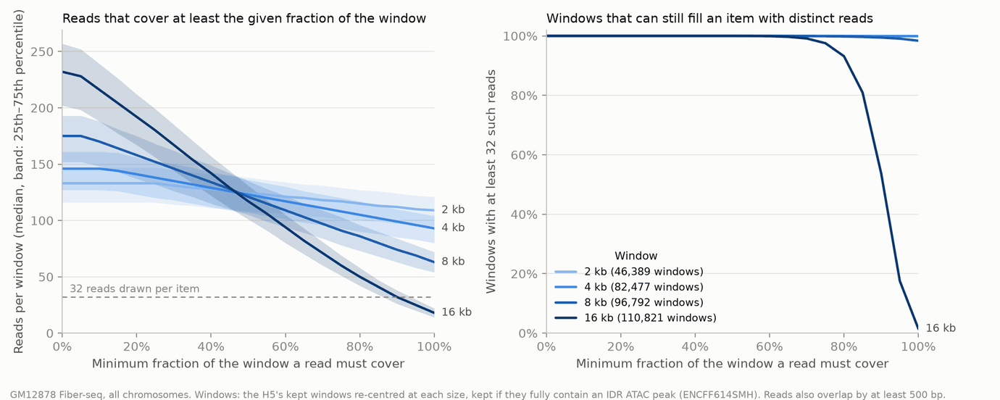

# Summary

The mESC best configuration (AlphaGenome encoder, k=9 attention U-Net with dilated fine
down convs, Muon lr 0.01, EMA 0.999) was trained on GM12878 Fiber-seq through the new
lane-packed figwig loader, on exactly the H5's regions and settings, and compared with the
original Fiber-seq CNN (`smf_models/GM12878_fiberseq`, trained on the same windows from the
H5). On the same val batches and masks the new model's val loss is only 0.37% lower
(0.17905 vs 0.17971), but on sampled reads it is better on every metric by 4-9 standard
errors, closing about 30% of the remaining gap to the pseudo-replicate ceiling. On the same
node and H100, the same 188,000 steps took 13.7 h against 39.6 h (0.26 vs 0.76 s/step).

# Key Points

- **Same data as the H5.** The figwig loader with `kept_windows.bed` (the H5's 167,468 kept
  windows), 2,114 bp regions, 2,048 bp crops, 500 bp min overlap and 32 spanning molecules
  gives the H5's reads and calls exactly (1,271 of 1,271 windows checked, chr1/2/8/21/X,
  active and background). Split: ChromBPNet fold 0 (val chr8, chr20; test chr1, 3, 6), as
  the old run. 12,304 val regions.
- **Val loss, fixed masks** (seeded by batch index, same batches for both):
  new 0.17905, old 0.17971; paired difference -0.00066 +/- 0.00002 SE, new lower in 49/49
  batches. The rescoring reproduces the new run's last logged val loss (0.17912).
- **Sample metrics, 1,000 val regions x 1,024 reads, 32 steps, bf16, seed 0** (paired by
  region, new - old +/- SE; the pseudo-replicate ceiling in the last column):

  | Metric | New | Old | New - old | Ceiling |
  |---|---|---|---|---|
  | Profile Pearson, matched reads | 0.837 | 0.825 | +0.012 +/- 0.002 | 0.868 |
  | Profile Spearman, matched | 0.851 | 0.844 | +0.007 +/- 0.001 | 0.870 |
  | Run lengths, accessible, W1 (bp) | 0.462 | 0.510 | -0.048 +/- 0.010 | 0.342 |
  | Run lengths, protected, W1 (bp) | 3.06 | 3.23 | -0.17 +/- 0.05 | 2.18 |
  | Covariation corr-of-corr, matched | 0.375 | 0.371 | +0.004 +/- 0.001 | 0.405 |
  | Covariation corr-of-corr, all reads | 0.644 | 0.638 | +0.006 +/- 0.001 | - |

  Gap closed between shuffle and ceiling (metrics summary): profile Pearson 0.968 vs 0.954,
  Spearman 0.984 vs 0.977, run-length W1 zeros 0.971 vs 0.962, ones 0.959 vs 0.939. Pooled
  site Pearson 0.920 vs 0.894 (all reads), 0.852 vs 0.827 (matched). Per region the new model
  wins only 52-61% of regions; the gain is small per region but consistent.
- **Training speed.** Both runs on `sh04-03n07` (H100 80GB), 400 epochs = 188,000 steps at
  256 regions x 32 reads: new 49,174 s (13.7 h, 0.26 s/step), old 142,719 s (39.6 h,
  0.76 s/step), 2.9x faster. The figwig loader (reads live from disk, 7 workers) kept up.
  The old step time matches the ~0.69 s baseline CNN step on mESC.
- **Val loss understates the difference.** A 0.37% val loss gain comes with a ~30% smaller
  gap on profile and run-length metrics (inferred: the U-Net mostly improves read-level
  structure that per-site likelihood barely weighs).

# Details

## Data path: lane-packed figwig files

`data_preparation/fiberseq/calls_figwig.py` packs each chromosome's molecules into lanes
(rows of a pileup, lowest free lane at each start; 512 lanes, 4,096 bp tiles, groups of 32)
in `<chrom>.fw`, with a molecule table `<chrom>.molecules.npz` (start, end, lane, strand,
haplotype, read ID). `smf_net.figwig_data` (`data=figwig` in the scripts) reads windows live
from a BED of regions, so region and window lengths are settings instead of properties of a
prepared H5. GM12878: 19,032,437 molecules kept, 203 dropped by the lane cap (pileups over
repeats), 39 GB; conversion 2-7 min per chromosome. A 32-read, 2,048 bp item loads in
~2 ms on one thread (with the `deflate` package, ~2x faster reads than zlib).

## Models

- **New:** `smf_models/GM12878_fiberseq_figwig_alphagenome_unet_attn_muon_ema_k9_dilated`,
  best checkpoint `epoch399-step188000.ckpt` (the last epoch).
- **Old:** `smf_models/GM12878_fiberseq`, `epoch=369-step=173900_ont_polarity.ckpt`
  (dilated CNN body and CNN DNA encoder; trained on `h5/`, then converted to the ONT
  encoding). It was saved from a `torch.compile`d model, so its keys carry `_orig_mod.`,
  which `load_model` rejects. The comparison used a copy with the prefix stripped,
  `$SCRATCH/smfnet_figwig/GM12878_fiberseq_epoch369_ont_polarity_plainkeys.ckpt`; the
  original is unchanged.
- The old run's own logged val loss (0.18001 at epoch 399) used random masks under older
  code and is not comparable with the new run's fixed-mask curve.

## Commands

Training (job 51816287), from `$SCRATCH/smfnet_figwig/`
([script](fiberseq-figwig-unet-vs-cnn/scripts/train_k9_dilated_fiber_2kb.sh)):

```bash
sbatch train_k9_dilated_fiber_2kb.sbatch   # btrippe, 1 GPU, 8 CPUs, 125 GB, 36 h
```

The script runs `scripts/train.py data=figwig assay_type=fiberseq_m6a` with the figwig
settings above, `data.cfg.num_workers=7`, and the U-Net options of
`$SCRATCH/smfnet_dilated/train_eval_k9_dilated.sh`. It uses the env of
`~/repos/SMFNet_unet_figwig` (`pixi run --frozen --manifest-path`) with
`PYTHONPATH=~/repos/SMFNet_unet_figwig_runs/src`. Its post-training val sample failed
(`assay_type=` passed to `sample.py`, which has no such key); the script is fixed and the
sample was rerun as below.

Fixed-mask val loss ([script](fiberseq-figwig-unet-vs-cnn/scripts/rescore_val_figwig.py)),
run in an interactive L40S allocation:

```bash
PYTHONPATH=~/repos/SMFNet_unet_figwig_runs/src pixi run --frozen \
  --manifest-path ~/repos/SMFNet_unet_figwig/pyproject.toml python rescore_val_figwig.py \
  --checkpoint new_unet_figwig=$M/GM12878_fiberseq_figwig_alphagenome_unet_attn_muon_ema_k9_dilated/epoch399-step188000.ckpt \
  --checkpoint old_cnn_h5=$SCRATCH/smfnet_figwig/GM12878_fiberseq_epoch369_ont_polarity_plainkeys.ckpt \
  --out $SCRATCH/smfnet_figwig/rescored_val_batches.jsonl
```

Sampling and metrics for both models (job 51926807, 23 min on an H100;
[script](fiberseq-figwig-unet-vs-cnn/scripts/eval_val_samples.sh)): `sample.py` with
`data.cfg.max_regions_per_split=1000 regions.source=split regions.split=val`, then
`metrics.py plot.enabled=true` with positional and flank baselines off. Outputs:
`$SCRATCH/smfnet_figwig/eval/{samples,metrics}_val1000_{new_unet_figwig,old_cnn_h5}/`.

## Longer context: reads available by coverage fraction



*Requiring reads to cover at least 75% of the window still leaves >= 32 reads in nearly
every window up to 8 kb; at 16 kb the threshold has to stay near 75%.*

Windows here are the kept-window centres re-centred at each size and kept if they fully
contain an IDR ATAC peak (ENCFF614SMH, downloaded to `$SCRATCH/fiberseq/GM12878/inputs/`).
On the kept windows themselves (no peak rule, the next training plan), windows with >= 32
reads covering >= 75%: active 100% / 100% / 99.9% / 98.2% and background 100% / 100% /
99.8% / 96.9% at 2 / 4 / 8 / 16 kb; median such reads 115 / 107 / 92 / 61. Under the H5's
rule (any read overlapping by 500 bp) the share of drawn reads covering the whole window is
83% at 2 kb, 64% at 4 kb, 37% at 8 kb and 8% at 16 kb (chr21), which is why longer windows
need a minimum-fraction rule. Scripts:
[reads_by_coverage.py](fiberseq-figwig-unet-vs-cnn/scripts/reads_by_coverage.py),
[plot_reads_by_coverage.py](fiberseq-figwig-unet-vs-cnn/scripts/plot_reads_by_coverage.py),
[kept_windows_at_75.py](fiberseq-figwig-unet-vs-cnn/scripts/kept_windows_at_75.py).

# Update 2026-11-12

The 16 kb pilot planned under "Longer context" ran: see
[16 kb pilot and labelling efficiency](../2026-11-12/fiberseq-16kb-pilot-labelling-efficiency.md).
On the same central 1 kb sites it is 4.1% better than this note's 2 kb model, all from
reading the rest of each molecule; its generated reads lack about half the molecule-wide
(labelling) variance, which led to a design for modelling labelling efficiency and enzyme
bias explicitly. The 75% rule there replaced the "nearly every window up to 8 kb" plan with
16 kb reads and 1,024 bp DNA flanks.

# Related Notes

- [Fiber-seq GM12878 data preparation](../2026-10-05/fiberseq-gm12878-data-preparation.md):
  how the H5 windows (and so `kept_windows.bed`) and the fold-0 split were chosen.
- [Span inpainting; k=9 + dilated fine convs as the new best](../2026-11-10/inpainting.md):
  the architecture and settings reused here, and the U-Net's weakness on long gaps, which
  the coverage-fraction rule is meant to avoid at long context.
- [Patched U-Net](../2026-11-07/patched-unet.md): cost linear in positions, the basis for
  going to longer windows next.
- [Attention U-Net training speed](../2026-11-06/unet-training-speed.md): the fused norm,
  channels-last and Toeplitz output conv behind the 0.26 s step.
- [Frozen AlphaGenome encoder](../2026-10-29/frozen-alphagenome-encoder.md): baseline CNN
  step time (~0.69 s), consistent with the old run's 0.76 s/step.

# Open Questions

- Positional and flank baselines and the test split were not run; the comparison is val
  only, without baselines.
- How much of the 2.9x speedup comes from the U-Net body and AlphaGenome encoder, and how
  much from the speed work (fused norm, channels-last, Toeplitz output conv)? Not separated
  here; both runs took the same number of steps.
- Next: train at 4 kb and 8 kb on the same centres with a 75% minimum read fraction
  (loader option not yet written), and decide how to treat background at long context.

# Sources

- Code: SMFNet-dev branches `nd_figwig` (7143e63, figwig loader) and `nd_unet_figwig`
  (0bf6c72 merge into nd_unet_inpaint, 6ce74dd).
- Scripts: [fiberseq-figwig-unet-vs-cnn/scripts/](fiberseq-figwig-unet-vs-cnn/scripts/).
- Results: `$SCRATCH/smfnet_figwig/rescored_val_batches.jsonl`,
  `$SCRATCH/smfnet_figwig/eval/`, wandb summaries of runs jzsqt5m2 and dm0hrhuy in
  `/scratch/users/diamant/wandb/wandb/`.
- IDR ATAC peaks: ENCODE [ENCFF614SMH](https://www.encodeproject.org/files/ENCFF614SMH/).
- figwig: [jmschrei/figwig](https://github.com/jmschrei/figwig) 0.3.0.
