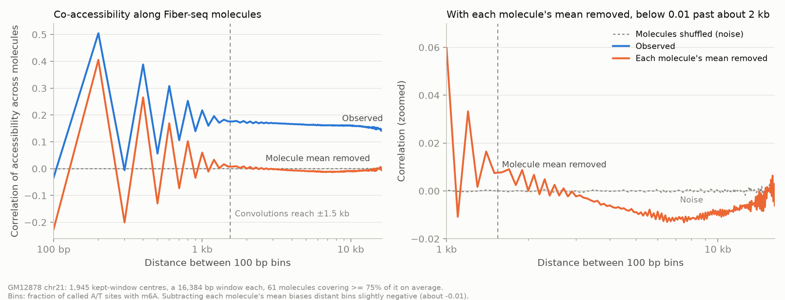
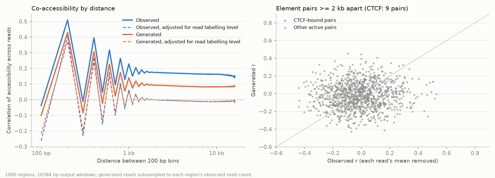
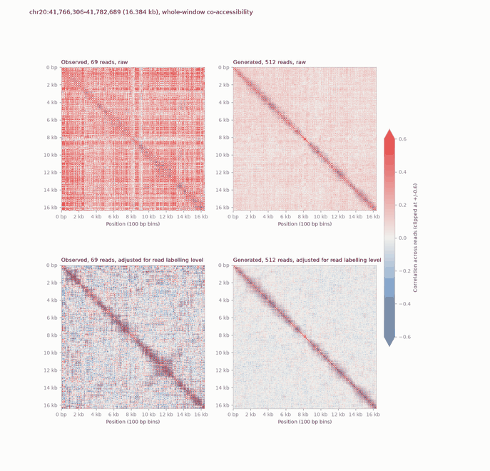
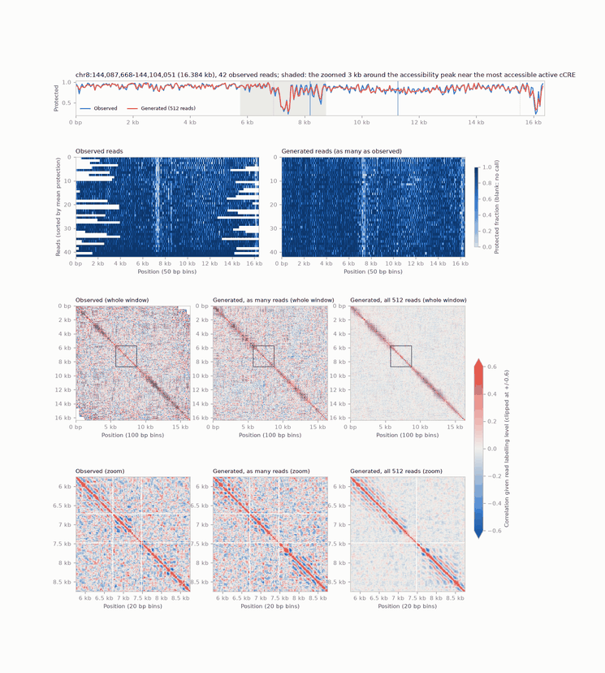

# Summary

A 25-epoch pilot of the 2 kb run's best U-Net at long context: 16,384 bp of reads with
1,024 bp of DNA on each side (`dna_flank=1024`), reads drawn only if they cover >= 75% of
the read window. Its val loss (0.157) is lower than the 2 kb model's (0.179) mostly because
16 kb windows are mostly easier nucleosomal sites. On the same sites (the central 1 kb, same
reads and masks) it is 4.1% better than the 2 kb model, and all of that comes from reading
the rest of the molecule: with the flanking calls masked it is 0.7% worse.

Generated reads reproduce profiles and distance-dependent co-accessibility, but only about
half of the between-molecule variance (spread of read means 0.42 of observed; long-range
co-accessibility plateau 0.083 vs 0.158), at 32, 64 or 128 sampling steps alike. That
component is technical: per-molecule labelling efficiency. Adjusting for each read's
labelling level, observed and generated co-accessibility match at long range and the
generated short-range (nucleosome-scale) coupling is 10-20% weak. Specific long-range
co-accessibility does exist between CTCF sites (partial r +0.14 given labelling level vs
+0.02 for random position pairs).

The agreed next step models labelling explicitly: a per-molecule efficiency estimated
without information about region activity, and an emission head
P(m6A) = q * sigma(c_context + b_molecule) + (1 - q) * eps, with the same quantities given to
the network as conditioning.

# Key Points

- **Architecture: `CNNConfig.dna_flank`** (default 512 = the old middle-half crop at
  2,048 bp, so every 2,048 bp checkpoint is unchanged; rescored val loss 0.17912 = logged).
  With AlphaGenome it must be a multiple of 64 bp. A fixed flank instead of a context that
  scales with the window: the encoder's 64 bp features see about +/-600 bp, so 1,024 bp
  clears them; 18 kb of DNA is 44% less encoder work than 32 kb.
- **Reads at 16 kb:** windows with >= 32 reads covering >= 75% of the read window: 98.2% of
  active and 96.9% of background kept-window centres (median 61 reads). Under the 2 kb (H5)
  rule only 8% of drawn reads would cover a 16 kb window.
- **Training:** 32 regions x 32 reads (77 GB of 80 at peak; 16 x 32 is 40 GB), Muon lr 0.01,
  EMA 0.999, 25 epochs x 3,651 steps (matched to the 2 kb run's 1.58T read positions),
  10 h 58 min; 116,807 train / 11,923 val regions; val loss 0.15686, still falling.
- **Why its val loss is lower:** per-site entropy of the scored sites (the loss a model
  knowing only per-site rates would get) is 0.272 nats for 16 kb windows vs 0.310 for the
  2 kb model's centres, ratio 0.878, the same as the val-loss ratio 0.881.
- **Same sites, central 1 kb** (11,923 val regions; `rescore_centre.py`):

  | | 2 kb model | 16 kb model | 16 kb, calls outside centre masked |
  |---|---|---|---|
  | all | 0.1779 | 0.1707 (-4.1%) | 0.1791 (+0.7%) |
  | active | 0.1855 | 0.1785 (-3.8%) | 0.1870 (+0.8%) |
  | most accessible 10% | 0.2558 | 0.2467 (-3.5%) | 0.2581 (+0.9%) |

- **Generated reads** (1,000 val regions x 512 reads; generated subsampled to the observed
  count for curves):

  | distance | raw obs | raw gen | adjusted obs | adjusted gen |
  |---|---|---|---|---|
  | 200 bp | 0.509 | 0.430 | 0.408 | 0.372 |
  | 1 kb | 0.228 | 0.140 | 0.065 | 0.052 |
  | 2-4 kb | 0.170 | 0.089 | -0.005 | -0.005 |
  | 8-16 kb | 0.158 | 0.083 | -0.011 | -0.012 |

  Same plateau at 32 / 64 / 128 steps (0.079 / 0.079 / 0.078 at 8-16 kb). Spread of per-read
  means, generated / observed (generated reads given observed no-call patterns): 2 kb U-Net
  0.92, 2 kb CNN 0.89, 16 kb pilot 0.42; so not the read norm, and only visible at 16 kb
  where local variation averages out.
- **CRE pairs 2-15 kb apart**, partial correlation given molecule labelling level (window
  level excluding the elements), >= 50 shared molecules:

  | pairs | n | mean r | p < 0.001 | r > 0.3 |
  |---|---|---|---|---|
  | CTCF-CTCF | 493 | +0.136 | 6.7% | 16.8% |
  | CTCF-other active | 8,000 | +0.049 | 1.5% | 4.0% |
  | other active | 44,448 | +0.029 | 1.2% | 2.9% |
  | random positions | 13,288 | +0.020 | 0.85% | 2.4% |

  At >= 100 molecules: CTCF-CTCF 18% p < 0.001 (n = 55) vs random 0.85%. 480 / 52,941 real
  pairs at FDR < 0.05.

# Details

## Observed co-accessibility by distance, and the receptive field

The run's U-Net reaches +/-1.5 kb with its convolutions (gradient support with randomised
weights); only the 2 bottleneck attention layers (64 bp tokens) see further. Observed
co-accessibility (16 kb windows, 75% reads, 100 bp bins) with each molecule's mean removed is
0.41 at 200 bp, 0.06-0.07 at 1 kb and <= 0.01 past ~2 kb, while the raw correlation stays at
0.14-0.17 out to 16 kb (chr21 and chr8 agree; active and background alike).



*Distance-dependent co-accessibility is within the conv reach; beyond it there is a flat,
molecule-wide component (blue).*

Element pairs on observed data (genome-wide, cCREs of candidates.bed): CTCF-CTCF pairs
co-vary (+0.093 with the molecule mean subtracted vs -0.01 to -0.04 for other groups), not
through haplotype (+0.091 within haplotype) and flat with distance (+0.089 / +0.092 / +0.096
at 2-5 / 5-10 / 10-15 kb). At matched accessibility much of it goes (less-open element
0.20-0.35: CTCF +0.108, mixed CTCF-other +0.058, other +0.060), leaving a CTCF-specific
+0.04-0.05; the per-pair partial-correlation test above confirms CTCF-CTCF pairs stand out.

## The pilot's generated reads



*Raw curves (solid) differ by the molecule-wide component; adjusted for each read's
labelling level (dashed) they match at long range and differ slightly at short range. The
pair panel (right) has too few CTCF pairs in these regions to judge.*

The adjustment regresses each bin's accessibility on the read's mean over the window (slope
per bin, so open bins can respond more to labelling) and correlates the residuals; it
also removes any biological molecule-wide variation.



*chr20:41.77 Mb: the observed raw map is red throughout (labelling); adjusted, observed and
all 512 generated reads show the same near-diagonal structure.*



*chr8:144.09 Mb: protection profiles match; observed reads sorted by protection show a
labelling gradient the generated reads lack; the 512-read zoom shows the ~190 bp nucleosome
bands seen in the observed zoom.*

Plot conventions settled with the user: whole window at 100 bp plus a 3 kb zoom at 20 bp
around the most accessible active element; diverging blue-grey-red clipped at +/-0.6
(preferred to the Mola paper's sequential 0-0.6 scale, which hides negatives); a panel with
all generated reads; protection on the read heatmaps and profiles. Mola (Wang et al., bioRxiv
2026) bins at 20 bp over 3 kb views, shows 10x generated molecules, and scores maps by mean
row correlation against a split-half Spearman-Brown ceiling.

## Training-design discussion (recorded in FIGWIG_TODO.md, not yet built)

- Batch size: no lower lr or accumulation; a 16 kb step holds 2x the read positions of a
  2 kb step, and Muon normalises update size.
- Encoding DNA once for more reads per region gains little (encoder ~6% of a step; 8 x 128
  reads 0.34 vs 0.38 s/step) and 16 kb regions have only ~61 qualifying reads.
- Curriculum / mixing: weights are length- and flank-independent (the 2 kb model loads
  strictly into a 16 kb config), so warm starts work; preferred: mixed-length batches
  (short element-centred + long), possibly ramped. CRE loss weighting (calls in IDR peaks:
  15.1% of the 2 kb model's centre, 4.2% of a 16 kb window, so w ~ 4) with `val/loss_cre` /
  `val/loss_bg` tracking; region weights for multi-CRE windows (>= 3 active cCREs in 32.8%
  of 16 kb windows; >= 2 CTCF-bound in 2.5%). Jitter (the advisor's point): it is 66 bp now;
  for 1 kb training widen it to +/-512 bp. Segment training (U-Net only on distant CRE
  segments, attention across them) is a later option, ~2.7x cheaper, with a train/inference
  mismatch.

## Labelling efficiency and enzyme bias (design agreed)

Per-molecule labelling efficiency is technical and wide (see the related notes), and the
m6A context bias is strong (+/-3 bp, 64x odds 5th-95th percentile, the same in open and
closed chromatin and on both strands).

1. **Per-molecule efficiency b_m without region information:**
   logit P(m6A at site s on molecule m) = a_s + b_m, with a_s from the pileup of all molecules
   (absorbs region activity and context bias) and b_m fitted on the molecule's background
   sites only (outside +/-500 bp of IDR peaks and active cCREs) over its whole span. Running
   genome-wide (`molecule_efficiency.py`); chr21/chr3/chr4: >= 99.98% of molecules fitted,
   b median -0.07 to -0.08, IQR about -0.50 to +0.28. To validate against the raw rate, the
   nucleosome-length shift, independence from region activity and a linker-based estimate.
2. **Model:** the network outputs q = P(accessible); P(m6A) = q * e + (1 - q) * eps with
   e = sigma(c_context + b_m), c from a frozen +/-3 bp table computed in the model from the DNA
   (RC- and jitter-safe). The user's idea, adopted: the same quantities also as conditioning,
   so the network can read its input read correctly (an m6A at an inefficient context on a
   lightly labelled read is strong evidence of accessibility): b_m as per-read FiLM, e (or c)
   as an input channel. Interpretability: attributions on q are free of enzyme bias, and
   generation can be run at a fixed efficiency. Check: with all calls masked q must not
   depend on b_m. Caveat: non-local labelling effects (unmethylated short linkers on light
   reads) are not per-site and would leak into q.
3. Filtering: drop molecules below ~2%; no 8% ceiling.

## Commands

All from the H100 allocation 51969713 with the `~/repos/SMFNet_unet_figwig` pixi env and
`PYTHONPATH=~/repos/SMFNet_unet_figwig_runs/src` (see each script's header):

```bash
bash $SCRATCH/smfnet_figwig/smoke_16kb.sh 32 bs32            # batch-size smoke tests
nohup bash $SCRATCH/smfnet_figwig/train_k9_dilated_fiber_16kb.sh > ...out 2>&1
nohup bash $SCRATCH/smfnet_figwig/eval_16kb_val.sh <epoch24 ckpt> pilot25 > ...out 2>&1
python rescore_centre.py --long <16 kb ckpt> --short <2 kb ckpt> --out ... --mask-outside-centre
bash $SCRATCH/smfnet_figwig/eval_16kb_steps.sh               # 32 / 64 / 128 steps, 300 regions
python compare_samples.py --samples <samples.h5> --out <dir> --elements candidates.bed
python element_pairs_partial.py                               # CRE pairs, ~30 min on CPU
python molecule_efficiency.py <figwig dir> <out dir> chr1 ... # 4 processes in parallel
```

The hg38 FASTA the Fiber-seq jobs used
(`/scratch/groups/btrippe/brian/projects/SMF/fiberseq/reference/hg38.fa`) was removed on
2026-11-11; UCSC hg38 was re-downloaded to `/scratch/groups/btrippe/ndiamant/reference/hg38.fa`
(its index is byte-identical to the old one). `$SCRATCH/smfnet_paper_data/reference/hg38.fa`
is now a dangling symlink.

# Related Notes

- [GM12878 Fiber-seq through the figwig loader, U-Net vs CNN](../2026-11-11/fiberseq-figwig-unet-vs-cnn.md):
  the 2 kb model this pilot is compared with.
- [Per-molecule m6A rate in GM12878 Fiber-seq](fiberseq-per-read-m6a-rate.md): the rate
  distribution and filter options behind the labelling discussion.
- [Fiber read m6A rate evaluation (smf-hmm)](../../smf-hmm/2026-11-12/fiber-read-m6a-rate-evaluation.md):
  model states track labelling; drop reads below 2%, no 8% ceiling.
- [Fiber-seq m6A sequence-context bias (smf-hmm)](../../smf-hmm/2026-10-30/fiberseq-m6a-sequence-context-bias.md):
  the +/-3 bp table for the emission head.
- [Fiber HMM enzyme-bias diagnostic (smf-hmm)](../../smf-hmm/2026-10-30/fiber-hmm-enzyme-bias-diagnostic.md):
  how a DNA-conditioned model absorbs enzyme bias without context-offset emissions.
- [Fiber other_long footprints and linkers (smf-hmm)](../../smf-hmm/2026-11-11/fiber-other-long-footprint-reads-and-linkers.md):
  the non-local labelling effect (light reads merge footprints).
- [Span inpainting](../2026-11-10/inpainting.md): the architecture's configuration.

# Open Questions

- Does b_m validate (labelling, not region activity)? Does the CTCF pair signal survive with
  b_m as the covariate, and which pairs are they?
- Does the emission head with efficiency conditioning restore the between-molecule spread
  and keep q invariant to b_m at full mask?
- Does the 16 kb model reproduce the CTCF-CTCF partial correlations (needs regions chosen
  to contain such pairs)? Is the 10-20% short-range deficit a sampler or model limit
  (remasking test)?
- metrics.py on the 1,000-region samples was still running when this note was written.

# Sources

- Code: SMFNet-dev `nd_unet_figwig` 961d8ba; scripts in
  [fiberseq-16kb-pilot-labelling-efficiency/scripts/](fiberseq-16kb-pilot-labelling-efficiency/scripts/).
- Mola: Wang R, Jin J, Pott S, Zhou J. "Predicting single-molecule chromatin distribution
  from DNA sequence." bioRxiv 2026, doi 10.64898/2026.10.29.762992 (local PDF in
  ~/repos/SMFNet_public).
- IDR ATAC peaks ENCODE [ENCFF614SMH](https://www.encodeproject.org/files/ENCFF614SMH/);
  UCSC hg38 `hgdownload.soe.ucsc.edu/goldenPath/hg38/bigZips/hg38.fa.gz`.
