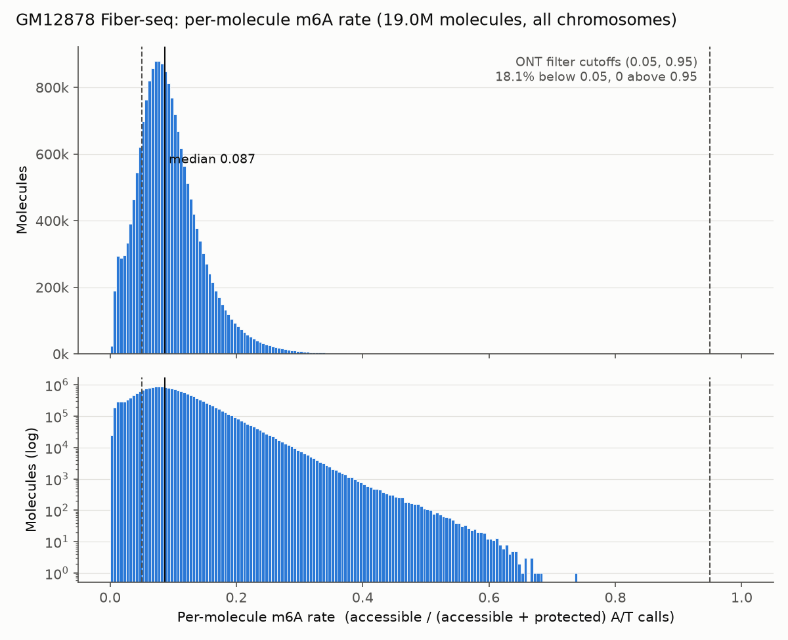

# Summary

The Fiber-seq data preparation (`data_preparation/fiberseq/`) has **no read-level filter
on methylation rate**. Molecules are never dropped for being nearly fully methylated or
unmethylated. The SMF-ONT pipeline does drop reads with a rate below 0.05 or above 0.95
(`methyl_filter_mBED.py`); that filter was not carried over.

Across all 19.0M GM12878 molecules in the calls TSVs, the per-molecule m6A rate has median
0.087 and maximum about 0.74. No molecule is above 0.95, so the ONT upper cutoff would do
nothing, and its 0.05 lower cutoff would drop 18.1% of molecules, mostly the normal low
end of the distribution.

Bubb et al. 2026 recommend fibers with **2-8% of adenosines methylated** for per-fiber
state inference (FIRE, nucleosomes, footprints). Only 39.6% of our molecules fall in that
range; 56.2% are above 8%. Whether their rate is on the same scale as ours (denominator,
m6A calling threshold) is unconfirmed.

# Key Points

- **Filters that exist** (`fiberbam_to_calls.py`, `calls_to_h5.py`): MAPQ ≥ 20;
  `-F 0xF04`; reads must carry `MM`/`ML` tags; ≥ 500 bp overlap with a region and with a
  window; windows need ≥ 32 molecules spanning all of them. ML ≥ 230/255 is a per-base
  call threshold (below it an assayable A/T is "protected"), not a read filter.
- **Distribution:** percentiles 1/5/25/50/75/95/99 = 0.010 / 0.023 / 0.059 / 0.087 /
  0.121 / 0.189 / 0.256; mean 0.094; pooled base-level rate 0.0895.
- **Tails:** 4.2% below 0.02, 1.1% below 0.01; 0.35% (66,050) above 0.3, 1,043 above 0.5,
  0 above 0.95.
- **Low-rate shoulder:** counts plateau at about 290k per 0.005 bin from 0.005 to 0.02
  before rising to the main peak. *Inferred, not checked:* this may be a group of
  under-labelled fibers (weak Hia5 activity) mixed into the population.
- **Bubb et al. range applied to our data:** < 2%: 4.2%; 2-8%: 39.6%; > 8%: 56.2%;
  > 12%: 25.4%.

# Details

## Our per-molecule rate

Rate = accessible / (accessible + protected) over the molecule's full aligned span, using
the calls TSV labels: `1` accessible (m6A, ML ≥ 230) and `2` protected (an assayable A/T
that matches the reference, called below ML 230). No-calls (`0`) are excluded. Median span
17.2 kb, median 10,065 A/T calls per molecule; every molecule had at least one call.

These are whole-molecule rates. A molecule cropped to one 2,114 bp training window can
have a quite different rate, so a window-level filter would need its own look.



*Per-molecule m6A rate is unimodal around 0.087 with a long right tail ending near 0.74;
the ONT cutoffs (dashed, 0.05 and 0.95) would remove 18% of molecules at the low end and
none at the high end.*

## What Bubb et al. 2026 recommend

Quotes below came from a web-fetch summary of the bioRxiv full text; I could not download
the text directly (bioRxiv returned a Cloudflare block, error 1015). The 2-8% sentence came
back identically in two separate fetches.

- **Per-fiber m6A rate 2-8%.** "fibers with 2-8% of adenosines methylated provide the most
  accurate and rich FIRE information" (discussion of Fig. 2B). The Fig. 3A caption marks
  "the %m6A range recommended for per-fiber state feature inference."
  - Below 2%: too little signal to call nucleosomes and accessible regions.
  - Above 8%: nucleosome-wrapped DNA starts getting methylated, creating false long
    accessible stretches and undercalling true accessible regions.
- **MAPQ 60** (uniquely mapped, pbmm2), stated for hybrid or divergent-genome
  comparisons rather than as a general rule. We use MAPQ ≥ 20.
- **Remove partial alignments** before the FIRE pipeline, and filter or correctly remap
  organellar reads.
- The range is shown across Arabidopsis, rice, maize and human GM12878.
- **Not found in the fetched text:** whether fibers outside 2-8% should be dropped or only
  treated with caution, and which ML threshold they use to call m6A.

## Implication for SMFNet (recommendation, untested)

Most of our molecules sit above the 8% ceiling, so a strict 2-8% filter would keep about
40% of the data and remove mostly high-rate fibers. The paper's reason for the ceiling,
methylation leaking onto nucleosomal DNA, bears directly on footprint labels. Before
adopting a filter: confirm the paper's denominator and m6A threshold, then compare
training/evaluation on 2-8% fibers against all fibers, or add per-fiber rate as a
covariate. A lower cutoff around 0.01-0.02 would target the low-rate shoulder without
cutting into the main peak.

## Command provenance

Run inside Slurm job 51969713 (sh04-03n07, 8 CPUs, 125 GB) with the SMFNet repo's pixi
`default` environment (system python is too old for the scripts); `zstd` from `/bin`.

```bash
cd ~/repos/SMFNet_public
export CONDA_OVERRIDE_CUDA=12
PY=.pixi/envs/default/bin/python
# per-molecule accessible/protected counts, one npz per chromosome (4 min 46 s on 8 cores)
PATH=$PWD/.pixi/envs/default/bin:$PATH $PY $SCRATCH/fiber_read_m6a/read_rates.py $SCRATCH/fiber_read_m6a
# summary statistics and histogram
$PY $SCRATCH/fiber_read_m6a/plot.py
```

Scripts: [read_rates.py](fiberseq-per-read-m6a-rate/scripts/read_rates.py),
[plot.py](fiberseq-per-read-m6a-rate/scripts/plot.py). The input calls directory is
hard-coded in `read_rates.py`, and `plot.py` reads and writes `/scratch/users/diamant/fiber_read_m6a/`.
The per-chromosome `chr*.npz` outputs stay in `$SCRATCH/fiber_read_m6a/` (purged after 90
days). The figure in this note was quantized to 256 colors with Pillow.

# Related Notes

- [Fiber-seq GM12878 data preparation](../2026-10-05/fiberseq-gm12878-data-preparation.md):
  The pipeline examined here; it already flags the ML ≥ 230 threshold as inherited from
  `smf_hmm` and unchecked against FIRE, which matters for comparing our rate to the paper's.
- [Fiber-seq figwig U-Net vs CNN](../2026-11-11/fiberseq-figwig-unet-vs-cnn.md): Current
  Fiber-seq training results, trained on these unfiltered molecules; the baseline any
  rate-filter experiment would compare against.

# Open Questions

- What denominator and m6A ML threshold does Bubb et al. use for "% of adenosines
  methylated"? Does it match accessible / (accessible + protected) at ML ≥ 230?
- Do they recommend dropping out-of-range fibers, or only caution in per-fiber inference?
- Are the low-rate-shoulder molecules (0.005-0.02) different in span, haplotype, strand,
  or sequencing run?
- Does restricting training or evaluation to 2-8% fibers change SMFNet metrics, and how
  does the rate distribution look per training window rather than per molecule?

# Sources

- Bubb KL, Perchlik M, Cuperus J, Queitsch C. "Unpacking Chromatin Accessibility with
  Fiber-seq." bioRxiv, 2026-08-19. https://www.biorxiv.org/content/10.64898/2026.08.14.744917v1
- SMFNet `data_preparation/fiberseq/fiberbam_to_calls.py` (read filters lines 267-288,
  ML threshold line 179), `calls_to_h5.py` (overlap and depth filters lines 103, 170),
  `README.md` (Filters section).
- SMFNet `data_preparation/SMF-ONT/vendor/nf-smfont/bin/methyl_filter_mBED.py`
  (0.05 / 0.95 read methylation-rate filter).
