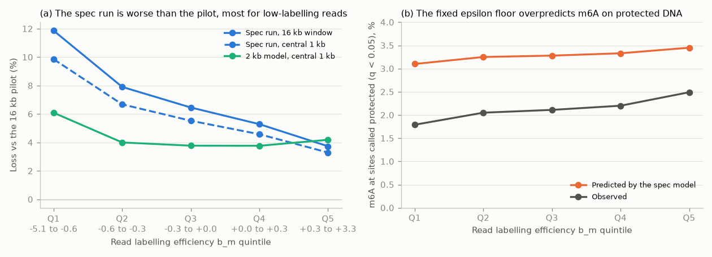

# Summary

We built the spec agreed on 2026-11-12 (see the
[pilot note](../2026-11-12/fiberseq-16kb-pilot-labelling-efficiency.md)) and trained it for 25
epochs from scratch on the pilot's architecture and data. The spec has six parts, all
settings that default to today's behaviour:

- mixed window lengths;
- strong jitter;
- 10% background regions;
- per-read labelling efficiency b_m with a 2% molecule-rate filter;
- an enzyme emission head;
- CRE and background val losses.

The run took 12 h on one H100, about the pilot's speed. It is worse than the pilot.

**On identical reads and masks** (all 11,923 val regions, no molecule filter), with each read's
b_m given to it, the spec run's loss is:

- +5.5% over the central 1 kb and +6.4% over the 16 kb window, relative to the pilot;
- +1.3% relative to the 2 kb model over the central 1 kb (the pilot is −4.0%).

The gap is largest for low-labelling reads: +9.9% in the lowest b_m quintile, falling to
+3.3% in the highest.

**Why (measured):** the emission head degenerated.

- **e saturated at 1.** Its learned bias went from −0.66 to +7.83, so e = σ(bias + context +
  0.62·b_m) is about 1 for nearly every read and context. That removes the context table and
  most of b_m's effect through e, leaving P(m6A) = q + (1 − q)·ε.
- **The fixed ε = 0.025 is too high.** At sites the model calls protected (q < 0.05) it predicts
  3.1–3.5% m6A against 1.8–2.5% observed. The excess is largest for low-labelling reads, which
  matches the loss gradient across quintiles.

The run changed several things at once. How much of the gap the jitter, the 10% background
and the mixed lengths add is **not yet separated**; that needs an ablation without the head.

# Key Points

- **Same-sites loss** (weighted masked cross-entropy over observed calls):

  | reads | central 1 kb: spec | pilot | 2 kb | spec vs pilot | 16 kb window: spec | pilot | spec vs pilot |
  | --- | --- | --- | --- | --- | --- | --- | --- |
  | all (381,536) | 0.1801 | 0.1707 | 0.1779 | +5.5% | 0.1670 | 0.1569 | +6.4% |
  | rate ≥ 0.02 (trained on) | 0.1840 | 0.1747 | 0.1819 | +5.3% | 0.1707 | 0.1607 | +6.2% |
  | rate < 0.02 (filtered from training) | 0.0709 | 0.0581 | 0.0655 | +22.1% | 0.0632 | 0.0498 | +26.9% |
  | active regions | 0.1876 | 0.1785 | 0.1855 | +5.1% | 0.1679 | 0.1579 | +6.4% |
  | background regions | 0.1734 | 0.1637 | 0.1711 | +5.9% | 0.1662 | 0.1560 | +6.5% |
  | b_m Q1 (−5.12 to −0.62) | 0.1246 | 0.1135 | 0.1204 | +9.9% | 0.1120 | 0.1001 | +11.9% |
  | b_m Q3 (−0.26 to 0.00) | 0.1837 | 0.1741 | 0.1807 | +5.5% | 0.1700 | 0.1597 | +6.5% |
  | b_m Q5 (+0.30 to +3.35) | 0.2260 | 0.2188 | 0.2279 | +3.3% | 0.2149 | 0.2072 | +3.7% |

  The gap holds on the reads the run trained on, so it is not just the filtered molecules.
- **Learned emission parameters:** bias +7.832 (starting at −0.66, e = 0.34), b_m scale 0.623.
  ε stays fixed at 0.025.
- **Calibration** (fully masked reads, 160 val regions, 41.5M sites):

  | b_m quintile | share of sites with q < 0.05 | there, predicted P(m6A) | observed | all sites, predicted | observed |
  | --- | --- | --- | --- | --- | --- |
  | −5.04 to −0.63 | 0.78 | 0.0310 | 0.0179 | 0.0542 | 0.0436 |
  | −0.63 to −0.27 | 0.58 | 0.0325 | 0.0205 | 0.0888 | 0.0820 |
  | −0.27 to 0.00 | 0.51 | 0.0328 | 0.0211 | 0.1090 | 0.1028 |
  | 0.00 to +0.30 | 0.45 | 0.0333 | 0.0220 | 0.1314 | 0.1259 |
  | +0.30 to +2.49 | 0.35 | 0.0345 | 0.0249 | 0.1801 | 0.1758 |

  The model overpredicts m6A everywhere, most in the lowest quintile (0.054 vs 0.044 over all
  sites).
- **Val losses during training** (not comparable to the pilot's: different molecules and an
  emission head). val/loss went 0.1797 → 0.1719 → 0.1704 at epochs 0, 4 and 24. At epoch 24:
  - loss_cre 0.2475 vs loss_bg 0.1670 (CRE sites 48% harder);
  - by SMF length: 1 kb 0.1896, 2 kb 0.1838, 4 kb 0.1786, 8 kb 0.1739.

  The pilot's val/loss was 0.1585 at epoch 4 and 0.1569 at epoch 24. Both runs gain little
  after epoch 4.
- **Cost:** 11.2 h of training and 0.8 h of validation over five val loaders, against 10.9 + 0.4 h
  for the pilot. Steady state was 0.41 s per step (pilot 0.43), with 3,641 steps per epoch.
  Memory peaked near 79 GB of 80 (pilot 77 GB).



*(a) The spec run's deficit against the pilot grows as read labelling falls, while the 2 kb
model's stays near 4%. (b) At sites the spec model calls protected, it predicts more m6A
than observed in every quintile, the fixed ε floor's signature.*

# Details

## What was built (nd_unet_figwig, all settings default off)

- **Loader (8e8da7c):**
  - `efficiency_dir=` puts each read's b_m on `SMFItem.efficiency` (NaN → 0).
  - `min_molecule_rate=0.02` drops molecules by background-site m6A rate (4.3% of GM12878
    molecules).
  - Jitter is `region_length` minus the input, here 32,768 − 18,432, so ±7 kb.
  - `jitter_retries=3` redraws an offset whose window has fewer than 32 reads covering 75%.
    On chr20 it never had to fall back to the centred offset.
  - `background_fraction=0.1` is a weighted sampler on the BED's class column; 9.8% sampled.
  - `short_smf_lengths=[1024,2048,4096,8192]` with `short_batch_fraction=0.1`. Single-length
    batches; regions per short batch scale with batch_size × 18,432 / input length (192, 144,
    96, 57), so each feeds AlphaGenome the same number of bases.
  - One val loader per length, logged as `val_<len>bp/...`. The model needs
    `variable_input_length`.
  - `cre_bed=` puts a per-position IDR-peak mask on items, giving `val/loss_cre` and `val/loss_bg`.
- **Emission head (75549a4):**
  - The network outputs q = P(accessible); P(m6A) = q·e + (1 − q)·ε, with
    e = σ(bias + c_context + s·b_m).
  - c_context is the smf_hmm accessibility-adjusted ±3 bp table, A-centred, with T sites
    reverse-complemented, so it is RC-safe. It is a frozen buffer, centred.
  - The bias starts at the table mean plus the most-accessible bin (e = 0.34); bias and s are
    learned. ε = 0.025 is the fixed HMM's protected-state methylation probability.
  - The network also gets e per site as a 4th input channel and b_m through a zero-initialised
    per-read FiLM after the input conv.
  - Sampling takes per-read b_m, one value, or draws from the training molecules' quantiles.
  - The prior file comes from `data_preparation/fiberseq/enzyme_prior.py`.
  - `init_weights=` warm starts were built but not used in this run, which trained from
    scratch.

## Why the head degenerated (inferred)

Only the product q·e enters the likelihood, and q is free per read and site. So the network
can absorb e, context bias and labelling level included, into q, and the data have no pull
toward e < 1. Pushing e to 1 costs nothing and frees the network from a fixed, imperfect
table.

With e ≈ 1, all labelling variation must come through q. The floor (1 − q)·ε stays at 2.5%
whatever the read's efficiency, but a low-labelling molecule's protected DNA is methylated at
about 1.8%. Its predictions can't drop that low, so low-b_m reads lose most.

The pilot has no floor: its plain logit can go as low as the data need. Two parts of this
chain are measured: the overprediction at protected sites and its growth at low b_m. The
claim that the floor causes most of the loss gap is inferred; the other spec changes are
confounded.

## Options considered (not yet run)

- **Additive logits (recommended):** logit P(protected) = network + context + s·b_m, the
  user's original "network learns only the residual" form. It has no floor and nothing to
  saturate; the input channel and the FiLM stay.
- **Keep the mixture, fixed:** freeze e's bias at a calibrated value, and make ε learned and
  dependent on b_m, since protected-DNA labelling plausibly scales with enzyme as well.
- **Ablation:** the same spec with the head off, to price the jitter, background and
  mixed-length changes on their own. It needs a new job: the current allocation, job
  51969713, ends around 17:30 on 2026-11-13.

## A worker segfault in the first smoke test

The first smoke test (chr21, everything on) lost all 7 workers of one val loader to a
segfault during Lightning's sanity check. It did not reproduce:

- the loaders alone ran cleanly;
- the rerun passed;
- the job's memory peaked at 60 of 125 GB, with no cgroup failures.

The cause is unknown. One suspect is concurrent loading of figwig's numba cache from NFS,
like the earlier array-job race. The run script sets `NUMBA_CACHE_DIR` on node-local disk and
`PYTHONFAULTHANDLER=1`, and the 25-epoch run had no crash.

## Commands

Environment for every command: the H100 allocation (job 51969713, sh04-03n07);
`PATH=/share/software/user/open/pixi/0.53.0/bin:$PATH`;
`PYTHONPATH=$HOME/repos/SMFNet_unet_figwig_runs/src`;
`NUMBA_CACHE_DIR=$L_SCRATCH/numba_cache`; and
`pixi run --frozen --manifest-path $HOME/repos/SMFNet_unet_figwig/pyproject.toml`
(written `pixi run` below).

```bash
# prior file for the emission head (training chromosomes that have efficiency files)
pixi run python data_preparation/fiberseq/enzyme_prior.py \
  --context-table ~/repos/smf_hmm/evaluation/datasets/smf/context_bias/adj_table_3_3.npz \
  --efficiency-dir $SCRATCH/fiberseq/GM12878/efficiency \
  --out $SCRATCH/fiberseq/GM12878/enzyme/enzyme_prior.npz \
  chr2 chr4 chr5 chr7 chr9 chr10 chr11 chr12 chr13 chr14 chr15 chr17 chr18 chr19 chrX
# smoke test (chr21, 40 steps, 50% short batches, warm start from the pilot)
bash $SCRATCH/smfnet_figwig/smoke_spec.sh b
# the 25-epoch run (started 2026-11-12 17:46, exit 0 at 2026-11-13 05:03)
cd $SCRATCH/smfnet_figwig && nohup bash train_spec_16kb.sh > train_spec_16kb.out 2>&1 &
# same-sites evaluation (~8 min) and calibration
M=/scratch/users/diamant/smf_models
pixi run python $SCRATCH/smfnet_figwig/spec_eval/rescore_same_sites.py \
  --spec $M/GM12878_fiberseq_figwig_16kb_spec_mixed_jitter_emission_unet_attn_muon_ema_k9_dilated/epoch24-step91025.ckpt \
  --pilot $M/GM12878_fiberseq_figwig_16kb_flank1024_alphagenome_unet_attn_muon_ema_k9_dilated/epoch24-step91275.ckpt \
  --short $M/GM12878_fiberseq_figwig_alphagenome_unet_attn_muon_ema_k9_dilated/epoch399-step188000.ckpt \
  --out $SCRATCH/smfnet_figwig/spec_eval/same_sites.npz
pixi run python $SCRATCH/smfnet_figwig/spec_eval/emission_calibration.py \
  $M/GM12878_fiberseq_figwig_16kb_spec_mixed_jitter_emission_unet_attn_muon_ema_k9_dilated/epoch24-step91025.ckpt
pixi run python $SCRATCH/smfnet_figwig/spec_eval/plot_spec_eval.py   # the figure
```

Copies of the scripts are in
[fiberseq-16kb-spec-run-emission-head/scripts/](fiberseq-16kb-spec-run-emission-head/scripts/):

- `train_spec_16kb.sh` and `smoke_spec.sh`;
- `rescore_same_sites.py`, `emission_calibration.py` and `plot_spec_eval.py`.

The calibration numbers in panel (b) are copied from `emission_calibration.py`'s output.

# Related Notes

- [16 kb pilot and labelling efficiency](../2026-11-12/fiberseq-16kb-pilot-labelling-efficiency.md):
  The pilot this run is compared with, the b_m fit and its validation, and the emission-head
  design this note tests.
- [Per-read m6A rate](../2026-11-12/fiberseq-per-read-m6a-rate.md): The molecule-rate
  distribution behind the 2% filter.
- [Figwig U-Net vs CNN](../2026-11-11/fiberseq-figwig-unet-vs-cnn.md): The 2 kb model used as
  the third comparison.
- [m6A sequence-context bias](../../smf-hmm/2026-10-30/fiberseq-m6a-sequence-context-bias.md):
  The ±3 bp adjusted table used as the frozen context term.

# Open Questions

- How much of the 5–6% is the head, and how much the jitter, background share and mixed
  lengths? An ablation run with the head off would tell.
- Does the additive-logit form beat the pilot on the same reads, and does it restore the
  between-molecule spread of generated reads (read-mean spread 0.42 vs observed in the pilot)?
- Is the frozen context table worth keeping once the network can learn context itself? The
  pilot already absorbs enzyme bias from DNA.
- Does strong jitter help elsewhere, such as positional-bias tests, even if it costs loss at
  centred val windows? Not measured.

# Sources

- SMFNet `nd_unet_figwig` at 75549a4 (dev remote): `src/smf_net/figwig_data.py`,
  `src/smf_net/model.py` (`EmissionHead`), `src/smf_net/cnn.py` (read FiLM), `scripts/train.py`,
  `data_preparation/fiberseq/enzyme_prior.py`, `FIGWIG_TODO.md`.
- Run outputs and checkpoints listed in the frontmatter.
- smf_hmm `evaluation/datasets/smf/context_bias/adj_table_3_3.npz` and `fit_context_tables.py`.
