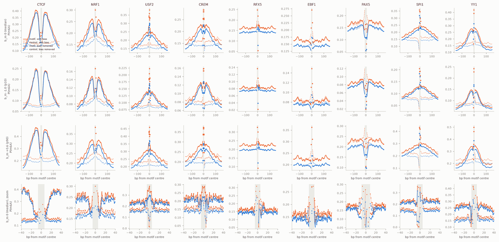
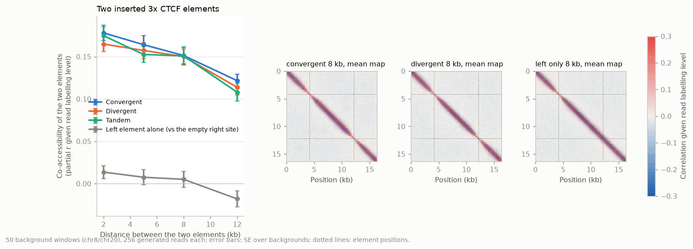

# Summary

After the mixture emission head failed (see the
[spec-run note](../2026-11-13/fiberseq-16kb-spec-run-emission-head.md)), the user chose to change
one thing at a time. We reran the original 2 kb figwig setup (1,024 bp window) with only an
**additive** head: logit P(protected) = network − (c + s·b_m). Here c is the frozen ±3 bp
context table, b_m the read's labelling efficiency, and s learned. The head keeps the e input
channel and the b_m FiLM. The setup was otherwise identical: same regions, ±33 bp jitter, all
molecules.

- **2 kb val loss: 0.17763 vs 0.17912 (−0.83%), the same reads.** That is more than twice the
  U-Net's gain over the old CNN. Sample metrics are unchanged within 1.5 SE. (A small leak
  applies: b_m is fitted partly on the scored calls.)
- **Optimizer ablation:** Muon + EMA is best on val loss (AdamW + EMA 0.17804, AdamW without
  EMA 0.17815). With EMA on both, Muon and AdamW tie on samples. EMA matters: without it,
  matched profile Pearson falls by 0.0027 ± 0.0011.
- **Generated reads now track the molecule's labelling.** With each observed read's b_m, the
  spread of read means is 1.003× observed, and its correlation with b_m is 0.694 (observed
  0.683). At fixed b_m = 0, labelling variation vanishes: spread 0.66×, and raw
  co-accessibility at 0.5–1 kb drops from 0.15 to −0.006.
- **The network absorbed most of the efficiency effect.** s fell from 1 to 0.21 (0.31 at
  16 kb). The context table enters at a fixed weight of 1.
- **Debiased TF footprints** (nine GM12878 TFs, b_m = 0, −1.0, +0.6). Removing the context
  offset mostly lowers the single-base m6A spikes inside motifs, for example YY1 0.40 → 0.31
  and SPI1 0.35 → 0.25. Footprint shapes outside the motif are unchanged.
  - CTCF, NRF1, USF2, CREM, SPI1 and YY1 open ±150 bp; CTCF also has a protected core.
  - RFX5 and EBF1 show no opening; PAX5 only a local dip.
- **16 kb additive vs the 16 kb pilot: −0.19% val loss.** At the central 1 kb, against the
  2 kb additive model, the 16 kb model is −2.7% at CRE sites and −3.6% at other sites. All of
  that comes from the rest of the read: with calls outside the centre hidden, it is +0.5% /
  +0.3% *worse* than the 2 kb model.
- **CTCF pairs co-vary, but not by orientation.**
  - Inserted 3× CTCF pairs, 16 kb additive model at b_m = 0: correlation 0.18 at 2 kb down to
    0.12 at 12 kb, with no labelling adjustment needed. Convergent = divergent = tandem.
  - Observed CTCF–CTCF pairs split by motif strand: convergent +0.166 ± 0.025, divergent
    +0.162 ± 0.018, tandem +0.137 ± 0.017. Pairs with a clear motif at both ends co-vary about
    twice as much as the rest (+0.085).
  - The model matches the data. Single-molecule co-accessibility of CTCF sites does not look
    like a looping readout (inferred).

# Key Points

- **2 kb runs, 400 epochs each, identical except for the optimizer and head.** Best val/loss,
  with fixed val masks:

  | run | best val/loss | at epoch 99 | loss_cre | loss_bg |
  | --- | --- | --- | --- | --- |
  | original (Muon + EMA, no head) | 0.17912 | 0.18027 | – | – |
  | additive, Muon + EMA | **0.17763** | 0.17871 | 0.2321 | 0.1678 |
  | additive, AdamW + EMA | 0.17804 | 0.17892 | 0.2327 | 0.1681 |
  | additive, AdamW, no EMA | 0.17815 | 0.17970 | 0.2328 | 0.1682 |

- **Sample metrics.** 1,000 val regions × 1,024 reads, b_m drawn from the training
  distribution. Paired per-region differences vs the original, ± SE:

  | run | profile Pearson, matched | Spearman, matched | accessible run-length W1 (bp) | protected run-length W1 (bp) |
  | --- | --- | --- | --- | --- |
  | additive Muon + EMA | −0.0006 ± 0.0016 | −0.0015 ± 0.0012 | −0.014 ± 0.010 | +0.06 ± 0.05 |
  | additive AdamW + EMA | −0.0005 ± 0.0017 | −0.0014 ± 0.0013 | −0.007 ± 0.010 | +0.03 ± 0.05 |
  | additive AdamW, no EMA | −0.0033 ± 0.0017 | −0.0032 ± 0.0013 | −0.014 ± 0.010 | +0.06 ± 0.05 |

  AdamW without EMA minus additive Muon + EMA: Pearson −0.0027 ± 0.0011, Spearman
  −0.0018 ± 0.0008. AdamW + EMA minus Muon + EMA: +0.0001 ± 0.0010.
- **Read spread.** 1,000 val regions × 128 reads; generated reads take their observed read's
  no-call positions:

  | set | spread of read means vs observed (median) | r(read mean, b_m) | raw co-accessibility 0.5–1 kb |
  | --- | --- | --- | --- |
  | observed | 1.000 | 0.683 | 0.152 |
  | additive, matched b_m | 1.003 | 0.694 | 0.162 |
  | additive, b_m = 0 | 0.662 | 0.001 | −0.006 |
  | original | 0.951 | 0.002 | 0.140 |

  The labelling-adjusted co-accessibility (about −0.12) is the same in all sets. It is
  negative because adjusting for the read mean subtracts each bin's own share of that mean.
- **Learned head parameters:** s = 0.205 and bias −0.711 at 2 kb; s = 0.314 and bias −0.642 at
  16 kb.
- **16 kb additive run vs the pilot, val/loss:**

  | epoch | additive | pilot | difference |
  | --- | --- | --- | --- |
  | 0 | 0.16268 | 0.17575 | −7.4% |
  | 4 | 0.15805 | 0.15852 | −0.30% |
  | 24 | 0.15657 | 0.15686 | −0.19% |

  The additive run ended with loss_cre 0.2362 and loss_bg 0.1531, and took 12.4 h of training.
- **Central-1 kb loss, same reads and masks.** All 11,923 val regions of the 16 kb set;
  31.2M CRE calls (IDR peaks), 170.3M other calls:

  | model | CRE sites | other sites |
  | --- | --- | --- |
  | 16 kb additive | **0.2280** | **0.1599** |
  | 16 kb additive, calls outside the centre hidden | 0.2357 | 0.1664 |
  | 16 kb pilot | 0.2282 | 0.1601 |
  | 2 kb additive | 0.2344 | 0.1658 |
  | original 2 kb | 0.2359 | 0.1673 |

  Relative to the 2 kb additive model, with 95% region-bootstrap intervals:
  - 16 kb additive: −2.7% [−2.8, −2.7] at CREs, −3.6% [−3.6, −3.5] elsewhere.
  - Centre only: +0.5% [+0.5, +0.6] at CREs, +0.3% [+0.3, +0.4] elsewhere.
- **CTCF insertion** (16 kb additive, b_m = 0; 50 background windows × 256 reads). Correlation
  of the two elements across reads; the partial r given read labelling is within 0.004 of it:

  | distance | convergent | divergent | tandem | left element alone |
  | --- | --- | --- | --- | --- |
  | 2 kb | +0.182 | +0.167 | +0.179 | +0.017 |
  | 5 kb | +0.166 | +0.160 | +0.156 | +0.009 |
  | 8 kb | +0.153 | +0.153 | +0.153 | +0.008 |
  | 12 kb | +0.122 | +0.115 | +0.110 | −0.018 |

  The SE is about ±0.01. Convergent minus divergent, paired by background: +0.013 ± 0.013,
  +0.007, +0.001 and +0.008 at 2, 5, 8 and 12 kb. For comparison, the pilot (b_m drawn per
  read) had raw r 0.31 but partial 0.20 at 2 kb. The new model's coupling is a little weaker
  and fades a little faster with distance.
- **Observed CTCF–CTCF pairs by motif orientation.** 493 pairs 2–15 kb apart with ≥ 50 shared
  molecules; partial r given window labelling level and b_m:

  | orientation | pairs | raw r | partial r (level) | partial r (both) | p < 0.001 |
  | --- | --- | --- | --- | --- | --- |
  | convergent | 38 | +0.342 ± 0.023 | +0.192 ± 0.026 | +0.166 ± 0.025 | 10.5% |
  | divergent | 62 | +0.371 ± 0.017 | +0.199 ± 0.018 | +0.162 ± 0.018 | 6.5% |
  | tandem | 105 | +0.358 ± 0.016 | +0.169 ± 0.018 | +0.137 ± 0.017 | 7.6% |
  | motif unclear at either end | 288 | +0.274 ± 0.008 | +0.103 ± 0.008 | +0.085 ± 0.008 | 2.1% |

  Convergent − divergent: +0.004 (Welch p = 0.9). Convergent − tandem: +0.030 (p = 0.33).
  The same holds at 2–5 kb (0.18 / 0.18 / 0.15) and 5–10 kb (0.15 / 0.16 / 0.13). With 38
  convergent pairs, only a difference of about 0.07 or more would have been detectable.



*Biased (orange) and bias-removed (blue) P(m6A), with motif (solid) and control (dashed), at
b_m = 0, −1.0 and +0.6, plus a ±40 bp zoom at b_m = 0. Removing the context offset mostly
lowers the m6A spikes on motif bases. The bias-removed curves still scale with b_m because s
is only 0.21.*



*With every read at b_m = 0, the two inserted CTCF elements co-vary at 0.12–0.18 over 2–12 kb,
equally in every orientation, and not with an empty partner site.*

# Details

## The additive head and what it absorbed

The additive head (2514917) adds `SMFNetConfig.emission_form`, either "mixture" (the spec run's)
or "additive". The additive form returns the network's logit minus (c + s·b_m). The head's bias
only enters the e input channel.

The head lowered 2 kb val loss without changing profile or run-length metrics. That fits what
it should do: explain molecule-wide labelling rather than local structure (inferred). The
read-spread check confirms it directly:

- With matched b_m, generated read means follow b_m as observed reads do.
- At b_m = 0 they don't vary with labelling at all.
- The original model reproduces the observed amount of spread at 2 kb (0.95×), but at random
  with respect to b_m (correlation 0.002). It infers each read's level from the read itself.

The learned s of 0.21 shows the network carries about 80% of b_m's effect itself, through the
FiLM and e channel, and the offset only the rest. To force the labelling effect through the
offset, which a clean debiasing would need, fix s = 1 in a retrain (not done).

## Marginalization with debiased profiles

The marginalization changes (759ba00) add two settings:

- **`sampling.efficiency`** fixes b_m for every read.
- **`sampling.record_debiased`** records read-mean P(m6A) per position after sampling, with and
  without the offsets. `SMFNet.emission_probabilities` re-predicts each finished read in 4
  folds, so every site is predicted from the rest of its read with itself hidden. Both values
  come from the same pass; the debiased one is the network's own logit, a mean-context site on
  a median molecule.

The results go to `marginalizations.h5` under `profiles/{m6a,m6a_debiased}/{background,motif,control}`.
These are read means of about 15 MB, against about 15 GB per read and site.

**TF panel.** Consensus sequences come from the HMM repo's matrices (`gm12878_train.yaml`),
trimmed to positions of ≥ 0.5 bits of information:

| TF | JASPAR | consensus |
| --- | --- | --- |
| CTCF | MA0139.2 | CCACCAGGGGGCG |
| NRF1 | MA0506.1 | GCGCCTGCGCA |
| USF2 | MA0526.3 | GTCATGTGAC |
| CREM | MA0609.3 | GTGACGTCAC |
| RFX5 | MA0510.1 | CCCTGGCAACA |
| EBF1 | MA0154.4 | TCCCCAGGGGA |
| PAX5 | MA0014.2 | GGGCAGCCAAGCGTGAC |
| SPI1 | MA0080.5 | AGAGGAAGTGA |
| YY1 | MA0095.2 | AAGATGGCGGC |

**Controls.** The first matched shuffle is often nearly the motif (CTCF's differed by a single
swap; PAX5's kept its core). So each control is the shuffle sharing the shortest substring with
the motif in either orientation, among 2,000 with the same assay site counts.

**Run.** 200 random backgrounds, both orientations, 1,024 reads; about 40 min per b_m on an
H100 (`owners`).

**Reading the footprints:**

- **Outside the motif,** the biased curve sits slightly above the debiased one. Averaging
  σ(z + c) over random flanks lifts it, by Jensen's inequality, even though c averages about
  zero (inferred).
- **Inside the motif,** the big orange m6A spikes are mostly Hia5 preferring those bases. YY1,
  SPI1, CREM, EBF1, NRF1 and USF2 all drop by 0.05–0.1 when the offset is removed.
- **The SPI1 control's A-run** (`AAAAATGGGGG`) dips even when debiased. This is consistent with
  the m6A blind spot in A-runs found in the
  [HMM footprint screen](../../smf-hmm/2026-11-10/gm12878-fiberseq-tf-footprint-screen.md),
  part of which the network apparently learned beyond the table (inferred).
- **Same TF pattern as the HMM screen.** That screen saw strong observed footprints for CTCF
  and NRF1, weak ones for the E-box (USF) and CRE, and none for most others. Here the model
  opens chromatin for CTCF, NRF1, USF2, CREM, SPI1 and YY1, but not for RFX5 or EBF1.

## CRE vs other sites at the central 1 kb

`cre_same_sites.py` scores five predictors with the same noise level and mask draw per read:
the 16 kb additive model, the same model with calls outside the central 1 kb hidden, the
pilot, the 2 kb additive model and the original 2 kb model. CRE sites are the IDR-peak mask.
All CRE sites fall in active regions, since background windows have no peak in their centre.

The hidden-flank variant is out of the 16 kb model's training distribution: it only saw reads
covering ≥ 75% of 16 kb. So its slight deficit reflects how it was trained, not necessarily what
a 16 kb model could do. No run has yet trained on a short read inside a long DNA window. The
spec run's short batches also cropped the DNA (1 kb reads with 3 kb of DNA). The fix would
hide calls outside a random short read window while keeping the full 18 kb of DNA.

## CTCF orientation in observed reads

`ctcf_pairs_by_orientation.py` reuses the pairs and correlations of `element_pairs_efficiency.py`
(the [pilot note's](../2026-11-12/fiberseq-16kb-pilot-labelling-efficiency.md) CRE-pair test).
It takes each element's best MA0139.2 hit within ±150 bp, on either strand.

- **Calling a strand:** the hit must beat 9.4 bits, the 95th percentile of best hits in 5,000
  random 300 bp windows, and the other strand must be ≥ 2 bits weaker. That called 568 of 910
  elements (283 +, 285 −).
- **Orientation convention:** JASPAR's forward strand, as in the insertion experiment.
  Convergent means left +, right −.

The proportions (38 convergent, 62 divergent, 105 tandem) are close to the 1:1:2 expected by
chance. Interpretation (inferred): co-accessibility of two CTCF sites on one molecule reflects
both being bound or a shared local chromatin state, not a convergent loop. That fits a
footprinting assay measuring occupancy and accessibility rather than 3D contact.

## Commands

Jobs went to `btrippe,hns`, later with `owners` and `--requeue` added, all with
`-C GPU_SKU:H100_SXM5 -G 1`.

Every job sets these:
- `PATH=/share/software/user/open/pixi/0.53.0/bin:$PATH`;
- `PYTHONPATH=$HOME/repos/SMFNet_unet_figwig_runs/src` (detached at 2514917 for training, 759ba00 after);
- `NUMBA_CACHE_DIR` on node-local disk.

Steps without a GPU ran on a CPU allocation with `CONDA_OVERRIDE_CUDA=12.0 pixi run --frozen`.

```bash
cd $SCRATCH/smfnet_figwig
# 2 kb training (jobs 52216081, 52238776, 52238780), then a 1,000-region val sample + metrics
sbatch train_additive_2kb.sbatch; sbatch train_additive_2kb_adamw_ema.sbatch; sbatch train_additive_2kb_adamw.sbatch
# metrics PDF from the saved samples (the run script omitted plot.enabled)
pixi run --frozen python scripts/metrics.py hydra.run.dir=$M/metrics_val_subset1000_plots \
  samples_path=$M/samples_val_subset1000/samples.h5 plot.enabled=true \
  metrics.include_positional_baselines=false metrics.include_flank_baselines=false
# read spread (job 52358063, 5 min)
sbatch additive_eval/read_spread.sbatch
# TF panel, marginalizations at b_m = 0 / -1.0 / +0.6 (array 52359735, ~40 min each), plot
pixi run --frozen python marg/make_motifs.py > marg/gm12878_hmm_tfs.tsv
sbatch marg/marginalize_additive.sbatch
pixi run --frozen python marg/plot_debiased_footprints.py marg/footprints_debiased.png \
  "marg/additive_b0:b_m 0 (median)" "marg/additive_bp10:b_m -1.0 (p10)" "marg/additive_bp90:b_m +0.6 (p90)"
# 16 kb additive training (job 52362594, 12.5 h)
sbatch train_additive_16kb.sbatch
# central-1 kb CRE comparison (job 52466850, ~13 min)
sbatch additive_eval/cre_same_sites.sbatch
# CTCF insertion at b_m = 0 (job 52469059, 18 min + summary)
sbatch ctcf_pairs/ctcf_additive_b0.sbatch
# observed CTCF pairs by orientation (10 s, CPU)
pixi run --frozen python $SCRATCH/tm_inspect/coaccessibility/ctcf_pairs_by_orientation.py
```

Copies of all the scripts are in
[fiberseq-additive-emission-head/scripts/](fiberseq-additive-emission-head/scripts/).

# Related Notes

- [Spec run and the mixture head's failure](../2026-11-13/fiberseq-16kb-spec-run-emission-head.md):
  Why we went back to one change at a time, and what the additive form replaces.
- [16 kb pilot and labelling efficiency](../2026-11-12/fiberseq-16kb-pilot-labelling-efficiency.md):
  The pilot used as the 16 kb comparison, the b_m fit, the first CTCF insertion and the CRE-pair
  test reused here.
- [Figwig U-Net vs CNN](../2026-11-11/fiberseq-figwig-unet-vs-cnn.md): The original 2 kb run
  and its evaluation settings, matched here.
- [Patched U-Net, Muon+EMA vs AdamW+EMA](../2026-11-07/patched-unet.md): The earlier optimizer
  comparison on this U-Net, which the ablation agrees with.
- [HMM TF footprint screen](../../smf-hmm/2026-11-10/gm12878-fiberseq-tf-footprint-screen.md):
  The same TF panel in observed reads, and the A-run m6A blind spot.
- [m6A sequence-context bias](../../smf-hmm/2026-10-30/fiberseq-m6a-sequence-context-bias.md):
  The ±3 bp table used as the context offset.

# Open Questions

- Does fixing s = 1 make the debiased footprints independent of b_m, without costing val loss?
- Can a 16 kb model trained with short reads inside long DNA windows match the 2 kb model when
  it sees only 1 kb of the read, and does that recover the CRE gap?
- Is the small 2 kb val gain partly the b_m leak? Fitting b_m without each val window's sites
  would tell.
- Is there a convergent-orientation effect below 0.07? More pairs (CTCF ChIP peaks rather than
  thinned cCREs) would give more power.
- Do the additive model's footprints match observed footprints around native motifs once
  context bias is removed?

# Sources

- SMFNet `nd_unet_figwig` at 759ba00: `src/smf_net/model.py` (`emission_form`,
  `emission_probabilities`), `src/smf_net/evaluation/sampling.py`,
  `src/smf_net/evaluation/marginalization_io.py`, `scripts/marginalize.py`, `tests/test_emission.py`.
- Run outputs and evaluation files listed in the frontmatter.
- smf_hmm `evaluation/tf_chip/references/` (MA0139.2, MA0506.1, MA0526.3, MA0609.3, MA0510.1,
  MA0154.4, MA0014.2, MA0080.5, MA0095.2) and `configs/gm12878_train.yaml`.
