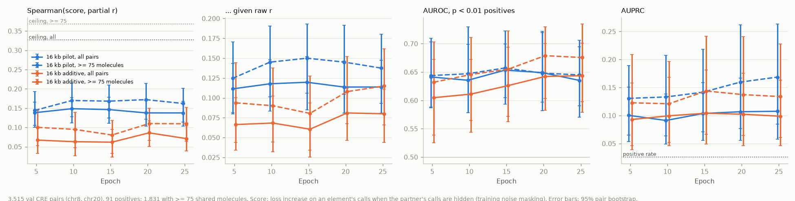

# Summary

We built a set of cheap, paired evaluations for long-context (16 kb) SMFNet models and moved
them into `src/smf_net/evaluation/`. All of them score observed molecules except the read
spread, which samples a few hundred regions. Each takes 1-10 min per model on an H100.

- **CRE pairs** (`cre_pairs.py`): does the model use one element to predict another 2-15 kb
  away?
  - **Observed side:** for every active-cCRE pair, the partial correlation of the two
    elements' accessibility across shared molecules, given each molecule's labelling (window
    level and b_m).
  - **Model side:** the loss increase on one element's calls when the partner's calls are
    hidden, on the same molecules.
  - **Summary:** Spearman with the observed partial r, the same given raw r, and AUROC/AUPRC.
- **Short range** (`same_sites.py`): several models on the same central 1 kb calls and
  masks, each with its own DNA flanks (2,048 bp for a 2 kb model, 3,072 bp for a 16 kb one).
- **Labelling spread** (`read_spread.py`): do generated reads vary between molecules like
  observed ones, and does that variation follow b_m?
- **Position and window profile** (`position.py`): loss on elements placed at different
  window offsets, and loss along the window.

**Main findings:**
- **Calibration.** The first pair test hid whole elements ("block" masking), an input
  training never produces. The 16 kb additive model was miscalibrated there: worse with the
  partner visible in 95% of pairs. Scoring under the training noise ("noise" masking, now
  the default) fixes it: 59% of pairs better.
- **Ceiling.** Observed partial r is only about 10% reliable (split halves of each pair's
  molecules), so no score can exceed about 0.33 Spearman with it. The models reach
  0.07-0.14, and they predict a pair's co-variation about as well as an independent
  half-depth replicate of the data.
- **The 16 kb pilot leads on Spearman.** It beats the additive models (+0.067 [+0.040,
  +0.095]), still by +0.034 given raw r; AUROC and AUPRC are tied.
- **Checkpoint scan.** Every pair metric is flat from epoch 5 to 25 for both models.
- **Short batches fix short range.** The jitter + short-batch runs trained overnight close
  almost the whole short-range gap to the 2 kb model at 3 kb input (+2.71% -> +0.32%), with
  unchanged 16 kb val loss and pair metrics.

# Key Points

- **Pair metrics, val (chr8, chr20), noise masking.** 3,515 pairs and 91 positives
  (partial r > 0, p < 0.01). Each cell is all pairs / pairs with >= 75 shared molecules:

  | model | Spearman | given raw r | AUROC | AUPRC (random: 0.026 / 0.032) |
  | --- | --- | --- | --- | --- |
  | 16 kb pilot | 0.138 / 0.162 | 0.114 / 0.137 | 0.635 / 0.645 | 0.108 / 0.169 |
  | 16 kb additive | 0.071 / 0.110 | 0.080 / 0.115 | 0.643 / 0.675 | 0.099 / 0.134 |
  | + jitter + short batches | 0.082 / 0.115 | 0.065 / 0.091 | 0.629 / 0.655 | 0.090 / 0.129 |
  | + 10% background | 0.066 / 0.092 | 0.077 / 0.095 | 0.620 / 0.647 | 0.094 / 0.132 |
  | split-half ceiling | 0.33 / 0.37 | | | |

  Paired bootstrap over pairs:
  - **pilot − additive:** Spearman +0.067 [+0.040, +0.095]; given raw r +0.034 [+0.007,
    +0.064]; AUROC −0.006 [−0.066, +0.055]; AUPRC +0.011 [−0.020, +0.044].
  - **New runs − additive (Spearman):** +0.011 [−0.015, +0.038] and −0.005 [−0.032, +0.022].
  - **Agreement:** under noise masking the models' per-pair scores correlate at 0.74.
- **Block vs noise masking** (pilot / additive):

  | | block | noise |
  | --- | --- | --- |
  | pairs where seeing the partner helps | 78% / 5% | 61% / 59% |
  | mean delta (nats per call) | +0.00028 / −0.00053 | +0.00005 / +0.00004 |
  | Spearman with partial r | 0.127 / 0.071 | 0.138 / 0.071 |
  | the two models' deltas correlate | 0.14 | 0.74 |

  Each model's block scores correlate only 0.17-0.19 with its noise scores. bf16 scoring is
  fine: float32 deltas correlate 0.99 with bf16.
- **Ceilings from split halves.**
  - **All pairs:** the halves correlate at 0.052 across pairs, a Spearman-Brown reliability
    of 0.10. That gives Pearson and Spearman ceilings of 0.31 and 0.33.
  - **Pairs with >= 75 molecules:** reliability 0.14, ceiling 0.37. (At >= 100 molecules,
    0.16 on only 587 pairs. No pair has 150.)
  - **The analytic Fisher-z noise model underestimates the noise:** it predicted 0.25 and
    0.48.
  - **Against one half's labels:** the other half of the data scores AUROC 0.570, AUPRC
    0.026 (positive rate 0.020) and Spearman 0.056. The pilot scores 0.589 / 0.041 / 0.100,
    the additive model 0.544 / 0.043 / 0.053.
- **Short range** (central 1 kb of all 12,304 2 kb val regions, same reads and masks; loss
  per call vs the 2 kb additive model):

  | model (DNA input) | all sites | CRE sites | other sites |
  | --- | --- | --- | --- |
  | 2 kb additive (2,048 bp), reference | 0.17765 | 0.23216 | 0.16779 |
  | original 2 kb (2,048 bp) | +0.84% | +0.66% | +0.88% |
  | 16 kb pilot (3,072 bp) | +4.16% | +3.86% | +4.23% |
  | 16 kb additive (3,072 bp) | +2.71% | +2.78% | +2.69% |
  | + jitter + short batches (3,072 bp) | **+0.32%** | +0.50% | +0.27% |
  | + 10% background (3,072 bp) | **+0.26%** | +0.35% | +0.24% |

  95% intervals are about ±0.03-0.08%. The 2 kb models reproduce their logged val losses
  (0.17765 vs 0.17763; original 0.17914 vs 0.17912).
- **16 kb val/loss:** additive 0.15657, + jitter + short batches 0.15675, + background
  0.15665. The new runs' short-length val losses are 0.177 / 0.171 / 0.166 / 0.160 at
  1 / 2 / 4 / 8 kb.
- **Labelling spread** (300 val regions, 32 reads each; generated reads take the observed
  no-call patterns):
  - **pilot:** 0.63 of the observed spread of read means, r(read mean, b_m) −0.01.
  - **every additive model with matched b_m:** 1.005-1.007, r(read mean, b_m) 0.93
    (observed 0.937).
  - **at fixed b_m:** 0.21.
  - **raw co-accessibility at 0.5-1 kb:** observed 0.162, matched 0.195-0.197 (overshoot),
    fixed about 0. Adjusted for the read mean, about 0 everywhere.
- **Position:** within 0.11% of the centre at every offset up to ±4 kb, for all four 16 kb
  models.
- **Window profile:** no edge penalty (first 512 bp bin −3%, last −0.5% vs the middle
  half). The middle bins are highest because val windows are centred on CREs.



*CRE pair metrics at the periodic checkpoints (epochs 5-25) of the 16 kb pilot (blue) and the
16 kb additive run (orange), all pairs (solid) and >= 75 shared molecules (dashed), 95% pair
bootstrap. Everything is flat within its error bars from epoch 5; dotted lines are the
split-half Spearman ceilings and the positive rate.*

# Details

## CRE pair test

**The pair table** (`build_pair_table`, CPU, 90 s for the val chromosomes).
- **Elements:** active cCREs of `candidates.bed`, with CTCF-bound status from its
  annotation column.
- **Pairs:** 2-15 kb apart, with >= 50 molecules covering both elements ±100 bp, and >= 10
  calls per element and >= 500 labelling-level calls per molecule.
- **Per molecule:** the accessible fraction at each element ±100 bp. Labelling level is the
  accessible fraction from 4 kb outside the pair on each side, excluding ±300 bp around both
  elements.
- **Statistics:** partial r of the two elements given level and b_m (both regressed out),
  Fisher-z p, BH q, and the same partial r on two random halves of the molecules.

The val table has 3,515 pairs, 91 positives at p < 0.01 with r > 0 (17 equally
significant negative), 13 at q < 0.05, and 22 CTCF-CTCF pairs. The test chromosomes (chr1,
chr3, chr6) have about 19,500 candidate pairs.

**Scoring** (`score_pairs`, about 10 min per model with noise masking). Each pair gets one
model input window centred between its elements, holding up to 64 of the same molecules.
- **`masking=noise` (default):** 4 draws of the training noise (one level per read, a mask
  per site), shared by every condition. A is scored on its noise-masked calls with the
  weighted training loss, with B's calls under the same mask or with all of B's calls turned
  into no-calls; likewise for B. The pair's score is the mean loss increase.
- **`masking=block`:** everything visible except A (scored) and, without the partner, B.

A model that has learned the conditional distribution cannot do worse on average for seeing
more of the true data. So consistently negative block scores signal miscalibration on an
input that is out of distribution, not a property of the model's long-range knowledge.

**Why the pilot leads on Spearman** (partly inferred).
- **Under block masking,** the pilot's scores tracked raw r about as much as partial r. Raw r
  includes labelling, and the pilot gets no b_m, so the partner is labelling evidence for
  it.
- **Under noise masking,** the pilot still leads given raw r (+0.034), so that's not the
  whole story.
- **One possible reason (untested):** partial r removes labelling only linearly. The pilot
  has to infer each molecule's state from its calls, and may capture non-linear labelling
  effects left in partial r.

**Span masking.** Adding random span masking to training would make block-style
conditioning in distribution. It's a TODO item.

## Short range, labelling spread, position

- **Short range** (`same_sites.py`): rescoring the 2 kb models reproduces their logged val
  losses, which validates it.
  - **Which 16 kb models are out of distribution:** the pilot and the additive run never
    saw short inputs, so 3 kb inputs are new to them. The jitter + short-batch runs trained
    on 1 kb windows with 3 kb of DNA in 10% of batches, which is exactly this setup.
- **Read spread** (`read_spread.py`):
  - **Generated sets:** emission models get two, one with the observed reads' b_m
    ("matched") and one at b_m = 0 ("fixed"); other models get one.
  - **Measures:** spread of read means, their correlation with b_m, and raw and
    read-mean-adjusted co-accessibility in distance bands.
- **Position** (`position.py`):
  - **Elements:** the val set's 500 first active elements.
  - **Fixed across offsets:** the same molecules covering ±3 kb, the same calls (the rest of
    each read hidden) and the same masks.
  - **What changes:** the element's offset from the window centre (−4 to +4 kb), so only the
    position and the DNA beyond ±3 kb differ.
  - **Result:** no position bias, even in the pilot trained with ±33 bp jitter. That's
    within this likelihood test only; sampled-profile positional effects were not tested.

## Practical notes

- **Code locations:**
  - **Development:** the worktree `~/repos/SMFNet_unet_figwig` (branch `nd_unet_figwig`,
    `dev` remote only; `origin` is the public repo).
  - **Jobs:** `~/repos/SMFNet_unet_figwig_eval`, a detached checkout. Training jobs used
    `~/repos/SMFNet_unet_figwig_runs`. Jobs read the code when they start, so a checkout must
    not move while a job that uses it is queued or running.
- **Partitions:** H100 jobs ran on `btrippe,hns` for long runs and with `owners` added for
  short evaluations. `owners` jobs get preempted; `--requeue` restarted them automatically.
- **Hydra quirks:** tuple fields arrive as `ListConfig`, so the configs convert them in
  `__post_init__`. `score_same_sites.py` takes checkpoints as `name:path` list entries,
  because Hydra can't add keys to a typed mapping.

## Commands

Environment for every command:
- `PATH=/share/software/user/open/pixi/0.53.0/bin:$PATH`;
- `PYTHONPATH=<checkout>/src`;
- `NUMBA_CACHE_DIR` on node-local disk;
- `pixi run --frozen --manifest-path ~/repos/SMFNet_unet_figwig/pyproject.toml` (written
  `pixi run` below). On nodes without a GPU, also `CONDA_OVERRIDE_CUDA=12.0`.

```bash
L=$SCRATCH/smfnet_figwig/long_range; F=$SCRATCH/fiberseq/GM12878
# pair table (CPU, 90 s)
pixi run python scripts/build_cre_pairs.py hydra.run.dir=$L/cre_pairs_val figwig_dir=$F/figwig \
  efficiency_dir=$F/efficiency elements_bed=/scratch/groups/btrippe/ndiamant/fiberseq/GM12878/candidates.bed \
  "chromosomes=[chr8,chr20]"
# pair scores per checkpoint (masking=noise by default; masking=block for the old test)
pixi run python scripts/score_cre_pairs.py hydra.run.dir=$L/scores_val_noise_<name> checkpoint=<ckpt> \
  pairs_path=$L/cre_pairs_val/cre_pairs.tsv figwig_dir=$F/figwig efficiency_dir=$F/efficiency \
  fasta_path=/scratch/groups/btrippe/ndiamant/reference/hg38.fa
# short range, several models
pixi run python scripts/score_same_sites.py reference=add2 "checkpoints=[add2:<ckpt>,jm16:<ckpt>,...]" \
  data.fasta_path=... data.figwig_dir=$F/figwig data.regions_bed=$F/kept_windows.bed \
  data.efficiency_dir=$F/efficiency data.min_overlap=500 data.min_spanning_molecules=32 \
  "data.val_chrm=[chr8,chr20]" cre_bed=$F/inputs/ENCFF614SMH.bed.gz
# labelling spread, position, window profile (16 kb data settings)
pixi run python scripts/long_range_eval.py checkpoint=<ckpt> data.fasta_path=... data.figwig_dir=$F/figwig \
  data.regions_bed=$F/kept_windows.bed data.efficiency_dir=$F/efficiency data.region_length=18498 \
  data.model_input_length=18432 data.dna_flank=1024 data.min_read_fraction=0.75 data.min_overlap=500 \
  data.min_spanning_molecules=32 "data.val_chrm=[chr8,chr20]" spread.regions_per_batch=8
# checkpoint scan and its figure
sbatch $L/scan_checkpoints.sbatch
pixi run python $L/plot_checkpoint_scan.py $L/scan/checkpoint_scan.png $L/cre_pairs_val/cre_pairs.tsv \
  "16 kb pilot=$L/scan/pilot16_epoch" "16 kb additive=$L/scan/additive16_epoch"
```

**Jobs:**

| job | what |
| --- | --- |
| 52500375 | pair scores, block masking |
| 52503642 | float32 check |
| 52531791 | pair scores, noise masking |
| 52502575 | short range, 4 models |
| 52503575 | `long_range_eval.py`, pilot and additive |
| 52536071 | checkpoint scan |
| 52530193 | the two new runs: pairs, `long_range_eval.py`, short range with 6 models |
| 52499650, 52499652 | the two new training runs, 11.6-11.8 h each |

The `.sbatch` files and the plot script are copied in
[long-range-evaluation-suite/scripts/](long-range-evaluation-suite/scripts/).

**Checkpoints** (in `/scratch/users/diamant/smf_models/`):

| model | checkpoint |
| --- | --- |
| 16 kb pilot | `GM12878_fiberseq_figwig_16kb_flank1024_alphagenome_unet_attn_muon_ema_k9_dilated/epoch24-step91275.ckpt` |
| 16 kb additive | `..._16kb_flank1024_additive_emission_unet_attn_muon_ema_k9_dilated/epoch24-step91275.ckpt` |
| + jitter + short batches | `..._16kb_flank1024_additive_emission_jitter_mixed_unet_attn_muon_ema_k9_dilated/epoch24-step91275.ckpt` |
| + 10% background | `..._16kb_flank1024_additive_emission_jitter_mixed_bg10_unet_attn_muon_ema_k9_dilated/epoch24-step91275.ckpt` |
| 2 kb additive | `GM12878_fiberseq_figwig_additive_emission_alphagenome_unet_attn_muon_ema_k9_dilated/epoch398-step187530.ckpt` |
| original 2 kb | `GM12878_fiberseq_figwig_alphagenome_unet_attn_muon_ema_k9_dilated/epoch399-step188000.ckpt` |

# Related Notes

- [Additive emission head](../2026-11-15/fiberseq-additive-emission-head.md): The models
  compared here (2 kb and 16 kb additive), b_m, and the first CRE/CTCF analyses this suite
  formalises.
- [16 kb pilot and labelling efficiency](../2026-11-12/fiberseq-16kb-pilot-labelling-efficiency.md):
  The pilot, the b_m fit and the original observed CRE-pair partial correlations.
- [Spec run](../2026-11-13/fiberseq-16kb-spec-run-emission-head.md): The first
  jitter/short-batch implementation (with the failed mixture head).
- [Inpainting](../2026-11-10/inpainting.md): Span-masking work relevant to the block-masking
  calibration issue.

# Open Questions

- Does span masking in training make block-masked scores agree with noise-masked ones, and
  change the pair metrics?
- Why does the pilot (no b_m) lead on Spearman given raw r? Test with a non-linear labelling
  adjustment of the observed partial r, or by scoring the additive model at b_m = 0.
- A larger fixed evaluation set (test chromosomes, about 3× the pairs) would tighten AUROC
  and AUPRC, which 91 positives leave at about ±0.06 and ±0.03 between models.
- Matched-b_m generated reads overshoot raw co-accessibility (0.196 vs 0.162 at 0.5-1 kb).
  Why?
- The pair metrics are flat over training. Would a longer schedule, or training that weights
  long-range signal more, move them toward the 0.33-0.37 ceiling?

# Sources

- SMFNet `nd_unet_figwig` at 52518fb (dev remote): `src/smf_net/evaluation/cre_pairs.py`,
  `same_sites.py`, `read_spread.py`, `position.py`; `scripts/build_cre_pairs.py`,
  `score_cre_pairs.py`, `score_same_sites.py`, `long_range_eval.py`; tests; `FIGWIG_TODO.md`.
- Outputs under `$SCRATCH/smfnet_figwig/long_range/` and the checkpoints above.
